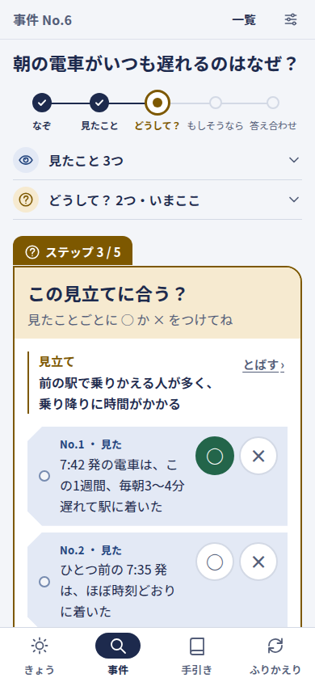

# 1. 鳥観図 — アプリ全体をいちばん上から眺める


## この章でわかること

- 推理手帳が何をするアプリか（一言で）と、なぜ作ったのか
- だれが、1日のどんな瞬間に使うのか
- 中心の流れ（事件 → 手がかり → 見立て → もしそうなら → 確かめる日 → 答え合わせ → ノーベリ帳／屋根裏の棚）を、見本の事件1つで追う
- 流れの1段ずつが、ホームズのどの技能の練習になっているか
- アプリを作っている部品（ブラウザ・CloudFront・EC2 の中の4つの箱・MySQL・Google）と、そのつながり
- 機能の一覧と、それぞれをどの章で詳しく読めるか

> **この解説書の読み方**
> どの節も「**役目（一言）→ たとえると → 中身**」の順に書いています。まず役目とたとえだけを拾い読みして全体をつかみ、気になったところで中身を読むのがおすすめです。難しい言葉は、最初に出てきたところで言い換えています。

---

## 1-1. 一言でいうと

**役目：** このアプリが「何をするものか」を、最初に1文でつかみます。

**たとえると：** 探偵が胸ポケットに入れている捜査手帳です。気になったことを書き留め、「たぶんこうだろう」という考えを並べ、「それなら明日ここを見れば分かるはず」と確かめる日を手帳に書き込み、その日が来たら答え合わせをします。

**中身：** 推理手帳（英語の副題 **Deduction Notebook**）は、

> **毎日の「気になる」を事件にして、手がかりから見立てを立て、「もしそうなら」を確かめる日をカレンダーに入れ、答え合わせで見立てを直す手帳**

です。シャーロック・ホームズのものの見方を、本を読んで終わりにせず、**自分の生活の中で練習して記録する**ための道具です。

観察 → 仮説 → 予想 → 確かめる → 振り返る、という手順を、タスク管理（やることの管理）の中に組み込んであるのが特徴です。タスク管理は「確かめることを忘れない」ために使います。考える練習を「毎日やらなければならない追加の宿題」にはしません。

### このアプリが言うこと・言わないこと

| | 中身 |
|---|---|
| 言う | 観察 → 仮説 → 予想 → 確かめる → 振り返る、の手順を、自分の生活で練習して記録する手帳です |
| 言わない | 使えば考える力が伸びる、という約束。練習の結果がほかの場面にまで広がるかは研究でも確かではないためです（調査 R2・R3）。病気を見分けたり手当てしたりする目的にも使いません（調査 R5） |

言ってはいけない言葉の一覧は [言葉のルール](../design/words.md) の「3. 使わない言葉」にまとめてあり、画面にもコードの名前にも使いません。

---

## 1-2. なぜ作ったのか（目的）

**役目：** 作る理由を知っておくと、画面の1つずつが「なぜこの形なのか」が分かります。

**たとえると：** 洋服の仕立て屋が、採寸の前に「どんな場面で着たいか」を聞くのと同じです。

**中身：** シャーロック・ホームズの物語は、観察から筋道を立てて考える手本として、昔から読まれてきました。ホームズの推理には、演繹（えんえき。決まりから「それならこうなるはず」と導く考え方）も含まれています。けれど、本を読んで終わりにすると、日常で使える力にはなりにくいものです。そこで「毎日の生活の中でホームズの視点を育てられないか」を出発点に、タスク管理アプリに組み込んだ形で作りました。思い描いている使う人は、たとえば子どもと一緒に、論理的に考える練習をしている保護者です。細谷功さんの『具体と抽象』のように、具体と抽象を行き来して考える（「つまり？」「たとえば？」）考え方も取り入れています（[要件定義書 1章](../design/requirements.md)）。

| 層 | 中身 |
|---|---|
| 表の要望 | ホームズのものの見方を、日常で練習できるアプリ。タスク管理に組み込まれた形 |
| 奥の願い | 親子の会話や毎日の判断で「どうしてそう思った？」「何を見れば確かめられる？」を使えるようになりたい |
| 気づいていないかもしれない必要 | 見立てが外れても気まずくならずに考え直せる場。当てる訓練より、「見たこと・考えたこと・まだ分からないこと」を分けて、次の観察で見立てを直す習慣 |
| 参考にしたい形 | 自分でツールを作りたい人が持ち帰れる、分かりやすい作りと説明書（この解説書もその1つです） |

---

## 1-3. だれが使うのか

**役目：** 使う人を決めると、言葉の選び方と画面の出し分けが決まります。

**たとえると：** 同じ地図でも、子ども用には絵を多く、大人用には地名を細かく書きます。推理手帳も、使う人によって言葉を少し変えます。

**中身：**

| 使う人 | どんな人か | 1日の中でアプリに触れる瞬間 |
|---|---|---|
| 保護者 | 子どもと一緒に、論理的に考える練習をしている | 朝：今日の予定と「答え合わせ待ち」を見る。日中：気になった出来事を1つ記録。夜：子どもと1つの出来事を話す |
| 子ども（相棒） | 保護者と一緒に練習する。中高生を想定。13歳未満なら自分のアカウントは持たない | 保護者の端末で「相棒の見立て」を先に書く。翌日「確かめた？」を一緒に見る |
| 施術者 | 整体・鍼灸などの施術者。自分の見方を振り返りたい | 施術のあとに、自分が見たこと・ご本人の言葉・自分の見立てを分けて書き、次回確かめることを残す。**お客さまの記録には使わない** |

- 登録は **一般公開** です。Google アカウントがあれば、だれでも登録できます。設定（`.env` の `SUIRI_INVITE_ONLY=true`）を変えると **招待制**（運営者がコマンド `php artisan invite:add メールアドレス` で名簿に入れたメールアドレスの人だけが新しく登録できる形）に戻せます。どちらのときも管理画面は作りません（運営者が利用者の記録の中身を読めないようにするためです）。
- ログインは **Google だけ** です。パスワードの登録はありません。
- 設定の「ふだんの場面」を **親子** にした人には、子ども向けの言葉（まちがいノート・ぼくの図鑑・「かも」など）を出します。事件の場面を **仕事** にすると、施術者向けの言い方（見た・触れた・測った／ご本人の言葉／次回、確かめること）に変わります。くわしくは [2章](02-screens.md) の「言葉の出し分け」です。

---

## 1-4. 中心の流れ

**役目：** アプリの全部の画面は、この1本の流れのためにあります。ここをつかめば、残りの章は「この流れのどこの話か」で読めます。

**たとえると：** 天気予報の答え合わせです。空の様子（手がかり）から「明日は雨かも」（見立て）と考え、「雨なら朝の時点で西の空が暗いはず」（もしそうなら）と予想を書き、翌朝（確かめる日）に空を見て答え合わせをします。外れたら「どこを見落とした？」をメモし、当たって分かったことは「夕焼けの翌日は晴れやすい」のような決まりとして棚に置いておきます。

### 流れの図

```
 予定・タスク・ふと気づいたこと
        │「気になる」を押す（押さなくてもよい）
        ▼
 ┌────────── 事件（なぞ）──────────────┐
 │ 手がかり：見た／聞いた／なかった         │ ← あとから何度でも足せる
 │ 見立て  ：説明の案（2つ以上を勧める）    │ ← 手がかりに ○（合う）×（合わない）を付けて消していく
 │ もしそうなら：この見立てが正しいなら      │
 │           〜が見えるはず（確かさ％）     │
 └──────────────┬──────────────────┘
                │ 確かめる日を決める
                ▼
     確かめるタスク ──→ Google カレンダー（専用カレンダー「推理手帳」）
                │ その日が来る（きょうの画面とカレンダーが知らせる）
                ▼
     答え合わせ：当たり／外れ／どちらとも言えない／前提が崩れた
                │
       ┌────────┴──────────┐
       ▼                    ▼
  外れ → ノーベリ帳        わかったこと → 屋根裏の棚
  （何を見落とした？）      （つまり？＝決まり／たとえば？＝ほかの場面）
```

### 見本の事件で追ってみる

アプリに入っている見本のデータ（`src/database/seeders/Demo/DemoDailyCase.php`。手元で動かすときだけ入れる架空の記録）の事件「**朝の電車がいつも遅れるのはなぜ？**」で、流れを1段ずつ追います。

| 段 | 画面の言葉 | 見本の事件では | 何のための段か |
|---|---|---|---|
| 1 | **事件**・**なぞ** | タスク「7:42 の電車に乗る」の行の「気になる」から、なぞ「朝の電車がいつも遅れるのはなぜ？」を作る | 気になったことを「〜はなぜ？」の形にして、考える的を1つに絞る |
| 2 | **手がかり** | 見た「7:42 発は、この1週間、毎朝3〜4分遅れて着いた」／見た「ひとつ前の 7:35 発は、ほぼ時刻どおり」／なかった「雨の日も晴れの日も、遅れ方は変わらなかった」／聞いた「駅の放送『前の駅で、乗り降りに時間がかかっています』」 | 見たこと・人から聞いたこと・あるはずなのになかったことを、考えと分けて書く |
| 3 | **見立て** | ①線路の工事で、ゆっくり走っている　②前の駅で乗りかえる人が多く、乗り降りに時間がかかる | 説明の案を2つ以上並べ、決めつけを遅らせる |
| 4 | **○×** | ①は「7:35 発は時刻どおり」に ×（合わない）。②は3つの手がかりに ○（合う） | 手がかりに合わない見立てを消していく |
| 5 | **もしそうなら**（予想）と **確かさ** | ①から「工事のせいなら、駅の掲示板に工事のお知らせが貼ってあるはず」（確かさ 60％） | 見立てが正しければ何が見えるはずかを、先に書いておく。**保存したら書き換えられない**（後知恵を防ぐ） |
| 6 | **確かめる日**・**確かめるタスク** | 予想を保存すると、確かめる日のタスク「確かめる：工事のせいなら…」が自動でできる。カレンダーとつないでいれば、専用カレンダーに「推理手帳：答え合わせの日」が入る | 確かめるのを忘れないため。タスク管理に組み込む理由はここ |
| 7 | **答え合わせ** | 掲示板にお知らせはなかった → **外れ**。一言「『遅れ＝工事』と決めつけていた」 | 最初の予想の文と書いた日時を見ながら、結果を一言で残す |
| 8 | **ノーベリ帳** | 外れの理由「思い込みがあった」とともに一覧に載る。見立て①は「消えた」、②は「有力」に変える | 外れを責めずに集め、どこを見落としやすいかを見えるようにする |
| 9 | 次の予想 | ②から「前の駅の乗り降りのせいなら、前の駅を出る時刻の表示も3分ほど遅れているはず」（確かさ 75％・確かめる日は今日の 7:40） | 直した見立てで、もう一度確かめる |
| 10 | **屋根裏の棚** | 「原因を1つに決める前に、比べる相手（ほかの時間・ほかの日）を作る」を決まり（つまり？）として置く | この事件から分かった決まりを、ほかの場面でも使えるようにためておく |

画面では、この表の段を1つずつ **いまやることのカード** として出し、済んだ段は上に「見たこと 3つ」のように小さくたたみます。下は、段 4（○×）まで来たところの事件の画面です。ほかの段の画面は [2章の「事件の画面」](02-screens.md) にあります。



### 画面の言葉とコードの名前は同じものを指す

**役目：** 画面の言葉で探せば、コードの中の名前も見つかるようにしています。

**たとえると：** お店の看板と帳簿の項目名が同じなので、店員さんもお客さんも同じ言葉で話せる、という作りです。

| 画面の言葉 | 意味 | コードの名前（モデル／表／URL） |
|---|---|---|
| 事件・なぞ | 気になる出来事と、その題名 | `CaseFile`／`case_files`／`/cases`（`case` は PHP の予約語なので `CaseFile`） |
| 手がかり（見た・聞いた・なかった） | 事件について確かめた事実 | `Clue`／`clues`。種類は `ClueKind`（`seen`・`heard`・`absent`） |
| 見立て | 説明の案（仮説） | `Hypothesis`／`hypotheses`。状態は `HypothesisStatus`（検討中・有力・消えた・当たり） |
| ○× | 手がかりが見立てに合うか | `Fit`（`fits`・`contradicts`）／`clue_hypothesis` |
| もしそうなら・確かさ・確かめる日 | 見立てが正しければ見えるはずのこと | `Prediction`／`predictions`（`statement`・`confidence`・`check_on`） |
| 確かめるタスク | 予想から自動で作るタスク | `Task`（`kind` が `verify`） |
| 答え合わせ | 予想の結果の記録 | `PredictionResult`（`hit`・`miss`・`unclear`・`void`） |
| 何を見落とした？ | 外れたときの原因 | `MissReason` |
| ノーベリ帳 | 外れた予想の一覧 | `/norbury` |
| 屋根裏の棚（つまり？・たとえば？） | 自分で選んでためる決まりと例 | `AtticNote`／`attic_notes`／`/attic` |
| 相棒・見せ合う | 同じ端末で一緒に考える人と、隠して書いた見立てを並べること | `users.partner_name`・`case_files.revealed_at` |
| ワトソンのひとこと | 決まった規則で出す問いかけ（AI ではない） | `App\Services\Watson`・`config/watson.php` |

全部の言葉（子ども向けの言い方つき）は [言葉のルール](../design/words.md)、表の形は [データ設計](../design/data-model.md) にあります。

---

## 1-5. ホームズの技能との対応

**役目：** 流れの1段ずつが、ホームズのどの技能を練習しているのかを示します。使う人が「なぜこの段があるのか」を説明できるようにするためです。

**たとえると：** 体育の授業で、準備体操・走る・跳ぶの1つずつが「どの筋肉を使うか」を知っておくようなものです。

**中身：** ホームズの思考を10の技能（S1〜S10）に分けたのは調査 [R1](../research/R1-holmes-method.md) です。流れとの対応は [要件定義書 3-3](../design/requirements.md) で決めました。

| 流れの段 | ホームズの技能 | 原作の場面の例 |
|---|---|---|
| 手がかり（見た） | S1 見るのではなく観察する／S2 ささいなことを拾う | 『ボヘミアの醜聞』の階段17段 |
| 手がかり（聞いた） | S3 事実と推理を分ける | 『四つの署名』1章 ウィグモア街の郵便局 |
| 手がかり（なかった） | S6 起きなかったことに気づく | 『白銀号事件』吠えなかった犬 |
| 見立て | S4 決めつけを遅らせる／S5 別の説明を並べて消す | 『ブラック・ピーター』 |
| ○×で消す | S5 不可能を除いて残ったもの | 『四つの署名』6章 |
| もしそうなら（予想） | S7 想像して予測し、確かめる（**ここが演繹**） | 『赤毛組合』膝を見に行く |
| 原因をさかのぼる | S8 逆向きに推理する | 『緋色の研究』第2部7章 |
| 屋根裏の棚 | S9 知識の棚をつくる | タバコの灰の研究 |
| ノーベリ帳 | S10 間違いを認めて直す | 『黄色い顔』「ノーベリ」 |

### 3つの考え方（演繹・帰納・アブダクション）

このアプリが大事にしている **演繹** は、流れの中の2か所に当たります。

| 考え方 | 一言でいうと | 流れの中の段 |
|---|---|---|
| アブダクション（仮説形成） | 意外な事実を、うまく説明する案を思いつく | 見立てを立てる段 |
| 演繹 | 「この見立てが正しいなら、〜が見えるはず」と導く。合わない見立てを消す | もしそうなら（予想）の段と、×で見立てを消す段 |
| 帰納 | 確かめた例をいくつも集めて、決まりを取り出す | 屋根裏の棚に「つまり？」をためる段 |

この3つの言葉は難しいので、**毎日の入力画面には出しません**。説明は「手引き」の画面（`/guide/reasoning`）にだけ置いています。画面での見え方は [2章](02-screens.md) の「手引き」にあります。

---

## 1-6. 全体の部品


**役目：** アプリがどんな部品でできていて、利用者の操作がどこを通るのかを、いちばん上から眺めます。

**たとえると：** 町の小さな探偵事務所です。依頼人（ブラウザ）は、まずビルの受付（CloudFront）で用件を伝えます。受付は鍵のかかった通信（https）で依頼人を迎え、奥の事務所（EC2 というサーバー）に用件を渡します。事務所の中には4人の係がいます：入口の門番（web）、推理をして書類を作る探偵（app）、後回しにした用事を片づける助手（worker）、書類の保管庫（db）。身分証の確認とカレンダーの管理は、外の専門の会社（Google）に頼みます。

**中身：**

```
利用者のブラウザ（スマホ・パソコン）
  │ https://suiri.agi-japan.com
  ▼
CloudFront（suiri-prod-cf）  ← https を受ける。画面は取り置かない
  │ http（80番）
  ▼
EC2（suiri-prod-ec2・東京）の中で docker compose が4つの箱を動かす
  ├ web    （nginx 1.27）        入口の門番。CSS・JS は自分で返し、PHP の仕事は app へ
  ├ app    （PHP 8.4 + Laravel 13）画面を作る・記録を保存する
  ├ worker （同じ PHP の箱）       後回しの仕事（カレンダーへの書き出し）と、15分・5分ごとの決まった仕事
  └ db     （MySQL 8.4）          すべての記録の保管庫
        │
        └→ Google（ログイン・Google カレンダー）
```

| 部品 | 一言でいうと | くわしく |
|---|---|---|
| ブラウザ | サーバーが作った HTML を表示する。画面の動きに JavaScript を使わず、ふつうのフォームで送る | [2章](02-screens.md) |
| CloudFront | AWS の配達の窓口。https（鍵のかかった通信）を受け、EC2 に渡す | [10章](10-deploy-aws.md) |
| EC2 | AWS で借りるサーバー1台。東京にある | [10章](10-deploy-aws.md) |
| web（nginx） | 入口の門番。ファイルはそのまま返し、それ以外は app に渡す | [3章](03-architecture.md) |
| app（Laravel） | アプリの本体。ルート → 受付 → 用事 → モデル → 画面、の順に1回の操作を処理する | [3章](03-architecture.md) |
| worker | 画面を待たせたくない仕事（Google カレンダーへの書き出し）と、時刻で動く仕事（15分ごとの取り込み・5分ごとの片づけ）を受け持つ | [3章](03-architecture.md) |
| db（MySQL） | 利用者・事件・タスク・予想などの表。後回しの仕事の列（`jobs`）・ログイン状態（`sessions`）・一時的な覚え（`cache`）も表にしまう | [4章](04-data.md)・[データ設計](../design/data-model.md) |
| Google ログイン | 本人の確認を Google に任せる。受け取るのは名前・メール・アイコン・ID だけ | [11章](11-google-setup.md) |
| Google カレンダー | 専用カレンダー「推理手帳」にタスクの題名と日時とリンクと、見分けるための番号だけを書く。今日の予定は題名と時刻だけを読み、5分で忘れる | [11章](11-google-setup.md)・[Google の決まり](../../.claude/rules/google.md) |

**アプリの中では AI を使いません。** 「ワトソンのひとこと」（「これは見たこと？　それとも考えたこと？」などの問いかけ）は、`config/watson.php` に書いた言葉の一覧で決まった規則どおりに出しています。教材（技能・名推理カード・練習メニュー）も、前もって書いた JSON のファイル（`src/database/data/guide/`）を読むだけです。外部の書体・CDN・アクセス解析・広告も読み込みません。推理手帳から外へつながるのは Google だけです。そのうえで、つなぎたい人だけが、自分の ChatGPT・Claude から記録を読ませる窓口（読むだけ。仕事の場面の事件は見せない）を使えます（[12章](12-ai-connect.md)）。

### 1回の記録で、裏で何が起きるか

**役目：** 画面の後ろで何が動いているかを、予想を1つ立てる操作で見ておきます。

**たとえると：** 探偵が手帳に「明日確かめる」と書くと、助手がそれを見て、事務所の外の予定表（Google カレンダー）にも書き写しに行きます。探偵は助手が戻るのを待たずに、次の仕事に移れます。

1. 事件の画面の「もしそうなら、何が見える？」のカードで「この日に確かめる」を押すと、受付が用事 `MakePrediction` を呼び、**予想**と**確かめるタスク**を1度に保存します（片方だけ保存されることがないよう、まとめて1回の書き込みにします）。
2. タスクが保存されると、見張り役 `TaskObserver` が気づき、「このタスクをカレンダーに書き出す」という仕事 `PushTaskToCalendar` を、db の `jobs` 表に積みます（カレンダーとつないでいる人だけ）。
3. 画面はここで返事をします。Google の返事は待ちません。
4. **worker** の箱が `jobs` 表から仕事を取り出し、Google カレンダーの専用カレンダーに「推理手帳：答え合わせの日」を書きます。予想の文そのものは送りません。
5. 15分ごとに worker が専用カレンダーを読み、Google 側で日時を動かされた予定があれば、タスクの期日を合わせます（`PullCalendarChanges`）。

くわしい流れは [3章](03-architecture.md) と [6章](06-google.md)（Google ログインとカレンダー連携）にあります。

---

## 1-7. 機能の一覧と、どこで詳しく読めるか

**役目：** 機能を一覧にして、それぞれをどこで読めばよいかを案内します。

**たとえると：** 本の巻頭にある「この本の使い方」のページです。

`(C-6)` のような記号は [要件定義書](../design/requirements.md) の要件の番号です。

| 機能 | 何ができるか | 画面（住所） | くわしく読む所 |
|---|---|---|---|
| ログインと同意（A-1〜A-3） | Google でログイン。Google アカウントがあればだれでも登録できる（設定で招待制にも戻せる）。初回は利用規約・プライバシーポリシーへの同意と年齢の確認 | トップ `/`・同意 `/agree` | [2章](02-screens.md)・[11章](11-google-setup.md) |
| きょう（D-1〜D-5） | 今日の予定とやることを1つの画面に。上から、いまやることのカード（答え合わせ待ちか、記録のきっかけ）・きょうの予定とやること（予定と今日のやることを時刻順に。期日を過ぎたやることも上に赤い印で）・これから・いつか・済み のたたんだ枠・今日の練習・捜査中の事件。下のナビは きょう・事件・手引き・ふりかえり の4つ | `/today` | [2章](02-screens.md) |
| タスク（T-1〜T-8） | きょうの画面の1行で書く欄で、題名を書いて「今日」「明日」「いつか」を押して足す。左の丸で済み、行を押して直す・消す。日にちや時刻も決めるときは、くわしく作る画面。予想時間とかかった時間で見積もりの答え合わせ | `/today`・`/tasks/create`・`/tasks/{番号}/edit`（前の一覧の住所 `/tasks` は `/today` へ移る） | [2章](02-screens.md) |
| 事件（C-1〜C-12） | なぞ・手がかり・見立て・○×・もしそうなら・答え合わせ・閉じる。作る画面は4つの問いを1つずつ、事件の画面は「いまやること」のカードを1枚だけ出す。一番軽い記録は手がかり1つと見立て1つ | `/cases`・`/cases/{番号}` | [2章](02-screens.md)・[5章](05-reasoning-flow.md)・[3章](03-architecture.md)（手がかりを足す流れ） |
| 相棒の見立て（C-11） | 1台のスマホを渡し合って、相棒と自分が互いの見立てを隠して書き、「いっしょに見せ合おう！」で並べる | 事件の画面 | [2章](02-screens.md)・[5章](05-reasoning-flow.md) |
| 答え合わせ（C-7・C-8） | 最初の予想の文と書いた日時を見ながら、4つの結果と一言。外れなら「何を見落とした？」 | `/predictions/{番号}` | [2章](02-screens.md)・[5章](05-reasoning-flow.md)・[4章](04-data.md)（書き換えられない仕組み） |
| ワトソンのひとこと（W-1〜W-6） | 決まった規則で、一度に1つだけ問いかける。保存は止めない | 事件の画面 | [5章](05-reasoning-flow.md)・[要件定義書 4-4](../design/requirements.md) |
| 手引き（L-1〜L-5） | 10の技能・名推理カード（23枚）・練習メニュー（11種）・演繹・帰納・アブダクションの説明 | `/guide` | [2章](02-screens.md)・[4章](04-data.md)（教材のファイル）・[教材の決まり](../../.claude/rules/guide-content.md) |
| ふりかえり（R-1〜R-3） | 週の数字と内訳・週の問い・確かさの答え合わせ（確かさの区間ごとの当たった割合） | `/review` | [2章](02-screens.md)・[5章](05-reasoning-flow.md) |
| ノーベリ帳（R-4） | 外れた予想と「何を見落とした？」の一覧と、種類ごとの数 | `/norbury` | [2章](02-screens.md)・[5章](05-reasoning-flow.md) |
| 屋根裏の棚（R-5） | 自分で選んでためる決まり（つまり？）と例（たとえば？）。予想を立てるときに選べる | `/attic` | [2章](02-screens.md)・[5章](05-reasoning-flow.md) |
| 設定（A-4〜A-7） | 表示名・相棒の名前・ふだんの場面・記録のきっかけ。データのダウンロード（JSON）・退会・ログアウト | `/settings` | [2章](02-screens.md)・[4章](04-data.md)（退会で消える仕組み） |
| カレンダー連携（G-1〜G-7） | 専用カレンダーへの書き出し、今日の予定の表示、15分ごとの取り込み、連携の解除 | `/calendar/connect` | [2章](02-screens.md)・[11章](11-google-setup.md)・[Google の決まり](../../.claude/rules/google.md) |
| 公開ページ（P-1・P-2） | このアプリについて・プライバシーポリシー・利用規約 | `/about`・`/privacy`・`/terms` | [2章](02-screens.md) |
| 動かす場所 | 手元は Docker の4つの箱、本番は AWS の EC2 と CloudFront | — | [3章](03-architecture.md)・[8章](08-operations.md)・[10章](10-deploy-aws.md) |
| 招待制にしたときの名簿・見本のデータ・テスト・決まりのチェック | `invite:add`・`DemoSeeder`・`php artisan test`・`bin/check` | — | [8章](08-operations.md) |

画面と住所と受付（コントローラー）の対応の全部は [基本設計 2章](../design/basic-design.md)、画面を組み立てる部品の全部は [部品説明書](../design/components.md) にあります。

---

## 1-8. わざと作らないもの

**役目：** 作らないものを決めておくと、あとから「足したほうが便利そう」に流されずに済みます。

**たとえると：** 料理の献立で「今日は揚げ物はなし」と先に決めておくと、買い物で迷いません。

| 作らないもの | 理由 |
|---|---|
| AI による採点・当たり外れの判定・思考の点数 | 日常の出来事には答えの決まったデータがなく、もっともらしい採点は信頼を損なう。答え合わせは現実（確かめる日）に任せる |
| お客さま（他人）ごとの記録 | 病歴などの特に慎重に扱うべき個人情報を持たないため。表にも列にもコードの名前にも作らない |
| 病名や症状のチェック、施術の結果の判定 | 医療の判断に見える機能は、法律（医師法・薬機法）の線を越えるおそれがあるため |
| 続けた日数・バッジ・順位 | 罰や圧力で続けさせると、途切れたときにやめてしまう（調査 R3）。休んでも何も減らない |
| ふだんのカレンダーへの書き込み、予定を自動で動かす機能 | 利用者の予定を勝手に変えないため。許可も最小にする |
| 運営者が記録の中身を読める管理画面 | 利用者の記録を守るため。招待制に戻したときの名簿の管理もコマンドで行う |

---

## 次に読む章

- 画面を1つずつ見る：[2. 画面の案内](02-screens.md)
- 1回の操作がブラウザから DB までどう流れるか：[3. しくみ（太らない MVC）](03-architecture.md)
- 表とそのつながり：[4. データ](04-data.md)
- 中心の流れの決まりを1段ずつ：[5. 推理の流れ](05-reasoning-flow.md)
- どのファイルが何をしているか：[7. ファイルの案内](07-file-guide.md)
- 手元で動かす：[8. 動かし方と運用](08-operations.md)
- わからない言葉を引く：[9. 用語集](09-glossary.md)
- 本番（AWS）に載せる手順：[10. 本番（AWS）に載せる](10-deploy-aws.md)
- Google の準備：[11. Google の準備](11-google-setup.md)
- 何を作るかの元の決めごと：[要件定義書](../design/requirements.md)・[言葉のルール](../design/words.md)
