# 2. 画面の案内 — どの画面で何をするか

## この章でわかること

- 推理手帳にある画面の一覧と、画面どうしのつながり
- 画面ごとに：何をする画面か、上から何が並び、なぜその順なのか、押すと何が起きるか
- どの画面にも共通する骨組み（上の帯・ナビ・お知らせ・注意書き・フッター）と見た目の決まり
- 子ども向けの言葉（ふだんの場面が「親子」の人）と、仕事の場面の言葉の出し分け
- 画面ごとの住所（URL）・受付（コントローラー）・画面のファイル

> **読み方のコツ**
> 画面ごとに「① 役目（一言）→ ② たとえると → ③ スクリーンショット → ④ 上から並ぶもの（となぜその順か）→ ⑤ 押すと → ⑥ 裏側（住所・ファイル）」の順で書いています。はじめは ①〜⑤ だけ読んで画面の流れをつかみ、コードを触るときに ⑥ を見てください。
> スクリーンショットは、見本のデータ（`DemoSeeder`。架空の利用者「ワトソン（見本）」の記録）を入れて撮ったものです。ことわりのないものはスマホの幅（横 390px）で、「パソコン」と書いたものは横 1280px の画面を縮めています。

---

## 2-0. 画面の全体の流れ

```
（ログインしていない人）
トップ（/）──「Google でログイン」──→ Google の画面 ──→（初めてなら）同意（/agree）──→ きょう

（ログインした人。メニューは「きょう・事件・手引き・ふりかえり」の4つ。右上の歯車は設定）
きょう（/today。今日の予定とやること・これから・いつか・済みを1枚に）
  ├─ 気になったことを書こう ────────→ 事件を作る（/cases/create。1問ずつ）──→ 事件の画面
  ├─ 答え合わせ待ちの「答え合わせ」 ──→ 答え合わせ（/predictions/{番号}）
  ├─ 予定・やることの行の「気になる」 → 事件を作る（きっかけの題名つき）
  ├─「何をする？」＋今日・明日・いつか → やることができて、きょうの画面に戻る
  ├─「くわしく ›」・行を開いて「直す」→ やることを書く（/tasks/create）・直す（/tasks/{番号}/edit）
  ├─ 今日の練習の「やってみる」 ──────→ 事件を作る（練習メニューの問いかけつき）
  └─ 捜査中の事件 ─────────────────→ 事件の画面（/cases/{番号}。いまやることのカード1枚）
（前のタスクの一覧 /tasks は、きょうの画面へ移るだけ）
事件（/cases）──→ 事件を作る・事件の画面 ──→ 答え合わせ
手引き（/guide）──→ 技能（/guide/skills/S1…）・3つの推論（/guide/reasoning）
                  ・名推理カード（/guide/scenes → 表 → 裏）・練習メニュー（/guide/practices）
ふりかえり（/review）⇄ ノーベリ帳（/norbury）⇄ 屋根裏の棚（/attic）
設定（/settings）──→ カレンダーとつなぐ（/calendar/connect）──→ Google の画面 ──→ 設定

だれでも見られる：このアプリについて（/about）・プライバシーポリシー（/privacy）・利用規約（/terms）
```

---

## 2-1. どの画面にも共通する骨組み

**役目：** どの画面でも同じ場所に同じものがあるようにして、迷わないようにします。

**たとえると：** 手帳のどのページにも、上に日付の欄、端にインデックスの耳が付いているのと同じです。

### ログインしたあとの画面（`components/layouts/app.blade.php`）

- **上の帯**：左に画面の名前（例「10月31日（土）きょう」「事件」）、右端に **設定の歯車**。画面によっては、設定の左に主なボタンを置きます（事件の一覧の「事件を作る」、事件を作る画面の「作る」、答え合わせの「記録する」など）。スマホで、下までスクロールしなくても押せるようにするためです。
- **ナビ（メニュー）**：「きょう・事件・手引き・ふりかえり」の4つ（前は「今日」と「タスク」が別でしたが、1つの「きょう」にまとめました。2-5）。スマホでは **画面の下に固定**（親指で届く位置）、パソコンでは **左に縦** に並びます（`components/layouts/nav.blade.php`。項目は `config/suiri.php` の `nav`）。いま開いている画面の項目は、絵を紺で塗った丸の中に出して名前を太くします（パソコンでは項目ごと紺で塗る）。
- **お知らせ**：保存などのあと、中身の一番上に「手がかりを足しました。」のような一文が出ます（`components/ui/flash.blade.php`）。
- **フッター**：このアプリについて・プライバシーポリシー・利用規約へのリンクと、「医療機器ではありません」の一文（`components/layouts/footer.blade.php`。文は `config/suiri.php` の `notes.footer`）。

### ログインする前の画面（`components/layouts/guest.blade.php`）

上に題字「推理手帳」の帯、下にフッター。ログイン中の人が公開ページ（このアプリについてなど）を開いたときは、右上に「手帳に戻る」が出ます。

### 入力欄の下の注意書き

文を書く欄の下には、**いつも小さく注意書き** が出ます（`components/ui/privacy-note.blade.php`）。「ここに書くのは、あなた自身の観察と考えです。ほかの人の名前・連絡先・顔写真…は書かないでください。人のことは『同僚A』『電車の向かいの人』のように書いてください。」という内容です。他人の記録を持たない、という決まりを、書く瞬間に思い出せるようにするためです。

### 見た目の決まり

- テーマは **手帳**：紙の色の背景、紺のインク、差し色に深い赤。見出しは明朝体、本文はゴシック体。書体は端末にあるものだけを使い、外から読み込みません。
- **平らな紙**：影・つや・浮き上がる動き・ずっと続く動きは付けません。区切りは細い線と余白です。
- **ダークモード**は「夜の書斎」（濃い紺の背景・生成りの文字）。端末の設定に合わせて自動で切り替わります。

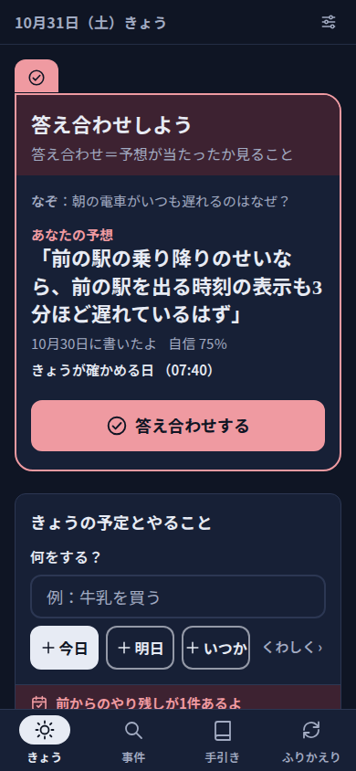

- **JavaScript は「あると便利」な所だけに使います。** 保存はすべてふつうのフォームで送り、「押すと開く欄」は HTML の `<details>`、場面で言葉を切り替えるのは CSS（`:has`）です。JavaScript を使うのは、事件を作る画面を1問ずつ見せる所（`stepper.js`）、提案や分のボタンを押すと欄に書き出しが入る所（`suggest-chips.js`・`minute-chips.js`）、AI に相談する用に写すボタンだけです。どれも JavaScript が動かないときは、全部の欄が並ぶ・自分で書くなど、ふつうのフォームとして使えます。だから古い端末でも、通信が遅くても使えます。

---

## 2-2. 言葉の出し分け（子ども向け・仕事の場面）

**役目：** 同じ画面を、使う人に合わせた言葉で見せます。

**たとえると：** 同じ料理を、子どもには小さく切って、大人にはそのまま出すようなものです。料理（データとコード）は同じで、盛り付け（言葉）だけを変えます。

### 子ども向けの言葉：ふだんの場面が「親子」の人

設定の「ふだんの場面」を **親子** にすると、次の画面で子ども向けの言葉が出ます。判断はコードの1か所（`User::prefersKidWords()`）にまとめてあり、事件ごとの場面では切り替えません（[言葉のルール 2-2](../design/words.md)）。

| 画面 | 子ども向けにするもの | 例 |
|---|---|---|
| 事件の一覧 | 状態のつまみと場面の札 | 捜査中 →「調べ中」、解決 →「わかった」（迷宮入りは大人にも「おあずけ」）、日常 →「ふだん」 |
| 事件を作る・事件の画面 | 場面と手がかりの種類の言い方、見立ての呼び名、予想のカードの言葉と確かさの目安、閉じた事件のはんこ | 見立て →「かも」、いつ確かめる？ →「いつ見に行く？」、75％ →「けっこう 自信がある」、解決！ →「わかった！」 |
| 答え合わせ | 結果と見落としの言い方 | 当たり →「あたり」、どこで見落とした？ →「どこでまちがえた？」 |
| 今日 | 今日の練習の短い説明 | 練習メニューの子ども向けの説明（`kid_description`） |
| ふりかえり・ノーベリ帳・屋根裏の棚 | 呼び名・見落としの言い方・結果の言い方 | ノーベリ帳 →「まちがいノート」、屋根裏の棚 →「ぼくの図鑑・わたしの図鑑」、思い込みがあった →「思いこみがあった」 |
| 手引き | 何も選んでいなければ子ども向けの説明が先 | 「大人向け・子ども向け」のボタンで切り替えられる |
| 名推理カード | 子ども向けのヒントを初めから開いておく | |

### 仕事の場面の言葉：事件の場面が「仕事」のとき

施術者が自分の見方を振り返るときの言い方です。コードの名前は変えず、表示だけを変えます（`config/suiri.php` の `labels.by_scene.work`）。

| ふだんの言葉 | 仕事の場面での表示 |
|---|---|
| 見た | 見た・触れた・測った |
| 聞いた | ご本人の言葉 |
| 見立て | 見立て（医療の判断ではない、という一言が添えられる） |
| もしそうなら | 次回、確かめること |

仕事の場面では、事件を作る画面で「仕事」を選んだときに「仕事のときは、お客さまの名前や病名は書かないでね。」の注意が出ます（初めて仕事の場面の事件を作るときは約束の全文も。`components/case-new/work-note.blade.php`）。事件の画面では、見たことを書くカードの欄の上に「お客さまの記録には使えません」という注意が出ます（`components/case/work-caution.blade.php`）。

---

## 2-3. トップ（ログイン前。`/`）

**役目：** 初めて来た人に「何をするアプリか」を伝え、ログインのボタンを示す玄関です。

**たとえると：** 手帳を買う前に、帯に書いてある説明と「中身の見本」を読むようなものです。

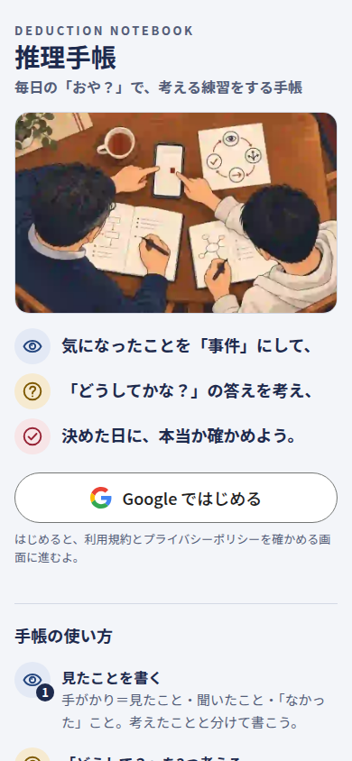

**上から並ぶもの（となぜその順か）**

1. 小さな英字「DEDUCTION NOTEBOOK」と、大きな題字「**推理手帳**」。
2. 一言の説明：「毎日の『気になる』を事件にして、手がかりから見立てを立て、**『もしそうなら』**を確かめる日をカレンダーに入れる。…」
3. **「Google でログイン」** ボタンと、「はじめると、利用規約とプライバシーポリシーを確かめる画面に進むよ。」の一文（招待制に切り替えているときだけ、頭に「招待制です。」が付きます。文は `config/suiri.php` の `home.open`・`home.invite`）。スマホでもスクロールせずに押せる高さに置いています（主なボタンは最初の画面に収める決まり）。
4. **手帳の使い方**：1 手がかり → 2 見立て → 3 もしそうなら → 4 答え合わせ、を番号つきの行で。ログインする前に流れが分かるようにするためです。
5. **お約束**：効果は約束しないこと、続けた日数や点数の仕組みはなく、休んでも何も減らないことの短い説明と、「このアプリについて（くわしく）」へのリンク。使い始める前に、できること・できないことを正直に伝えるためです。

**押すと**

- **Google でログイン**：Google の画面へ移ります（`/auth/google`）。初めての人は登録されて同意の画面へ、2回目からはきょうの画面へ進みます（既定の一般公開では、Google アカウントがあればだれでも登録できます）。招待制に切り替えているときは、Google で選んだアカウントのメールアドレスが名簿になければ「招待制です」と出て、登録されません。
- Google の鍵がまだ設定されていない手元の環境では、ボタンは「準備中」になります。
- ログインしている人がトップを開くと、きょうの画面に送られます。

**裏側**

| 項目 | 中身 |
|---|---|
| 住所 | `GET /`（ルート名 `home`） |
| 受付 | `src/app/Http/Controllers/HomeController.php`（ログイン済みなら `Landing::url()` ＝今日へ） |
| 画面 | `src/resources/views/home.blade.php`・部品 `components/auth/google-button.blade.php` |
| ログインの用事 | `Auth\GoogleLoginController`（送り出す `redirect`・戻る `callback`）→ `Actions/Auth/LoginWithGoogle`（利用者を探す／作る。招待制のときだけ名簿を確かめる） |

---

## 2-4. 同意（初めてログインしたとき。`/agree`）

**役目：** 使い始める前に、利用規約・プライバシーポリシーへの同意と、年齢の確認をもらいます。

**たとえると：** 図書館の利用カードを作るときに、規則を読んで署名する欄です。

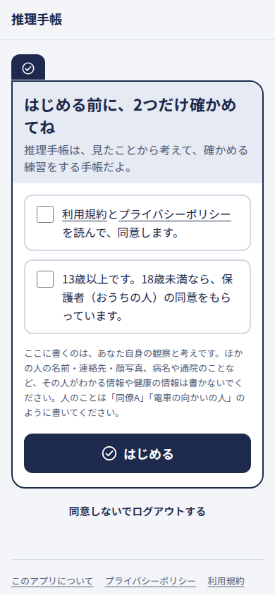

**上から並ぶもの**

1. 見出し「はじめる前に」と、何をする手帳かの一言。
2. **2つのチェック**：「利用規約とプライバシーポリシーを読み、同意します。」（規約とポリシーは別のタブで開く）／「13歳以上です。18歳未満の場合は、保護者の同意を得ています。」
3. 個人情報の注意書き。
4. **「はじめる」** ボタン。
5. 「同意せずにログアウトする」。

**押すと**

- **はじめる**：2つともチェックしていれば、同意した日時（`users.agreed_at`）を記録し、元の画面（なければ今日）へ進みます。お知らせ「ようこそ、推理手帳へ。」が出ます。チェックが足りなければ、足りない項目の下に赤い文が出ます。
- まだ同意していない人が、ほかの画面を開こうとしても、この画面に戻されます（ミドルウェア `agreed` ＝ `EnsureAgreed`）。

**裏側**

| 項目 | 中身 |
|---|---|
| 住所 | `GET /agree`（`agree.show`）・`POST /agree`（`agree.store`） |
| 受付 | `Auth\AgreementController`（確かめは `Requests/Auth/AcceptTermsRequest`、記録は `Actions/Auth/AcceptTerms`） |
| 画面 | `src/resources/views/auth/agree.blade.php` |

---

## 2-5. きょう（最初の画面。`/today`）

**役目：** 開いた瞬間に「いまやること」が1つだけ大きく見え、その下で、今日の予定とやることを **書く・済ませる・見通す** までを1枚で済ませる画面です。ログインした人は、まずここに着きます。

前は「今日」の画面と「タスク」（やることの一覧）の画面が分かれていて、明日より先のやることや済んだやることを見るには、タスクの画面に移る必要がありました。利用者から「今日とタスクが一緒になって、もうちょっと操作がシンプルになるとありがたい」という声があり、1つの画面「きょう」にまとめました。下のナビも5つから4つ（きょう・事件・手引き・ふりかえり）に減りました。

**たとえると：** 手帳の「今日のページ」です。いちばん上に付箋を1枚だけ貼り（いま、いちばん先にすること）、その下に今日の予定とやることを書く欄があります。ページの下には「これから」「いつか」「済み」の3つのポケットが付いていて、ふだんは閉じたまま、何枚入っているかだけが見えます。前は別のノート（タスクの一覧）を開かないと見られなかったものが、同じページのポケットに入った、というイメージです。

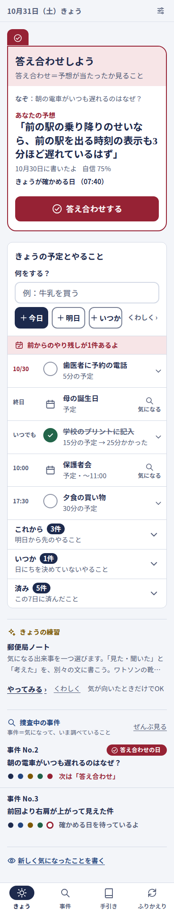

**上から並ぶもの（となぜその順か）**

作り直しの1つ目の原則「1画面に『いまやること』は1つ」に沿って、いちばん上に大きなカード（`<x-ui.step-card>`）を1枚だけ置き、その下に今日のこと、さらに下に急がないものを並べます。上ほど「いま」に近く、下ほど「あとで見ればよい」ものです。並びの優先の順は [要件定義書 D-1](../design/requirements.md) のとおりで、「記録のきっかけ」と「答え合わせ待ち」を1枚のカードにまとめ、その日にいちばん先にする方だけを出します。

1. **（やることを済ませた直後だけ）「できたね！」の緑の枠**：「『牛乳を買う』、できたね！」と「20分の予定だったよ。実際は何分だった？」。15分・30分・1時間のボタンを1回押すだけで書けます（ほかの分は欄に書く）。下に「気になる」。どちらも任意で、何もしなくてかまいません。
2. **いまやることのカード（1枚だけ）**：中身は日によって変わります（部品 `<x-today.next-step>`）。
   - **答え合わせの日が来た予想があるとき**：深い赤のカード「答え合わせしよう」。見出しの下に「答え合わせ＝予想が当たったか見ること」と言葉の一言の説明を添え、事件のなぞ・あなたの予想（書いたときの文のまま）・書いた日と自信・確かめる日と、横いっぱいの **「答え合わせする」** ボタン。出すのはいちばん古い1件だけで、ほかはカードの下に「ほかにも1件あるよ」とたたみます。今日いちばん先にすることなので、これがあればこちらを出します。
   - **ないとき**：紺のカード「気になったこと、ある？」（例「今週、体操着を2回わすれた」）。設定で決めた **書くタイミング**（記録のきっかけ。例「夕食のあとに、気になったことを1つ」）をカードの中に出し、**「気になったことを書こう」** のボタンで事件を作る画面へ進みます。いつ・何のあとに書くかを先に決めておくと続けやすい、という研究（実行意図）に基づいています。まだ決めていなければ、カードの下に小さく「書く時間を決めると、続けやすいよ。時間を決める」（設定へ）。
3. **きょうの予定とやること**（1枚の枠。部品 `<x-today.agenda>`）。やることに関係するものは、全部この枠の中にまとめます。上から：
   - **「何をする？」の1行と「今日」「明日」「いつか」**（部品 `<x-task.quick-add>`）：見出しのすぐ下に、いつも開いています。題名を書いて、いつやるかのボタンを1回押すだけで作れます。ボタンがそのまま期日を決めるので、日付を選ぶ欄を開かなくてかまいません（今日＝今日の日付・明日＝明日の日付・いつか＝期日なし）。題名の欄で Enter を押したときは「今日」になります。いちばんよく使う「今日」だけを紺で塗っています。日にち・時刻・何分かかりそうかも決めたいときだけ、右の **「くわしく ›」** で、書いた題名を持ってやることを書く画面（2-6-1）へ進みます。前は見出しの横の「＋ 書く」を押して開く欄でしたが、書くまでの手数を1つ減らすため、いつも出しておくことにしました。入力欄は「何をする？」の1つだけなので、「いま何を入れればいいか」は迷いません。
   - **前からのやり残し**：期日を過ぎて、まだ済んでいないやることです。並びのいちばん上に、赤い帯「前からのやり残しが1件あるよ」と、左に赤いもとの期日（例「10/30」）を付けて出します。前は数だけを出して一覧の画面へさそっていましたが、移らずにその場で済ませられるよう、行そのものを出すことにしました。いちばん上の答え合わせのカードに出ている予想の確かめるタスクは、ここには二重に出しません。
   - **予定と今日のやること**：Google カレンダーの今日の予定（つないでいる人だけ。カレンダーの絵つきで、読むだけ）と、今日が期日のやることを **時刻の順に1つの並び** にします（終日・「いつでも」が上）。左に時刻。やることの行は左の丸を1回押すと済み、済んだものは緑のチェックと線を引いて残ります（今日やったことが見えるように）。予定の行の右には **「気になる」**。終わって3時間以内の予定には「さっき終わった予定：気になったことは？」を添え、「気になる」を赤い枠で目立たせます（提案 S-6。[5章](05-reasoning-flow.md) の 5-14）。
   - **これから・いつか・済み**（たたんだ3つの枠。部品 `<x-today.later-tasks>`）：枠のいちばん下に、名前と件数（例「これから 3件」）と一言だけを3行で出し、押すとその場で開きます。前のタスクの一覧の4つのタブの代わりです。
     - **これから**：明日から先のやることを、日付ごとの小さな見出し（明日なら「明日・11月1日（日）」）の下に並べます。先の日付のものが見えなくならないよう、日数で区切らずに全部出します。
     - **いつか**：日にちを決めていないやること（作った順）。
     - **済み**：この7日に済んだこと（新しい順に30件まで）。予想時間とかかった時間を「15分の予定 → 25分かかった」の形で並べるので、予想と実際の差がひと目でわかり、次の見積もりの手がかりになります。丸を押すと、まだに戻せます。
     - ふだん閉じておくのは、画面を開いたときに今日のことだけに目が行くようにするためです。今日の並びの下に置いたのは、今日のことを片づけたあとで見通すものだからです。「明日」「いつか」で書いたとき、作った・直したやることが明日より先・いつか・済みに入るとき、前の一覧の住所（`/tasks?view=upcoming` など）から来たときは、その枠だけを開いた状態で出します（住所の `?open=`）。
4. **きょうの練習・捜査中の事件**：ページの下に、カードにせず小さく出します（パソコンでは左右に並ぶ）。練習は手引きの練習メニューから日替わりで1つ（同じ日に何度開いても同じもの）。名前と短い説明、「やってみる」「くわしく」と「気が向いたときだけでOK」。捜査中の事件は最近さわった3件で、「事件＝気になって、いま調べていること」の一言と「ぜんぶ見る」。
5. **（答え合わせのカードを出している日だけ）「新しく気になったことを書く」**：上のカードが答え合わせのときも、書く入口をいちばん下に小さく1行で残します。

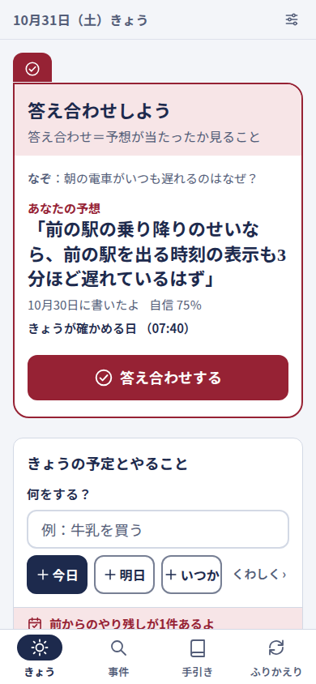

スマホの最初の画面（390×844）に、いまやることのカードと「何をする？」の1行が両方入るようにしています。開いてすぐに「答え合わせ」も「やることを書く」もできます。

**やることの行を押すと開く**

やることの行は、ふだんは左の丸（済ませる）と題名だけです。題名の所を押すと、その場で行が開き、**「直す」「気になる」「消す」** が出ます（HTML の `<details>`。JavaScript は使いません）。「消す」は押すと「消すと、もとに戻せないよ。消していい？」が出て、もう一度押すと消えます。ふだん見える操作を丸の1つにしぼり、ほかの操作は開いたときだけ見せるためです。行を押せば何ができるかがその場でわかるので、前のように直す画面へ移らなくても、消す・気になるが済みます。

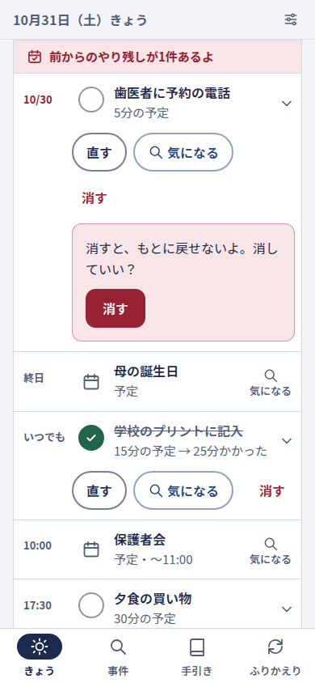

**確かめるタスク**（予想から自動でできたもの）は見分けがつくようにしています。左は押せない点線の丸と虫めがね、題名は「確かめる：〜はず」、まだ済んでいなければ右に **「答え合わせ」**。答え合わせを済ませると自動で済みになるので、丸を押して済ませたり戻したりはできません（判断はコードの1か所 `Task::answeredByPrediction()`）。開いた中には「気になる」を出さず（もとの事件があるため）、答え合わせ待ちのものは「消す」も出しません（やめるときは、直す画面で予想を取り下げる）。

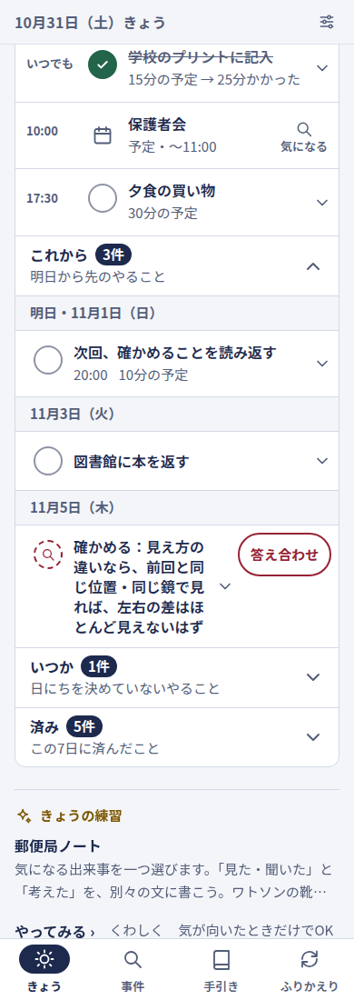

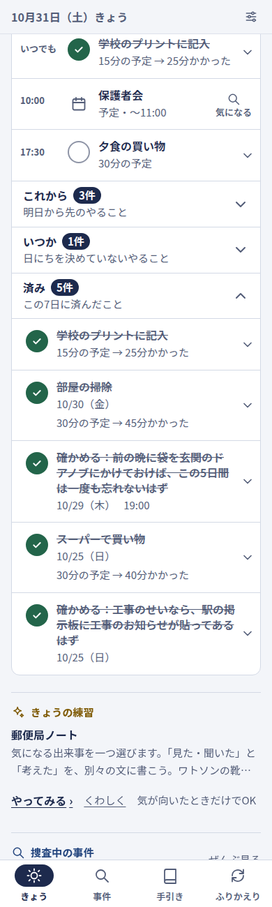

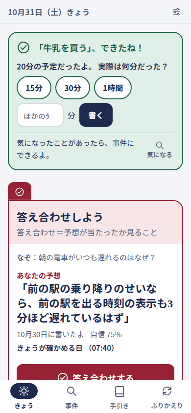

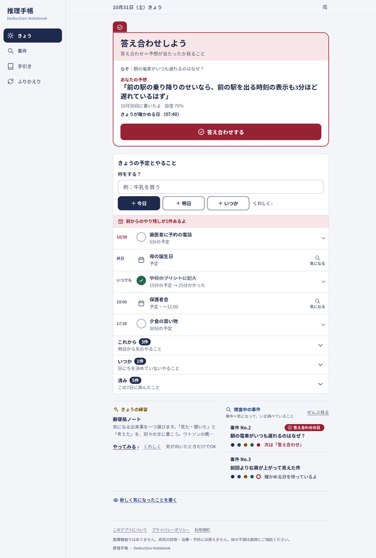

**押すと**

| 押すもの | 起きること |
|---|---|
| 答え合わせする | その予想の答え合わせの画面へ（`/predictions/{番号}`） |
| ほかにも◯件あるよ | 待っているほかの予想が開き、1件ずつ押すとその答え合わせへ |
| 気になったことを書こう | 事件を作る画面へ |
| 時間を決める | 設定の画面へ（記録のきっかけを決める） |
| ＋今日・＋明日・＋いつか | 書いた題名でやることを作る（`POST /tasks`。押したボタンの値が期日 `due_on` になる）。今日なら今日の並びに入り、明日・いつかなら「これから」「いつか」の枠を開いた状態で、きょうの画面に戻る |
| くわしく ›（「何をする？」の横） | 書いた題名を持って、やることを書く画面へ（`POST /tasks/draft`。題名を URL に載せないため、送るのはフォーム） |
| やることの左の丸 | その場で済ませる（`POST /tasks/{番号}/done`）。済ませた直後の緑の枠が上に出る。済んだものの丸は、まだに戻す（`DELETE /tasks/{番号}/done`） |
| 15分・30分・1時間（緑の枠） | かかった時間を書く（同じ `POST /tasks/{番号}/done` に `actual_minutes` を送る） |
| やることの題名の所 | その場で行が開き、「直す」「気になる」「消す」が出る（もう一度押すと閉じる） |
| 直す | やることを直す画面へ（`/tasks/{番号}/edit`） |
| 消す | 確かめの一言が出て、もう一度押すと消える（`DELETE /tasks/{番号}`） |
| 気になる（予定の行・開いたやることの行・緑の枠） | その題名（予定なら時刻つき）をきっかけにして、事件を作る画面へ（`POST /cases/draft`） |
| 答え合わせ（確かめるタスクの行の右） | その予想の答え合わせの画面へ |
| これから・いつか・済み | その場で枠が開く（もう一度押すと閉じる） |
| やってみる（きょうの練習） | その練習メニューの問いかけ入りで、事件を作る画面へ |
| くわしく（きょうの練習） | 手引きの練習メニューの、そのメニューの説明へ |
| 捜査中の事件の1行 | 事件の画面へ |

**裏側**

| 項目 | 中身 |
|---|---|
| 住所 | `GET /today`（`today`。`?open=upcoming\|someday\|done` で、その枠を開いて出す）。前のタスクの一覧の住所 `GET /tasks`（`tasks.index`）は画面を返さず、`/today` へ移すだけ（`?view=upcoming` → `?open=upcoming` のように読みかえる。`?view=today` や値なしは `/today`） |
| 受付 | `Today\TodayController`（データを集めて渡すだけ）・`Tasks\TaskController::index`（`/today` へ移すだけ） |
| データを集める係 | `Queries/Today/DuePredictionsQuery`（答え合わせの日が来た予想）・`Queries/Today/AgendaQuery`（予定と今日のやることを時刻順に。さっき終わった予定の印 `just_ended` も付ける）・`Queries/Tasks/TaskListQuery::forToday()`（やり残し・これから（日付ごと）・いつか・済み（この7日）と件数、「今日」「明日」のボタンの日付）・`TaskListQuery::justDone()`（済ませた直後の1件）・`Services/Guide/DailyPractice`（きょうの練習）・`Queries/Cases/OpenCasesQuery`（捜査中の事件） |
| 画面 | `src/resources/views/today/index.blade.php` |
| 部品 | `components/today/`（`next-step`・`due-prediction`・`due-predictions`・`agenda`・`agenda-event`・`later-tasks`・`fold`・`task-rows`・`practice-suggestion`・`open-cases`）・`components/task/`（`done-followup`・`quick-add`・`item`・`check`・`curious`）・`components/ui/`（`step-card`・`big-button`・`confirm`） |
| 言葉と数 | `src/config/suiri.php` の `today`（`answer`・`record`・`agenda`・`later`・`practice`・`cases`）・`tasks`（`quick`・`row`・`words`・`done_followup`）・`today_tasks`（済みに出す日数 7 と件数 30） |

Google の今日の予定は、題名と時刻だけを受け取り、5分だけ覚えて記録としては保存しません（`Services/Google/GoogleCalendarAgenda`）。部品の1つずつの役目と受け取る値は [部品説明書の3章・4章](../design/components.md) にあります。

---

## 2-6. やることを書く・直す

タスク（画面の言葉では「やること」）の一覧は、2-5 の「きょう」の画面にまとめました。ここで説明するのは、くわしく決めて書く画面と、直す画面の2つです。どちらも「まず『何をする？』だけ」を大きく出し、日にちや時間は開いたときに決めます。どちらの画面を開いているときも、ナビは「きょう」に印が付きます（やることは「きょう」の仲間だからです）。

### 2-6-1. やることを書く（`/tasks/create`）

**役目：** 題名のほかに、いつ・何時から・何分かかりそうか・メモまで決めて、やることを作ります。

**たとえると：** 手帳に1行書いてから、余白に「いつ」「何分くらい」を書き足すようなものです。書き足すかどうかは自由です。

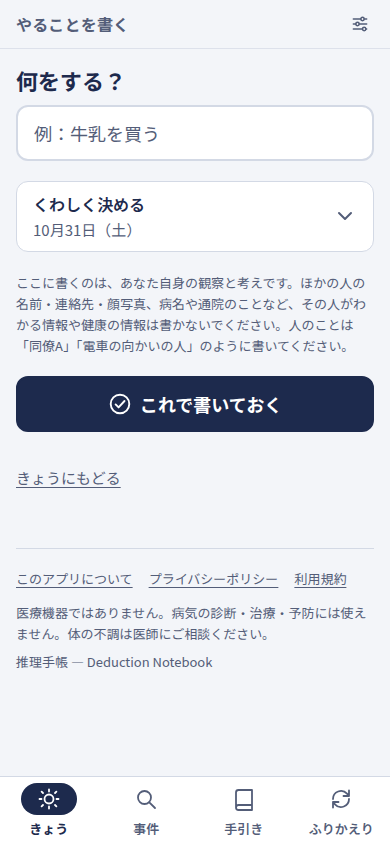

**上から並ぶもの**

1. **何をする？**（必須）：大きな入力欄と例「例：牛乳を買う」。
2. **くわしく決める**（押すと開く）：閉じているときは、決めた日にち（初めは今日）・時刻・予定の分を見出しの下に並べます。開くと：
   - **いつやる？**（空なら「いつか」）と **何時から？**（空なら「いつでも」）を横に並べる。
   - **何分かかりそう？**：15分・30分・1時間のボタン（押すと欄に入るだけ）と、ほかの分を書く欄。題名が似た前のやることがあれば、すぐ下に「前の『買い物』は 30分の予定で、45分かかったよ（15分長かった）」の吹き出しを出します（見積もりの答え合わせ。過去の実績を思い出すと、楽観しすぎる見積もりが減るという研究によります。[要件定義書 T-8](../design/requirements.md)）。
   - **メモ**。
3. 注意書きと、横いっぱいの **「これで書いておく」**。

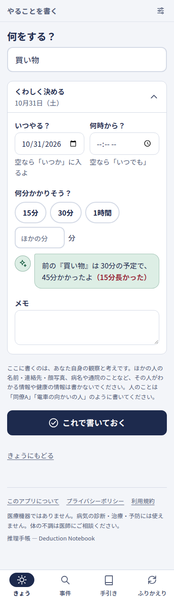

きょうの画面の「何をする？」の横の「くわしく ›」から来たときは、そこで書いた題名が入り、「くわしく決める」が開いています。種類はいつも「ふつう」です（確かめるタスクは予想から自動で作るので、ここでは作りません）。書くと、きょうの画面に戻ります（明日より先・いつかのものなら、その枠を開いて）。

### 2-6-2. やることを直す（`/tasks/{番号}/edit`）

きょうの画面で、やることの行を開いて「直す」を押すと来る画面です。

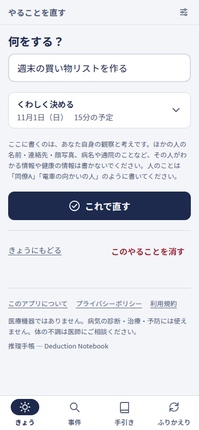

書く画面と同じ欄（部品 `components/task/form.blade.php` を共有）に、いまの値が入っています。済んだやることなら「実際は何分だった？」の欄も出ます。下の左に「きょうにもどる」（きょうの画面の、そのやることが入る所へ）、右に「このやることを消す」（押すと確かめの欄が開き、もう一度押すと消える）。

確かめるタスクを開いたときは、上に「予想から作った『確かめるタスク』だよ。答え合わせをすると、自動で済むよ。」の吹き出しと「答え合わせ」ボタンが出て、「くわしく決める」が開いています。題名（予想の文の写し）は直せず、答え合わせ待ちの予想のものは期日が必須です（期日を変えると、予想の確かめる日も一緒に変わる）。消すボタンの代わりに「予想を取り下げる」が出ます（取り下げると、このやることも消える）。

保存すると、きょうの画面の、そのやることが見える所に戻り、「『〜』を直したよ。」のお知らせが出ます。期日が今日まで（過ぎたものも）なら上の並びに入るので枠は開かず、明日より先なら「これから」、期日なしなら「いつか」、済んだものなら「済み」の枠を開いた状態で出ます（消したときも、そのやることがいた所へ戻ります）。

**裏側（やること）**

| 項目 | 中身 |
|---|---|
| 住所 | `GET /tasks/create`・`POST /tasks`・`POST /tasks/draft`・`GET /tasks/{task}/edit`・`PATCH /tasks/{task}`・`DELETE /tasks/{task}`・`POST/DELETE /tasks/{task}/done`。`GET /tasks`（`tasks.index`）は `/today` へ移すだけ（2-5） |
| 受付 | `Tasks\TaskController`（作る・直す・消す。前の一覧の住所は移すだけ）・`Tasks\DraftTaskController`・`Tasks\CompleteTaskController`・`Tasks\ReopenTaskController`。作る・直す・消すのあとは `TaskListQuery::openOf()` で、そのやることが入る枠を決めて `/today?open=…` へ戻す。済ませる・戻すのあとは元の画面へ戻す（分からなければ `/today`） |
| 用事・振り分け | `Actions/Tasks/`（`CreateTask`・`UpdateTask`・`CompleteTask`・`ReopenTask`・`DeleteTask`）・`Queries/Tasks/TaskListQuery`・`SimilarTasksQuery` |
| 画面 | `src/resources/views/tasks/`（`create`・`edit`）・部品 `components/task/` |
| 動き | 分のボタン `src/resources/js/parts/minute-chips.js`（押すと欄に数を入れるだけ。JavaScript が動かないときはボタンが隠れ、欄に書けば送れる） |
| 言葉 | `src/config/suiri.php` の `tasks`（`words`・`quick`・`row`・`done_followup`・`similar`・`flash`） |

期日のあるタスクは、カレンダーとつないでいれば専用カレンダーにも書き出されます（タスクの担当は Google のことを知らず、見張り役 `TaskObserver` が書き出しの仕事を出します。[3章](03-architecture.md)）。

---

## 2-7. 事件

事件の画面は4つです。事件の一覧（`/cases`）・事件を作る（`/cases/create`）・事件の画面（`/cases/{番号}`）・答え合わせ（`/predictions/{番号}`）。相棒モードの「渡し合い」と仕事の場面は、事件の画面の中で動きます。

### 作り直しで何が変わったか（先に読んでほしいこと）

**役目：** 事件まわりの画面を、「いま何を入れればいいか」がひと目でわかる形に作り直しました。

**たとえると：** すごろくの盤です。前の形は、盤の上のマスに全部の指示を一度に書いてあるようなものでした。新しい形では、いまいるマスだけが大きく光り、通ってきたマスには印が付き、先のマスはうすく見えるだけです。

**中身：** 前の事件の詳細は、手がかり・見立て・○×・予想を立てる欄が1画面に全部並んでいました。オーナーからは「パッと見て『ああ、今はこれを入力すればいいんだ』とはっきりわかるようにしないと。あれもこれも入力するところが同時に出るとわからない」「子供と使うことを想定してないでしょ」という声がありました。使う人は、保護者と中高生の子どもが1台のスマホを一緒にのぞく場面が中心です。そこで、作り直しの3つの原則（AI 向けの決まり `.claude/rules/ui-design.md`）に合わせて、次のように変えました。

| 原則 | 事件の画面での形 |
|---|---|
| 1画面に「いまやること」は1つ | いまやることのカード（`<x-ui.step-card>`）を **1枚だけ** 大きく出す。済んだことは上に1行ずつたたみ、まだ先のことは出さない。ほかにできることは、カードの下に小さく1行ずつ |
| やわらかい話し言葉 | 問いは「見たことを1つ教えて」「どうしてだと思う？」のような話し言葉で、例を添える。手がかり・見立て・もしそうなら などの言葉は、初めて出る所で「見立て＝『どうしてだろう？』の答えの案」と一言の説明を付ける |
| 子どもと一緒に使える | 主なボタンは横いっぱいで高さ 48px 以上、本文は 16px 以上。ふだんの場面が親子の人には、子ども向けの言い方（「かも」「いつ見に行く？」など）を出す |

段（中心の流れの1歩ずつ）には、それぞれの **色と絵** があります。どの画面でも同じなので、色を見れば「いまどの段か」がわかります（見本は [部品の見本（UI キット）](../design/ui-kit.md)）。

| 段 | 絵 | 色 |
|---|---|---|
| なぞ | （なし） | 紺のインク |
| 見たこと（手がかり） | 目 | 紺 |
| どうして？（見立て） | はてな | からし色（黄土色） |
| もしそうなら（予想） | 矢印 | 深い緑 |
| 確かめる日 | カレンダー | 深い緑 |
| 答え合わせ | チェック | 深い赤 |

### 2-7-1. 事件の一覧（`/cases`）

**役目：** 新しい事件を作るか、続きを調べる事件を選ぶ画面です。

**たとえると：** 探偵事務所の書類棚の引き出しです。「捜査中」「解決」「おあずけ」の3つのつまみ（インデックス）があり、引き出しを開けると、ファイルの背に「事件 No.6」と題と、どこまで調べたかの印が見えます。

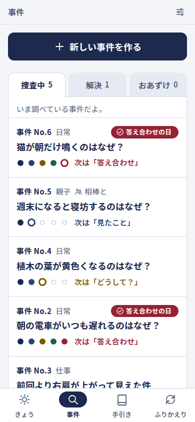

**上から並ぶもの（となぜその順か）**

1. **「＋ 新しい事件を作る」**：横いっぱいの大きなボタン（`<x-ui.big-button>`）。この画面でいちばんよくすることなので、一番上です。
2. **状態のつまみ**：捜査中・解決・おあずけ（件数つき）。選んだつまみは下の紙とつながって白く見え、ほかは淡い紺です。**おあずけ** は「迷宮入り」のことで、大人にも子どもにも「おあずけ」と出し、つまみの下に「おあずけ＝迷宮入り。わからないまま置いた事件だよ。」と一言説明します。ふだんの場面が親子の人には、捜査中・解決が「調べ中」「わかった」になります（[言葉のルール 2-2](../design/words.md)）。
3. **つまみの下の一言**：「いま調べている事件だよ。」のように、その引き出しが何かを書きます。
4. **事件の行**（最近さわった順）：1行ごとに、
   - 上に「事件 No.6」と場面（相棒モードなら「相棒と」の絵つき）。番号は URL の番号と同じです。
   - 大きく **なぞ**。
   - 下に **段ごとの進み具合の小さな丸**（なぞ → 見たこと → どうして？ → もしそうなら → 答え合わせ）。済んだ段は段の色で塗り、いまの段は段の色の枠、まだの段はうすい丸です。横に「次は『どうして？』」の一言（確かめる日を待っているときは「確かめる日を待っているよ」、閉じた事件は「10月29日に閉じたよ」）。
   - 確かめる日が来た予想があれば、右上に赤い **「答え合わせの日」** の札。
5. **場面でしぼる**（いちばん下にたたんである）：すべて・日常・親子・仕事 の札。しぼっているときは、紙の上に「『親子』の事件だけ出しているよ」と「しぼるのをやめる」が出ます。ふだんは使わないので、一番下にたたみました。
6. 事件が多いときは、下に「前のページ」「次のページ」。

前の一覧は、事件ごとに「手がかり 3・見立て 2」のような数を並べていました。数では「次に何をすればいいか」がわからないので、作り直しで **段の丸と「次は〜」の一言** に変えています。

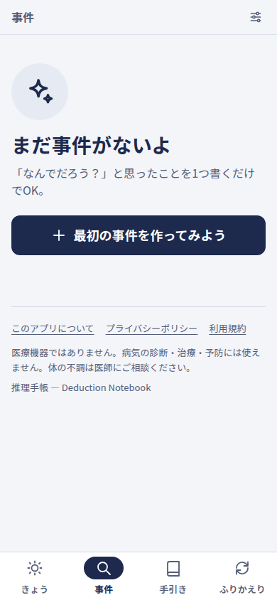

**空のとき**：事件がまだ1つもないときは、つまみも並びも出さず、絵と一言と **「最初の事件を作ってみよう」** のボタンだけにします（`<x-ui.empty-state>`）。開いたときに、まず何をすればいいかがわかるようにするためです。つまみの中だけが空のとき（解決した事件がまだない など）は、引き出しの中に小さな絵と「解決した事件はまだないよ」のような一言を出します。

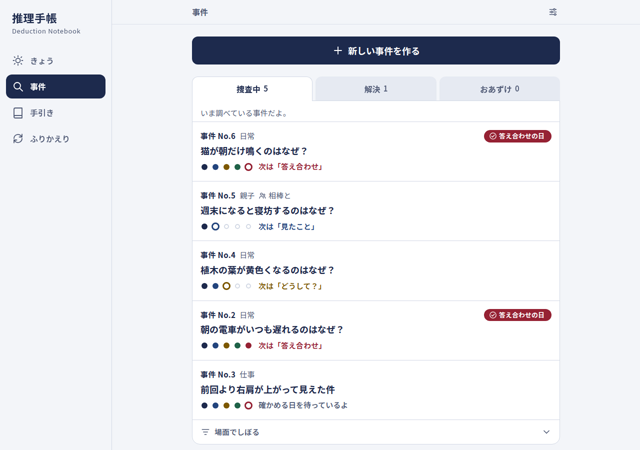

**押すと**

| 押すもの | 起きること |
|---|---|
| 新しい事件を作る・最初の事件を作ってみよう | 事件を作る画面へ |
| つまみ | その状態の事件だけを出す（`?status=open\|solved\|cold`。場面でしぼっていれば、それは残す） |
| 場面の札 | その場面の事件だけを出す（`?scene=daily\|family\|work`） |
| 事件の行 | その事件の画面へ |

### 2-7-2. 事件を作る（`/cases/create`）— 1問ずつ

**役目：** 気になったことを、4つの問いに **1つずつ** 答えて事件にします。一番軽い記録（なぞと、見たこと1つ・見立て1つ）なら、ここだけで済みます。

**たとえると：** 捜査ファイルの受付の係の人が、「何が気になったの？」「何を見たの？」「どうしてだと思う？」と1つずつ聞いてくれて、最後に表紙を見せて「これで作るよ」と確かめてくれるようなものです。用紙を渡されて全部の欄を自分で埋めるより、どこから書けばいいか迷いません。

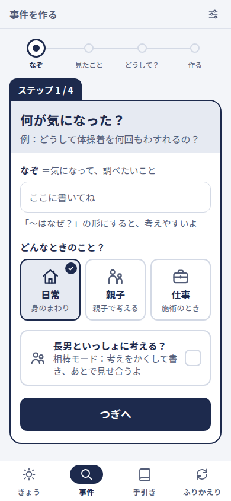

**どの問いにも共通の形**

- 上に **進み具合の丸4つ**（なぞ・見たこと・どうして？・作る）。済んだ問いは塗った丸にチェック、いまの問いは大きな枠です。
- その下に **いまやることのカード** 1枚。左上のつまみに段の絵と「ステップ 2 / 4」、問いの見出しと例、中身（入力欄など）、いちばん下に横いっぱいの **「つぎへ」**。
- カードの下に小さく、左に「‹ もどる」、右に「あとで書く ›」（書かずに次へ進む。2問目と3問目だけ）。
- 主なボタン（つぎへ）が、スマホの最初の画面の中に見えるようにしています。

**4つの問い（上から順に1つずつ出る）**

1. **何が気になった？**（なぞ・場面・相棒）
   - **なぞ**（必須）：見出しの横に「＝気になって、調べたいこと」、欄の下に「『〜はなぜ？』の形にすると、考えやすいよ」。考える的を最初に1つに決めるためです。
   - **どんなときのこと？**：日常（身のまわり）・親子（親子で考える）・仕事（施術のとき）の3枚の絵つきの札。初めは設定の「ふだんの場面」が選ばれています。**仕事** を選ぶと、すぐ下に「仕事のときは、お客さまの名前や病名は書かないでね。」の注意が出ます（初めて仕事の場面で作る人には、約束の全文も）。
   - **「長男といっしょに考える？」**（設定に相棒の名前があるときだけ）：相棒モードを入れるチェック。入れると、3問目の欄が「事件を作ったあとに書くよ」の説明に替わります（2-7-4）。
2. **見たこと・聞いたことを1つ教えて**（最初の手がかり。書かなくてもよい）
   - 吹き出し「手がかり＝自分の目や耳でたしかめたこと」。
   - **どうやって知った？**：見た（目で見た）・聞いた（人から聞いた）・なかった（ないと気づく）の3枚の絵つきの札。
   - 「› 書き出しのヒント」（たたんである。押すと「いつ？」「何回？」などのボタンが開き、押すと欄に「いつ：」のような書き出しが入る）と、欄（「見たまま書いてね。『〜と思う』は次で」）。見たことと考えたことを分けるための一言です。
3. **どうしてだと思う？**（最初の見立て。書かなくてもよい）
   - 上に、2問目で書いた見たことを小さく写します（「見たこと：今週、体操着を2回わすれた」）。見ながら考えられるようにするためです。
   - 吹き出し「見立て＝『どうしてだろう？』の答えの案。外れてもいいよ」。
   - 「› 考えるヒント」（別の説明の型。時間・習慣・環境…）と欄。
4. **これで事件を作るよ**（確かめて送る）
   - なぞを事件の題として大きく、場面を小さく。その下に、見たこと・見立てを **証拠品の荷札**（`<x-ui.evidence-tag>`）の形で。書かなかった所は「まだ書いていないよ。あとで足せるよ」。
   - 札の右の **「直す」** で、その問いに戻れます。
   - 横いっぱいの **「＋ 事件を作る」**。

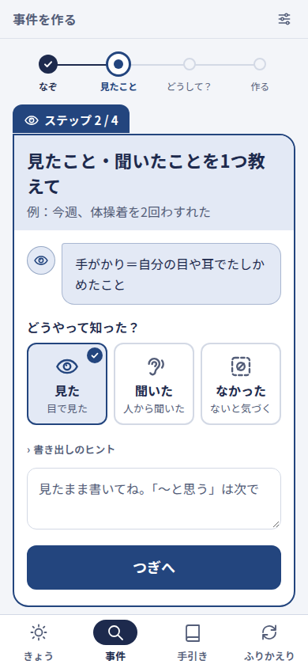

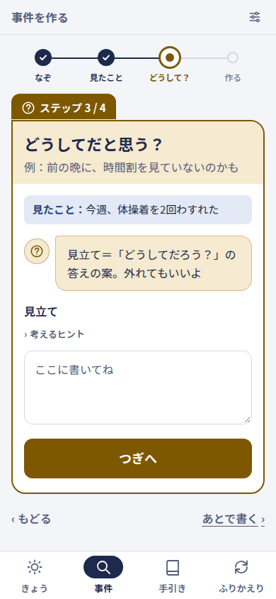

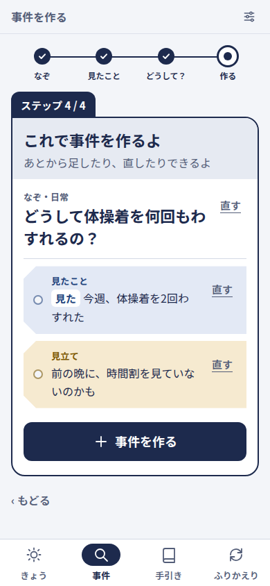

**なぜ1問ずつにしたか**

前の作る画面は、なぞ・場面・相棒モード・最初の手がかり・最初の見立ての欄が1画面に縦に並んでいました。入力欄が5つ同時に見えると、どこから書けばいいか、どこまで書けば作れるのかがわかりません（オーナーの「あれもこれも入力するところが同時に出るとわからない」）。1問ずつにすると、いまの問いだけに答えればよく、最後の確かめで全体を見直せます。送るのは最後の1回だけなので、途中でやめても何も保存されません。

**動き（`resources/js/parts/stepper.js`）**

- 4つの問いは、じつは **1つのフォーム** の中にあります。JavaScript がいまの問いだけを見せ、「つぎへ」で次の問いを見せるだけで、送信はしません。
- 「つぎへ」は、いまの問いの欄が決まりどおりか（なぞが空でないか など）を確かめてから進みます。だめならブラウザの吹き出しで知らせます。「あとで書く」は確かめずに進みます。
- 1行の欄（なぞ）で Enter を押すと、送らずに次の問いへ進みます（日本語の変換を決める Enter は除く）。
- 問いを進めるたびにブラウザの履歴に `#step-2` のような印を積むので、ブラウザの「戻る」でも前の問いに戻れます。
- 4問目の札の中身（なぞ・見たこと・見立て）は、それまでの欄の入力を JavaScript が写したものです。
- 送ったあと、決まりに合わずに戻ってきたときは、エラーのある問いから見せます。
- **JavaScript が動かないとき** は、4つの問いが縦に全部並び、いちばん下の「事件を作る」でそのまま送れます（「つぎへ」「もどる」と丸の列は隠れたまま）。
- 場面で「仕事」を選んだときの言い方の切り替えと、相棒モードを入れたときの3問目の切り替えは、JavaScript ではなく CSS（`:has`）で動きます。

**きっかけ**：きょうの画面の予定・やることの行の「気になる」から来たときは、1問目に「きっかけ：タスク『7:42 の電車に乗る』」と小さく出て、事件に写しが残ります。練習メニューの「やってみる」から来たときは、なぞの欄にメニューの問いかけが入っていて、例の行に「練習メニュー『〜』の問いかけを入れておいたよ。変えてもいいよ」と出ます。カードの下の「練習のしかたを読む」で説明を開けます。2問目・3問目の例も、メニューの問いかけに変わります。

**子ども向けと仕事の場面**：ふだんの場面が親子の人には、場面の札が「ふだん・おやこ・しごと」、手がかりの札の説明が「目でたしかめた」「人から聞いた」「『ない』を見つけた」、3問目の見立ての呼び名が「かも」になります。1問目で「仕事」を選ぶと、2問目の札が「見た・触れた・測った」「ご本人の言葉」に、ヒントが「どこが？」「どのくらい？（数で）」などに替わります。

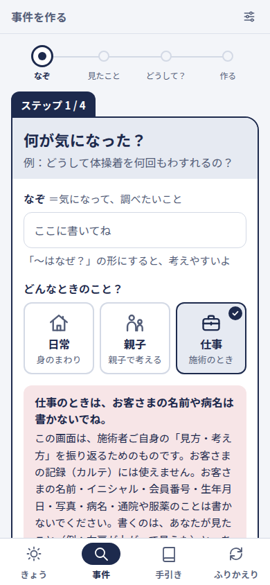

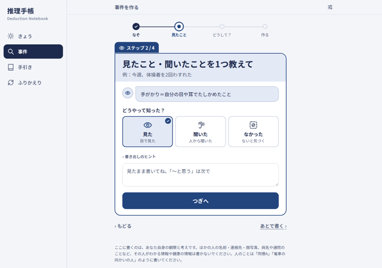

**押すと**：「事件を作る」で、事件と、書いてあれば最初の見たこと・見立てを1度に保存して、その事件の画面へ進みます（お知らせ「事件を作りました。」）。

### 2-7-3. 事件の画面（`/cases/{番号}`）— いまやること1つ

**役目：** 記録の中心です。開くと、その事件で **いまいちばんすべきこと** のカードが1枚だけ大きく出ます。手がかりを書く・見立てを書く・○× を付ける・予想を立てる・確かめる日を待つ・答え合わせ・閉じる、のどれか1つです。

**たとえると：** 捜査本部の机の上に、いま取りかかる書類が1枚だけ置いてあり、済んだ書類は脇にたたんで積んである状態です。脇の束はいつでも開いて読み返せますが、机の真ん中には「次はこれ」の1枚しかありません。

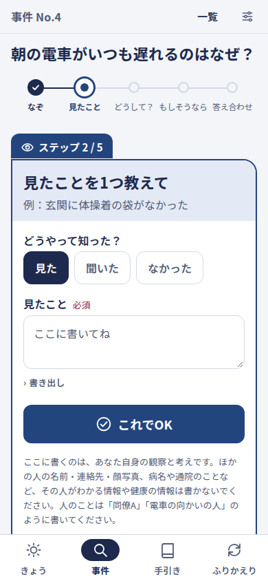

**上から並ぶもの（となぜその順か）**

1. **上の帯**：画面の名前「事件 No.6」と、右に「一覧」（事件の一覧へ戻る）。
2. **なぞ**：アプリの中で明朝体を使うのはここだけです（事件の題として目立たせる）。場面が日常でないとき・相棒モード・きっかけがあるときだけ、下に小さく1行（「仕事」「親子・相棒モード」「きっかけ：タスク『7:42 の電車に乗る』」）。
3. **進み具合の丸5つ**：なぞ・見たこと・どうして？・もしそうなら・答え合わせ。済んだ段は紺の丸にチェック、いまの段は段の色の大きな枠、まだの段はうすい丸です（`<x-ui.progress>`）。一覧の行の丸と同じ並びです。
4. **済んだ段の要約**（中身のある段だけ、1行ずつ）：
   - 「見たこと 3つ」：押すと、集めた見たことが **証拠品の荷札** として並びます（番号・種類・本文）。札の右の「直す」で、その見たことを直すカードになります。
   - 「どうして？ 2つ」：押すと、見立ての状態と本文の一覧。「見直す・○× をつける」で、見立てを見直すカードになります。
   - 「もしそうなら 1つ」：押すと、予想の文と「11月5日に確かめる」「当たり」などの結果。
   - いまの段には「・いまここ」と付きます。
5. **いまやることのカード**（1枚だけ）：左上のつまみに段の絵と「ステップ 3 / 5」、段の淡い色の面に問いと例、白い面に中身と横いっぱいの主なボタン。主なボタンの下に、吹き出しを1つだけ添えます。ふだんは **言葉の一言の説明**（「見立て＝『どうしてだろう？』の答えの案。当たっているかは、あとで確かめるよ。」）、ワトソンのひとことがあるときはそちら（5章の 5-13）。
6. **ほかにできること**：カードの下に、小さく1行ずつ。捜査中の事件では「見たことをもう1つ書く」「見立てをもう1つ書く」「見立てを見直す・○× をつける」「なぞを直す」「事件を閉じる」。押すと、その用事が **いまやることのカード** になります（住所に `?open=add-clue` などが付く）。いま出ているカードと同じ用事の行は出しません。見立てのある事件では、ここに「AI に相談する用に写す」ボタンも入ります（自分の ChatGPT などに貼るための文を作るボタン。別の章で説明します）。

前の画面でカードの外に並んでいた手がかりの一覧や見立てのカードは、4 の要約にたたみました。開けば全部読めますが、開かなければ、いまやることのカードだけが目に入ります。


**カードの種類（どのカードが出るか）**

ふだんは、`Queries/Cases/NextStep`（いまの一手を決める係。5章の 5-12）が決めた段のカードが出ます。

| いまの状態 | カード（つまみ） | 中身 | 主なボタン |
|---|---|---|---|
| 見たことがまだない | 「見たことを1つ教えて」（目・紺・ステップ 2 / 5） | どうやって知った？（見た・聞いた・なかった の札）、見たことの欄、「› 書き出し」（たたんである） | これでOK |
| 見立てがまだない | 「どうしてだと思う？」（はてな・からし色・3 / 5） | 見立ての欄、「› ほかの説明の型（押すと書き出しが入る）」、前にわかったこと（屋根裏の棚の候補） | これでOK |
| 見立てが全部ちがった | 「見立てが全部ちがったよ。ほかの理由は？」 | 同じ | これでOK |
| 予想を立てる前で、まだ ○× のない見たことがある | 「この見立てに合う？」（はてな・からし色・3 / 5） | 見立ての引用、見たことの荷札ごとに大きな ○（合う）・×（合わない）。× があれば「× があるね。この見立ては、ちがいそう？」と「ちがった にする」。○× は任意で、見立ての横の「とばす」で飛ばせる | 次へ：もしそうならを考える |
| 予想を立てる | 「もしそうなら、何が見える？」（矢印・深い緑・4 / 5） | 見立ての引用 → **見えるはずのこと**（「型を使う」で穴埋めの文が入る）→ 書くと **どのくらい自信ある？**（50〜95％の10枚の札。初めはどれも選ばない）→ 選ぶと **いつ確かめる？**（大きな日付と、明日・3日後・1週間後・カレンダーの予定の日のボタン）、「› 時刻や、前にわかったことも使う（なくてもOK）」、「保存すると、この文と自信は直せないよ。」 | この日に確かめる |
| 確かめる日を待っている | 「11月5日（木）に確かめよう」（カレンダー・深い緑・5 / 5） | カレンダーの紙のような大きな日付と、予想の文・自信。「やることに入れたよ。その日、今日の画面に出るよ。」（カレンダーとつないでいれば「カレンダーに入れたよ」）。下に小さく「先に答え合わせをする」「取り下げる」 | （主なボタンなし。待つ段） |
| 確かめる日が来た | 「答え合わせをしよう」（チェック・深い赤・5 / 5） | 前に書いた予想の文と「10月30日に書いた予想・自信 75%」 | 答え合わせをする（答え合わせの画面へ） |
| 当たりの見立てがあり、待っている予想がない | 「事件を閉じる？」（「『当たり』の見立てがあるよ」） | どうなった？（「解決！ わかった」「おあずけ まだわからない」の大きな2枚）、わかったことを一言（なくてもOK） | 事件を閉じる |
| 閉じた事件 | 「解決！」か「おあずけ」の丸いはんこと、閉じた日・結論。その下に「つまり、何がわかった？」のカード | 「つまり？」の欄。書き始めると「ほかに当てはまりそうなことは？」（たとえば？）が出る | 棚にしまう（屋根裏の棚へ） |
| 相棒モードで見せ合う前 | 渡し合いのカード（2-7-4） | | |

予想を立てるカードは、カードの中でも **1問ずつ** です。「見えるはずのこと」を書くまでは自信の札を、自信を選ぶまでは日付を隠します（JavaScript ではなく CSS の `:has` で隠す。`:has` が使えない古い端末では全部の問いが縦に並ぶ）。主なボタンはいつもカードの下にあります。


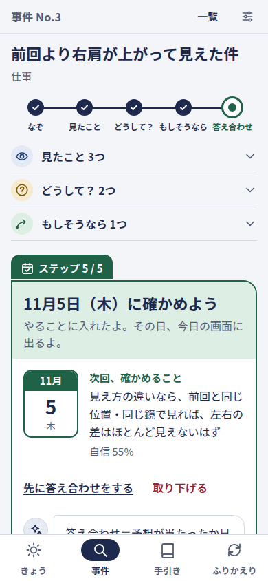

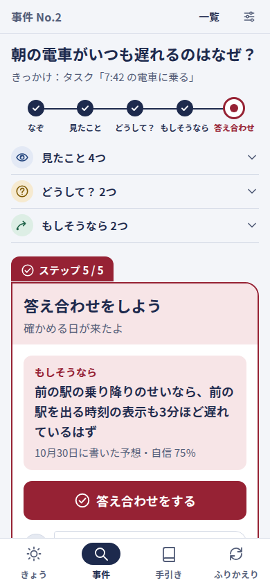

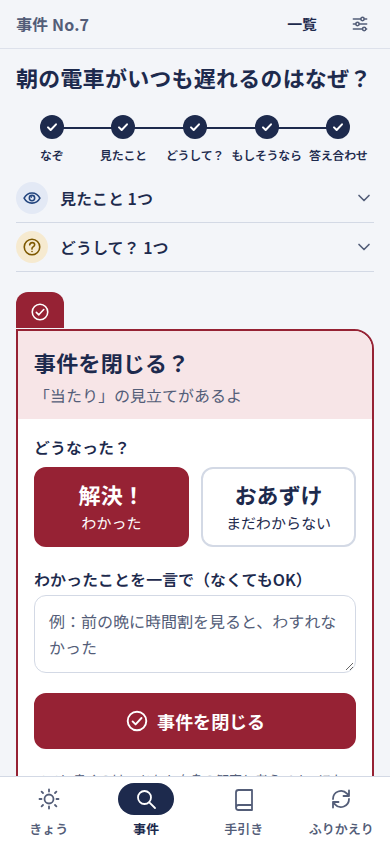

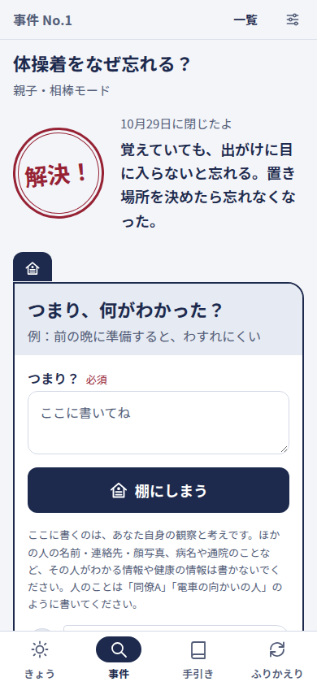

**閉じたあとの「つまり？・たとえば？」**：前の画面では、事件を閉じる欄の中に「つまり？」「たとえば？」も並んでいました。作り直しでは、閉じるカードでは「どうなったか」と一言だけを聞き、閉じたあとの画面で「つまり、何がわかった？」を1問ずつ聞きます。書いた「つまり？」は屋根裏の棚の知識として保存され、どの事件からわかったかも結ばれます（送り先は屋根裏の棚の受付 `attic.store`）。この事件からもう棚にしまったことがあれば、聞き直さずにそれを見せます。まだ答え合わせしていない予想が残っていれば、「答え合わせをする」の入口も出ます（閉じたあとでも結果は書ける）。閉じた事件の「ほかにできること」は「なぞを直す」「事件を開き直す」です。

**ほかにできることから開くカード**

| 押すもの | 出るカード | 中身 |
|---|---|---|
| 見たことをもう1つ書く | 「見たことを、もう1つ教えて」 | 見たことを書くカードと同じ。下に「もどる」 |
| 見立てをもう1つ書く | 「ほかの理由もありそう？」 | 見立てを書くカードと同じ。例の前に「2つあると、くらべられるよ」 |
| 見立てを見直す・○× をつける（要約の「見直す・○× をつける」も） | 「見立てを見直そう」 | 見立てごとに、状態の大きなボタン（検討中・有力・消えた・当たり。押すと「考えを変えた記録」が残る）・「○× をつける」・「もしそうならを立てる」・「直す」（本文を直す・消す） |
| 荷札の「直す」 | 「見たことを直す」 | 種類と本文の欄、「これで直す」、下に「この見たことを消す」（確かめてから消す。付けた ○× も消える） |
| なぞを直す | 「なぞを直す」 | なぞと場面の欄、「これで直す」、下に「事件を消す」（確かめてから消す。見たこと・見立て・予想・確かめるやることも消える） |
| 事件を閉じる | 「事件を閉じる？」 | 閉じることを勧めるカードと同じ。下に「もどる」 |

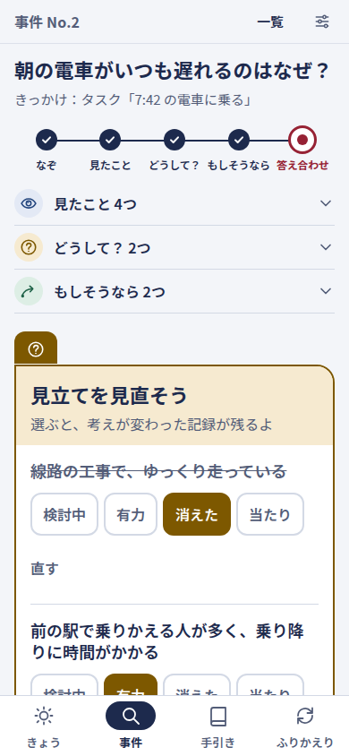

**どのカードを出すかの決め方**：部品 `<x-case-step.desk>` が上から順に確かめ、最初に当てはまったものを出します。① 閉じた事件 → 閉じたカード、② 住所の `?open=` の頼み（なぞを直す・見たことを直す・見たことをもう1つ・閉じる）、③ 相棒モードで見せ合う前 → 渡し合い、④ 見立てにかかわる `?open=` の頼み（見直す・見立てをもう1つ・○×・予想）、⑤ 予想を立てる段で、まだ ○× のない見たことがあれば ○× のカード、⑥ それ以外は `NextStep` の段。

**押したあと**：カードの中のボタンは、どれもふつうのフォームで送ります。保存すると、受付はふだん事件の画面へ戻すので、次のいまやることのカードが出ます（見たことを書いた → 次は「どうしてだと思う？」）。見直しや ○× のカードのように、同じカードのまま続けたいフォームは、隠し項目 `back_open` を送ります。受付（`RedirectsToCase`）は決まった値（`config/suiri.php` の `case_board.back_open`）のときだけ、`?open=` を付けて同じカードに戻します。

**子ども向けと仕事の場面**：ふだんの場面が親子の人には、見立てが「かも」、「いつ確かめる？」が「いつ見に行く？」、主なボタンが「この日に見に行く」、待つカードが「11月5日に見に行こう」、閉じた事件のはんこが「わかった！」、屋根裏の棚が「図鑑」になります（`config/suiri.php` の `case_board.kid`）。仕事の場面の事件では、手がかりの札が「見た・触れた・測った」「ご本人の言葉」、予想が「次回、何が見えるはず？」「次回、確かめること」になり、見たことのカードの欄の上に施術者向けの注意（`<x-case.work-caution>`）が出ます。仕事の場面で「よくなった・楽になった」などと書くと、ワトソンが「施術のほかに考えられることは？」と、自然な経過・生活の変化・測り方のばらつき・期待などのほかの原因を考えるよう問いかけます。

**パソコンでは**：いまやることのカードを左の広い列に、進み具合を右の細い列に置きます。右の列は5つの段を縦に並べた目次で、中身のある段は要約（開ける）、ない段は丸と名前、いまの段には段の色の枠と「いまここ」が付きます。

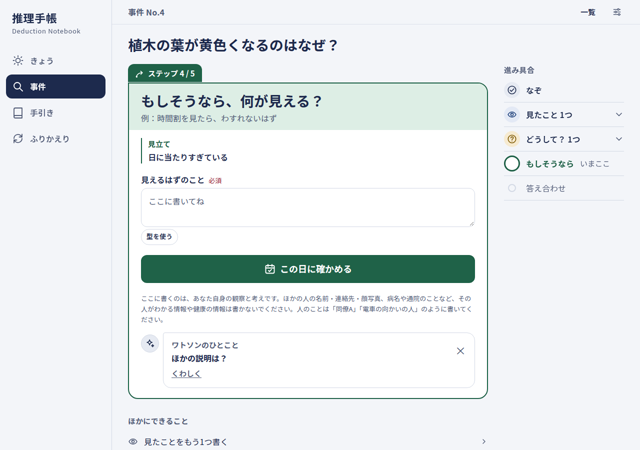

**押すと**

| 押すもの | 起きること |
|---|---|
| これでOK（見たこと） | 見たことを保存して、次のカードへ（`POST /cases/{番号}/clues`） |
| これでOK（見立て） | 見立てを保存して、次のカードへ（`POST /cases/{番号}/hypotheses`） |
| ○ ／ × | 印を付ける（`PUT /hypotheses/{番号}/clues/{番号}`）。付いている印をもう一度押すと外す（`DELETE`）。同じ ○× のカードに戻る |
| ちがった にする・状態のボタン | 見立ての状態を変え、「考えを変えた記録」を残す（`PATCH /hypotheses/{番号}`） |
| 次へ：もしそうならを考える・とばす | 予想を立てるカードへ（`?open=predict-{番号}`） |
| この日に確かめる | 予想と **確かめるタスク**（期日＝確かめる日）を1度に作る（`POST /hypotheses/{番号}/predictions`）。次は待つカード |
| 先に答え合わせをする・答え合わせをする | 答え合わせの画面へ |
| 取り下げる | 予想を取り下げる（確かめてから）。まだ済んでいない確かめるタスクは消す。予想の文は記録として残る |
| 事件を閉じる | 閉じ方と一言を保存（`POST /cases/{番号}/close`）。次は閉じた事件の画面 |
| 棚にしまう | 「つまり？」「たとえば？」を屋根裏の棚に保存（`POST /attic`）。どの事件からかも結ぶ |
| 事件を開き直す | 捜査中に戻す（`DELETE /cases/{番号}/close`） |
| ワトソンのひとことの × | その規則を、この事件ではもう出さない（`POST /cases/{番号}/hints/{規則}`） |

### 2-7-4. 相棒の渡し合い（相棒モードの事件）

**役目：** 1台のスマホを相棒（例：長男）と自分で **渡し合って**、互いの見立てを見ないで書き、あとで一緒に見せ合います（要件 C-11）。

**たとえると：** クイズ番組で、2人が別々のフリップに答えを書いて、「せーの」で同時に見せるのと同じです。先に相手の答えを見ると、つられてしまうからです。ここではフリップの代わりに、スマホそのものを手渡しします。

相棒モードは、設定に **相棒の名前** を入れると使えるようになり、事件を作る1問目の「長男といっしょに考える？」で選びます。見せ合う前の事件を開くと、いまやることのカードが、次の段の渡し合いになります。上の進み具合は「長男さん → 父さん → 見せ合う」の丸3つです（呼び名は、相棒の名前と設定の表示名に「さん」を付けたもの）。渡し合いの間は、ふだんの5つの丸と済んだ段の要約をスマホでは出さず、付箋と主なボタンを最初の画面に収めます。見本の画像には、自分の表示名が「父さん」のものと「ワトソン（見本）」（見本の利用者の名前）のものが混ざっています。

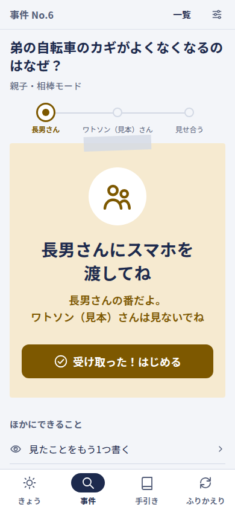

1. **相棒にスマホを渡す**：大きな付箋（`<x-ui.handoff>`）に「長男さんにスマホを渡してね」「長男さんの番だよ。父さんは見ないでね」。受け取った人が **「受け取った！はじめる」** を押します。だれの番かを、文字の大きさと色ではっきり見せるためです。
2. **相棒が書く**：カード「どうしてだと思う？」（ステップ 1 / 3）。なぞと、見たことの荷札（読むだけ）を見ながら、「長男さんの見立て」を1つ書いて「これでOK」。まだ書けなければ、下の「あとで書く（父さんの番へ）」で飛ばせます。
3. **相棒が ○ を付ける**：カード「合う手がかりに ○ を付けよう」。いま書いた見立てと、荷札ごとの大きな ○・× のボタン。○× は、あとで見せ合うときに「見ていたところの違い」を出すのに使います（付けなくても進める）。主なボタンは **「書けたら、父さんにわたしてね」**。下に「ほかの理由も書く」。
4. **自分の番**：同じ流れ（渡す付箋 → 書く → ○ を付ける）で、ステップ 2 / 3。最後のボタンは「書けたら、長男さんをよぼう」です。
5. **いっしょに見せ合おう**：カード「2人とも書けたね！」（ステップ 3 / 3）。2人がそれぞれ何個書いたか（文は見せない）を並べ、**「いっしょに見せ合おう！」**。相棒がまだ書いていなければ「まだ」と出て、相棒の番に戻るリンクも出ます（書かなくても見せ合える）。
6. **見せ合い**：カード「2人の見立てを並べたよ」。上に2人の見立てを（スマホでは上下に）並べ、下に **手がかりの荷札** ごとに、それぞれが ○ や × を付けた見立ての番号（例「父 ○1」「長 印なし」）を2人の丸い印で並べます。付け方が分かれた荷札はからし色にして **「見方が分かれたよ」** と出し、いちばん下に「『どうしてそこに ○ を付けたの？』と聞いてみよう」。勝ち負けではなく、話すきっかけにするための並びです。

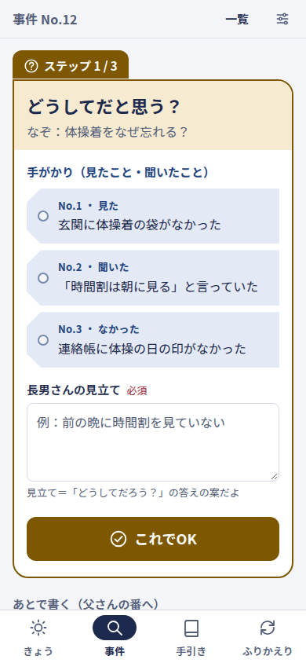

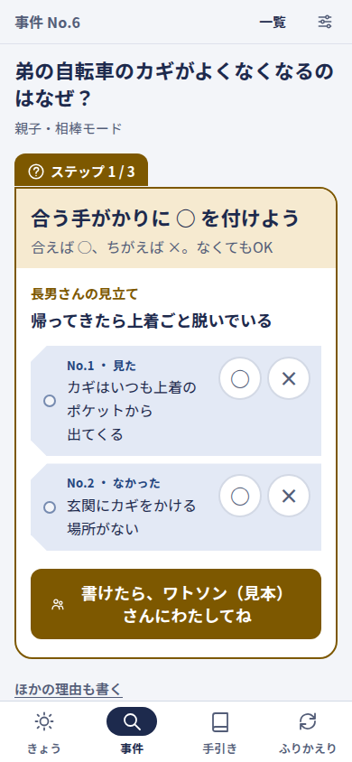

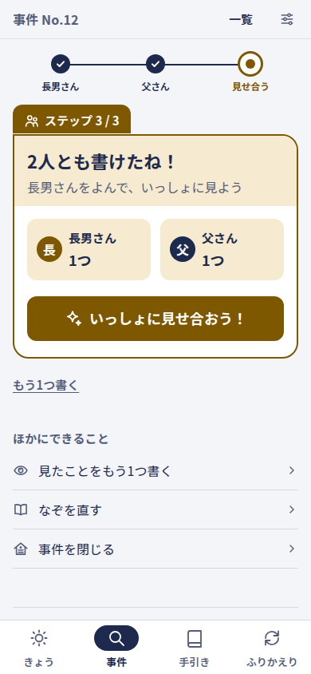


**しくみ**

- いまの番は住所の `?turn=partner`・`?turn=self` で決まります。見せ合う前は、いまの番の人の見立てだけを画面に渡し、もう片方の見立ての文は **HTML にも入れません**。済んだ段の要約にも、見立ての一覧を出しません。
- 「受け取った！はじめる」「ほかの理由も書く」「書けたら、長男さんをよぼう」は、同じページの中の印（`#relay-partner-write` など）へのリンクです。印の付いた部分だけを CSS（`:target`）で見せるので、JavaScript なしで動き、ページを読み直しても同じ所に戻ります。
- 「書けたら、父さんにわたしてね」は自分の番の住所（`?turn=self`）へのリンク、「いっしょに見せ合おう！」は見せ合う受付（`POST /cases/{番号}/reveal`）へのフォームです。見せ合った直後は、見せ合いの場所（`#reveal`）へ戻ります。
- 見せ合ったあとは、ふだんの事件の画面（いまの一手のカード）に戻り、見せ合いはカードの下の「見せ合い（ちがい 2つ）」の欄にいつでも開ける形で残ります。予想は、見せ合ったあとでしか立てられません。
- 「隠す」は、**同じ端末で一緒に使うための画面の約束** です。同じアカウントの中で相手の見立てを守る鍵ではありません（5章の 5-15）。

### 2-7-5. 仕事の場面の事件

並びとカードは同じで、言葉だけが変わります。

| ふだんの言葉 | 仕事の場面での表示 | 出る所 |
|---|---|---|
| 見た | 見た・触れた・測った | 作る画面の2問目の札・見たことのカード・荷札 |
| 聞いた | ご本人の言葉 | 同じ |
| 見立て | 見立て（医療の判断ではない、という一言が添えられる） | 見立てのカード・予想のカードの引用 |
| もしそうなら、何が見える？ | 次回、何が見えるはず？ | 予想のカードの問い |
| もしそうなら | 次回、確かめること | 待つカード・要約 |

事件を作る1問目で「仕事」を選んだときの注意（2-7-2）と、事件の画面の見たことのカードの欄の上に出る注意（「お客さまの記録には使えません」）で、他人の記録を持たない決まりを、書く瞬間に思い出せるようにしています。上の「確かめる日を待っているとき」の画像は、仕事の場面の見本の事件です。

### 2-7-6. 答え合わせ（`/predictions/{番号}`）

**役目：** 確かめる日が来た予想の結果を、4つのボタンから1つ選んで残す画面です。

**たとえると：** テストの答案を返してもらったときに、自分が最初に書いた答えを見ながら丸付けをすることです。書き直した答案ではなく、**最初に書いた答え** を見るのが大事です。


**上から並ぶもの（となぜその順か）**

1. **「‹ 事件 No.2」となぞ**：どの事件の予想かと、戻るリンク。
2. **前に書いた予想**：「この予想を書いたのは 10月30日（金）21:30だよ」と、予想の文をかぎかっこで大きく。下に鍵の絵と「あとから変えられないよ」、右に「くわしく」（押すと、自信・書いた日時（年まで）・確かめる日・見立て・使った屋根裏の知識が開く）。結果を選ぶ前に必ず目に入るよう、一番上に置きます（後知恵を防ぐため。要件 C-7）。前の画面は、ここに確かさや見立てなどを全部並べていました。いちばん大事な「いつ・何と書いたか」が埋もれないよう、ほかは「くわしく」にたたみました。
3. **「実際はどうだった？」のカード**（チェック・深い赤）：見出しの下に「答え合わせ＝予想が当たったか見ること」。**4つの大きなボタン**（当たり・外れ・どちらとも言えない・前提が崩れた）は、答え合わせのはんこ（`<x-ui.stamp>`）と同じ色と輪の形（当たり＝赤い二重の輪、外れ＝紺の輪、どちらとも言えない＝からし色の輪、前提が崩れた＝灰色の点線の輪）にしてあり、選ぶとその色で塗られます。
   - **外れ** を選んだときだけ、「どこで見落とした？」の札（手がかりが足りなかった・見立てが1つだけだった・思い込みがあった・確かめ方がずれていた・偶然）と「外れは、次の推理の材料だよ。」が出ます。外れのときは必ず選びます。
   - **どちらとも言えない・前提が崩れた** を選ぶと、「前提が崩れた＝そもそも前提がちがったこと。この2つは、当たり外れに数えないよ。」が出ます。
   - どれかを選ぶと「ひとことメモ（書けたら）」の欄が出ます。
   - 選ぶ前に入力欄を全部見せないのは、ここでも「いまやること（結果を1つ選ぶ）」をはっきりさせるためです。切り替えは JavaScript ではなく CSS の `:has` です。
4. 横いっぱいの **「結果を保存する」** と、個人情報の注意書き。

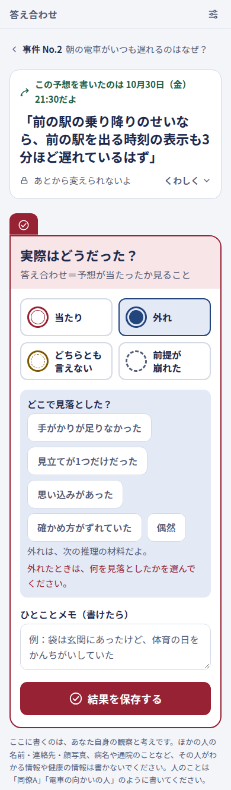

**押すと**：結果を保存し、確かめるタスクを **自動で済み** にします（カレンダーの予定も見張り役が直します）。外れならノーベリ帳に載ります。

**済ませたあとに開くと**：前に書いた予想の右上に、**「確かめた」の丸いはんこ**（当たり・外れ…）が押された形になります。その下に「10月31日（土）に確かめたよ」・どこで見落としたか・メモ。外れなら「この外れは『ノーベリ帳』に入ったよ。名探偵も外すよ。直せるのが強さだよ。」と「ノーベリ帳を開く」。その下に、**次の一手** を1つだけ大きく出します。

| 結果 | 次の一手 |
|---|---|
| 当たりで、見立てがまだ「当たり」でない | カード「見立てを『当たり』にする？」と見立ての本文、「『当たり』にする」（押すと「考えを変えた記録」が残る）。下に「このままにして事件にもどる」 |
| 外れで、見立てがまだ「消えた」でない | 「見立てを『消えた』にする？」（同じ形） |
| どちらとも言えない・前提が崩れた | 「もう一度、予想してみる？」「確かめ方を変えると、次はわかるかも。」と「新しい予想を立てる」 |
| どれにも当たらない（見立てがもうその状態・消えた見立て・閉じた事件） | 「事件にもどる」だけ |

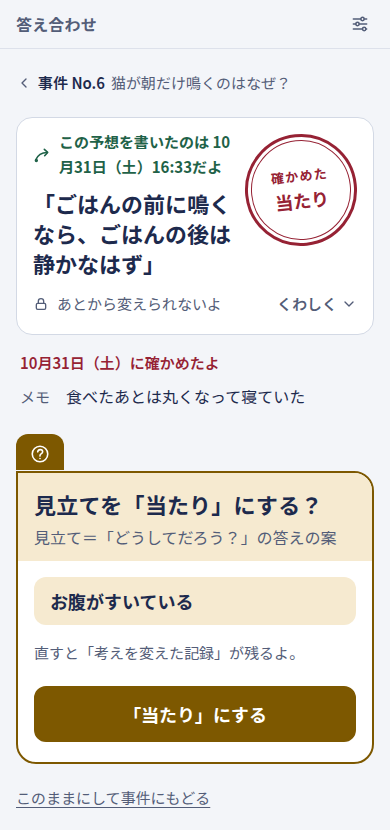

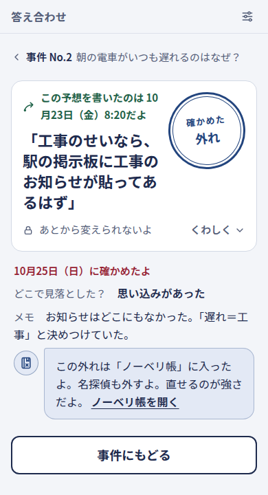

取り下げた予想を開いたときは、「この予想は 10月31日に取り下げたよ。文はそのまま残してあるよ。」と「事件にもどる」だけを出します。ふだんの場面が親子の人には、結果が「あたり・はずれ・わからない・そもそもちがった」、見落としの問いが「どこでまちがえた？」になります。

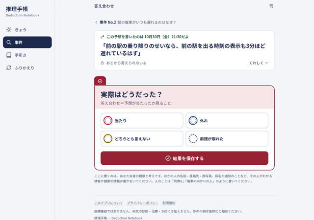

**裏側（事件）**

| 項目 | 中身 |
|---|---|
| 住所 | 事件 `GET /cases?status=&scene=`・`GET /cases/create`・`POST /cases/draft`・`POST /cases`・`GET /cases/{case}?open=&turn=`・`PATCH/DELETE /cases/{case}`・閉じる `POST/DELETE /cases/{case}/close`・見せ合う `POST /cases/{case}/reveal`・手がかり `POST /cases/{case}/clues`・`PATCH/DELETE /clues/{clue}`・見立て `POST /cases/{case}/hypotheses`・`PATCH/DELETE /hypotheses/{hypothesis}`・○× `PUT/DELETE /hypotheses/{hypothesis}/clues/{clue}`・予想 `POST /hypotheses/{hypothesis}/predictions`・答え合わせ `GET /predictions/{prediction}`・`POST /predictions/{prediction}/result`・取り下げ `POST /predictions/{prediction}/withdraw`・ひとことを閉じる `POST /cases/{case}/hints/{rule}`・閉じたあとの「つまり？」 `POST /attic` |
| 受付 | `src/app/Http/Controllers/Cases/`：CRUD は `CaseController`・`ClueController`・`HypothesisController`・`FitController`・`PredictionController`、CRUD でない動きは1アクションの `CloseCaseController`・`ReopenCaseController`・`RevealHypothesesController`・`ResolvePredictionController`・`WithdrawPredictionController`・`DismissHintController`・`DraftCaseController`。保存のあと事件の画面へ戻す決まり（`back_open`）は `Cases/Concerns/RedirectsToCase` |
| 用事 | `Actions/Cases/`（`CreateCase`・`AddClue`・`AddHypothesis`・`ChangeHypothesisStatus`・`SetFit`・`MakePrediction`・`ResolvePrediction`・`WithdrawPrediction`・`CloseCase`・`RevealHypotheses` など）・`Actions/Attic/SaveAtticNote` |
| 組み立て | `Queries/Cases/CaseBoardQuery`（事件の画面の全部）・`NextStep`（いまの一手）・`RevealBoard`（見せ合いの並び）・`SuggestionsQuery`（書き出しの提案）・`CaseListQuery`（一覧と段の丸のための数）・`NewCaseDraft`（作る画面の初めの値）・`Services/Watson/WatsonNotes`（ひとこと） |
| 画面 | `src/resources/views/cases/`（`index` 一覧・`create-steps` 作る・`board` 事件の画面）・`predictions/show.blade.php` 答え合わせ |
| 部品 | 作る `components/case-new/`・事件の画面 `components/case-step/`・渡し合い `components/case-partner/`・一覧と答え合わせ `components/case/`（`list-filter`・`summary`・`prediction-original`・`resolve-form`・`resolve-result`）・共通 `components/ui/`（`step-card`・`progress`・`big-button`・`evidence-tag`・`stamp`・`handoff` など） |
| 動き | 1問ずつ進む `src/resources/js/parts/stepper.js`・書き出しのボタン `src/resources/js/parts/suggest-chips.js`（どちらも JavaScript が動かなくてもフォームは送れる） |
| 言葉 | `src/config/suiri.php` の `case_new`（作る）・`case_board`（事件の画面）・`case_partner`（渡し合い）・`case_list`（一覧）・`resolve`（答え合わせ） |

部品の1つずつの役目と受け取る値は [部品説明書の5章](../design/components.md) にあります。

---

## 2-8. 手引き

**役目：** ホームズの考え方を、原作の場面から学ぶ画面です。毎日の記録とは別の「読み物と練習」の棚です。

**たとえると：** 探偵事務所の本棚です。いちばん手前に名場面のクイズカードの箱があり、その奥に、ホームズの10のわざの解説書、毎日の練習メニュー表、3つの考え方の入門書が並んでいます。

手引きの画面（入口と名推理カード1枚を除く）の上には、**入口・名推理カード・練習・3つの考え方** の4つのタブが並び、行き来できます。教材の中身はすべて JSON のファイル（`src/database/data/guide/`：`overview.json`・`skills.json`・`scenes.json`・`practices.json`・`reasoning.json`）にあり、`Support/Guide/GuideLibrary` が読みます。作り直しでは「1画面に『いまやること』は1つ」の原則に沿って、入口でいちばん大きく見せるものを「名推理カードで遊ぼう」の1つにし、ほかの行き先はその下に控えめに並べました。

### 2-8-1. 手引きの入口（`/guide`）

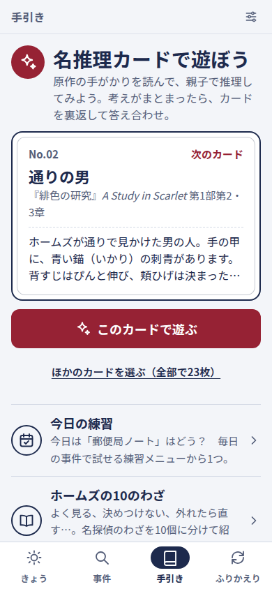

**上から並ぶもの（となぜその順か）**

1. **名推理カードで遊ぼう**（いちばん大きく）：遊び方の一言（「原作の手がかりを読んで、親子で推理してみよう。…」）、次に遊ぶカード（まだ推理を書いていない最初の1枚）の見本を本物のカードの形で（番号・題・作品名・表の書き出し）、横いっぱいの **「このカードで遊ぶ」**、下に小さく「ほかのカードを選ぶ（全部で23枚）」。全部のカードに書き終えたら、最初のカードに戻ります（右上の札が「はじめのカード」になる）。
2. **ほかの行き先**：今日の練習（「今日は『郵便局ノート』はどう？」のように、その日の練習の名前入り）・ホームズの10のわざ・3つの考え方を、絵・名前・一言の行で。入口では行き先の一覧そのものが案内なので、ほかの手引きの画面の上にあるタブは置きません（同じ行き先を二重に出さない）。
3. **ホームズの10のわざ**：手帳の段（手がかり：見た／聞いた／なかった・見立て（どうして？）・合う・合わない（○×）・もしそうなら・答え合わせ・原因をさかのぼる・屋根裏の棚・ノーベリ帳）ごとに、段の色の丸の絵と名前、初めて出る言葉の一言の説明（例「見立て＝『どうしてだろう？』の答えの案。2つ以上出してみよう。」）、その段で練習になるわざ（S1〜S10）と、そのわざが出てくる原作の場面へのリンク。段によっては「アブダクション」「演繹」「帰納」の札が付きます。ふだんの場面が親子の人には、わざの子ども向けの名前を先に出します。[1章](01-birdseye.md) の対応表を画面にしたものです。

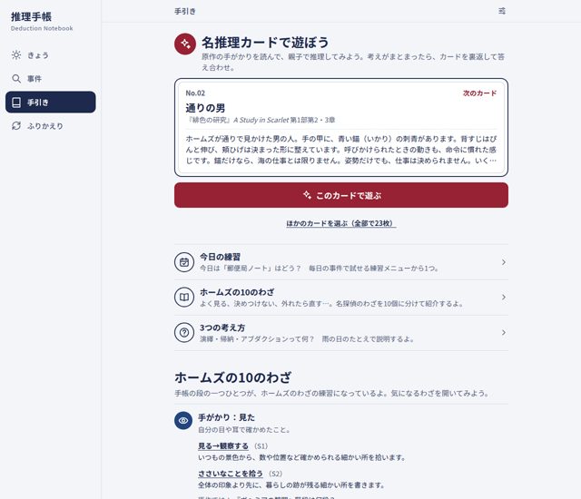

### 2-8-2. わざ（`/guide/skills/S1` など）

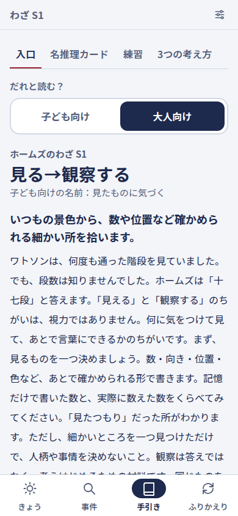

上から：タブ → **「だれと読む？」**（子ども向け・大人向けの横いっぱいの大きな2つのボタン）→ 「ホームズのわざ S1」と名前（例「見る→観察する」。子ども向けの名前「見たものに気づく」も小さく）→ 一言のまとめと説明（選んだ向き）→ **原作の英語の短い引用と出典**（日本語は自前の要約で、既存の訳文は写さない）→ 緑のつまみの紙「ふだんの練習の例」（大人なら・子どもなら・施術者なら）と「やりがちなこと」→ 「このわざを練習しよう」（このわざの練習メニューと、このわざが出てくる名推理カード）→ 前と次のわざ。

切り替えはリンク（`?kid=1`・`?kid=0`）なので JavaScript は要りません。何も選んでいなければ、ふだんの場面が親子の人には子ども向けを出します。

### 2-8-3. 3つの考え方（`/guide/reasoning`）

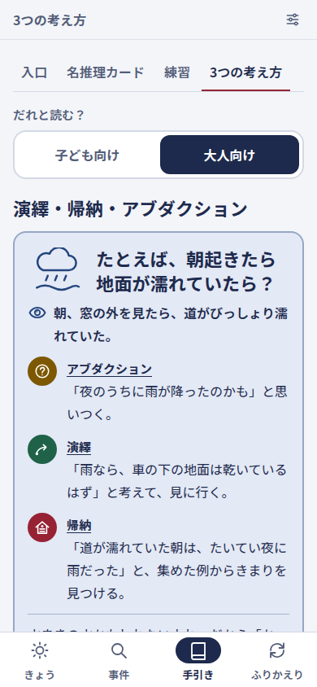

上から：タブ → 「だれと読む？」の切り替え → **身近なたとえ**「たとえば、朝起きたら地面が濡れていたら？」（雨雲と水たまりの絵。見たこと「道がびっしょり濡れていた」に、アブダクション＝「夜のうちに雨が降ったのかも」と思いつく、演繹＝「雨なら、車の下の地面は乾いているはず」と考えて見に行く、帰納＝「道が濡れていた朝は、たいてい夜に雨だった」ときまりを見つける、を1行ずつ。最後に「水まきの水かもしれない。だから『かも』は2つ以上出して確かめよう」）→ はじめの説明（選んだ向き）→ 流れの順の3つ（1 アブダクション → 2 演繹 → 3 帰納）。それぞれ段の色のつまみの付いた紙で、子ども向けの呼び名・このアプリのどの段で使うかの札・説明・どのくらい確か？・原作では（カードで推理してみる）・この手帳では → いちばん下に注意（ホームズが「演繹」と呼んだものの多くは、論理学の演繹とは少し違う、という話）。

たとえは、向きの切り替えに関係なく、大人にも子どもにも同じものを出します。保護者にも子どもにも同じたとえで伝わるようにするためです。毎日の画面には出さない難しい言葉（[言葉のルール](../design/words.md) の 3）を、ここでだけ説明します。

### 2-8-4. 名推理カード（一覧 `/guide/scenes`・1枚 `/guide/scenes/{key}`）

**役目：** 原作の場面を、**手がかりだけを読んで自分で推理してから**、裏返してホームズの推理と比べる練習です（L-2）。

**たとえると：** 推理クイズの本で、答えのページを手で隠して、自分の答えを考えてからめくるのと同じです。

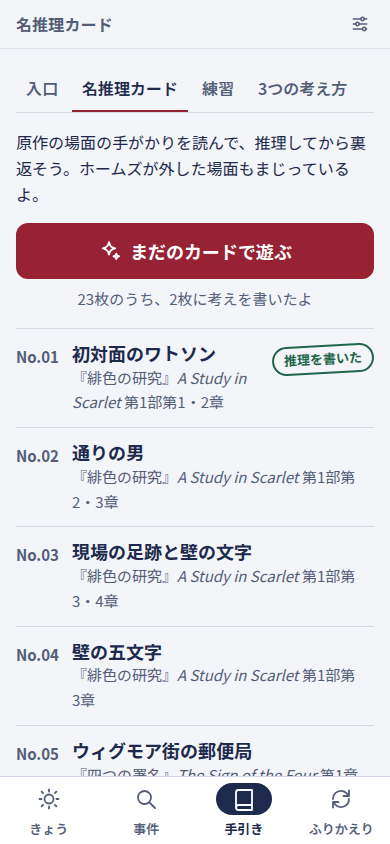

**一覧**：遊び方の一言（「ホームズが外した場面もまじっているよ」）→ 大きな **「まだのカードで遊ぶ」**（まだ推理を書いていない最初のカードへ。全部書いたら「最初のカードから遊ぶ」）と、書いた枚数（「23枚のうち、2枚に考えを書いたよ」）→ カード23枚の一覧。1行ごとに番号（No.01）・題・作品名と章、ホームズが外した場面には赤い「ホームズが外した」のはんこ、自分が推理を書いたカードには緑の「推理を書いた」のはんこ。

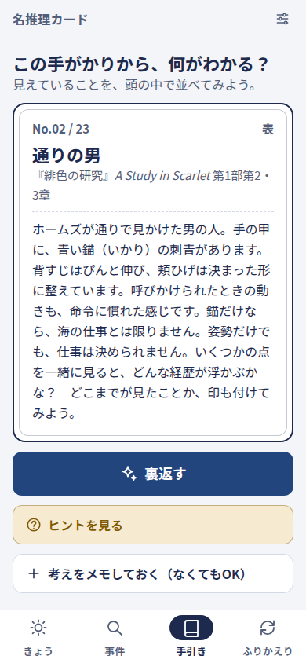

**表**：大きな問い「この手がかりから、何がわかる？」とひとこと（親子の人には「まずは声に出して言ってみよう」、ほかの人には「見えていることを、頭の中で並べてみよう」）→ **カード**（二重の枠。番号・題・作品名と章・手がかり。ホームズが見たものだけで、推理の答えは書いていない）→ 横いっぱいの **「裏返す」** → 「ヒントを見る」（押すと開く。親子の人には初めから開いている）→ 「考えをメモしておく（なくてもOK）」（押すと欄・「メモして裏返す」・注意書きが開く。前に書いたメモがあれば入れて開いておく）→ 小さく「カードの一覧にもどる」。カードと「裏返す」を最初の画面に収めるため、表の画面にはタブを置きません。

メモを書かなくても裏返せます。入力欄を最初から開いておくと、いまやること（考えて裏返す）がぼやけるので、メモの欄はたたんでおき、親子の人には「声に出して言う」ことを勧めています。表の画面の HTML には、ホームズの推理を **最初から入れていません**（受付 `Guide\SceneController` が、裏だけに出す欄を外して渡す）。ページのソースを見ても答えは分かりません。

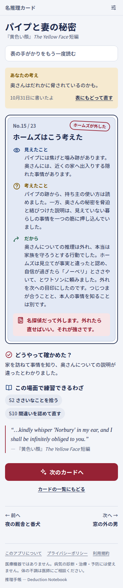

**裏**（`?side=back`）：題と作品名 → 「表の手がかりをもう一度読む」（押すと開く）→ **あなたの考え**（からし色の付箋。書いた日と「表にもどって直す」。書かずに裏返したときは「表にもどって書いてみる」）→ カードの裏 **「ホームズはこう考えた」**（ホームズの推理を「見えたこと・考えたこと・だから」に分け、段の絵と色を付ける。外した場面には「名探偵だって外します。外れたら直せばいい。それが強さです。」の一言）→ どうやって確かめた？ → この場面で練習できるわざ → 原作の英語の引用 → 横いっぱいの **「次のカードへ」**（最後のカードなら「カードの一覧にもどる」）→ 前と次のカード。自分の考えとホームズの推理を上下に並べ、どこが同じでどこが違うかを見比べられるようにしています。

**押すと**：「裏返す」「メモして裏返す」で `POST /guide/scenes/{key}/attempt` に送ります。メモが書いてあれば保存し（同じカードは上書き）、空なら保存せずに、どちらも裏へ進みます（保存したときは「あなたの考えをとっておいたよ。」のお知らせ）。

### 2-8-5. 練習メニュー（`/guide/practices`）

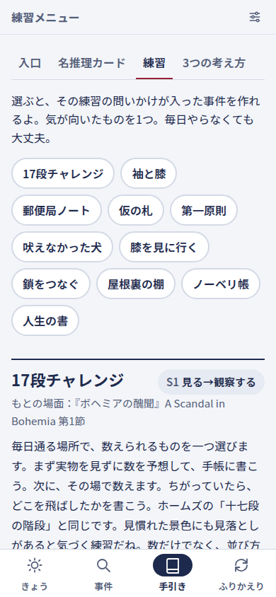

上から：タブ → 使い方の一言（「選ぶと、その練習の問いかけが入った事件を作れるよ。気が向いたものを1つ。毎日やらなくても大丈夫。」）→ **11種の名前のボタン**（押すと下の説明へ飛ぶ。11種をひと目で見て選べるように）→ メニューごとの説明（名前とわざの札・もとの場面・大人向けの説明・子ども向けの説明（親子の人には子ども向けを先に）・例のなぞ）と **「この練習を始める」**。

11種：17段チャレンジ・袖と膝・郵便局ノート・仮の札・第一原則・吠えなかった犬・膝を見に行く・鎖をつなぐ・屋根裏の棚・ノーベリ帳・人生の書。

**押すと**：「この練習を始める」で、そのメニューの問いかけ（なぞの例・手がかりの書き方・見立ての案内）が入った **事件を作る画面** へ進みます（`/cases/create?origin=practice&practice={key}`）。

**裏側（手引き）**

| 項目 | 中身 |
|---|---|
| 住所 | `GET /guide`・`/guide/reasoning`・`/guide/skills/{key}`・`/guide/scenes`・`/guide/scenes/{key}`・`POST /guide/scenes/{key}/attempt`・`GET /guide/practices` |
| 受付 | `Guide\GuideController`（入口・3つの考え方）・`SkillController`・`SceneController`・`SaveSceneAttemptController`・`PracticeController` |
| 教材を読む係 | `Support/Guide/GuideLibrary`（`nextScene()` 次に遊ぶカード・`position()` 何枚目か・`neighbors()` 前と次 など）・`ReasoningSteps`（推理を事実・推理・結論に分ける）・`SceneAttemptReader`（自分の推理を読む）・`Services/Guide/DailyPractice`（今日の練習） |
| 画面 | `src/resources/views/guide/`（`index`・`reasoning`・`skills/show`・`scenes/index`・`scenes/show`・`practices/index`）・部品 `components/guide/` |
| 言葉 | 教材の文は `src/database/data/guide/*.json`、画面の決まった言葉は `src/config/suiri.php` の `guide`（`tabs`・`titles`・`audience`・`scenes`・`front`・`back`・`skill`・`practices`・`reasoning`） |

---

## 2-9. ふりかえり（`/review`）

**役目：** 1週間の記録を数字で見て、「なぜそうなった？」の問いに答える画面です（R-1〜R-3）。

**たとえると：** 部活の週末ミーティングです。今週の記録表を見てから、「なぜ今週はうまくいった？」を話し合い、ノートに書きます。

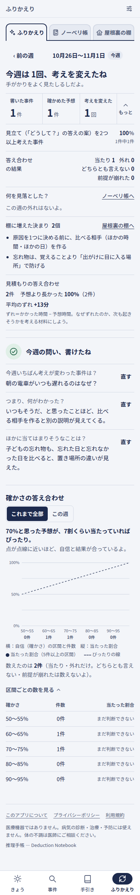

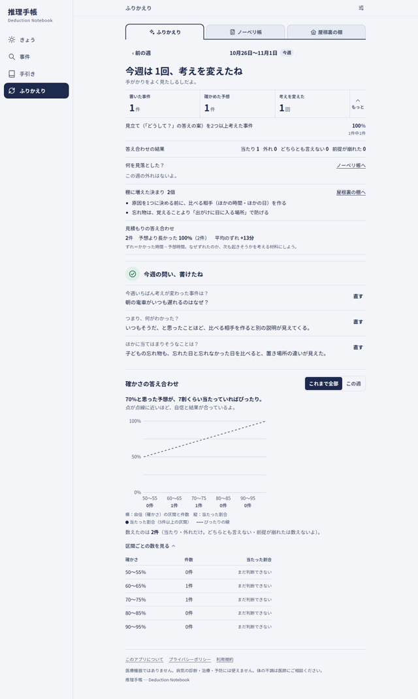

**上から並ぶもの（となぜその順か）**

まず数字と内訳で週を見てから、問いに答える、という **ふりかえる順** に並べています。

1. **切り替え**：ふりかえり／ノーベリ帳／屋根裏の棚。ナビの「ふりかえり」から入った先の、中の目次です。
2. **週の帯**：「‹ 前の週」・「10月26日〜11月1日」・（今週なら）「今週」の札・次の週（今週より先へは進めない）。
3. **数字の札4つ**：記録した事件／見立てを2つ以上（その割合と「1件中1件」）／答え合わせした予想（「当たり1・外れ0」）／考えを変えた（見立ての状態を変えた回数）。答え合わせの結果はここにまとめ、下の内訳では二重に出しません。
4. **この週の内訳**：外れから学んだこと（何を見落とした？。「ノーベリ帳へ」）／屋根裏の棚に増えた知識（「屋根裏の棚へ」）／見積もりの答え合わせ（予想より長かった割合と平均のずれ。「なぜずれたのか、次も起きそうかを考える材料にします。」）。
5. **週の問い**：「今週いちばん考えが変わった事件は？」（その週に動いた事件から選ぶ）・「つまり？」・「たとえば？」と **「保存する」**（同じ週は上書き）。問いの補足は「どうだった？」ではなく「なぜそうなった？」の形です（理由を説明させるほうが学びが深まるという研究によります）。
6. **確かさの答え合わせ**：「これまで全部／この週」の切り替え → 図（横が確かさ、縦が当たった割合。点線は「確かさ＝当たった割合」のぴったりの線。外部のグラフの部品を使わず SVG で描く）→ 区間ごとの表（確かさ・件数・当たった割合）。数えるのは当たりと外れだけで、**件数が5件より少ない区間は「まだ判断できない」** と出し、点も打ちません。少ない件数で「自信過剰」などと決めつけないためです。

**続けた日数・点数・順位は出しません。** 数が0でも責める言葉は出しません（R-6）。

**裏側**

| 項目 | 中身 |
|---|---|
| 住所 | `GET /review/{week?}`（`week` は週の月曜日 `2026-10-26` の形。省略は今週）・`PUT /review/{week}` |
| 受付 | `Review\ReviewController` |
| 組み立て | `Queries/Review/WeekReviewQuery`・`WeekCasesQuery`・`Services/Review/WeeklyStats`（数字）・`Calibration`（確かさの答え合わせ）・`EstimateCheck`（見積もり）・`ReviewWeek`（週の計算）・用事 `Actions/Review/SaveWeeklyReflection` |
| 画面 | `src/resources/views/review/show.blade.php`・部品 `components/review/`（`tabs`・`week-nav`・`stat`・`week-details`・`reflection-form`・`calibration`・`calibration-chart`） |

---

## 2-10. ノーベリ帳（`/norbury`）

**役目：** 外れた予想と「何を見落とした？」を集める帳面です（R-4）。どこを見落としやすいかが分かると、次の見立てで同じところを確かめられます。

**たとえると：** テストの間違い直しノートです。名前は、ホームズが自分の読み違いを戒めるために「ノーベリ」とささやいてくれ、とワトソンに頼んだ『黄色い顔』の場面から取っています。

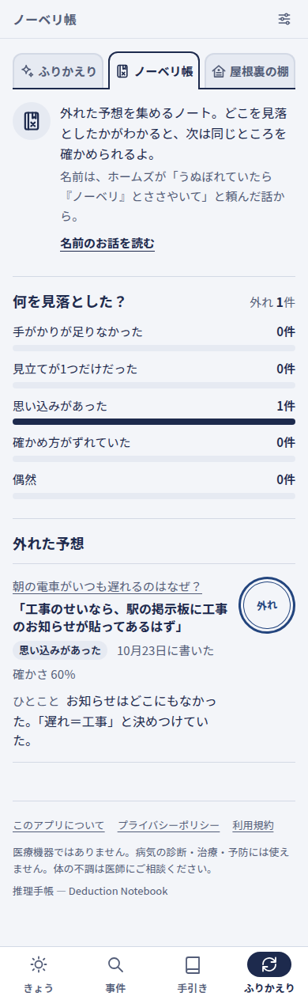

**上から並ぶもの**

1. 切り替え（ふりかえり・ノーベリ帳・屋根裏の棚）。
2. 短い説明と、「名前の由来（『黄色い顔』）」（押すと開く）。親子の人には子ども向けの呼び名「まちがいノート」も出ます。
3. **何を見落とした？**：5つの種類ごとの数を横の棒で（数は文字でも出す。パソコンでは2列）。いちばん多い種類が目で分かります。
4. **外れた予想**：新しい順に、事件のなぞ（押すと事件へ）・予想の文（書いたときのまま）・書いた日と確かさ・見落としの札・一言。

**裏側**：住所 `GET /norbury`、受付 `Review\NorburyController`、組み立て `Queries/Review/NorburyQuery`、画面 `src/resources/views/norbury/index.blade.php`・部品 `components/review/`（`story`・`reason-counts`・`miss-item`）。

---

## 2-11. 屋根裏の棚（`/attic`）

**役目：** 自分の事件から取り出した決まり（つまり？）と、その例（たとえば？）を、選んで置いておく棚です（R-5）。予想を立てるときに、ここから知識を選べます。

**たとえると：** 自分だけの図鑑です。名前は、ホームズが「頭の中は小さな屋根裏部屋のようなもので、役に立つ道具だけを選んで入れるべきだ」と話す『緋色の研究』の場面から取っています。

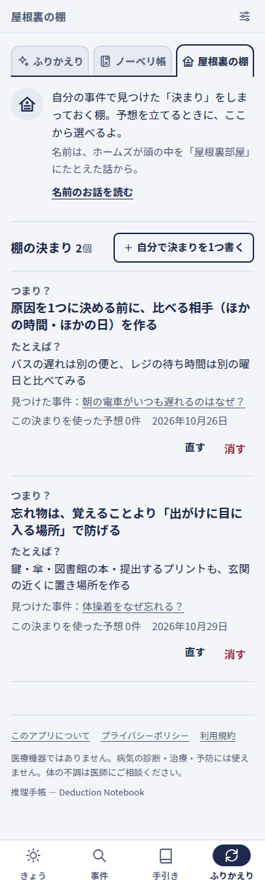

**上から並ぶもの（となぜその順か）**

1. 切り替えと短い説明、「名前の由来（『緋色の研究』）」。親子の人には「ぼくの図鑑・わたしの図鑑」も。
2. **棚の知識**（件数つき）：一番上に **「＋ 知識を足す」**（知識が1つでもあれば1行にたたんである。棚を見るのが主な用事なので）。その下に新しい順に1枚ずつ：つまり？（太字）・たとえば？・生まれた事件（押すと事件へ）・この知識を使った予想の数・日付、右に「直す」「消す」。

**押すと**：「知識を足す」を開くと、つまり？・たとえば？・どの事件から（任意）の欄。「直す」を押すと、その1枚がその場で入力欄に変わります。知識は、事件を閉じるときの「つまり？」からも入ります（2-7-3 の「事件を閉じる欄」）。

**裏側**：住所 `GET/POST /attic`・`PATCH/DELETE /attic/{note}`、受付 `Attic\AtticNoteController`、用事 `Actions/Attic/SaveAtticNote`、組み立て `Queries/Review/AtticNotesQuery`、画面 `src/resources/views/attic/index.blade.php`・部品 `components/review/`（`attic-form`・`attic-item`）。

---

## 2-12. 設定（`/settings`）

**役目：** 自分の呼び名・相棒・言葉の出し分け・記録のきっかけを決め、カレンダー連携・データのダウンロード・退会・ログアウトをまとめて置く画面です。上の帯の右の歯車から、どの画面からでも開けます。

**たとえると：** 手帳の最初のページの「持ち主の欄」と、裏表紙の「手帳の扱い方」をまとめたページです。

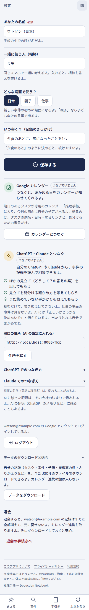

**上から並ぶもの（となぜその順か）**

よく変えるものを上に、めったにしない・取り返しのつかないものを下に置いています。

1. **自分のこと**：表示名（必須）／**相棒の名前**（同じ端末で一緒に考える人の呼び名。入れると事件で「相棒の見立て」が使える）／**ふだんの場面**（日常・親子・仕事。新しい事件の場面の初めの値になる。親子にすると子ども向けの言葉が出る）／**記録のきっかけ**（今日の画面の一番上に出る一文）と「保存する」。
2. **Google カレンダー**：状態の札と説明。つないでいなければ「カレンダーとつなぐ」。
3. **データのダウンロードと退会**：「データをダウンロード」（自分の記録を全部 JSON のファイルで。カレンダー連携の鍵は入らない）と、退会の説明と「退会の手続きへ」。
4. **ログイン**：どの Google アカウントでログインしているかと「ログアウト」。


カレンダーの枠は4つの状態で変わります：準備中（Google の鍵がまだ設定されていない）・つないでいない・**つながっている**（最後に同期した日時と「つなぐのをやめる」）・**切れた**（「連携が切れました。つなぎ直してください。」の赤い一文と「つなぎ直す」）。やめるときは、専用カレンダー「推理手帳」も Google から消すかを選べます（消さなければ、書いた予定はそのまま残る）。

**押すと**

- **退会の手続きへ**：確かめの欄が開き、「退会する」と入力して押すと、その人の記録がすぐにすべて消えます（Google の許可も取り消す）。元に戻せないので、先にダウンロードを勧めています。
- **データをダウンロード**：その場で JSON のファイルが保存されます。

**裏側**

| 項目 | 中身 |
|---|---|
| 住所 | `GET/PATCH /settings`・`GET /settings/export`・`DELETE /account`・`POST /logout` |
| 受付 | `Settings\SettingsController`・`Account\ExportUserDataController`・`Account\DeleteAccountController`・`Auth\LogoutController` |
| 用事 | `Actions/Settings/UpdateSettings`・`Actions/Account/ExportUserData`・`Actions/Account/DeleteAccount` |
| 画面 | `src/resources/views/settings/show.blade.php`・部品 `components/settings/`（`calendar-panel`・`danger-zone`・`consent-row`） |

---

## 2-13. カレンダーとつなぐ（`/calendar/connect`）

**役目：** Google カレンダーとつなぐ **前に**、送るもの・送らないもの・読むものを1画面で見せ、同意をもらう画面です（G-1）。

**たとえると：** 引っ越しの荷物を運んでもらう前に、「この箱は運ぶ、この箱は運ばない」を書いた紙を、業者さんと一緒に確かめるようなものです。


**上から並ぶもの**

1. 一言：「Google カレンダーに専用のカレンダー『推理手帳』を作り、期日のあるタスクを書き込みます。ふだんのカレンダーには書き込みません。」
2. 表：**送るもの**（タスクの題名と日時と、推理手帳に戻るリンクと、どのタスクの予定かを見分ける番号だけ。番号はアプリの中の通し番号で、記録の中身ではない。確かめるタスクの題名は「推理手帳：答え合わせの日」に決めてある）／**送らないもの**（メモ、事件のなぞ・手がかり・見立て・予想の文などの本文）／**読むもの**（今日の予定の題名と時刻だけ。説明・場所・参加者は受け取らず、5分だけ覚える。専用カレンダーで動かした日時はタスクに写す）／**Google**（米国の会社）／**やめるとき**（設定の画面からいつでも）。
3. **「同意して Google へ進む」** と、「Google の画面で『このアプリは Google で確認されていません』という注意が出ることがあります。」の説明。
4. 「設定に戻る」。

**押すと**：Google の画面に移り、カレンダーの許可（専用カレンダーを作って書く `calendar.app.created` と、自分の予定を読む `calendar.events.owned.readonly`）を求めます。許可して戻ると、専用カレンダーを作り、期日のあるタスクをまとめて書き出して、設定の画面に「Google カレンダーとつなぎました。」と出ます。

**裏側**：住所 `GET /calendar/connect`（説明）・`POST /calendar/connect`（`calendar.redirect`。Google へ）・`GET /calendar/callback`（戻り先）・`DELETE /calendar`（やめる）。受付 `Calendar\ConnectCalendarController`・`DisconnectCalendarController`、用事 `Actions/Calendar/ConnectCalendar`・`DisconnectCalendar`、画面 `src/resources/views/calendar/connect.blade.php`。Google 側の準備は [11章](11-google-setup.md)、決まりは [Google の決まり](../../.claude/rules/google.md) にあります。

---

## 2-14. 公開ページ（このアプリについて・プライバシーポリシー・利用規約）

**役目：** ログインしていなくても読める、決まりごとのページです（P-2）。どの画面のフッターからも開けます。

**たとえると：** 商品の箱の裏に書いてある、使い方と注意書きと保証書です。


| ページ | 住所 | 中身 |
|---|---|---|
| このアプリについて | `/about` | 何をするアプリか（流れの4段）・言えること言わないこと・注意書き（医療機器ではない、など）・ホームズの名前について・運営者 |
| プライバシーポリシー | `/privacy` | 運営者・いただく情報・使う目的・使っている外部のサービス・Google のデータの扱い・残す期間と消すこと・お子さまの利用など14項目 |
| 利用規約 | `/terms` | 第1条〜第12条（本アプリの目的・使える人・してはいけないこと・施術者の方へ・退会など） |

運営者の氏名・連絡先・日付は `src/config/legal.php` の【】の仮の値で、運営者が自分で書き込みます。受付は `LegalController`（`about`・`privacy`・`terms`）、画面は `src/resources/views/legal/` です。

---

## 次に読む章

- アプリ全体の流れと部品を眺め直す：[1. 鳥観図](01-birdseye.md)
- 「手がかりを足す」を押したとき、裏で何が順番に起きるか：[3. しくみ（太らない MVC）](03-architecture.md)
- いまの一手・ワトソンのひとこと・相棒モードの決まりと、その理由：[5. 推理の流れ](05-reasoning-flow.md)
- 画面に出てくる言葉を引く：[9. 用語集](09-glossary.md)
- 画面を組み立てる部品の1つずつ：[部品説明書](../design/components.md)
- 画面の言葉と子ども向けの言い方の全部：[言葉のルール](../design/words.md)
- 画面と住所と受付の対応表：[基本設計 2章](../design/basic-design.md)
- Google の準備：[11. Google の準備](11-google-setup.md)
