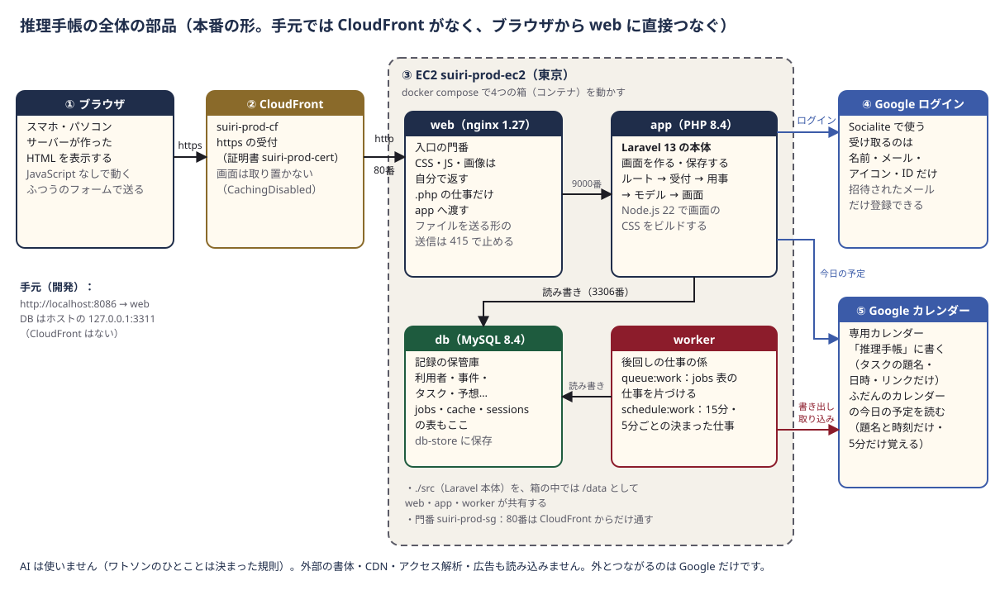
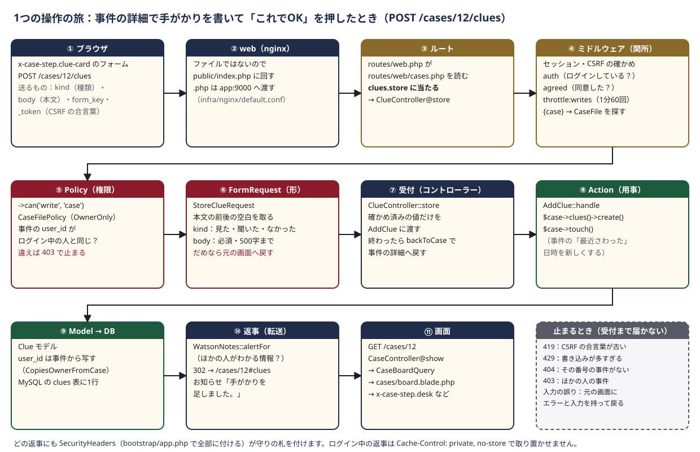
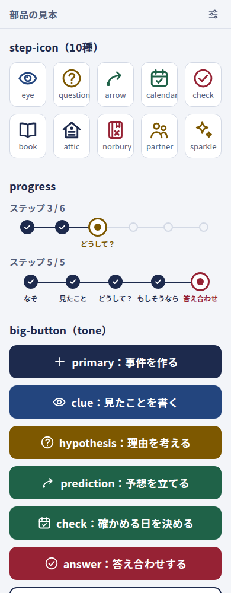
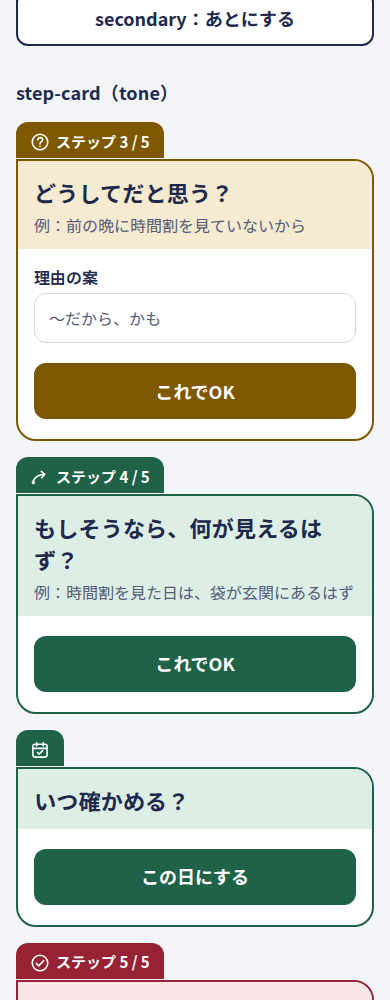
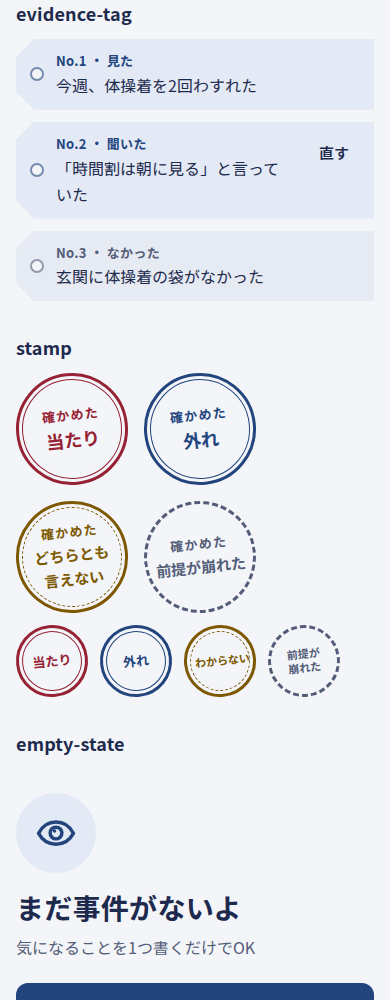

# 3. しくみ — 太らない MVC

## この章でわかること

- アプリを動かしている4つの箱（app・worker・web・db）と、それぞれの仕事
- 外の世界（Google）とどこでつながっているか
- Laravel の MVC を、このアプリでは「太らない MVC」として、どの層に何を置いているか（[基本設計 1章](../design/basic-design.md)）
- 1つの操作「手がかりを足す」が、ブラウザから DB まで、実物のファイルを1歩ずつどう通るか（ルート → ミドルウェア → Policy → FormRequest → 受付 → Action → Model → 画面）
- 画面を待たせない「後回しの仕事」（Google カレンダーへの書き出し）の流れ
- 1ファイルの行数の上限と、決まりを機械で確かめる `bin/check`
- 画面側（Blade・部品・Vite）の作りと、見た目の作り（Tailwind のクラスと `@theme`・共通の部品・段ごとの色）
- 本番で CloudFront の後ろで動かすための設定

> **言葉の言い換え**
> この章では、Laravel の用語を次の日本語で呼びます。**ルート**＝住所の表、**ミドルウェア**＝関所、**コントローラー**＝受付、**FormRequest**＝形の確かめ係、**Policy**＝権限の確かめ係、**Action**＝用事の係、**Query**＝読み出しのまとめ係、**Service**＝外とのやりとりの係、**Model**＝表の窓口、**ビュー（Blade）**＝画面のひな形、**コンポーネント**＝表示の部品。

---

## 3-1. 全体の部品：4つの箱



**役目：** アプリは「入口（web）」「本体（app）」「後回しの係（worker）」「保管庫（db）」の4つの箱に分かれて動いています。

**たとえると：** 小さな探偵事務所です。入口の門番（web）が来客を迎え、パンフレット（CSS や画像）なら自分で手渡し、相談ごと（PHP の処理）だけを奥の探偵（app）に回します。探偵は書類棚（db）を見ながら答えを作ります。「あとで役所に届けておいて」という用事は、メモにして棚に置き、助手（worker）が順番に片づけます。助手は時計も見ていて、15分ごと・5分ごとの決まった見回りもします。

この4つの箱は **Docker（ドッカー）** で動いています。Docker は「アプリを動かすのに必要なもの一式を箱（コンテナ）に詰めて、どのパソコンでも同じように動かす道具」です。箱の設計図はプロジェクト直下の `docker-compose.yml` と `infra/` フォルダにあります。

| 箱（サービス名） | 中身 | 仕事 | 外からの入口 |
|---|---|---|---|
| `app` | PHP 8.4-FPM ＋ Laravel 13（`infra/php/Dockerfile`） | アプリの本体。画面を作る・記録を読み書きする。`php artisan` のコマンドもここで動かす。Node.js 22 も入っていて、画面の CSS のビルド（`npm run build`）もここ | 外には出さない（web からだけ 9000 番で受ける） |
| `worker` | app と同じ箱の作り | `php artisan schedule:work`（時刻を見て決まった仕事を積む）と `php artisan queue:work`（積まれた仕事を片づける）を同時に動かす。Google カレンダーへの書き出し・15分ごとの取り込み・5分ごとの片づけ | なし |
| `web` | nginx 1.27（`infra/nginx/default.conf`） | 入口の門番。`public/` の中のファイル（ビルドした CSS など）は自分で返し、それ以外は Laravel の入口 `public/index.php` に回して app に渡す | 手元はパソコンの 8086 番、本番は 80 番（`.env` の `WEB_LISTEN`） |
| `db` | MySQL 8.4（`infra/mysql/`。文字は utf8mb4・時刻は日本時間） | 記録の保管庫。利用者・事件・タスク・予想などの表に加えて、後回しの仕事の列（`jobs`）・ログイン状態（`sessions`）・一時的な覚え（`cache`）も表にしまう | 手元のパソコンの `127.0.0.1:3311` からだけ（`.env` の `DB_PORT`） |

### それぞれの設定の要点

- **`docker-compose.yml`**
  - `app` と `worker` は `user: "1000:1000"` で動きます。手元のパソコンの利用者と同じ番号なので、箱の中で作られたファイルもそのまま直せます。
  - `worker` の命令は `sh -c "php artisan schedule:work & php artisan queue:work --sleep=3 --tries=3 --max-time=3600"`。2つの係を1つの箱で動かし、失敗した仕事は3回まで試し、1時間ごとに起動し直して古いメモリを捨てます。
  - `db` には **健康診断（healthcheck）** があり、MySQL が答えるようになってから app と worker を起動します（`depends_on` の `condition: service_healthy`）。
  - どの箱も、ログは 10MB × 5 ファイルまで（`x-logging`）。本番のディスクがいっぱいにならないようにするためです。
- **`infra/nginx/default.conf`**
  - `root /data/public;`：外に見せるのは `public` フォルダだけ。
  - `try_files $uri $uri/ /index.php?$query_string;`：ファイルが実在すればそれを返し、なければ `index.php`（Laravel）に回す。
  - `.php` は `fastcgi_pass app:9000;` で app に渡す。FastCGI は web と PHP が話すための約束事です。
  - **ファイルを送る形（`multipart/form-data`）の送信は 415 で止めます。** 推理手帳にはファイルを上げる機能がないので、PHP に届く前に断っています。
  - 「.」で始まるファイル（`.env` など）は `deny all;` で見せません。
  - `server_tokens off;`：返事とエラーの画面に nginx の版を書きません（`Server: nginx` だけ）。版が分かると、その版の弱点を狙われやすくなるためです。
- **`infra/php/`**：`php.ini`（エラーの中身を画面に出さない・時刻は日本時間・`expose_php = Off` で返事に PHP の版 `X-Powered-By` を書かない）と `zz-security.conf`（PHP-FPM の危ない機能を上書きできない形で止める）。

### `./src` を3つの箱で共有している

`docker-compose.yml` では、web・app・worker のどれにも `./src:/data` と書いてあります。プロジェクトの `src` フォルダ（Laravel 本体）を、箱の中では `/data` という名前で見せる、という意味です。

- **たとえると：** 門番・探偵・助手が同じ棚を見ている状態です。
- **なぜ：** エディタで `src` のファイルを直すと、箱を作り直さなくてもすぐ反映されます。ただし **worker は起動したときのコードで動き続ける** ので、Job（後回しの仕事）や予定のコードを直したら `docker compose restart worker` が要ります。

DB のデータは `db-store` という Docker の保存場所（ボリューム）に入っていて、箱を止めたり作り直したりしても消えません。

### ネットワークのアドレス帯を決めている理由

`docker-compose.yml` の最後で、4つの箱が互いを `app`・`db` という名前で呼び合う専用の内線網 `suiri-net` のアドレスを `10.232.0.0/24` に決めています。このパソコンではほかのプロジェクトの Docker ネットワークが多く、Docker が自動で選ぶアドレス帯が埋まっているためです（Baker Street English は `10.231.0.0/24`）。

### 2種類の `.env`

| ファイル | 読む人 | 中身 |
|---|---|---|
| プロジェクト直下の `.env` | `docker compose` | DB の名前・パスワード、公開する番号（`WEB_LISTEN`・`DB_PORT`） |
| `src/.env` | Laravel | アプリの名前・住所（`APP_URL`）、DB の接続先（`DB_HOST=db`）、ログイン状態・後回しの仕事・取り置きを DB の表にしまう設定（`SESSION_DRIVER`・`QUEUE_CONNECTION`・`CACHE_STORE` が `database`）、Google の鍵（`GOOGLE_CLIENT_ID` など） |

どちらもパスワードを含むので git には入れません（`bin/check` が止めます）。見本はそれぞれの `.env.example` です。`env()` で値を読んでよいのは `src/config/` の中だけで、ほかのコードは `config('suiri.…')` のように設定を通して読みます。

---

## 3-2. 外の世界とのつながり

**役目：** アプリが自分の4つの箱の外と話す相手は、**Google だけ** です。

**たとえると：** 事務所が外とやりとりする窓口は「身分証の確認（Google ログイン）」と「予定表の管理（Google カレンダー）」の2つだけ、という作りです。それ以外の仕事は全部、事務所の中で済ませます。

| つながる先 | だれが話すか | いつ | 何をやりとりするか |
|---|---|---|---|
| Google ログイン | app（Laravel Socialite という部品） | 「Google でログイン」を押したとき | 名前・メール・アイコン・ID（`sub`）だけを受け取る。照合は ID で行い、新しい人は登録する（既定は一般公開。設定 `SUIRI_INVITE_ONLY=true` の招待制のときだけ、名簿 `invitations` にメールアドレスがある人に限る。`Actions/Auth/LoginWithGoogle`） |
| Google カレンダー（書く） | worker | タスクを作った・直した・済んだ・消したあと | 専用カレンダー「推理手帳」に、タスクの題名と日時とリンクと、どのタスクの予定かを見分ける番号（`suiri_task_id`）だけ。確かめるタスクの題名は「推理手帳：答え合わせの日」に固定（予想の文を送らないため） |
| Google カレンダー（取り込む） | worker | 15分ごと | 専用カレンダーで動かされた・消された予定を読み、タスクの期日を合わせる |
| Google カレンダー（今日の予定） | app | 今日の画面を開いたとき | ふだんのカレンダーの今日の予定の題名と時刻だけ。保存せず、5分だけ覚える（`Services/Google/GoogleCalendarAgenda`） |

カレンダーとの話は、公式の重い部品を使わず、Laravel の HTTP の道具で Google の REST API（住所に送ると JSON で返事が来る窓口）を直接呼んでいます（`Services/Google/CalendarApi`）。中身が読める薄い部品のほうが学びやすいからです（[要件定義書 7章](../design/requirements.md)）。つなぐ・書き出す・取り込む・今日の予定の4つの流れのくわしい話は、[6章](06-google.md)（Google ログインとカレンダー連携）にあります。

**アプリの中では AI を使いません。** ワトソンのひとことは `config/watson.php` に書いた言葉の一覧で決まった規則どおりに選び（`Services/Watson/WatsonNotes`・`TextSigns`）、教材は `src/database/data/guide/` の JSON を読むだけです。外部の書体・CDN・アクセス解析・広告も読み込みません。自分の ChatGPT・Claude から記録を読ませる窓口（`/mcp`。読むだけ）は、利用者の AI が読みに来るしくみで、アプリが AI を呼ぶのではありません（[12章](12-ai-connect.md)）。

---

## 3-3. 太らない MVC：層ごとの役目と置き場所

**役目：** MVC は「受け付ける係（C：コントローラー）」「表の窓口（M：モデル）」「見た目の係（V：ビュー）」に仕事を分ける決まりです。推理手帳では、そこにさらに専門の係を足し、**1ファイル＝1つの役目** にしています。受付が何でも抱えて太らないようにするので「太らない MVC」と呼んでいます。

**たとえると：** 探偵事務所の分業です。

- 入口の警備員（**ミドルウェア**）が、入ってよい人かを確かめる。
- 権限の係（**Policy**）が「この書類はこの人のものか」を確かめる。
- 書式の係（**FormRequest**）が、申込書の書き方が正しいかを確かめる。
- 窓口の受付（**コントローラー**）は、話を聞いて係に回し、結果を渡すだけ。自分では推理しない。
- 用事の係（**Action**）が、1つの用事（「手がかりを足す」）をやり遂げる。
- 外回りの係（**Service**）が、Google とやりとりする。
- 資料係（**Query**）が、画面に出す一覧や集計をまとめる。
- 記録係（**Model**）が、書類棚（表）から出し入れする。
- 清書係（**ビュー**と**部品**）が、報告書（画面）を書く。

```
ブラウザ → routes/web/{機能}.php → ミドルウェア → Controller（受付）
              ├─ FormRequest（形の確かめ・入力をそろえる）
              ├─ Policy（この人がしてよいか＝持ち主か）
              ├─ Action（1つの用事。handle() 1つ）── Model / DB
              │      └─ Service（外とのやりとり：Google）
              ├─ Query（画面に出す一覧・集計の組み立て）
              └─ view() → Blade の画面 → Blade コンポーネント（表示の部品）
```

| 層 | 置き場所（`src/` から） | 受け持つこと | してはいけないこと |
|---|---|---|---|
| ルート（住所の表） | `routes/web.php` は読み込むだけ。中身は `routes/web/{機能}.php`（auth・legal・today・tasks・cases・guide・review・settings・calendar） | 住所・ルート名・ミドルウェア・`->can()` | クロージャ（その場の関数）で処理を書く |
| 受付 | `app/Http/Controllers/{機能}/` | 受け取る → Action や Query を呼ぶ → 画面か転送を返す。1アクションは目安10行 | `validate()`、DB の問い合わせの組み立て、外の API を呼ぶ |
| 形の確かめ | `app/Http/Requests/{機能}/` | `rules()`・`attributes()`・`prepareForValidation()` | DB に書く |
| 権限 | `app/Policies/` | 持ち主か（`view`・`update`・`delete`）。中身は共通の部品 `Policies/Concerns/OwnerOnly`。事件・手がかり・見立てには、捜査中の事件にだけ書き込める `write` も（`Policies/Concerns/WritesOpenCase`） | 確かめ・書き込み |
| 用事 | `app/Actions/{機能}/` | 1クラス＝1つの用事。外から呼べるのは `handle()` だけ。複数の表に書くなら `DB::transaction()` | 画面の都合（転送先・HTML）を知る |
| 外とのやりとり | `app/Services/{相手}/`＋約束 `app/Contracts/` | Google カレンダーなど。約束（インターフェース）越しに使い、テストでは偽物に差し替える | 画面・リクエストを知る |
| 読み出しのまとめ | `app/Queries/{機能}/` | 一覧・集計を組み立てて返す | 書き込み |
| 表の窓口 | `app/Models/` | 表どうしの関係・型・小さな判定（`isOpen()` など） | 複数の表にまたがる処理 |
| 列挙（種類と状態） | `app/Enums/` | 状態・種類。`label(?Scene $scene)` で表示の言葉を `config/suiri.php` から引く | 言葉の直書き |
| 後回しの仕事 | `app/Jobs/` | Google への書き出し・取り込み（worker が片づける） | 画面を待たせる処理を受付で直接 |
| 画面 | `resources/views/{機能}/{動作}.blade.php` | 部品を並べるだけ | `@php` のかたまりで計算する、DB に触る |
| 表示の部品 | `resources/views/components/{分類}/` | `<x-case-step.clue-card>` のような名前つきの部品。`@props` で受け取るものを宣言する | データを取りに行く |
| 設定値・文言 | `config/suiri.php`・`config/watson.php`・`config/legal.php` | 数字・文言・選択肢 | コードに直書き |

### なぜ分けるのか

- **探す場所が1つに決まる。** 「手がかりの種類の決まり」は `StoreClueRequest`、「手がかりを足す」は `AddClue`、「持ち主か」は `OwnerOnly` だけを見れば分かります。直す場所も1か所です。
- **受付が薄いので読みやすい。** 受付のメソッドは「受け取って、係に渡して、返す」の数行です（次の 3-4 の `ClueController::store()` が3行）。
- **同じ係を、いろいろな入口から使える。** 事件を作る用事 `CreateCase` は事件を作る画面から使い、見本のデータ（`DemoSeeder`）も同じ用事を順に呼んで記録を作ります。画面から作った記録と、見本の記録の形が食い違いません。
- **差し替えられる。** Google カレンダーは約束 `Contracts\CalendarApi` 越しに使うので、テストのときは偽物 `FakeCalendarApi`（メモリに書くだけ）に差し替わり、本物の Google に一度もつながずに確かめられます（`Providers/CalendarServiceProvider`）。
- **太ったら機械が止める。** 行数の上限があり、超えると `bin/check` が止めます（3-6）。

---

## 3-4. 1つの操作の旅：手がかりを足す



**役目：** 事件の詳細の手がかりのカードで「これでOK」を押してから、次の画面が出るまでに、裏で何が順番に起きているかを、実物のファイル名で1歩ずつ追います。

**たとえると：** 役所に申込書を出す流れです。窓口に行く（ルート）→ 入口で身分証を見せる（ミドルウェア）→ その書類を出す資格があるか確かめる（Policy）→ 申込書の書き方を確かめる（FormRequest）→ 受付が担当に回す（コントローラー）→ 担当が台帳に書く（Action・Model）→ 「受け付けました」の控えを渡し、元の窓口に案内する（返事と転送）。

例として、番号12の事件「朝の電車がいつも遅れるのはなぜ？」に、種類「見た」・本文「ひとつ前の 7:35 発は、ほぼ時刻どおりに着いた」を足すとします。

### ① ブラウザ：フォームを送る

事件の詳細を開くと、**いまやることのカード**が1枚だけ大きく出ます。手がかりがまだ1つもなければ「見たことを1つ教えて」のカードが、手がかりがあっても下の「ほかにできること」の「見たことをもう1つ書く」を押せば同じカード（住所に `?open=add-clue` が付く）が出ます。どちらも部品 `src/resources/views/components/case-step/clue-card.blade.php` のフォームです（どのカードを出すかは `<x-case-step.desk>` が決め、`<x-case-step.now>` が1枚だけ置きます）。

```blade
<form method="POST" action="{{ route('clues.store', $case) }}" class="space-y-4">
  @csrf
  <input type="hidden" name="form_key" value="add-clue">
  <x-ui.choices name="kind" :label="$t('clue.kind')" :options="$kinds" selected="seen" />
  <x-ui.textarea id="f-step-clue" name="body" :label="$t('clue.label')" rows="2" required ... />
  <x-ui.big-button tone="clue" icon="check">{{ $t('clue.button') }}</x-ui.big-button>
```

- `route('clues.store', $case)` は、ルート名から住所 `/cases/12/clues` を作ります。住所を手で書かないので、住所を変えてもここは直さずに済みます。
- `@csrf` は、隠し項目 `_token`（**CSRF の合言葉**）を入れます。ほかのサイトが勝手にこの手帳へ送信させる攻撃を防ぐためのものです。
- `<x-ui.choices>` は「どうやって知った？」（見た・聞いた・なかった）の大きな選択肢、`<x-ui.textarea>` は「見たこと」の欄、`<x-ui.big-button>` は横いっぱいの主なボタン「これでOK」です。言葉は `$t(…)` で `config('suiri.case_board.cards.clue')` から引きます。
- `form_key` は「どのフォームから送ったか」の印です。今の事件の詳細はカードを1枚ずつ出しますが、見立てを見直すカードのように1枚の中に同じ名前の欄（`body`）を持つフォームがいくつもある所では、入力に誤りがあって戻ってきたとき、そのフォームだけを開いてエラーを出すのに使います。

「これでOK」を押すと、ブラウザは `POST /cases/12/clues` に `kind=seen`・`body=…`・`form_key=add-clue`・`_token=…` を送ります。JavaScript は使っていません。ふつうのフォームの送信です。

### ② web（nginx）：app に渡す

`/cases/12/clues` という名前のファイルは `public/` にないので、`try_files` の決まりで `public/index.php` に回り、`fastcgi_pass app:9000` で app の箱の PHP に渡されます（本番では、その前に CloudFront が https を受けています。3-9）。

### ③ ルート：住所の表で行き先を決める

`src/routes/web.php` は、`routes/web/` の中の `.php` を名前の順に読み込むだけのファイルです。事件の住所は `src/routes/web/cases.php` にあります。

```php
Route::middleware(['auth', 'agreed'])->group(function () {
    Route::middleware('throttle:writes')->group(function () {
        Route::post('/cases/{case}/clues', [ClueController::class, 'store'])
            ->can('write', 'case')->name('clues.store');
```

「`POST /cases/{case}/clues` に来たら、ログイン（`auth`）・同意（`agreed`）・書き込みの回数制限（`throttle:writes`）の関所を通し、事件に書き込む権限（`can('write', 'case')`。持ち主で、事件が捜査中か）を確かめてから、`ClueController` の `store` に渡す。この行の名前は `clues.store`」という意味です。

### ④ ミドルウェア：関所を順に通る

| 関所 | どこで決めているか | 確かめること | だめなとき |
|---|---|---|---|
| セッション・CSRF | Laravel の `web` のまとまり（最初から付く） | クッキーからログイン状態を読み、`_token` がセッションの合言葉と同じか | 合言葉が古い（長く開いたままの画面など）と **419** |
| `auth` | Laravel の標準 | ログインしているか | トップ（`/`）へ送る（`bootstrap/app.php` の `redirectGuestsTo`） |
| `agreed` | `src/app/Http/Middleware/EnsureAgreed.php`（`bootstrap/app.php` で別名を付けている） | 利用規約などに同意したか | 同意の画面（`/agree`）へ送る |
| `throttle:writes` | `src/app/Providers/AppServiceProvider.php` の `RateLimiter::for('writes', …)` | 書き込みが1分に60回を超えていないか（人ごとに数える） | **429** |
| `{case}` を事件にする | 同じ `AppServiceProvider` の `Route::model('case', CaseFile::class)` | 住所の `12` から、事件の行（`CaseFile`）を探す。`case` は PHP の予約語なので、住所の名前とモデルの名前が違い、ここで結びつけている | その番号の事件がなければ **404** |

### ⑤ Policy：持ち主か確かめる

ルートの `->can('write', 'case')` は、「ログイン中の人が、この事件に `write`（書き込む）してよいか」を Policy に聞きます。事件の Policy は `src/app/Policies/CaseFilePolicy.php` で、中身は共通の部品 `OwnerOnly`（持ち主か）と `WritesOpenCase`（持ち主で、事件が捜査中か）です。`write` はまず持ち主かを `owns()` で確かめます。

```php
protected function owns(User $user, Model $record): bool
{
    return (int) $record->getAttribute('user_id') === (int) $user->getKey();
}
```

事件の `user_id`（持ち主）と、ログイン中の人の番号が同じときだけ許します。違えば **403** で止まり、受付には届きません。持ち主でも、事件が閉じている（解決・迷宮入り）なら「この事件は閉じています。書き足すときは、事件を開き直してください。」の **403** で止めます（画面にボタンを出さないだけでは、古いタブなどからの送信が通ってしまうため。テストは `src/tests/Feature/Cases/ClosedCaseWritesTest.php`）。運営者でも、ほかの人の記録は見られない作りです。どの住所でも他人の記録が 403 になることは、テスト `src/tests/Feature/Cases/OwnershipTest.php` が住所を1つずつ試して確かめています。

> **順番のメモ**
> [基本設計](../design/basic-design.md) の図では「受付 → FormRequest → Policy」の順に描いていますが、推理手帳では権限を **ルートの `->can()`** で確かめるので、実際には Policy が受付より先に動きます。権限のない人の送信は、中身を確かめる前に断る、という順番です。そのため FormRequest の `authorize()` は「ルートで確かめ済み」として `true` を返すだけにしています。

### ⑥ FormRequest：送られた形を確かめる

受付のメソッドは引数に `StoreClueRequest` を受け取ります。Laravel はメソッドを呼ぶ **前に**、この係で中身を確かめます（`src/app/Http/Requests/Cases/StoreClueRequest.php`）。

```php
protected function prepareForValidation(): void
{
    $this->merge(['body' => trim((string) $this->input('body'))]);   // 本文の前後の空白を取る
}

public function rules(): array
{
    return [
        'kind' => ['required', Rule::enum(ClueKind::class)],        // 見た・聞いた・なかった のどれか
        'body' => ['required', 'string', 'max:'.config('suiri.limits.clue_body')],  // 必須・500字まで
    ];
}
```

- `prepareForValidation()`：確かめる前に入力をそろえます。空白だけの本文は、空として扱われます。
- `rules()`：種類は列挙 `ClueKind`（`seen`・`heard`・`absent`）のどれか、本文は必須で500字まで。字数の上限はコードに直書きせず `config/suiri.php` の `limits` から引きます（表の列の長さと同じ値）。
- `attributes()`：エラーに出す項目の名前（「手がかり」）。エラーの文そのものは `src/lang/ja/validation.php` にまとめてあり、「手がかりを入力してください。」のようになります。

**だめなとき：** Laravel は受付を呼ばずに、元の画面（事件の詳細。「見たことをもう1つ書く」から開いたなら `?open=add-clue` の付いた同じ住所）へ戻します。そのときエラーと入力した値をセッションに入れて持っていくので、同じ手がかりのカードが出て、欄の下に赤い文と、さっき書いた本文が残ります（部品 `components/ui/textarea.blade.php` の `old()`）。

### ⑦ 受付：係に渡して、戻す

関所と確かめを通って、ようやく受付 `src/app/Http/Controllers/Cases/ClueController.php` の `store()` が動きます。

```php
public function store(StoreClueRequest $request, CaseFile $case, AddClue $addClue): RedirectResponse
{
    $clue = $addClue->handle($case, $request->validated('kind'), $request->validated('body'));

    return $this->backToCase($case, '手がかりを足しました。', [$clue->body], 'clues');
}
```

- 引数の `CaseFile $case` は④で探した事件、`AddClue $addClue` は Laravel が用意して渡してくれる用事の係です（自分で `new` しない。テストで差し替えやすくなる）。
- `$request->validated('kind')` は、⑥で確かめ **済み** の値だけを取り出します。確かめていない値を使わないためです。
- 受付がしているのは「用事を頼む」と「戻す」の2つだけです。

### ⑧ Action：1つの用事をやり遂げる

用事の係 `src/app/Actions/Cases/AddClue.php` です。

```php
public function handle(CaseFile $case, string $kind, string $body): Clue
{
    $clue = $case->clues()->create(['kind' => $kind, 'body' => $body]);
    $case->touch();

    return $clue;
}
```

- `$case->clues()->create(...)`：この事件の手がかりとして1行足します。事件「から」作るので、`case_file_id` は自動で入ります。
- `$case->touch()`：事件の「最近さわった日時」（`updated_at`）を新しくします。事件の一覧と今日の画面の「捜査中の事件」は、この日時の新しい順に並びます。
- 用事の係は、画面の都合（どこへ戻すか、何と知らせるか）を知りません。だから同じ `AddClue` を、見本のデータを作るときにもそのまま使えます。

### ⑨ Model → DB：表に1行足す

`src/app/Models/Clue.php` が、MySQL の `clues` 表の窓口です。

- `#[Fillable(['case_file_id', 'user_id', 'kind', 'body'])]`：まとめて入れてよい列の一覧。ほかの列（`id` など）を送られても入りません。
- `casts()` の `'kind' => ClueKind::class`：表には文字（`seen`）で入り、PHP では列挙（`ClueKind::Seen`）として扱えます。画面に出すときは `$clue->kind->label($case->scene)` で、場面に合わせた言葉（仕事の場面なら「見た・触れた・測った」）になります。
- 部品 `Models/Concerns/CopiesOwnerFromCase`：作る直前に、`user_id` が空なら **親の事件の持ち主を写します**。手がかりの表にも `user_id` を持たせて「すべての記録を持ち主で絞る」決まりを守るための写しで、渡し忘れても持ち主がそろいます。

ここで `INSERT INTO clues …` が MySQL に送られ、1行が保存されます。

### ⑩ 返事：事件の詳細へ転送する

受付が最後に呼んだ `backToCase()` は、事件の受付が共通で使う部品 `src/app/Http/Controllers/Cases/Concerns/RedirectsToCase.php` です。

1. `WatsonNotes::alertFor()` で、いま保存した本文に **ほかの人がわかる情報らしきもの**（電話番号・メールアドレスの形、「様」「さん」のつく名前らしきもの）がないかを見ます（ワトソンの W-5）。保存はもう済んでいて、止めはしません。
2. 戻り先の住所 `/cases/12` を作り、警告がなければ `#clues`（戻る場所の印）を付けます。警告があるときは、画面の一番上から見せるため印を付けません。フォームが隠し項目 `back_open`（見立てを見直すカード・○× のカードなど）を送ってきたときは `?open=…` を付けて同じカードに戻しますが、手がかりのカードは送らないので、ふつうの事件の詳細へ戻ります。
3. `redirect()->to($url)->with('status', '手がかりを足しました。')->with('watson_alert', …)` で、**302 の転送**（「次はこの住所を開いて」という返事）を返します。お知らせと警告は、次の1回の画面でだけ使える形でセッションに入ります。

POST のあとに画面を直接返さず、いったん転送するのは、ブラウザの「再読み込み」で同じ手がかりが二重に足されないようにするためです（PRG：送信 → 転送 → 表示 と呼ばれる型）。

### ⑪ 画面：事件の詳細を組み立てて返す

ブラウザは転送を受けて、すぐに `GET /cases/12#clues` を開きます。ここからはもう1回分の旅で、同じようにルート（`cases.show`）→ 関所 → `->can('view', 'case')` を通って、受付 `CaseController::show()` に届きます。

1. 受付はセッションから `watson_alert` を受け取り、組み立てを **読み出しのまとめ係** `src/app/Queries/Cases/CaseBoardQuery.php` に頼みます。
2. `CaseBoardQuery::handle()` は、手がかり・予想・閉じたひとこと・見立て（○×と予想つき）を **まとめて1度に読み込み**（`$case->load([...])`）、画面の部品がそれぞれ DB に問い合わせないようにします。そのうえで、相棒モードならいまの番の見立てだけに絞り、**いまの一手**（`NextStep`）、**ワトソンのひとこと**（`WatsonNotes::forCase()`。一番優先度の高い1つだけ）、見せ合いの表（`RevealBoard`）、予想で選べる屋根裏の知識、練習メニューの問いかけ、確かめる日の初めの値（明日）、子ども向けの言葉を出すか（`User::prefersKidWords()`）を用意します。
3. 受付は `view('cases.board', …)` で画面のひな形 `src/resources/views/cases/board.blade.php` に渡します。ひな形は部品を2つ置くだけです：

```blade
<x-case-step.head :case="$case" :kid="$kid" />
<x-case-step.desk :case="$case" :hypotheses="$hypotheses" … :step="$step" :watson="$watson" :board="$board" … class="mt-4" />
```

4. `<x-case-step.head>` が事件のなぞを、`<x-case-step.desk>` が残りを並べます。desk は進み具合 `<x-case-step.stages>` を置き、その中の荷札の束 `<x-case-step.clue-pile>` が「見たこと 2つ」のようにたたんだ1行になります（開くと、さっき足した手がかりも番号つきの荷札で並ぶ）。そのうえで desk は、いまの一手（`NextStep`）からどのカードを出すかを決め、`<x-case-step.now>` が **次のいまやることのカード** を1枚だけ出します（手がかりが1つ目なら「どうしてだと思う？」の見立てのカード `<x-case-step.hypothesis-card>`）。その下に「ほかにできること」`<x-case-step.more>` が小さく並びます。上の帯の下には、`<x-ui.flash>` がお知らせ「手がかりを足しました。」を出します。
5. できた HTML に、最後に全部の返事に付く関所 `src/app/Http/Middleware/SecurityHeaders.php` が **守りの札**（セキュリティのヘッダ）を付けます：ファイルの種類を推測させない・ほかのサイトの枠の中に表示させない・カメラなどを使わない、そしてログイン中の返事には `Cache-Control: private, no-store`（ブラウザにも CloudFront にも取り置かせない）。
6. ブラウザは HTML を受け取って表示します（今の事件の詳細には `#clues` の印に当たる場所がないので、画面は上から出ます）。CSS はビルド済みのファイルを web（nginx）が直接返します。

### 旅のまとめ

| 段 | ファイル | 一言 |
|---|---|---|
| フォーム | `resources/views/components/case-step/clue-card.blade.php` | いまやることのカード。`POST /cases/12/clues`。CSRF の合言葉と `form_key` つき |
| 門番 | `infra/nginx/default.conf` | `index.php` を通して app へ |
| 住所の表 | `routes/web/cases.php` | `clues.store` → `ClueController@store` |
| 関所 | `bootstrap/app.php`・`Http/Middleware/EnsureAgreed.php`・`Providers/AppServiceProvider.php` | ログイン・同意・回数制限・`{case}` を事件に |
| 権限 | `Policies/CaseFilePolicy.php`（`Policies/Concerns/OwnerOnly.php`・`WritesOpenCase.php`） | 持ち主でなければ 403。閉じた事件も 403 |
| 形 | `Http/Requests/Cases/StoreClueRequest.php` | 種類と本文を確かめる。だめなら元の画面へ |
| 受付 | `Http/Controllers/Cases/ClueController.php` | 用事に渡して、戻す |
| 用事 | `Actions/Cases/AddClue.php` | 1行足し、事件の日時を新しく |
| 表の窓口 | `Models/Clue.php`（`Models/Concerns/CopiesOwnerFromCase.php`） | 持ち主を写して保存 |
| 返事 | `Http/Controllers/Cases/Concerns/RedirectsToCase.php` | W-5 を見て、302 で事件の詳細へ |
| 画面 | `Http/Controllers/Cases/CaseController.php`・`Queries/Cases/CaseBoardQuery.php`・`resources/views/cases/board.blade.php`（`components/case-step/desk`・`now`） | まとめて読み込み、次のいまやることのカードを出す |

（パスは `src/` から。`infra/` だけはプロジェクト直下です。）

---

## 3-5. 画面を待たせない「後回しの仕事」（worker）

**役目：** Google カレンダーへの書き出しのように、時間がかかったり外の都合で失敗したりする仕事は、画面の返事とは切り離して **worker** に任せます。

**たとえると：** 探偵が「この予定を役所の掲示板にも貼っておいて」とメモを棚に置くと、助手があとで貼りに行きます。役所が閉まっていたら、助手は時間をおいて出直します。探偵は助手を待たずに、次の依頼人の話を聞けます。

予想を立てたときの流れです（[1章](01-birdseye.md) の「1回の記録で、裏で何が起きるか」のくわしい版）。

1. 受付 `Cases\PredictionController::store()` が用事 `Actions/Cases/MakePrediction` を呼びます。用事は `DB::transaction()` の中で **予想** と **確かめるタスク**（`kind` が `verify`、期日＝確かめる日）を1度に保存します。途中で失敗したら、両方ともなかったことになります。
2. タスクが保存されると、見張り役 `src/app/Observers/TaskObserver.php` が動きます（`Providers/CalendarServiceProvider` の `Task::observe()` で結んである）。保存の直前に予定の ID を決めておき（二重登録を防ぐため）、保存のあと、持ち主がカレンダーとつないでいれば、仕事 `Jobs/PushTaskToCalendar` を **保存が確定してから**（`afterCommit()`）`jobs` 表に積みます。タスクの担当のコードは、Google のことを何も知らなくて済みます。
3. 画面はここで返事をします。仕事を積むのに失敗しても、タスクの保存は成功のままにします（記録だけ残す）。
4. worker の `queue:work` が `jobs` 表から仕事を取り出し、`PushTaskToCalendar` が約束 `Contracts\CalendarApi` 越しに本物の `Services\Google\CalendarApi` を呼んで、専用カレンダーに予定を書きます。Google が止まっていれば失敗として、間をおいて試し直します。許可が切れていたら、連携を「切れた」にして、設定の画面で「つなぎ直してください」と知らせます。
5. 時刻で動く仕事は `src/routes/console.php` に書いてあり、worker の `schedule:work` が時刻を見て積みます。

| 予定 | 何をするか |
|---|---|
| 15分ごと（`config('suiri.calendar.pull_every_minutes')`） | `PullCalendarChanges`：つながっている人ごとに、専用カレンダーで動かされた・消された予定を読み、タスクの期日を合わせる（`Actions/Calendar/ApplyCalendarChanges`）。Google 側で新しく作られた予定は取り込まない |
| 5分ごと | `cache:prune-expired`：期限の過ぎた一時的な覚え（今日の予定の題名と時刻）を `cache` 表から消す。プライバシーポリシーの「5分で消す」を守るため |

worker が止まると、書き出しも、5分で消す約束も守れません。本番の更新のあとに `docker compose ps` で worker が動いているかを確かめるのはそのためです（[10章](10-deploy-aws.md)）。

---

## 3-6. 行数の上限と `bin/check`

**役目：** 「太らない」を口約束にせず、**機械で止めます**。

**たとえると：** 引っ越しの段ボールに「1箱20kgまで」と決めておき、量りに載せて超えたら詰め直すようなものです。重すぎる箱は運ぶ人が腰を痛めます。長すぎるファイルは、読む人が迷います。

### 1ファイルの行数の上限（コメント込み）

| 対象 | 上限 | 超えたら |
|---|---|---|
| コントローラー（`src/app/Http/Controllers/**`） | 150行 | 処理を Action・Query へ。7アクションを超えたらコントローラーを分ける |
| そのほかの PHP（`src/app/**`・移行・factory・seeder） | 200行 | 1クラス＝1つの役目に分ける |
| ルート（`src/routes/**`） | 120行 | `routes/web/{機能}.php` に分ける |
| 画面（`src/resources/views/**`） | 150行 | 意味のまとまりを `components/{分類}/` の部品にする |
| JavaScript（`src/resources/js/**`） | 200行 | `parts/` に部品ごとに分ける |
| CSS（`src/resources/css/**`） | 400行 | `@import` で分ける |
| テスト（`src/tests/**`） | 300行 | 確かめる動作ごとのファイルに分ける |

いまのところ、いちばん長いコントローラーは `Tasks\TaskController`（94行）、いちばん長いクラスは `Services/Google/CalendarApi`（173行）、事件の詳細の画面 `cases/board.blade.php` はたった18行です（中身は部品に分けてある）。上限を上げる例外は、理由つきで `bin/check` の `ALLOW_SIZE` に書く決まりで、いまは1つもありません。

### `bin/check` が確かめること

`bin/check` は Python で書いた見張りの道具で、決まりの一覧はファイルの中の表（`RULES`・`WORD_RULES`・`SIZE_LIMITS`）にあります。止めたときは、理由と「→ 直し方」を出します。

| 種類 | 例 |
|---|---|
| 太らない MVC | コントローラーで `validate(` を書かない・`DB::` を使わない・`Http::` で外を呼ばない、ルートにクロージャで処理を書かない、回数制限は名前つき（`throttle:writes`）で、`env()` は `config/` の中だけ、Blade で `@php` のかたまりを書かない |
| 見た目 | 外部のファイル（CDN・書体）を読み込まない、影・浮き上がり・ずっと続く動きを付けない |
| 個人情報 | ログに入力の本文を出さない、Google カレンダーに本文を送らない |
| 言葉 | 画面で使わない言葉（[言葉のルール 3章](../design/words.md)）、コードの名前に他人を表す言葉を使わない、難しい言葉（演繹・帰納・アブダクション）は手引きの画面だけ |
| 行数 | 上の表 |
| コメント | クラス・関数の手前に「何をするか」、if・ループの手前に「何を確かめてどう分かれるか」が書いてあるか（`bin/code_comments.py`） |
| ドキュメント | リンク切れ・使っていない画像・HTML 版（`docs/guide.html`）の作り直し忘れ |

くわしい使い方と、止められたときの直し方は [8章](08-operations.md) の 8-5・8-6 にあります。使い方は4つです。

| 使い方 | いつ | 確かめるもの |
|---|---|---|
| `bin/check rules [ファイル…]` | 手で | 渡したファイル（なければ全部）の決まり |
| `bin/check docs` | 手で | ドキュメントのリンクと HTML 版 |
| `bin/check staged` | コミットの前（`.githooks/pre-commit` が自動で） | コミットするファイルの決まり・秘密の値・整形・テスト・ドキュメント |
| `bin/check worktree` | 作業を終える前（`bin/hooks/before-stop` が自動で） | 直したファイルの決まり・画面のビルド・整形・テスト |

Claude Code でこのフォルダを開いて作業すると、ファイルを直した直後（`bin/hooks/after-edit`。PHP は pint で整形してから決まりを確かめる）と、コマンドを打つ前（`bin/hooks/guard-bash`。記録が消えるコマンドや、本番での危ない操作を止める）にも、見張りが動きます（設定は `.claude/settings.json`）。

---

## 3-7. 画面側の作り

**役目：** 画面は「サーバーで HTML を作って返す」形です。JavaScript は、押すと入力欄に値を入れるだけの小さな動き（提案のボタン・分のボタン）にしか使わず、なくても全部の操作ができます。

**たとえると：** 印刷所で刷り上がったページを、そのまま手渡す作りです。受け取った側（ブラウザ）は、組み立てずに読むだけです。

### Blade と部品（コンポーネント）

- 画面のひな形は Blade（`.blade.php`）。`{{ $case->title }}` のように書くと、値を **自動で安全な形に直して**（`<` を `&lt;` にするなど）埋め込みます。利用者が書いた文に HTML が混ざっていても、そのまま動くことはありません。
- 画面のファイルは **部品を並べるだけ** にし、見た目のまとまりは部品（`resources/views/components/{分類}/`）に分けています。`<x-case-step.clue-card :case="$case" :kid="$kid" />` と書くと、`components/case-step/clue-card.blade.php` が呼ばれます。部品は `@props` で受け取る値を宣言し、自分でデータを取りに行きません（データは受付と Query が用意する）。
- 分類は13：`ui`（共通）・`layouts`（骨組み）・`task`・`case`（事件まわりで共通に使う小物）・`case-new`（事件を作る）・`case-step`（事件の詳細のいまやることのカード）・`case-partner`（相棒モード）・`today`・`guide`・`review`・`settings`・`auth`・`legal`。全部の部品の役目は [部品説明書](../design/components.md) にあります。

### JavaScript にたよらない工夫

`src/resources/js/app.js` は読み込むだけの入口で、動きは `resources/js/parts/{部品}.js` に1部品1ファイルで書く決まりです。いまあるのは2つだけです：提案のボタンを押すと入力欄に書き出しを入れる `suggest-chips.js`（[5章](05-reasoning-flow.md) の 5-14）と、「何分かかりそう？」のボタンを押すと欄に数を入れる `minute-chips.js`。どちらも、動かなくてもフォームはふつうに送れます。ほかは、HTML と CSS だけでできることを使っています。

| したいこと | 使っているもの | 例 |
|---|---|---|
| 押すと開く欄 | HTML の `<details>` と `<summary>` | 済んだ段の要約「見たこと 3つ」・「消す前の確認」 |
| 選んだ場面で言葉を切り替える | CSS の `:has()`（Tailwind の `group-has-[…]`） | 事件を作る画面で「仕事」を選ぶと、手がかりの言い方が変わる |
| ○× を付ける・外す | 小さなフォーム2つ（PUT と DELETE） | 付いている印をもう一度押すと外れる |
| 1画面にフォームがいくつもある | 隠し項目 `form_key` と `old('form_key')` | 入力に誤りがあったフォームだけを開いて、エラーを出す |
| 予定・タスクの題名を「気になる」で持っていく | `POST /cases/draft` と一度きりの入力（`withInput`） | 題名を URL に載せない（アクセスの記録に残さない） |

### ビルド（Vite）

- Vite（`src/vite.config.js`）が CSS と JS を1つにまとめ、`docker compose exec -T app npm run build` で `public/build/` に書き出します。画面で新しいクラスを使ったら、ビルドし直します（`public/build/` は git に入れない）。
- 画面のひな形は `@vite(['resources/css/app.css', 'resources/js/app.js'])` でビルドしたファイルを読み込みます。
- 見た目の決め方（Tailwind のクラス・色の名前・共通の部品）は、次の 3-8 で説明します。

---

## 3-8. 見た目の作り — Tailwind のクラス・`@theme`・共通の部品・段ごとの色

**役目：** どの画面でも同じ決まりで見た目を作るためのしくみです。作り直しでは、3つの原則（1画面に「いまやること」は1つ・やわらかい話し言葉・子どもと一緒に使える）を、色の名前と共通の部品の形で守れるように組み直しました。

**たとえると：** 手帳に使う文房具をそろえることです。色ペンの色（色の名前）を決め、よく使う形の付箋・荷札・はんこ（共通の部品）を作っておけば、どのページを書くときも同じ道具で、同じ形と色が同じ意味になります。

決まりの元は [画面の見た目の決まり](../../.claude/rules/ui-design.md)、部品の形と色の見本は [部品の見本（UI キット）](../design/ui-kit.md)、部品の一覧は [部品説明書](../design/components.md) です。

### 見た目は Tailwind のクラスで書く

- **Tailwind CSS v4** は、HTML の `class` に短い名前を並べて見た目を決める道具です。たとえば `class="rounded-xl border-2 bg-sheet px-4 py-3 text-lg"` は「角を丸く・枠の太さ2px・カードの面の色・左右の余白・上下の余白・文字 18px」という意味です。
- 見た目は **Blade の中のクラス** で書きます。`src/resources/css/app.css` に独自のクラス（`.tone-clue { … }` のような規則）を足しません（`bin/check` が止める）。見た目がその HTML のすぐそばに書いてあるので、どこを直せばよいかがすぐわかり、CSS のファイルと行き来せずに済むからです。
- Tailwind は、Blade と JavaScript のファイルを読んで、**使われているクラスだけ** を CSS に書き出します（`app.css` の `@source '../views'`・`@source '../js'`）。そのため、クラスの名前を `"bg-{$tone}"` のように文字をつないで組み立てると見つけられません。名前はいつも、そのままの形で書きます。
- 新しいクラスを使ったらビルドし直します（`docker compose exec -T app npm run build`。並行作業中は前に `flock /tmp/suiri-build.lock` を付ける）。

### 色・書体・大きさの名前は `@theme` に置く

`app.css` に置くのは、名前と値だけです。

| 置く所 | 中身 | 例 |
|---|---|---|
| `@theme inline` | 色の名前を、下の変数につなぐ。`--color-clue` を足すと `bg-clue`・`text-clue`・`border-clue/40` が使える | `--color-clue: var(--clue);` |
| `@theme` | 書体（`font-sans` は UD 書体を先頭に。`font-mincho` は事件のなぞの1か所だけ）・角丸（`rounded-card`・いまやることのカードの `rounded-step`）・文字の大きさの段 | `--text-xl: 1.375rem;`（22px） |
| `:root` | 昼の色の値 | `--clue: #23457e;` |
| `@media (prefers-color-scheme: dark)` の `:root` | 夜（ダークモード）の色の値。変数を入れ替えるだけで全部の画面が切り替わるので、部品に `dark:` を書かない | `--clue: #a9c1ee;` |
| `@layer base` | 要素（`body`・`a`・見出し）の基本の見た目。本文 16px・行間 1.75・数字は桁のそろう形（`tabular-nums`） | |

- **紙と灰色**：背景はうすい青みの紙（`paper`）、いまやることのカードと入力欄は白（`sheet`）、文字は紺のインク（`ink`）、差し色は深い赤（`accent`）。灰色（`muted`・`rule`・`mark`）は、すべて紺に寄せた灰色です。段の色で塗った面の上の文字は `on-ink`（昼は白・夜は濃い紺）。
- **文字の大きさの段**：`text-xs` 13px・`text-sm` 15px・`text-base` 16px（本文）・`text-lg` 18px・`text-xl` 22px・`text-2xl` 28px。この段の外の大きさを作りません。子どもと一緒に読むので、いちばん小さな文字も 13px です。
- 書体は端末にあるものだけを使い、外から読み込みません。

### 段ごとの色と絵

「いまどこにいるか」を、文字を読む前に色と絵でわかるようにします。

| 段 | `tone` と色の名前 | 絵（`<x-ui.step-icon>`） | 昼／夜の色 |
|---|---|---|---|
| 見たこと（手がかり） | `clue`・`clue-soft` | `eye`（目） | 紺 #23457e ／ #a9c1ee |
| どうして？（見立て） | `hypothesis`・`hypothesis-soft` | `question`（はてな） | からし色 #7d5800 ／ #e6c065 |
| もしそうなら（予想） | `prediction`・`prediction-soft` | `arrow`（矢印） | 深い緑 #1f6248 ／ #8fd1ad |
| 確かめる日 | `check`（色は `prediction` と同じ緑） | `calendar`（カレンダー） | 同上 |
| 答え合わせ | `answer`・`answer-soft` | `check`（チェック） | 深い赤 #962234 ／ #ef9aa1 |
| ふつう | `plain`（`ink`・`mark`） | なし | 紺のインク |

- `-soft` は、その段の淡い面（見出しの面・荷札の面など）です。
- 夜の色は、昼の色を反転させたものではなく、同じ意味の色を夜でも読める明るさで選び直したものです。昼も夜も、文字と背景の明るさの差（コントラスト比）は 4.5 以上にしてあります（数値は [UI キット](../design/ui-kit.md)）。



### 共通の部品：同じ組み合わせは CSS ではなく Blade の部品にまとめる

同じクラスの組み合わせを何度も使うときは、CSS のクラスを作らずに、Blade の部品（`src/resources/views/components/ui/`）にまとめます。作り直しで足した主な部品は次のとおりです（全部の props は [部品説明書の2章](../design/components.md)）。

| 部品 | 何に使うか |
|---|---|
| `<x-ui.step-card>` | いまやることのカード（1画面に1枚）。左上に段の色のつまみ（捜査ファイルのタブ）と「ステップ 2 / 5」、段の淡い色の見出しの面に問いと例、その下に入力欄と主なボタン |
| `<x-ui.big-button>` | 横いっぱいの主なボタン（高さ 56px） |
| `<x-ui.progress>` | 進み具合の丸の列（済み＝塗った丸・いま＝大きな枠・まだ＝うすい丸） |
| `<x-ui.step-icon>` | 段ごとの手で描いた絵（10種） |
| `<x-ui.hint>` | 言葉の一言の説明やワトソンのひとことの吹き出し |
| `<x-ui.done-summary>` | 済んだことを1行にたたんだ要約 |
| `<x-ui.empty-state>` | まだ何もないときの、絵・一言・主なボタン1つ |
| `<x-ui.evidence-tag>` | 証拠品の荷札（手がかり1つ＝1枚の札） |
| `<x-ui.stamp>` | 答え合わせの「確かめた」の丸いはんこ（結果で色と線の形が変わる） |
| `<x-ui.handoff>` | 相棒モードの「スマホを渡して」の付箋 |

部品の中では、段の種類ごとのクラスの組み合わせを **PHP の配列** で選びます。たとえば `<x-ui.step-card>` の中はこうなっています（短くしたもの）。

```blade
{{-- 段の種類ごとの色の組み合わせ（tab：つまみ／frame：枠／top：見出しの面）。check は予想と同じ緑 --}}
@php($tones = [
  'clue' => ['tab' => 'bg-clue text-on-ink', 'frame' => 'border-clue', 'top' => 'bg-clue-soft'],
  'hypothesis' => ['tab' => 'bg-hypothesis text-on-ink', 'frame' => 'border-hypothesis', 'top' => 'bg-hypothesis-soft'],
  …
])
@php($c = $tones[$tone] ?? $tones['plain'])
```

`tone="clue"` を渡されたら `clue` の行のクラスを取り出して使い、知らない値なら `plain` の行を使います。クラスの名前がそのままの形で書いてあるので、Tailwind が見つけて CSS に書き出せます。画面のファイルは、`<x-ui.step-card icon="eye" tone="clue" title="気になったこと、ある？">` のように部品を置くだけです。





### カードは役割のあるものだけ・平らな紙

- 枠・塗り・角丸は「これは別のもの」という印です。囲むのは、いまやることのカード（`step-card`）と、題材の形（荷札・はんこ・付箋）だけにします。済んだこと・空のとき・一覧の1件は囲まず、細い線と余白で区切ります。カードの左に色の帯は付けません。
- 影・つや・グラデーション・浮き上がる動き・ずっと続く動きは付けません（`bin/check` が止める）。
- 押せるものはどれも高さ 48px 以上にします（主なボタンは 56px）。子どもの指でも押しやすくするためです。

---

## 3-9. CloudFront の後ろで動かすための設定

**役目：** 本番では、ブラウザ → CloudFront（https）→ EC2（http の80番）の順に届きます。アプリから見ると「http で呼ばれている」ように見えるので、それを正しく扱う設定がいります。

**たとえると：** 受付（CloudFront）が「表では鍵のかかった通信で受けました」と伝えてくれないので、事務所の中で「本番では、いつも鍵のかかった住所で返事を書く」と決めておくことです。

| 設定 | 場所（`src/` から） | 何をしているか | ないとどうなるか |
|---|---|---|---|
| CloudFront を信じる | `bootstrap/app.php` の `trustProxies(at: '*')` | CloudFront が付ける `X-Forwarded-For` から、本当のアクセス元を取る | 回数制限（ログインの試しすぎを止めるなど）が、全員を CloudFront の住所として数えてしまう |
| 本番では https の住所を作る | `app/Providers/AppServiceProvider.php` の `URL::forceScheme('https')`（`APP_ENV=production` のときだけ） | フォームの送り先・CSS の場所・Google の戻り先を必ず `https://` で作る | 保存のボタンでブラウザに「保護されません」と止められる |
| 次からも https で来て（HSTS） | `app/Http/Middleware/SecurityHeaders.php`（本番か https のとき） | ブラウザに「このサイトは1年間 https だけで開いて」と覚えさせる | 最初の1回を http で開かれたときに、途中で書き換えられる隙が残る |
| 取り置かせない | 同じ `SecurityHeaders.php` の `Cache-Control: private, no-store`（ログイン中）と、CloudFront の取り置きの決まり **CachingDisabled** | 自分の手帳の中身を、端末にも CloudFront にも残さない | ある人の手帳が、別の人に見えてしまうおそれ |
| 80番は CloudFront からだけ | AWS の門番 `suiri-prod-sg`（CloudFront の住所の一覧に絞る） | `trustProxies(at: '*')`（どこから来た情報も信じる）を安全に使う前提 | 外から直接 EC2 に来た人が、アクセス元をいつわれる |

本番の `src/.env` では `APP_ENV=production`・`APP_DEBUG=false`・`APP_URL=https://suiri.agi-japan.com`・`SESSION_SECURE_COOKIE=true`・`GOOGLE_REDIRECT_URI`（https の完全な住所）にします。手順は [10章 ステップ10・13](10-deploy-aws.md) にあります。これらの設定は **消さない** 決まりです（[`.claude/rules/deploy.md`](../../.claude/rules/deploy.md)）。

---

## 3-10. テストで確かめていること

**役目：** 決まりが守られているかを、テストで毎回確かめます。

**たとえると：** 事務所の戸締まりを、毎晩チェックリストで1つずつ確かめるようなものです。

- テストは `docker compose exec -T app php artisan test --compact` で動き、DB は箱の MySQL ではなく、メモリの中の sqlite を毎回まっさらにして使います（記録を消す心配がない）。
- Google は偽物です。`CalendarServiceProvider` がテストのときだけ `FakeCalendarApi` に差し替え、さらに `Http::preventStrayRequests()` で、偽物にしていない外への問い合わせをすべて失敗にします。本物の Google に一度もつながりません。
- テストは機能ごとのフォルダ（`src/tests/Feature/{Cases,Tasks,Today,Guide,Review,Calendar,Settings,Account,Auth,Legal,…}`）にあり、たとえば「手がかりを足す」まわりは `ClueAndHypothesisTest`（作る・直す・消す、W-5 の警告）と `OwnershipTest`（他人の事件の住所はすべて 403）が確かめています。

---

## 次に読む章

- アプリ全体を眺め直す：[1. 鳥観図](01-birdseye.md)
- 画面を1つずつ見る：[2. 画面の案内](02-screens.md)
- 表とそのつながり、持ち主で絞る決まり：[4. データ](04-data.md)
- 用事（Action）が受け持つ中心の流れの決まり：[5. 推理の流れ](05-reasoning-flow.md)
- ファイルを1つずつ引く：[7. ファイルの案内](07-file-guide.md)
- 手元で動かす・テスト・`bin/check`：[8. 動かし方と運用](08-operations.md)
- 本番（AWS）に載せる：[10. 本番（AWS）に載せる](10-deploy-aws.md)
- Google の準備：[11. Google の準備](11-google-setup.md)
- 層と置き場所・住所と受付の対応の元の決めごと：[基本設計](../design/basic-design.md)・[太らない MVC の決まり](../../.claude/rules/architecture.md)
