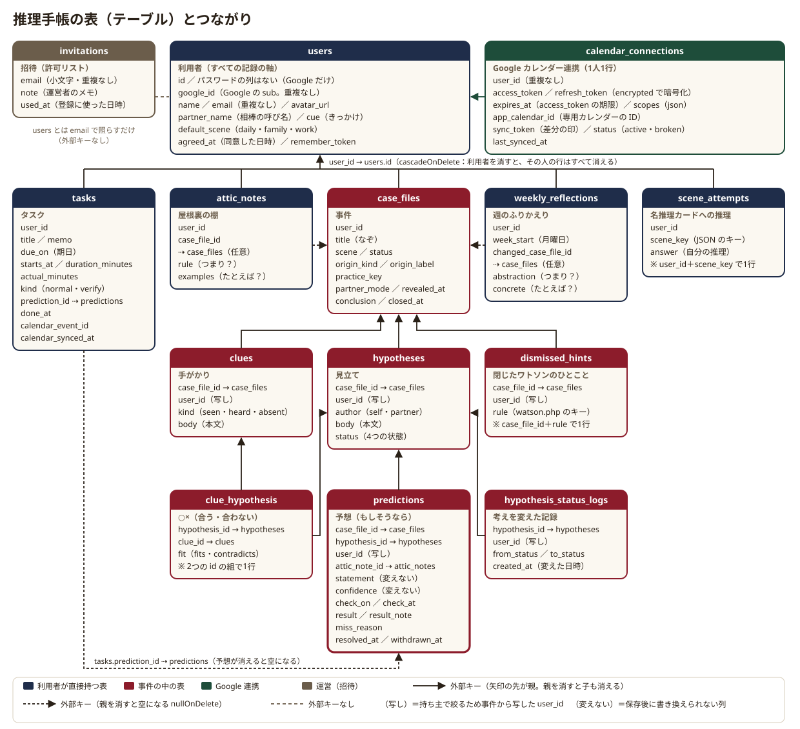

# 4. データ — 14の表とつながり

## この章でわかること

- 推理手帳のデータベースにある表（テーブル）と、表どうしのつながり（ER 図）
- 表の作り方を書いた「移行ファイル」（`src/database/migrations/`）と、表を扱う「モデル」（`src/app/Models/`）の関係
- いちばん大事な決まり「すべての記録を利用者を軸にする」と、他人（お客さまなど）の表を作らない理由
- 予想の文と確かさを、保存したあとに書き換えられないようにしている仕組み（モデルのどこで止めているか）
- 暗号化しているもの・外に出さないもの
- 退会したときに、その人の記録がまとめて消える仕組み（cascade）
- 教材（技能・名推理カードなど）を表ではなくファイル（`database/data/guide/*.json`）に置く理由と、読み込む係 `GuideLibrary`

> 表の列の一覧そのものは [データ設計（data-model.md）](../design/data-model.md) にあります。この章は、それを実物のコードと照らして「なぜそうしているか」を説明します。言葉（事件・手がかり・見立て…）の意味は [言葉のルール（words.md）](../design/words.md) です。

---

## 4-1. データベースと移行ファイル

**役目：** アプリが覚えておくこと（利用者・事件・手がかり・予想・タスク…）を、なくさないようにしまっておく場所です。

**たとえると：** 仕切りのついた帳簿の棚です。棚ごとに「事件の帳簿」「タスクの帳簿」と分かれていて、帳簿の1行が1件の記録です。帳簿どうしは「この手がかりは何番の事件のもの」という番号で結ばれています。

**中身：**

- データベースは **MySQL 8.4** で、Docker の `db` の箱の中で動いています。テストのときは、速く動くように **sqlite**（ファイルを使わない、メモリの中だけのデータベース）を使います。
- 表の形は、**移行ファイル**（マイグレーション。表を作る・直す手順を書いた PHP のファイル）に書いてあります。`docker compose exec -T app php artisan migrate` を動かすと、まだ動かしていない移行ファイルが名前の順に動き、表ができます。本番でも、表を足すときは `migrate` だけを使います。
- 表1つにつき、**モデル**（その表の1行を PHP のオブジェクトとして扱うクラス。`src/app/Models/`）が1つあります。モデルには「この表はどの表とつながっているか（関係）」「列の型（キャスト）」「小さな判定（例：予想が答え合わせ待ちか）」を書きます。

移行ファイルは16個あります。最初の3つは Laravel が用意する雛形、残りの13個が推理手帳のために作ったものです。

| ファイル（`src/database/migrations/`） | 作る表 |
|---|---|
| `0001_01_01_000000_create_users_table.php` | `users`（利用者）・`sessions`（ログインの状態） |
| `0001_01_01_000001_create_cache_table.php` | `cache`・`cache_locks`（一時的な置き場所） |
| `0001_01_01_000002_create_jobs_table.php` | `jobs`・`job_batches`・`failed_jobs`（後回しの仕事の列） |
| `2026_10_31_000001_create_invitations_table.php` | `invitations`（招待） |
| `2026_10_31_000002_create_case_files_table.php` | `case_files`（事件） |
| `2026_10_31_000003_create_clues_table.php` | `clues`（手がかり） |
| `2026_10_31_000004_create_hypotheses_table.php` | `hypotheses`（見立て） |
| `2026_10_31_000005_create_clue_hypothesis_table.php` | `clue_hypothesis`（○×） |
| `2026_10_31_000006_create_hypothesis_status_logs_table.php` | `hypothesis_status_logs`（考えを変えた記録） |
| `2026_10_31_000007_create_attic_notes_table.php` | `attic_notes`（屋根裏の棚） |
| `2026_10_31_000008_create_predictions_table.php` | `predictions`（予想） |
| `2026_10_31_000009_create_tasks_table.php` | `tasks`（タスク） |
| `2026_10_31_000010_create_weekly_reflections_table.php` | `weekly_reflections`（週のふりかえり） |
| `2026_10_31_000011_create_scene_attempts_table.php` | `scene_attempts`（名推理カードへの推理） |
| `2026_10_31_000012_create_dismissed_hints_table.php` | `dismissed_hints`（閉じたワトソンのひとこと） |
| `2026_10_31_000013_create_calendar_connections_table.php` | `calendar_connections`（Google カレンダー連携） |

アプリのデータを入れる表は、`users` と、2026-10-31 の13個のファイルが作る13の表を合わせた **14** です（Laravel の雛形の表は 4-10 で説明します）。

**並び順にも理由があります。** 外部キー（ほかの表の行を番号で指す列。「この予想は何番の屋根裏の知識を使ったか」など）は、指す先の表が先にないと作れません。予想（`predictions`）は屋根裏の棚（`attic_notes`）を指し、タスク（`tasks`）は予想を指すので、ファイルの番号は「屋根裏の棚（7）→ 予想（8）→ タスク（9）」の順にしてあります。

---

## 4-2. 全体の図（ER 図）

**役目：** 14の表と、表どうしのつながりを1枚で見るための図です（ER 図＝表（Entity）とつながり（Relationship）の図）。

**たとえると：** 帳簿の棚の見取り図です。どの帳簿がどの帳簿の番号を書き込んでいるかが、矢印でわかります。



**図の読み方：**

- **色**：紺は利用者が直接持つ表、赤は事件の中の表、緑は Google 連携、茶は運営のための表（招待）です。
- **実線の矢印**：外部キーです。矢印の先が「親」（指される側）で、**親の行を消すと、子の行も一緒に消えます**（`cascadeOnDelete`）。
- **点線の矢印**：外部キーですが、親を消しても子は残り、指していた列だけが空（null）になります（`nullOnDelete`）。
- **灰の破線**：外部キーはなく、メールアドレスの文字で照らし合わせるだけのつながりです（招待と利用者）。
- 利用者（`users`）の下の横線は、5つの表の `user_id` が `users.id` を指していることを表します。図をすっきりさせるため線は5本だけにしましたが、**事件の中の表も含めて、招待以外のすべての表が `user_id` を持ち、`users` を指しています**（箱の中の「user_id」）。
- 線を省いたつながりは、箱の中に「→ 表の名前」「⇢ 表の名前」で書いてあります（例：予想の `case_file_id → case_files`）。

---

## 4-3. いちばん大事な決まり：利用者を軸にする

**役目：** 「この記録はだれのものか」を、どの表でも同じやり方で決めておく決まりです。これがあるから、自分の記録は自分にしか見えません。

**たとえると：** 手帳の1ページずつに、持ち主の名前のはんこを押しておくことです。はんこが押してあるので、ほかの人の手帳のページが混ざっても、すぐに「これは自分のものではない」とわかります。

**中身：**

### どの表にも `user_id` がある

招待（`invitations`）以外のすべての表に、`user_id`（だれの記録か）の列があります。手がかり・見立て・予想のように、事件の下にある表にも `user_id` を持たせています。事件をたどれば持ち主はわかるのですが、**どの表でも「`user_id` を見るだけ」で持ち主を確かめられる**ように、事件から写しておくのです（図の「（写し）」）。

写し忘れを防ぐ仕掛けが、モデルにあります。

| 仕掛け | 場所 | すること |
|---|---|---|
| `CopiesOwnerFromCase` | `src/app/Models/Concerns/CopiesOwnerFromCase.php`（手がかり `Clue`・見立て `Hypothesis`・閉じたひとこと `DismissedHint` が使う） | 行を作る直前（`creating`）に、`user_id` が空なら、親の事件の持ち主を写す |
| `Prediction::booted()` | `src/app/Models/Prediction.php` | 作る直前に、事件が空なら見立ての事件を、持ち主が空なら事件の持ち主を写す |
| `HypothesisStatusLog::booted()` | `src/app/Models/HypothesisStatusLog.php` | 作る直前に、`user_id` が空なら見立ての持ち主を写す |

だから、`$case->clues()->create(['kind' => 'seen', 'body' => '…'])` のように事件から作れば、`user_id` を渡し忘れても持ち主がそろいます（テスト `tests/Feature/Models/ModelRulesTest.php` の `test_owner_is_copied_from_the_parent`）。

### 取り出すときも、持ち主から

- **一覧や集計**は、いつも利用者のモデルからたどります。例：きょうの画面の答え合わせ待ちは `$user->predictions()->whereNull('result')…`（`Queries/Today/DuePredictionsQuery`）。`User` モデルには `tasks()`・`caseFiles()`・`clues()`・`hypotheses()`・`predictions()`・`atticNotes()`・`weeklyReflections()`・`sceneAttempts()`・`dismissedHints()`・`calendarConnection()` の関係が並んでいて、ここから始めれば他人の行は混ざりません。
- **1件を開くとき**（住所に `/cases/12` のように番号が入るとき）は、ルートの `->can('view', 'case')` が **Policy**（してよいかを決める係）を呼びます。事件・手がかり・見立て・予想・タスク・屋根裏の棚の Policy は、どれも部品 `Policies/Concerns/OwnerOnly` を使い、「記録の `user_id` とログイン中の人の `id` が同じか」だけを確かめます。違えば 403（見る権利がない）になります。運営者でも、他人の記録は見られません（テスト `tests/Feature/Policies/OwnerOnlyTest.php`）。

### 他人の表を作らない理由

推理手帳には、「お客さま」「相手」のような**他人を表す表や列が1つもありません**。施術者が使うときも、書くのは「自分が見たこと・ご本人の言葉・自分の見立て・次に確かめること」だけで、お客さまごとのページは作りません。理由は3つです（[調査 R5](../research/R5-legal-privacy.md) の 0・1-4・2-3）。

1. **病気や通院のような、とても慎重に扱う個人情報（要配慮個人情報）を持たないため。** こうした情報は、本人の同意なしに集められず、漏れたら1件でも国（個人情報保護委員会）への報告と本人への通知が要ります。最初から持たない作りにすれば、その危険と負担がなくなります。
2. **運営者の手元に「人ごとに整理されたデータ」を作らないため。** お客さまごとのページがあると、データが人ごとに並び、だれの記録かがわかりやすくなります。ページを作らなければ、残るのは「施術者自身の考え方のメモ」だけです。
3. **医療の判断に見える機能に近づかないため。** 人ごとの経過を記録して判定する仕組みは、医療の道具に見えてしまいます。

この決まりは機械でも確かめています。コードの名前に他人を表す英単語を使うと `bin/check` が止め、画面には、ほかの人がわかる情報らしきもの（電話番号・メールアドレス・「〜さん」のつく名前）を見つけたときに、ワトソンのひとこと（W-5）が知らせます（[5章](05-reasoning-flow.md) の 5-13）。

> **相棒も「別の人の表」ではありません。** 相棒（例：長男）は、利用者の設定の `users.partner_name`（呼び名の文字だけ）と、見立ての `hypotheses.author = partner`（相棒が書いた見立ての印）で表します。相棒のアカウントや個人の記録は作りません。

---

## 4-4. 表ごとの説明

ここからは、14の表を1つずつ見ます。列のくわしい型と長さは [データ設計](../design/data-model.md) の 3 にあります。

### users（利用者）

**役目：** アプリを使う人の1行。すべての記録の持ち主です。

**たとえると：** 手帳の表紙の、持ち主の名前と好みを書いた欄です。

| 列 | 意味 |
|---|---|
| `google_id` | Google の利用者 ID（`sub`）。ログインの照合に使う。重複なし（[6章](06-google.md) の 6-1） |
| `name` / `email` / `avatar_url` | 表示名・Google のメールアドレス（重複なし）・アイコンの住所 |
| `partner_name` | 相棒の呼び名。入っていれば相棒モードを使える |
| `default_scene` | ふだんの場面（`daily`・`family`・`work`）。新しい事件の初めの値。`family` の人には子ども向けの言葉を出す（`User::prefersKidWords()`） |
| `cue` | 記録のきっかけ（例「夕食のあとに、気になったことを1つ」）。きょうの画面のいちばん上に出す |
| `agreed_at` | 利用規約・プライバシーポリシー・年齢の確認に同意した日時。空なら同意の画面へ送る |

**パスワードの列はありません。** ログインは Google だけだからです。`google_id` と `agreed_at` は、うっかり書き換えられないように「書き込んでよい列」（`#[Fillable]`）から外してあり、決まった用事だけが `forceFill` で入れます。

### invitations（招待）

**役目：** 招待制のときに、新しく登録してよいメールアドレスの一覧（許可リスト）です。既定の一般公開（`config('suiri.invite_only')` が false）では、登録を止めるのには使いません（名簿に行があれば、登録したときに `used_at` を記録するだけ）。

**たとえると：** 入口の受付が持つ「招待した人の名簿」です。受付を立てている（招待制の）ときだけ、名簿にない人は新しく入れません。

列は `email`（小文字にそろえる・重複なし）・`note`（運営者のメモ）・`used_at`（登録に使われた日時）。利用者とは**外部キーでつながず、メールアドレスの文字で照らす**だけです。運営者がコマンド `invite:add` で足します（[6章](06-google.md) の 6-2）。メールアドレスは `Invitation::normalize()` で前後の空白を取り、小文字にそろえてから入れ・探します。

### case_files（事件）

**役目：** 気になる出来事と、その「なぞ」。記録のいちばん大きな単位です。

**たとえると：** 1件ごとの捜査ファイルの表紙です。中に手がかり・見立て・予想の紙が綴じてあります。

| 列 | 意味 |
|---|---|
| `title` | なぞ（例「朝の電車がいつも遅れるのはなぜ？」） |
| `scene` / `status` | 場面（日常・親子・仕事）／状態（`open` 捜査中・`solved` 解決・`cold` 迷宮入り） |
| `origin_kind` / `origin_label` | きっかけ（タスク・予定・練習メニュー）と、その題名の写し。Google の予定の ID は持たない |
| `practice_key` | 練習メニューから作ったときの、メニューのキー |
| `partner_mode` / `revealed_at` | 相棒モードか／見せ合った日時。相棒モードで `revealed_at` が空の間は、互いの見立てを隠す（`CaseFile::hidesHypotheses()`） |
| `conclusion` / `closed_at` | 閉じたときの結論と日時 |

**名前の理由：** 「事件」をそのまま英語にすると `case` ですが、これは PHP の予約語（言語がすでに使っている言葉）なので、モデルは `CaseFile`、表は `case_files` です。住所の `{case}` は `AppServiceProvider` の `Route::model('case', CaseFile::class)` で `CaseFile` に結びつけています。

### clues（手がかり）

**役目：** 事件について確かめた事実の1つ。

**たとえると：** 捜査ファイルに貼る、1枚ずつの証拠メモです。

列は `case_file_id`（どの事件か）・`user_id`（写し）・`kind`（`seen` 見た・`heard` 聞いた・`absent` なかった）・`body`（本文、500字まで）。`created_at` が「足した日時」です。

### hypotheses（見立て）

**役目：** 手がかりを説明する案（仮説）の1つ。

**たとえると：** 「犯人はこの人かも」と書いた付箋です。何枚も貼れて、外れたら線で消します。

| 列 | 意味 |
|---|---|
| `author` | 書いた人（`self` 自分・`partner` 相棒）。相棒モードでないときは、いつも `self` |
| `body` | 本文（300字まで） |
| `status` | 状態（`considering` 検討中・`likely` 有力・`eliminated` 消えた・`confirmed` 当たり） |

見立てには、○×（`clue_hypothesis`）・考えを変えた記録（`hypothesis_status_logs`）・予想（`predictions`）がぶら下がります。モデルの `Hypothesis::clues()` は ○× をつけた手がかりを、`fits()` は ○× の行そのものを返します。

### clue_hypothesis（○×）

**役目：** 「この手がかりは、この見立てに合うか（○）合わないか（×）」の印。

**たとえると：** 見立ての付箋と証拠メモを結ぶ、○か×の札です。

列は `hypothesis_id`・`clue_id`・`fit`（`fits` 合う・`contradicts` 合わない）。**同じ見立てと手がかりの組は1行だけ**（一意の索引 `unique(['hypothesis_id', 'clue_id'])`）で、付け直すと上書きです。モデル `ClueHypothesis` は、Laravel の「中間の表」（Pivot）として作り、見立て側（`Hypothesis::clues()`）からも手がかり側（`Clue::hypotheses()`）からもたどれます。

### hypothesis_status_logs（考えを変えた記録）

**役目：** 見立ての状態を変えた（例：検討中 → 消えた）ことを、1回ごとに残す記録。

**たとえると：** 付箋を線で消したときに、手帳の余白に「○月○日、この案を消した」と書き添えることです。

列は `from_status`（前の状態）・`to_status`（新しい状態）・`created_at`（変えた日時）。書いたあとに直さないので `updated_at` の列はありません（モデルの `const UPDATED_AT = null`）。週のふりかえりの「考えを変えた」の回数は、この表を数えます。

### predictions（予想）

**役目：** 「もしこの見立てが正しいなら、〜が見えるはず」という予想。推理の流れの中心で、演繹の段です（[5章](05-reasoning-flow.md) の 5-5）。

**たとえると：** 封をした予言の手紙です。書いた日付と自信の度合いを書いて封をし、確かめる日に開けて答え合わせをします。封をしたあとは、中身を書き直せません。

| 列 | 意味 |
|---|---|
| `hypothesis_id` / `case_file_id` | どの見立てから導いたか／どの事件か |
| `attic_note_id` | 使った屋根裏の知識（任意） |
| `statement` | 予想の文（300字まで）。**保存後は書き換えない** |
| `confidence` | 確かさ（50〜95 を 5 刻み）。**保存後は書き換えない** |
| `check_on` / `check_at` | 確かめる日（必須）／時刻（任意。`HH:MM`） |
| `result` / `result_note` / `miss_reason` | 答え合わせの結果（`hit`・`miss`・`unclear`・`void`。空なら答え合わせ待ち）／一言／外れたときの原因 |
| `resolved_at` / `withdrawn_at` | 答え合わせした日時／取り下げた日時 |

`created_at` が「書いた日時」で、答え合わせの画面で必ず見せます。書き換えられない仕組みは 4-5 で説明します。モデルの小さな判定 `isPending()`（答え合わせ待ちか）・`isResolved()`・`isWithdrawn()`・`isDue($today)`（確かめる日が来たか）を、画面や集計が使います。索引 `(user_id, result, check_on)` は、きょうの画面の「答え合わせ待ち」を速く探すためのものです。

### tasks（タスク）

**役目：** やることの1行。予想から自動で作る「確かめるタスク」もここに入ります。

**たとえると：** 手帳の「やること」欄の1行です。確かめるタスクは、予言の手紙を開ける日のしおりです。

| 列 | 意味 |
|---|---|
| `title` / `memo` | 題名（100字まで）／メモ |
| `due_on` / `starts_at` | 期日（空なら「いつか」）／開始時刻（空なら終日） |
| `duration_minutes` / `actual_minutes` | 予想時間／かかった時間（見積もりの答え合わせに使う） |
| `kind` / `prediction_id` | 種類（`normal` ふつう・`verify` 確かめる）／確かめるタスクのもとの予想 |
| `done_at` | 済んだ日時 |
| `calendar_event_id` / `calendar_synced_at` | Google の予定の ID（ハイフンを抜いた UUID）／最後に書き出した日時（[6章](06-google.md)） |

`Task::answeredByPrediction()` は「確かめるタスクで、もとの予想が残っているか」を返します。真のときは、行の丸を押して済みにしたり戻したりできません（答え合わせで済みになる）。受付も画面も、このメソッド1つで判断します。索引 `(user_id, due_on)` と `(user_id, done_at)` は、今日・これから・済みの一覧を速くするためのものです。

### attic_notes（屋根裏の棚）

**役目：** 自分の事件から取り出した一般則（つまり？）と、その具体例（たとえば？）を1枚ずつためる棚。

**たとえると：** 自分だけの図鑑のページです（『緋色の研究』でホームズが頭を屋根裏部屋にたとえた話から）。

列は `rule`（つまり？、300字まで）・`examples`（たとえば？、500字まで）・`case_file_id`（どの事件からわかったか。任意）。事件を閉じるときに書いた「つまり？」から作られるほか、屋根裏の棚の画面で手でも足せます。予想を立てるときに棚の知識を選ぶと、予想の `attic_note_id` に入ります。

### weekly_reflections（週のふりかえり）

**役目：** 週ごとの問い（今週いちばん考えが変わった事件・つまり？・たとえば？）の答え。

列は `week_start`（週の始まりの月曜日）・`changed_case_file_id`（考えが変わった事件。任意）・`abstraction`（つまり？）・`concrete`（たとえば？）。**1人1週に1行**（一意の索引 `(user_id, week_start)`）で、書き直すと上書きです（`Actions/Review/SaveWeeklyReflection` の `updateOrCreate`）。

### scene_attempts（名推理カードへの推理）

**役目：** 手引きの名推理カードに、自分が書いた推理。

列は `scene_key`（`database/data/guide/scenes.json` のカードのキー）・`answer`（自分の推理）。**1人1カードに1行**（一意の索引 `(user_id, scene_key)`）です。カードそのものは表ではなくファイルにあるので（4-9）、表とファイルを結ぶのはキーの文字だけです。

### dismissed_hints（閉じたワトソンのひとこと）

**役目：** 事件ごとに「この問いかけはもう出さないで」と閉じた記録。

列は `case_file_id`・`rule`（`config/watson.php` の規則のキー。例 `single_hypothesis`）・`created_at`。**同じ事件の同じ規則は1行だけ**（一意の索引 `(case_file_id, rule)`）。規則のキーはこの表に入るので、`config/watson.php` のキーはあとから変えない決まりです（[5章](05-reasoning-flow.md) の 5-13）。

### calendar_connections（Google カレンダー連携）

**役目：** Google カレンダーとつないだ人の、鍵（トークン）と状態。1人1行です（`user_id` に重複なしの決まり）。

| 列 | 意味 |
|---|---|
| `access_token` / `refresh_token` | Google の鍵。**暗号化して保存**（4-6） |
| `expires_at` / `scopes` | access token の期限／許可された範囲（JSON の配列） |
| `app_calendar_id` | アプリが作った専用カレンダー「推理手帳」の ID |
| `sync_token` | 前回の取り込みからの差分を聞くための印 |
| `status` / `last_synced_at` | `active`（つながっている）・`broken`（許可が取り消された・切れた）／最後に同期した日時 |

使い方は [6章](06-google.md) でくわしく説明します。

---

## 4-5. 予想の文と確かさを書き換えられない仕組み

**役目：** 答え合わせのあとに「本当はこう思っていた」と予想を書き直す（後知恵）のを、仕組みで止めます。

**たとえると：** 封をした予言の手紙は、開ける日まで書き直せない、という約束です。考えが変わったら、古い手紙を書き直すのではなく、新しい手紙を書きます。

**なぜ：** 結果を知ったあとの人は、「最初からわかっていた」と感じやすいことが知られています（後知恵の偏り。[調査 R2](../research/R2-learning-science.md) の 2.2）。予想の道具やゲームの仕組みを調べた結果も「予想は書いた時点で固定し、答え合わせの画面では最初の予想と書いた日時を必ず見せる」でした（[調査 R3](../research/R3-products-oss.md) の 10-1 の 2）。

**中身：** 3つの段で止めています。

1. **直す入口を作らない。** 予想を直す画面・住所・用事（Action）がありません。`src/routes/web/cases.php` の先頭のコメントにも「予想の文と確かさを直すルートは作らない」と書いてあります。予想に対してできるのは、答え合わせ（`predictions.resolve`）と取り下げ（`predictions.withdraw`）だけです。
2. **モデルが止める。** それでもコードのどこかで書き換えようとしたら、モデルが例外（エラー）を投げます。`src/app/Models/Prediction.php` のこの部分です。

   ```php
   public const FROZEN = ['statement', 'confidence'];   // 保存後に書き換えてはいけない列

   static::updating(function (self $prediction) {         // 行を直す（UPDATE）直前に呼ばれる
       if ($prediction->isDirty(self::FROZEN)) {           // 文か確かさが、読み込んだときから変わっていたら
           throw new LogicException('予想の文と確かさは、保存したあとに書き換えられません。');
       }
   });
   ```

   `updating` は、Eloquent（Laravel のモデルの仕組み）が「この行を直します」という直前に呼ぶ合図です。`isDirty()` は「読み込んだときから値が変わったか」を返します。文か確かさが変わっていれば、保存の前に止まります。答え合わせの結果（`result`・`result_note`・`miss_reason`・`resolved_at`）や取り下げの日時（`withdrawn_at`）は、`FROZEN` に入っていないので書き込めます。
3. **画面で伝える。** 答え合わせの画面の「最初の予想」の枠（部品 `<x-case.prediction-original>`）の下に「予想の文と確かさは、保存したときのままです（あとから直せません）」と出します。

テストは `tests/Feature/Models/ModelRulesTest.php` の `test_prediction_statement_and_confidence_are_frozen`（結果は書けるが、確かさを書き換えると例外になる）です。

**取り下げても文は残ります。** 取り下げ（`Actions/Cases/WithdrawPrediction`）は `withdrawn_at` に日時を入れるだけで、文と確かさは記録として残します。

> **気をつけること：** `updating` は、モデルを1件ずつ読み込んで保存したときにだけ呼ばれます。`Prediction::where(...)->update([...])` のように、モデルを通さずに表をまとめて書き換える書き方では呼ばれません。いまのコードに、予想の表をまとめて書き換える所はありません。足すときも、この書き方は使わないでください。

---

## 4-6. 暗号化しているもの・外に出さないもの

**役目：** 盗まれると困る鍵を、データベースの中でも読めない形にし、画面やダウンロードにも出さないようにします。

**たとえると：** 家の合鍵を、鍵のかかる小箱に入れて棚にしまうことです。棚（データベース）を見られても、小箱の中身はすぐには使えません。

**中身：**

| 何を | どうしているか | 場所 |
|---|---|---|
| Google の `access_token`・`refresh_token` | Eloquent の `encrypted` キャストで暗号化して保存。読むときに自動で元に戻る | `CalendarConnection::casts()` |
| 上の2つと `sync_token` | `#[Hidden]` で、モデルを JSON にしたとき（データのダウンロードなど）に出さない | `CalendarConnection` の `#[Hidden([...])]` |
| `users.google_id`・`remember_token` | `#[Hidden]` で JSON に出さない | `User` の `#[Hidden([...])]` |
| カレンダー連携のダウンロード | 連携の行をまるごと出さず、「つながっているか」と専用カレンダーの ID だけを選んで出す | `Actions/Account/ExportUserData` |

`encrypted` キャストは、Laravel の暗号化の仕組み（鍵は `.env` の `APP_KEY`）を使います。データベースに入るのは、暗号化された長い文字列です。テスト `test_calendar_tokens_are_encrypted_and_hidden`（`ModelRulesTest`）と `tests/Unit/Google/GoogleTokensTest.php` が、表の生の値に鍵の文字が入っていないことを確かめています。暗号化の鍵が `APP_KEY` なので、本番の `APP_KEY` を作り直すと、保存したトークンが読めなくなります（その場合は、利用者につなぎ直してもらうことになります）。

`sync_token` は秘密ではないので暗号化していません（JSON には出しません）。

**記録の本文（手がかり・見立て・予想の文など）は、アプリでは暗号化していません。** 項目ごとに暗号化しても、鍵が同じサーバーにある限り、サーバーに入られたときの守りにはならないからです（[調査 R5](../research/R5-legal-privacy.md) の 2-3 の F）。その代わりに、①慎重に扱う情報をそもそも持たない（4-3）、②持ち主しか読めない（Policy）、③運営者が中身を読める管理画面を作らない、④ログに本文を書かない、で守ります（`.claude/rules/privacy.md`）。

---

## 4-7. 退会で消える仕組み（cascade）

**役目：** 退会した人の記録を、残らずすぐに消します。

**たとえると：** 手帳の持ち主の名前を棚から外すと、そのはんこが押されたページが全部まとめて抜ける仕掛けです。

**中身：**

### 外部キーの「消え方」は2種類

移行ファイルで外部キーを作るとき、親が消えたらどうするかを決めています。

| 書き方 | 親が消えると | 使っている所 |
|---|---|---|
| `->constrained()->cascadeOnDelete()` | **子の行も消える** | すべての `user_id`。事件の下の `case_file_id`（手がかり・見立て・予想・閉じたひとこと）。見立ての下の `hypothesis_id`（○×・考えを変えた記録・予想）。○× の `clue_id` |
| `->nullable()->constrained()->nullOnDelete()` | **子は残り、その列だけ空になる** | `tasks.prediction_id`・`attic_notes.case_file_id`・`predictions.attic_note_id`・`weekly_reflections.changed_case_file_id` |

`nullOnDelete` にしたのは「親が消えても、子には子の値打ちがある」ものです。事件を消しても、そこから取り出した屋根裏の知識や週のふりかえりは残ります。屋根裏の知識を消しても、それを使った予想は残ります。

### 退会の用事 `DeleteAccount`

退会（`DELETE /account`）は `src/app/Actions/Account/DeleteAccount.php` が次の順で行います。

1. **カレンダー連携を外す。** `Actions/Calendar/DisconnectCalendar` を呼び、Google で許可を取り消し（revoke）、連携の行を消します。Google が止まっていても、手元の鍵は必ず消します。利用者の Google にある専用カレンダーそのものは消しません（プライバシーポリシーに書いてあります）。
2. **ほかの端末のログインの記録（`sessions` の行）を消す。**
3. **招待の名簿の行を消す（ある場合）。** 名簿はメールアドレスを持っているからです。
4. **利用者の行を消す。** すると、`user_id` が `cascadeOnDelete` の表（タスク・事件・手がかり・見立て・○×・考えを変えた記録・予想・屋根裏の棚・週のふりかえり・名推理カードへの推理・閉じたひとこと）の、その人の行がデータベースの働きでまとめて消えます。

2〜4 は1つのトランザクション（全部できるか、全部なかったことにするかのまとまり）の中で行います。テストは `tests/Feature/Account/DeleteAccountTest.php` と `ModelRulesTest` の `test_factories_work_and_user_deletion_cascades` です。消えた記録はバックアップにだけ残り、バックアップは7日で消えます（`.claude/rules/privacy.md`）。

### データベースの cascade と、モデルの「見張り役」の違い

ここは初心者がつまずきやすいところです。データベースの `cascadeOnDelete` は、**データベースの中だけで**行を消します。PHP のモデルは呼ばれないので、モデルに付けた「消したときにすること」（見張り役 `TaskObserver` が、Google カレンダーの予定を消す仕事を出す、など）は動きません。

そこで、事件を消す用事 `Actions/Cases/DeleteCase` と、見立てを消す用事 `Actions/Cases/DeleteHypothesis` は、データベースに任せる前に、予想から作った確かめるタスクを**1件ずつモデルで消して**います。

```php
Task::whereIn('prediction_id', $case->predictions()->select('id'))->get()->each->delete();  // 1件ずつ消す＝見張り役が動き、カレンダーの予定も消える
$case->delete();                                                                           // 残り（手がかり・見立て・予想・○×）はデータベースの cascade で消える
```

退会のときは、先にカレンダー連携そのものを外す（1.）ので、予定を1つずつ消す必要はありません。

---

## 4-8. 日付だけの列と、状態や種類の列

**役目：** 日付や「状態」のように、書き方が何通りもありうる値を、1つの形にそろえる決まりです。

**中身：**

- **日付だけの列**（`tasks.due_on`・`predictions.check_on`・`weekly_reflections.week_start`）は、モデルで日付の型に変えず、`'2026-10-31'` の形の文字列のまま比べます。sqlite（テスト）と MySQL（本番）で日付の扱いが少し違うので、文字列にそろえると、どちらでも同じ結果になります。`'2026-10-30' <= '2026-10-31'` のように、この形の文字列は辞書の順がそのまま日付の順になります。
- **時刻だけの列**（`tasks.starts_at`・`predictions.check_at`）も `'07:40'` の形の文字列です。
- **状態や種類の列**（事件の状態・手がかりの種類・見立ての状態・答え合わせの結果・見落としの種類など）は、表では文字列で持ち、モデルで `src/app/Enums/` の列挙（決まった値だけを持つ型。例 `PredictionResult::Hit`）に変えます。画面に出す言葉（「当たり」など）は列挙の `label()` が `config/suiri.php` の `labels` から引くので、コードに日本語を直書きしません。
- **文字数の上限**は、表の列の長さと `config/suiri.php` の `limits` を同じにしてあります（例：予想の文は 300）。入力の検証（FormRequest）は `limits` を使います。

---

## 4-9. 教材は表ではなくファイルに置く

**役目：** 手引きの中身（10の技能・名推理カード・練習メニュー・演繹などの説明・手引きの入口）を、データベースではなく JSON のファイルに置き、`GuideLibrary` という係が読んで渡します。

**たとえると：** 利用者が書き込む手帳（データベース）と、全員に同じものを配る教科書（ファイル）を分けておくことです。教科書の誤字を直すのに、全員の手帳を開く必要はありません。

**なぜ表にしないか：**

1. **利用者のデータではなく「本の中身」だから。** だれが見ても同じで、利用者ごとに変わりません。利用者ごとに変わるのは「名推理カードに自分が書いた推理」だけなので、それだけを表（`scene_attempts`）にしています。
2. **文章として書き、読み比べ、直しやすいから。** JSON は文字のファイルなので、git で「どこをどう直したか」が1行ずつ見えます。引用は原文と一字一句同じか、出典の章は合っているか、を見直すのも楽です（`.claude/rules/guide-content.md`）。
3. **直したら置くだけで反映されるから。** 表に入れると、中身を直すたびに移行ファイルや入れ直しの手順が要ります。ファイルなら、コードと一緒に反映するだけです。
4. **機械で確かめやすいから。** 形の検査のテスト（`tests/Unit/Guide/GuideContentTest.php`：項目がそろっているか・キーが重ならないか・技能のキーが S1〜S10 にあるか）と、`bin/check` の「画面で使わない言葉」の検査が、JSON のファイルをそのまま読みます。

| ファイル（`src/database/data/guide/`） | 中身 | いまの数 |
|---|---|---|
| `skills.json` | ホームズの思考の10の技能（S1〜S10） | 10 |
| `scenes.json` | 名推理カード（原作の場面。ホームズが外した場面も混ぜる） | 23 |
| `practices.json` | 練習メニュー（選ぶと、問いかけ入りの事件を作る） | 11 |
| `reasoning.json` | 演繹・帰納・アブダクションの説明 | 1組 |
| `overview.json` | 手引きの入口（流れの段と技能の対応など） | 1組 |

項目の名前は [データ設計](../design/data-model.md) の 4 にあります。

### 読む係 `GuideLibrary`

`src/app/Support/Guide/GuideLibrary.php` が、ファイルを読む唯一の入口です。

| メソッド | 返すもの |
|---|---|
| `skills()`・`skill($key)` | 技能の一覧・1つ |
| `scenes()`・`scene($key)` | 名推理カードの一覧・1枚 |
| `practices()`・`practice($key)` | 練習メニューの一覧・1つ |
| `reasoning()`・`overview()` | 演繹などの説明・手引きの入口 |
| `practicesFor($skillKey)`・`scenesFor($skillKey)` | その技能を練習できるメニュー・カード |
| `skillNames()` | 技能のキーと名前の対応（札に名前を出すため） |
| `neighbors($name, $key)` | 並びの中の1つ前と1つ後ろ（「前へ・次へ」） |

読み込みは `load()` が1か所で行います。

```php
return Cache::rememberForever(
    "guide:{$name}:".filemtime($path),                    // キーにファイルの更新日時を入れる
    fn () => json_decode(file_get_contents($path), true, flags: JSON_THROW_ON_ERROR),
);
```

1度読んだ中身はキャッシュ（`cache` の表）に覚え、2回目からはファイルを読み直しません。キャッシュの名前（キー）にファイルの更新日時（`filemtime`）を入れているので、**ファイルを直すと名前が変わり、次に開いたときに自動で読み直します**。手でキャッシュを消す必要はありません。JSON の形が壊れていれば、`JSON_THROW_ON_ERROR` ですぐにエラーになり、こっそり空になることはありません。

ほかに、事件を作る画面の初めの値を作る `Queries/Cases/NewCaseDraft`（練習メニューの問いかけ）、今日の練習を選ぶ `Services/Guide/DailyPractice`、事件の詳細の `Queries/Cases/CaseBoardQuery` も、この係から教材を受け取ります。

---

## 4-10. Laravel の雛形の表

雛形のまま使っている表です。セッション・キャッシュ・キューは、どれもデータベースに置く設定（`.env` の `SESSION_DRIVER=database`・`CACHE_STORE=database`・`QUEUE_CONNECTION=database`）なので、表として存在します。

| 表 | 推理手帳での使い道 |
|---|---|
| `sessions` | ログインの状態。退会のときに、その人の行を消す |
| `cache`・`cache_locks` | 今日の予定（Google カレンダーの題名と時刻）を5分だけ置く。教材の中身（4-9）、書き込みの回数制限の数え、同じ仕事を重ねて積まないための札（`cache_locks`）もここ。期限の過ぎた行はコマンド `cache:prune-expired` が5分ごとに消す（[6章](06-google.md) の 6-12） |
| `jobs` | 後回しの仕事の列（カレンダーへの書き出し・取り込み）。worker の箱が取り出して片づける（[6章](06-google.md) の 6-10） |
| `failed_jobs` | 決めた回数を試してもだめだった仕事 |
| `job_batches` | 使っていない（雛形のまま） |

パスワードの再設定の表（`password_reset_tokens`）は、パスワードを持たないので作っていません。

---

## 次に読む章

- 推理の流れ（事件 → 手がかり → 見立て → もしそうなら → 答え合わせ）と、それぞれのクラス：[5. 推理の流れ](05-reasoning-flow.md)
- Google ログインとカレンダー連携（トークン・書き出し・取り込み）：[6. Google ログインとカレンダー連携](06-google.md)
- 画面を1つずつ見る：[2. 画面の案内](02-screens.md)
- 1回の操作がブラウザから DB までどう流れるか：[3. しくみ（太らない MVC）](03-architecture.md)
- 表の列の一覧：[データ設計](../design/data-model.md)・言葉の対応：[言葉のルール](../design/words.md)
- 個人情報の決まり：[`.claude/rules/privacy.md`](../../.claude/rules/privacy.md)・法律の調べ：[調査 R5](../research/R5-legal-privacy.md)
