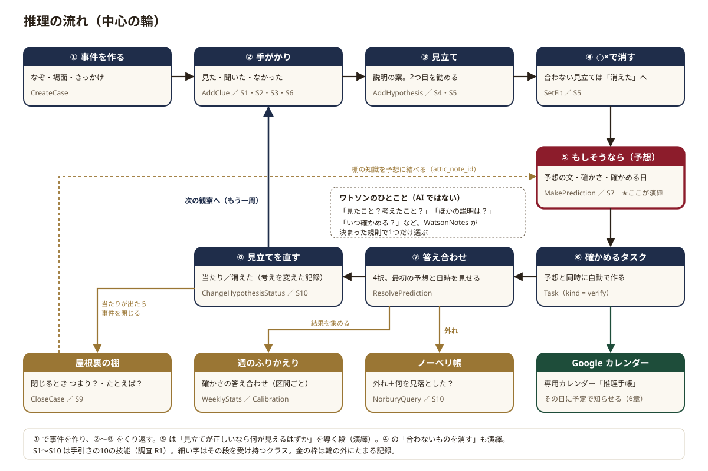
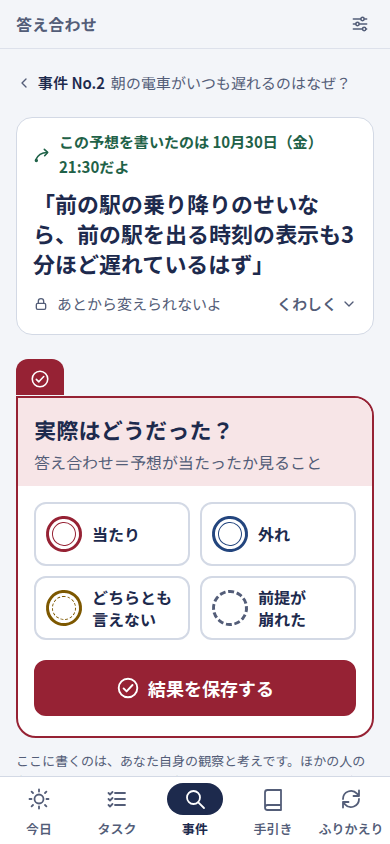
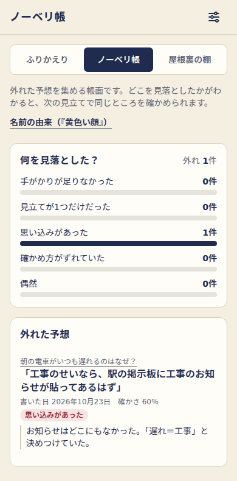
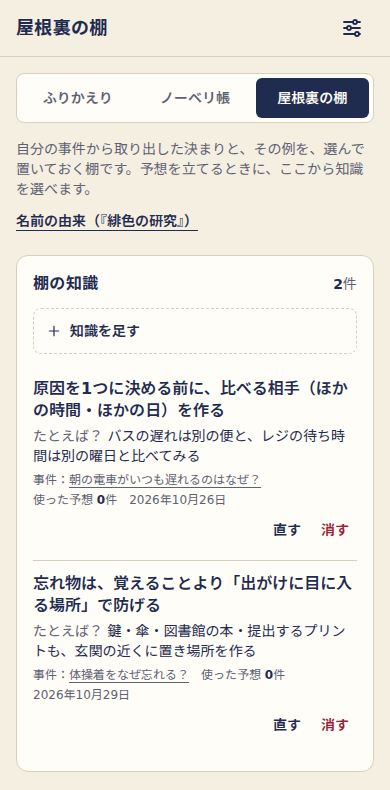
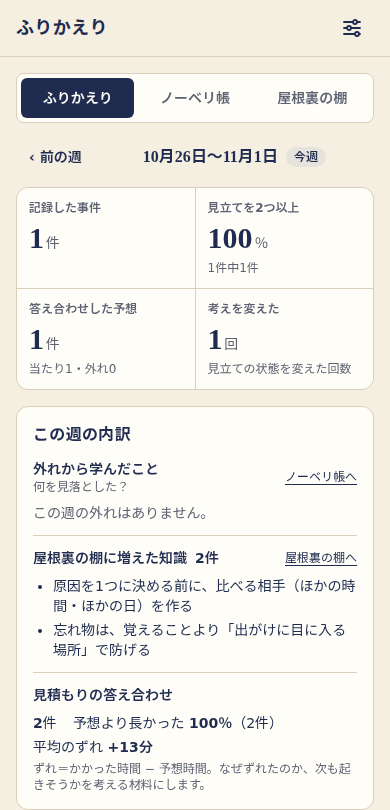
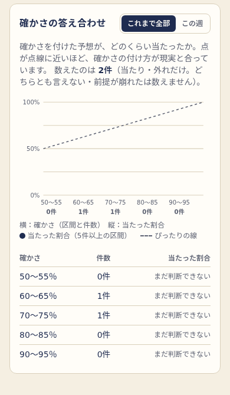
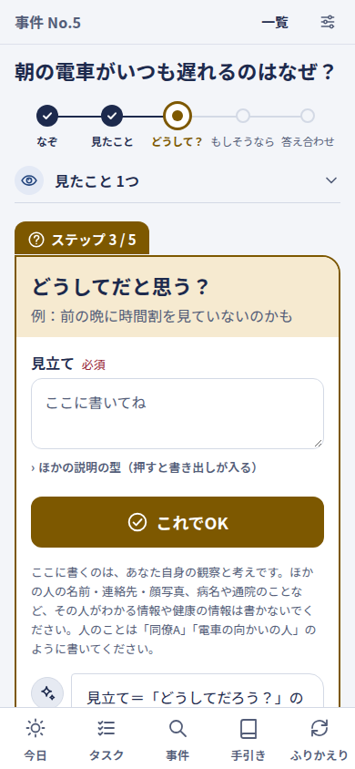
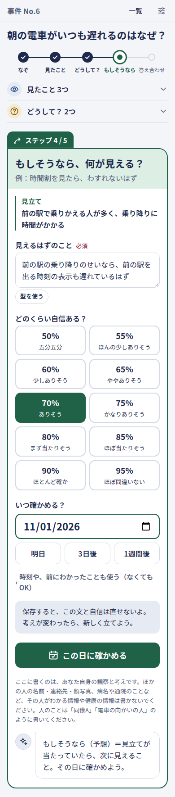
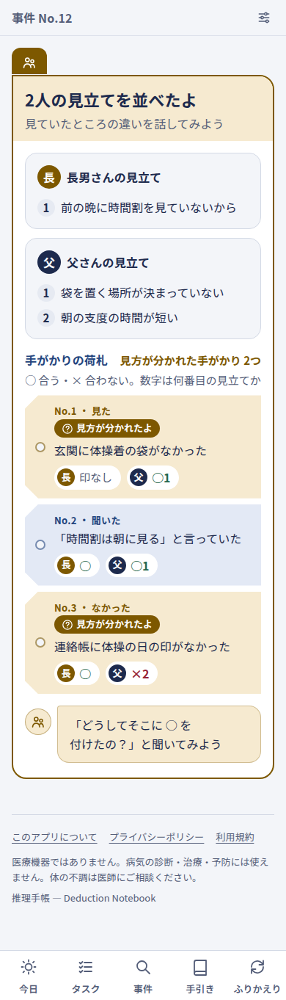

# 5. 推理の流れ — このアプリの中心

## この章でわかること

- 推理手帳の中心の流れ（事件を作る → 手がかり → 見立て → ○×で消す → もしそうなら → 確かめるタスク → 答え合わせ → 見立てを直す）を、1段ずつ
- 段ごとに、もとになったホームズの原作の場面（調査 R1）と、学習の研究（調査 R2・R3）
- 段ごとに、実物のクラス（`Actions/Cases/*`・`Services/Watson/*`・`Services/Review/*` など）がどこで何をしているか
- 事件の画面に1枚だけ出る「いまやることのカード」の決め方（いまの一手 `NextStep` と、カードを選ぶ部品）
- ワトソンのひとことの規則の一覧（`config/watson.php`）と、AI を使わない理由
- 入力欄の近くに出す「提案（AI なし）」：何が・いつ・なぜ出るか、言葉の重なりの決め方
- 相棒モード（1台のスマホを渡し合って隠して書き、見せ合う）の流れ
- 外れを集めるノーベリ帳、わかったことをためる屋根裏の棚、週のふりかえりと確かさの答え合わせ（キャリブレーション）

> 画面の言葉（事件・手がかり・見立て…）とコードの名前の対応は [言葉のルール](../design/words.md)、表の形は [4章](04-data.md) と [データ設計](../design/data-model.md) にあります。研究の出典は、この章の最後（5-16）にまとめました。

---

## 5-0. 全体の図

**役目：** 「観察 → 仮説 → 予想 → 確かめる → 振り返る」の手順を、毎日の出来事で1周ずつ回すための流れです。タスク管理は「確かめることを忘れない」ために使います。

**たとえると：** 探偵の捜査ノートの1冊の使い方です。気になる出来事を1件の事件として表紙を作り、見たことを書き、考えられる説明を並べ、「それならこうなるはず」と予言を書いて封をし、その日が来たら封を開けて答え合わせをします。外れたら、どこで見落としたかを書いておきます。

① で事件を作り、② から ⑧ をくり返します。輪の外の金の枠（ノーベリ帳・週のふりかえり・屋根裏の棚）は、くり返すうちにたまっていく記録です。

| 段 | ホームズの技能（[調査 R1](../research/R1-holmes-method.md) の S1〜S10） | 受け持つクラス |
|---|---|---|
| ① 事件を作る | （出発点：『緋色の研究』の「人生の書」） | `Actions/Cases/CreateCase`・`Queries/Cases/NewCaseDraft` |
| ② 手がかり | S1 観察する・S2 ささいなことを拾う・S3 事実と推理を分ける・S6 起きなかったことに気づく | `Actions/Cases/AddClue` |
| ③ 見立て | S4 決めつけを遅らせる・S5 別の説明を並べて消す | `Actions/Cases/AddHypothesis` |
| ④ ○×で消す | S5 合わないものを消す | `Actions/Cases/SetFit`・`ChangeHypothesisStatus` |
| ⑤ もしそうなら | S7 想像して予測し、確かめる（**ここが演繹**） | `Actions/Cases/MakePrediction` |
| ⑥ 確かめるタスク | S7 | `MakePrediction` が作るタスク（`kind = verify`） |
| ⑦ 答え合わせ | S7・S10 | `Actions/Cases/ResolvePrediction` |
| ⑧ 見立てを直す | S10 間違いを認めて直す | `ChangeHypothesisStatus` |
| ノーベリ帳 | S10 | `Queries/Review/NorburyQuery` |
| 屋根裏の棚 | S9 知識の棚をつくる | `Actions/Cases/CloseCase`・`Actions/Attic/SaveAtticNote` |
| 週のふりかえり | （振り返り・確かさの答え合わせ） | `Services/Review/WeeklyStats`・`Calibration`・`EstimateCheck` |

**演繹はどこか。** このアプリが大事にしている「演繹」は、前提から「必ずこうなる」と結論を導く推論です。ホームズが「deduction（演繹）」と呼んでいる推理の多くは、論理学では「いちばんありそうな説明を思いつく」推論（アブダクション）にあたります。純粋な演繹は「この見立てが正しいなら、〜が見えるはず」と予想を導く段（⑤）と、合わない見立てを消す段（④）です（[調査 R1](../research/R1-holmes-method.md) の 2-2・2-3）。見立てを立てる ③ がアブダクション、屋根裏の棚に一般則をためるのが帰納です。この3つの言葉は手引きの画面でだけ説明し、毎日の入力画面には出しません（[言葉のルール](../design/words.md) の 3）。

**画面では1段ずつ。** ② から ⑦ の段は、事件の画面に **いまやることのカード** として1枚ずつ出ます。開いた事件で「いま、どの段の何をすればいいか」をアプリが決めて、そのカードだけを大きく出し、済んだ段は上に「見たこと 3つ」のように1行ずつたたみます（作り直しで、この形にしました。理由と画面のくわしい並びは [2章の 2-7](02-screens.md)）。事件を作るときも、なぞ → 見たこと → どうして？ → 確かめ、の4つの問いを1つずつ聞きます（5-1）。

| 段 | 事件の画面のカード（段の色） |
|---|---|
| ② 手がかり | 「見たことを1つ教えて」（目の絵・紺） |
| ③ 見立て | 「どうしてだと思う？」（はてなの絵・からし色） |
| ④ ○×で消す | 「この見立てに合う？」（からし色。とばせる） |
| ⑤ もしそうなら | 「もしそうなら、何が見える？」（矢印の絵・深い緑） |
| ⑥ 確かめるタスク | 「11月5日（木）に確かめよう」（カレンダーの絵・深い緑） |
| ⑦ 答え合わせ | 「答え合わせをしよう」（チェックの絵・深い赤）→ 答え合わせの画面 |
| ⑧ 見立てを直す | 答え合わせのあとの「見立てを『当たり』にする？」と、「見立てを見直そう」のカード |
| 屋根裏の棚 | 「事件を閉じる？」→ 閉じたあとの「つまり、何がわかった？」 |

下は、見本のデータで記録した事件の画面です。見たこと3つと見立て2つが済み、いまは ④ の「この見立てに合う？」のカードが出ています。

---

## 5-1. 事件を作る

**役目：** 気になった出来事を、1件の「事件」として記録を始めます。

**たとえると：** 新しい捜査ファイルの表紙に、なぞ（「〜はなぜ？」）を書くことです。

**原作では：** 『緋色の研究』第1部2章で、ホームズは雑誌記事「人生の書」を書き、人に会ったらその人の来歴や職業を見分ける**毎日の練習**を読者に勧めています。「日常でホームズの視点を練習する」というこのアプリの目的は、原作の中にすでにあります（[調査 R1](../research/R1-holmes-method.md) の 1-0）。

**研究では：** 考える練習の伸びは、練習した種類の場面に強く出て、離れた場面にはあまり広がりません。だから題材は、練習用の問題ではなく、利用者が本当に考えたい日常の出来事そのものにします（[調査 R2](../research/R2-learning-science.md) の 0 の 2）。

**中身：**

- 入口は4つあります。事件の一覧の「新しい事件を作る」、今日の画面の「気になったことを書こう」、今日の画面やタスクの行の「気になる」、練習メニュー（今日の練習の「やってみる」など）です。
- 予定やタスクの「気になる」は、`POST /cases/draft`（`Http/Controllers/Cases/DraftCaseController`）で受け、題名の写しを「一度きりの入力」として作る画面へ持っていきます。題名を住所（URL）に載せないのは、住所はアクセスの記録に残るからです。
- 作る画面（`views/cases/create-steps.blade.php`）は、**4つの問いを1つずつ** 聞きます：① 何が気になった？（なぞ・場面・相棒モード）→ ② 見たこと・聞いたことを1つ教えて（最初の手がかり）→ ③ どうしてだと思う？（最初の見立て）→ ④ これで事件を作るよ（確かめて送る）。4つの問いは1つのフォームの中にあり、`resources/js/parts/stepper.js` がいまの問いだけを見せて「つぎへ」で進めます。送るのは最後の1回だけで、②と③は「あとで書く」で飛ばせます。JavaScript が動かないときは、4つが縦に並んでそのまま送れます（部品は `components/case-new/`。[2章の 2-7-2](02-screens.md)）。
- 作る画面の初めの値は `Queries/Cases/NewCaseDraft` が組み立てます。練習メニューから来たら、そのメニューの問いかけ（`prompts`：なぞ・手がかり・見立て・予想の案内）を各欄の案内にします。仕事の場面の事件がまだ1つもない人には、最初に「お客さまの記録には使えない」注意（`config/suiri.php` の `cases.work_caution`）を出します。
- 保存は `Actions/Cases/CreateCase` です。なぞ・場面・きっかけと一緒に、**最初の手がかり1つと見立て1つも1回で保存できます**（一番軽い記録。要件 C-10）。相棒モードの事件では、見立ては隠して書く流れにするので、最初の見立ては受け取りません（5-15）。
- 検証は `Http/Requests/Cases/StoreCaseRequest` です。相棒の名前を設定していない人が相棒モードを選んでも、ここで外します。

---

## 5-2. 手がかり（見た／聞いた／なかった）

**役目：** 事件について確かめた事実を、1つずつ足します。あとから何度でも足せます。

**たとえると：** 捜査ファイルに証拠メモを1枚ずつ貼ることです。メモには「自分の目で見た」「人から聞いた」「あるはずなのになかった」の色の札を付けます。

**原作では：**

- **見た**：『ボヘミアの醜聞』で、ワトソンは何百回も上った階段の段数（17段）を言えません。ホームズは「君は見ているが、観察していない」と言います。観察は視力ではなく、注意の向け方の習慣です（S1）。
- **聞いた**：『四つの署名』1章で、ホームズはワトソンの靴の赤い土（観察）と、そこからの推理（郵便局へ行った）をはっきり分けています（S3）。人の話は「そう言った」という事実で、中身が本当かは別です。
- **なかった**：『白銀号事件』で、夜中に馬が連れ出されたのに番犬が吠えなかったこと（"The dog did nothing in the night-time." "That was the curious incident."）から、ホームズは訪問者が犬のよく知る人物だと見抜きます（S6）。

**中身：**

- 事件の画面では、手がかりがまだない事件に「見たことを1つ教えて」のカード（部品 `<x-case-step.clue-card>`）が出ます。上から「どうやって知った？」（見た・聞いた・なかった の札）→ 見たことの欄 →「これでOK」。吹き出しで「見たこと（手がかり）＝目や耳でたしかめたこと。『〜と思う』は、次の『どうして？』で書こう。」と、事実と推理を分けるよう案内します（S3）。集めた手がかりは、済んだ段の「見たこと 3つ」を開くと **証拠品の荷札** として並びます（`<x-case-step.clue-pile>`）。2つ目からは「ほかにできること」の「見たことをもう1つ書く」から書きます。
- 用事は `Actions/Cases/AddClue`。`$case->clues()->create([...])` で足し、事件の「最近さわった日時」を新しくします（一覧の並び順に使う）。持ち主（`user_id`）は事件から写ります（[4章](04-data.md) の 4-3）。
- 種類は列挙 `ClueKind`（`seen`・`heard`・`absent`）。仕事の場面では、表示だけ「見た・触れた・測った」「ご本人の言葉」に変わります（`config/suiri.php` の `labels.by_scene.work`。[言葉のルール](../design/words.md) の 2）。
- 「見た」の手がかりに「と思う」「たぶん」のような推測の言葉や、「ので」「せいで」のような原因を決める言葉があると、ワトソンのひとことが「これは見たこと？　それとも考えたこと？」と聞きます（5-13 の W-1・W-2）。

---

## 5-3. 見立て（2つ目を勧める理由）

**役目：** 手がかりを説明できる案（仮説）を立てます。1つ目のあと、「ほかの説明は？」と2つ目を勧めます。

**たとえると：** 「犯人はこの人かも」と付箋に書いて貼ることです。1枚だけだと、その付箋に合う証拠ばかりが目に入るので、もう1枚貼ります。

**原作では：** 『ブラック・ピーター』で、警部が一人の青年を犯人と決めたとき、ホームズは "One should always look for a possible alternative, and provide against it. It is the first rule of criminal investigation."（別の可能性を探し、それに備える。それが捜査の第一原則だ）と言います。『白面の兵士』では、若者が隠されている理由を3つ並べ、一つずつ検討しています（S5）。

**研究では：** 「別の説明を考える」は、「公平に」「慎重に」のような心がけの声かけより、偏りを減らす効果がありました（Lord ら 1984、Hirt & Markman 1995）。ただし、**別の理由を2個書かせると後知恵の偏りが消えたのに、10個書かせると難しく感じて、かえって偏りが強まった**という実験があります（Sanna ら 2002）。そこで推理手帳は、2つ目を勧めますが、たくさんは求めません（[調査 R2](../research/R2-learning-science.md) の 2.2）。

**中身：**

- 用事は `Actions/Cases/AddHypothesis`。相棒モードでない事件では、書いた人はいつも「自分」にします。
- 書くカード（部品 `<x-case-step.hypothesis-card>`）の問いは、見立てがないときは「どうしてだと思う？」、「ほかにできること」の「見立てをもう1つ書く」から来たときは「ほかの理由もありそう？」（例の前に「2つあると、くらべられるよ」）、全部ちがったときは「見立てが全部ちがったよ。ほかの理由は？」に変わります。吹き出しは「見立て＝『どうしてだろう？』の答えの案。当たっているかは、あとで確かめるよ。」です。2つ目は勧めますが、いまやることのカードにはしません（たくさん書かせない）。
- 見立てが1つだけの捜査中の事件には、ワトソンのひとことが「ほかの説明は？」と聞きます（5-13 の W-3）。
- 閉じた事件には足せません。手がかり・見立て・○×・予想・見せ合うのルートはどれも `->can('write', …)` で、持ち主で事件が捜査中かを確かめます（`Policies/Concerns/WritesOpenCase`。閉じていれば「開き直してください」の 403）。答え合わせと取り下げだけは、閉じた事件でもできます（待っている予想の結果を残す・確かめるタスクを片づけるため）。

---

## 5-4. ○×で消す

**役目：** 見立てごとに、手がかりが合うか（○）合わないか（×）を付け、合わない見立てを消していきます。

**たとえると：** 付箋と証拠メモを1つずつ見比べて、合わない付箋に線を引くことです。

**原作では：** 『四つの署名』6章の「不可能を除いて残ったものが、どれほどありそうになくても真実だ」は有名です。ただし『白面の兵士』では、ホームズが最後に残した説明が、専門家の検査で訂正されます。**消す方法は、候補の一覧に漏れがないことが前提**で、最後に確かめるところまでがひと組です（S5 の「よくある失敗」）。だから推理手帳では、消したあとも ⑤ の予想で確かめに行きます。

**中身：**

- 用事は `Actions/Cases/SetFit`。見立てと手がかりの組ごとに `clue_hypothesis` の行を1つだけ持ち、付け直すと上書き（`updateOrCreate`）、もう一度押すと外します（行を消す）。
- 受付の前に、ルートが見立てと手がかりの**両方**が自分のものかを確かめ（`->can('update', 'hypothesis')->can('update', 'clue')`）、`UpdateFitRequest` が「同じ事件の見立てと手がかりか」を確かめます。
- 画面では、予想を立てる段に来たとき、まだ ○× の付いていない手がかりがあれば、先に「この見立てに合う？」のカード（部品 `<x-case-step.fit-card>`）を出します。見立てを引用し、手がかりの荷札ごとに大きな ○・× のボタン（直径 48px。子どもの指でも押しやすい）を並べます。○× は任意で、見立ての横の「とばす」か「次へ：もしそうならを考える」で予想のカードへ進めます。あとからは「見立てを見直す・○× をつける」で付けられます。
- × が1つでも付いた見立てには「× があるね。この見立ては、ちがいそう？」と「ちがった にする」のボタンが出ます。消すかどうかは利用者が決めます。
- 状態（検討中・有力・消えた・当たり）を変える用事は `Actions/Cases/ChangeHypothesisStatus` です。状態が本当に変わったときだけ、**考えを変えた記録**（`hypothesis_status_logs`：前の状態・新しい状態・日時）を1行残します。同じ状態を押しただけなら何も増やしません。この記録が、週のふりかえりの「考えを変えた」の回数になります。

---

## 5-5. もしそうなら（予想・確かさ・確かめる日）— ここが演繹

**役目：** 見立てから「もしこの見立てが正しいなら、〜が見えるはず」という予想を導き、自信の度合い（確かさ）と確かめる日を付けて保存します。

**たとえると：** 予言の手紙を書いて封をすることです。「○日に開けたら、〜になっているはず。自信は70％」と書き、日付を入れて封をします。封をしたら書き直せません。

**原作では：** 『赤毛組合』で、ホームズは「助手が地下でトンネルを掘っているなら、ズボンの膝は擦り切れて汚れているはずだ」と予想し、道を尋ねるふりをして膝を見ます。何が見えたかと聞かれ、"What I expected to see."（予想どおりのものさ）と答えます。『白銀号事件』では「想定が正しければ、馬はあの窪地を渡ったはずで、そこに足跡を探すべきだ」と予想し、実際に足跡を見つけます。反対に、兄のマイクロフトは観察と推理では弟より上なのに、自分の答えを確かめに行かないので探偵には向かない、とホームズは言います（S7）。

**研究では：**

- 自信の度合い（％）を付けて現実と答え合わせする練習には、大きな裏づけがあります。予測大会の実験では、1時間以内の訓練で予測が正確になり、過信がほぼ半分になりました（Mellers ら 2014、Moore ら 2017）。また、「絶対確実」とした予測は84％しか当たりませんでした。そこで確かさは50〜95％から選び、**100％は選べません**（[調査 R2](../research/R2-learning-science.md) の 3.1・3.5）。
- 「いつ・何をきっかけにやるか」を先に決めておくと、実際にやる割合が上がります（実行意図。Gollwitzer & Sheeran 2006）。日付だけより「日付と時刻」を書かせたほうが効果があったという実験もあります（Milkman ら 2011。[調査 R2](../research/R2-learning-science.md) の 6.2）。だから確かめる日は必須で、時刻も入れられます。

**中身：**

- 受付は `PredictionController@store`、用事は `Actions/Cases/MakePrediction` です。1つのトランザクションの中で、①予想を作り、②**確かめるタスク**を作ります（5-6）。
- 検証は `StorePredictionRequest` です。

  | 項目 | 決まり |
  |---|---|
  | 予想の文（`statement`） | 必須・300字まで |
  | 確かさ（`confidence`） | `config/suiri.php` の `confidence.choices` のどれか（50・55・…・95。それぞれ「五分五分」「ありそう」「ほぼ間違いない」などの目安の言葉つき） |
  | 確かめる日（`check_on`） | 必須・今日以降。初めの値は明日（`cases.check_after_days`） |
  | 確かめる時刻（`check_at`） | 任意・`HH:MM` |
  | 使う屋根裏の知識（`attic_note_id`） | 任意・**自分の棚の知識だけ**（`Rule::exists(...)->where('user_id', ...)`） |

  捜査中で、相棒モードなら見せ合ったあとの事件でだけ予想を立てられます（`authorize()`）。
- 画面は「もしそうなら、何が見える？」のカード（部品 `<x-case-step.predict-card>`）です。カードの中も **1問ずつ** で、① 見えるはずのこと（「型を使う」で穴埋めの文が入る）→ 書くと ② どのくらい自信ある？（50〜95％の10枚の札。自分で選んでもらうため、初めはどれも選ばない）→ 選ぶと ③ いつ確かめる？（大きな日付と、明日・3日後・1週間後などのボタン）が出ます。前の問いに答えるまで次の問いを CSS（`:has`）で隠し、主なボタン「この日に確かめる」はいつもカードの下にあります。ボタンの上には「保存すると、この文と自信は直せないよ。考えが変わったら、新しく立てよう。」と出します。
- **予想の文と確かさは、保存したあとは書き換えられません。** 直す画面も用事もなく、書き換えようとするとモデル（`Prediction::booted()` の `updating`）が止めます（[4章](04-data.md) の 4-5）。考えが変わったら、新しい予想を立てます。
- 取り下げはできます（`Actions/Cases/WithdrawPrediction`）。取り下げた日時を入れるだけで、文と確かさは残ります。まだ済んでいない確かめるタスクは、もう確かめる必要がないので消します（済んだものは記録として残す）。

---

## 5-6. 確かめるタスク

**役目：** 予想を立てると、確かめる日を期日にしたタスクが自動ででき、その日に「答え合わせ」を思い出させます。

**たとえると：** 予言の手紙を開ける日に挟んでおく、手帳のしおりです。

**原作では：** マイクロフトとの違い（5-5）のとおり、ホームズは確かめに行くところまでやります。推理手帳では、その「確かめに行く」をタスクにして、忘れないようにします。

**中身：**

- `MakePrediction` が、予想と同時にタスクを作ります。種類は `TaskKind::Verify`（確かめる）、期日は予想の確かめる日、開始時刻は確かめる時刻、題名は `config/suiri.php` の `cases.verify_task_title`（「確かめる：」＋予想の文。長ければ「…」で切る）、`prediction_id` にもとの予想を入れます。
- 確かめるタスクは、行の丸を押して済みにしたり戻したりできません。**答え合わせを済ませると、自動で済みになります**（5-7）。判断は `Task::answeredByPrediction()` の1か所です。
- 今日の画面では、確かめる日が今日までに来た予想があると、いちばん上のいまやることのカードが「答え合わせしよう」になります（`Queries/Today/DuePredictionsQuery`。結果がなく、取り下げてもおらず、`check_on` が今日以前のもの。出すのはいちばん古い1件で、ほかは「ほかにも1件あるよ」にたたむ）。事件の画面でも、いまやることが「答え合わせをしよう」のカードになります。同じ予想の確かめるタスクは、今日の画面の下の「きょうの予定とやること」には二重に出しません（`Queries/Today/AgendaQuery` の `$skipPredictionIds`）。
- カレンダーとつないでいれば、確かめるタスクも専用カレンダーに予定として書き出されます。そのとき**予定の題名は「推理手帳：答え合わせの日」に固定**し、予想の文は送りません（[6章](06-google.md) の 6-8）。

---

## 5-7. 答え合わせ（4択・最初の予想と日時を見せる理由）

**役目：** 確かめる日が来たら、予想が当たったかを記録します。

**たとえると：** 封をした予言の手紙を、みんなの前で開けることです。開ける前に、封筒に書いた日付と自信の度合いをまず読み上げます。

**原作では：** 『サセックスの吸血鬼』でホームズは、最初に頭の中で導いた推理が、独立したいくつもの出来事で一つずつ確かめられたとき、主観が客観になると言います（S7）。

**研究と、ほかの道具では：**

- 結果を知ったあとの人は「最初からわかっていた」と感じやすくなります（後知恵の偏り。[調査 R2](../research/R2-learning-science.md) の 2.2）。予想の道具や推理ゲームを調べた結果、いちばん大事な対策は「予想は書いた時点で固定し、**答え合わせの画面では最初の予想と書いた日時を必ず見せる**」でした（[調査 R3](../research/R3-products-oss.md) の 10-1 の 2）。
- 結果は4つにします。当たり・外れのほかに「どちらとも言えない」（実情がわからず決められない）と「前提が崩れた」（確かめる場面そのものがなくなった）を置き、この2つは当たり外れに数えません（予想の大会 Metaculus などの仕組み。[調査 R3](../research/R3-products-oss.md) の 10-1 の 3）。無理に当たり・外れに振り分けると、確かさの答え合わせ（5-11）がゆがむからです。

**中身：**

- 画面は `GET /predictions/{prediction}`（`PredictionController@show`）です。いちばん上の「前に書いた予想」の枠（部品 `<x-case.prediction-original>`）に、**書いた日時（`created_at`）と予想の文** を大きく出し、「あとから変えられないよ」と添えます。確かさ・確かめる日・どの見立てから・使った屋根裏の知識は「くわしく」にたたみ、いちばん大事な「いつ・何と書いたか」が埋もれないようにしています。
- その下の「実際はどうだった？」のカード（部品 `<x-case.resolve-form>`）に、4つの結果を大きなボタンで並べます。ボタンは答え合わせのはんこ（`<x-ui.stamp>`）と同じ色と輪の形なので、文字を読まなくても見分けられます。外れを選んだときだけ「どこで見落とした？」を、どれかを選んだら「ひとことメモ」を出します（CSS の `:has`）。ボタンと「結果を保存する」は、スマホの最初の画面に収まります。
- 受付は `ResolvePredictionController`、検証は `ResolvePredictionRequest` です。答え合わせ待ちの予想だけを受け付けます（済んだ・取り下げた予想は 403）。結果は列挙 `PredictionResult`（`hit`・`miss`・`unclear`・`void`）のどれか、一言は任意、**外れのときだけ「何を見落とした？」が必須**です（`required_if:result,miss`）。
- 用事 `Actions/Cases/ResolvePrediction` は、1つのトランザクションの中で、予想の行に鍵をかけて読み直し（`lockForUpdate()`）、答え合わせ待ちのときだけ、①結果・一言・（外れなら）見落とし・答え合わせの日時を予想に書き、②確かめるタスクがまだ済んでいなければ済みにします。取り下げと同時に来た・二重に送られたときは、先に書いたほうが残ります（取り下げの `WithdrawPrediction` と同じ形）。予想の文と確かさには触りません。
- 記録したあとに開くと、前に書いた予想の右上に「確かめた」の丸いはんこ（当たり・外れ…）が押された形になります。その下（部品 `<x-case.resolve-result>`）に、次の一手を1つだけ大きく出します。当たりなら「見立てを『当たり』にする？」、外れなら「見立てを『消えた』にする？」、どちらとも言えない・前提が崩れたなら「もう一度、予想してみる？」。押すと ⑧ の「見立てを直す」になり、考えを変えた記録が残ります。

---

## 5-8. 外れたら「何を見落とした？」— ノーベリ帳

**役目：** 外れた予想に、何を見落としたかを付けて集めます。外れを隠さず、次の推理の戒めにします。

**たとえると：** 「まちがいノート」です（子ども向けの呼び名もこれです）。どこでまちがえたかの種類ごとに数えると、自分のくせが見えてきます。

**原作では：** 『黄色い顔』で、ホームズは依頼人の妻の秘密を脅迫がらみと推理しますが、真相はまったく別の、温かい事情でした。その夜ホームズはワトソンに "kindly whisper 'Norbury' in my ear"（わたしが自信過剰になっていたら、耳もとで「ノーベリ」とささやいてくれ）と頼みます。『まだらの紐』では間違った方向へ行きかけて、すぐに考え直しています（S10）。

**中身：**

- 見落としの種類は列挙 `MissReason` の5つです。

  | 値 | 画面の言葉 | 子ども向け |
  |---|---|---|
  | `few_clues` | 手がかりが足りなかった | 手がかりが少なかった |
  | `single_hypothesis` | 見立てが1つだけだった | 「かも」が1つだけだった |
  | `assumption` | 思い込みがあった | 思いこみがあった |
  | `wrong_check` | 確かめ方がずれていた | 見に行き方がずれていた |
  | `chance` | 偶然 | たまたま |

- ノーベリ帳の画面（`/norbury`、`Review\NorburyController`）は `Queries/Review/NorburyQuery` が組み立てます。`misses()` が外れた予想を答え合わせの新しい順に（事件のなぞつきで）、`reasonCounts()` が見落としの種類ごとの数を（0件の種類も入れて）返します。
- 答え合わせの結果の画面には「この外れは『ノーベリ帳』に入ったよ。名探偵も外すよ。直せるのが強さだよ。」と「ノーベリ帳を開く」が出ます。責める言葉は出しません。

---

## 5-9. 閉じるとき「つまり？・たとえば？」— 屋根裏の棚

**役目：** 事件を閉じるとき、この事件からわかった一般則（つまり？）と、ほかに当てはまる場面（たとえば？）を書き、屋根裏の棚にためます。

**たとえると：** 自分だけの図鑑に、1ページ書き足すことです。「忘れ物は、覚えることより置き場所で防げる」と書き、その下に「鍵・傘・提出するプリントも同じ」と例を書きます。

**原作では：** 『緋色の研究』第1部2章で、ホームズは人の頭を小さな屋根裏部屋にたとえます。何でも詰めこむと役に立つ知識が埋もれるので、選んで並べておく。ホームズ自身、タバコの灰140種の研究など、自分の仕事に役立つ知識を選んで積み上げています（S9）。

**研究では：** 細谷功さんの『具体と抽象』と同じ考え方で、記録から一段上（決まり・型）へ、一段下（具体例）へ動く2つの問いを置いています（ハヤカワの「抽象のはしご」を、上下2方向の操作にしたもの。[調査 R2](../research/R2-learning-science.md) の 8.2・8.5）。ただし、練習の伸びが日常の外のかけ離れた場面まで広がることは期待しません（同 8.4）。だから題材は、いつも自分の事件です。

**中身：**

- 事件の画面では、2つの段に分けて聞きます。まず「事件を閉じる？」のカード（部品 `<x-case-step.close-card>`）で、「解決！（わかった）」か「おあずけ（まだわからない）」の大きな2枚から選び、わかったことを一言（なくてもOK）書きます。「おあずけ」は迷宮入りのことです。「当たり」の見立てがあって待っている予想がないときは、このカードがいまやることとして出ます。それ以外のときは「ほかにできること」の「事件を閉じる」から開きます。
- 閉じると、閉じた事件の画面（部品 `<x-case-step.closed-card>`）が「解決！」か「おあずけ」の丸いはんこを押した形になり、その下で「つまり、何がわかった？」を聞きます。書き始めると「ほかに当てはまりそうなことは？」（たとえば？）が出ます（CSS の `:has`）。「棚にしまう」で屋根裏の棚の受付（`POST /attic` → `Actions/Attic/SaveAtticNote`）に送り、どの事件からわかったか（`case_file_id`。自分の事件だけ選べる）も結びます。書かなくてもかまいません。この事件からもう棚にしまったことがあれば、聞き直さずにそれを見せます。
- 閉じる受付の用事 `Actions/Cases/CloseCase` は、状態・結論・閉じた日時を書きます（検証は `CloseCaseRequest`。捜査中の事件だけを受け付ける）。「つまり？」を一緒に受け取れば屋根裏の棚の知識も作れますが、作り直した画面は、閉じるのと棚にしまうのを別の段にしているので、そこには送りません。
- 閉じた事件は「開き直す」（`Actions/Cases/ReopenCase`）で捜査中に戻せます。前の結論は、前の考えの記録として消さずに残します。
- 屋根裏の棚の画面（`/attic`）では、手で足す・直す・消すこともできます（`Actions/Attic/SaveAtticNote`）。一覧は `Queries/Review/AtticNotesQuery` が、生まれた事件と「使った予想」の数つきで返します。
- 予想を立てるとき（5-5）、棚の知識を選ぶと、予想の `attic_note_id` に結ばれ、答え合わせの画面に「使った知識」として出ます。「この知識とこの手がかりから、この予想」という形です。

---

## 5-10. 見立てを直す（もう一周）

**役目：** 答え合わせの結果に合わせて見立ての状態を変え、次の観察へ戻ります。

**たとえると：** 外れた付箋に線を引き、当たった付箋に丸を付けて、また証拠集めに戻ることです。

**中身：** 5-7 の「次の一手」のボタンも、「見立てを見直そう」のカード（部品 `<x-case-step.edit-hyps-card>`。見立てごとに 検討中・有力・消えた・当たり の大きなボタン）も、○× のカードの「ちがった にする」も、`PATCH /hypotheses/{hypothesis}` → `HypothesisController@update` → `ChangeHypothesisStatus` に届きます（考えを変えた記録が残る）。「当たり」の見立てがあり、答え合わせ待ちの予想がなくなると、いまやることが「事件を閉じる？」のカードになります（5-12）。見立てが全部消えたら「見立てが全部ちがったよ。ほかの理由は？」のカードで ③ へ戻します。

---

## 5-11. 週のふりかえりと、確かさの答え合わせ（キャリブレーション）

**役目：** 1週間の記録を数字で振り返り、「なぜそうなった？」を書き、自分の自信の付け方が現実と合っているかを確かめます。

**たとえると：** 週末に捜査ノートを読み返し、「70％と書いた予言は、本当に10回に7回くらい当たっていたか」を数えることです。

**原作では：** 『バスカヴィル家の犬』4章で、ホームズは自分の推理を「確からしさを比べて、いちばんありそうなものを選ぶ領域だ」と言います（[調査 R1](../research/R1-holmes-method.md) の 2-2）。推理は「必ず正しい」ではなく「どのくらい確からしいか」の話です。

### 週のふりかえり

画面は `GET /review/{week?}`（`Review\ReviewController`）。週は月曜日の0時から次の月曜日の0時の手前までで、`Services/Review/ReviewWeek` が受け持ちます（住所の `2026-10-26` の形との行き来、前の週・次の週。未来の週は作らない）。数字は `Services/Review/WeeklyStats` が、その人の記録だけを数えます。

| 数字 | 数え方 |
|---|---|
| 記録した事件 | その週に作った事件の数 |
| 見立てを2つ以上 | その週の事件のうち、見立てが2つ以上ある割合 |
| 答え合わせした予想 | その週に答え合わせした数と、結果ごとの数 |
| 考えを変えた | その週に見立ての状態を変えた回数（`hypothesis_status_logs`） |
| 外れから学んだこと | その週の外れの、見落としの種類ごとの数 |
| 屋根裏の棚に増えた知識 | その週に足した知識の数と、新しいものから3件 |
| 見積もりの答え合わせ | `Services/Review/EstimateCheck`：予想時間とかかった時間の両方がある済んだタスクの数・予想より長かった割合・平均のずれ |

見積もりの答え合わせを入れたのは、自分の作業時間はほぼ必ず短く見積もられ、過去の実績を思い出して今回と結びつけると楽観の偏りが消えた、という研究があるからです（Buehler ら 1994。[調査 R2](../research/R2-learning-science.md) の 3.4）。タスクに予想時間を入れるとき、題名の似た過去のタスクの実績を見せるのも同じ理由です（`Queries/Tasks/SimilarTasksQuery`）。

**週の問い**（`config/suiri.php` の `review.questions`）は「今週いちばん考えが変わった事件は？」「つまり？」「たとえば？」で、それぞれ「なぜ考えが変わった？」「なぜそうなった？」と添えます。振り返りは「どうだった？」（出来の自己評価）より「なぜそうなった？」（説明）を聞くほうが効果が大きかった、というまとめがあるからです（Bisra ら 2018。[調査 R2](../research/R2-learning-science.md) の 5.3）。保存は `Actions/Review/SaveWeeklyReflection`（1週1行、書き直すと上書き）。

**休んでも何も減りません。** 記録のない週には「この週の記録はまだありません。休んでも、何も減りません。」と出します。連続日数や順位で続けさせないのは、連続記録が途切れたあとは行動が減ったという研究や、景品が子どもの「やりたい気持ち」を下げうるという研究があるからです（[調査 R2](../research/R2-learning-science.md) の 6.4、[調査 R3](../research/R3-products-oss.md) の 0 の 5）。

### 確かさの答え合わせ

`Services/Review/Calibration` が、確かさの区間ごとに「当たった割合」と件数を出します。

- **数えるのは、当たりか外れになった予想だけ**です（どちらとも言えない・前提が崩れた・答え合わせ待ち・取り下げは数えない）。
- 区間は `config/suiri.php` の `review.calibration_buckets`：50〜55・60〜65・70〜75・80〜85・90〜95％。
- 区間の件数が `calibration_min_count`（5件）より少なければ、割合を出さずに「**まだ判断できない**」と出します。件数が少ないうちの割合はぶれが大きいからです（[調査 R2](../research/R2-learning-science.md) の 3.3）。
- 図の点が点線（「70％と言ったら70％当たる」線）に近いほど、自信の付け方が現実と合っています。期間は「これまで全部」と「この週」を切り替えられます（`?range=week`）。他人とは比べません。
- 計算の中心 `summarize()` はデータベースを使わないので、単体のテスト（`tests/Unit/Review/CalibrationTest.php`）で確かめています。

研究では、自信の度合いを付けて現実と答え合わせする訓練には裏づけがある一方、「記録してグラフを見るだけ」で上達する根拠は弱い、とされています（Moore ら 2017。[調査 R2](../research/R2-learning-science.md) の 3.1・3.2）。だから推理手帳は、図だけに頼らず、「別の説明は？」「いつ確かめる？」という問いかけ（ワトソンのひとこと）と組み合わせています。

---

## 5-12. いまやることのカード（`NextStep` と、カードを選ぶ部品）

**役目：** 事件の画面に、「今いちばんすべきこと」のカードを1枚だけ出します。どの段にいるか、いま何を入れればいいかを迷わないためです。

**たとえると：** すごろくの盤の、いまいるマスだけが光っている状態です。どのマスが光るかは決まった順番で決まり、ほかのマスに寄り道したいときは「ほかにできること」から選びます。

**中身：** 2人の係で決めます。

**① いまの一手を決める係（`src/app/Queries/Cases/NextStep.php`）**：上から順に確かめ、最初に当てはまったものを返します。返すのは `key`（段の名前）と、対象の見立て・予想です。

| 順 | 当てはまる条件 | key | 出るカード |
|---|---|---|---|
| 1 | 事件が閉じている | `closed` | はんこと「つまり、何がわかった？」（5-9） |
| 2 | 相棒モードで、見せ合う前 | `partner_turn`・`self_turn` | 相棒の渡し合い（5-15） |
| 3 | 確かめる日が来た答え合わせ待ちの予想がある | `resolve` | 「答え合わせをしよう」 |
| 4 | 手がかりがまだない | `add_clue` | 「見たことを1つ教えて」 |
| 5 | 生きている（消えていない）見立てがない | `add_hypothesis`・`all_eliminated` | 「どうしてだと思う？」（全部消えたときは「見立てが全部ちがったよ。ほかの理由は？」） |
| 6 | 答え合わせ待ちがなく、「当たり」の見立てがある | `close` | 「事件を閉じる？」 |
| 7 | 答え合わせ待ちの予想がない | `predict` | 有力な見立て（なければ最初の見立て）の「もしそうなら、何が見える？」 |
| 8 | それ以外 | `wait` | 「11月5日（木）に確かめよう」（待つ） |

**② カードを選ぶ部品（`src/resources/views/components/case-step/desk.blade.php`）**：いまの一手のほかに、利用者が「ほかにできること」や荷札の「直す」で頼んだ用事（住所の `?open=`）も見て、出すカードを1つに決めます。上から順に、

1. 閉じた事件なら、閉じたカード（なぞを直す頼みだけは受ける）
2. 見立てにかかわらない頼み（`edit-case` なぞを直す・`edit-clue-{番号}` 見たことを直す・`add-clue` 見たことをもう1つ・`close` 閉じる）
3. 相棒モードで見せ合う前なら、渡し合い
4. 見立てにかかわる頼み（`edit-hyps` 見直す・`add-hypothesis` 見立てをもう1つ・`fit-{番号}` ○×・`predict-{番号}` 予想）
5. いまの一手が `predict` で、まだ ○× の付いていない手がかりがあり、手がかりか見立てが2つ以上あるなら、先に ○× のカード（④ の段。とばせる）
6. それ以外は、いまの一手のカード

カードの左上のつまみの「ステップ 3 / 5」と、上の進み具合の丸のいまの段は、段の対応表（`config/suiri.php` の `case_board.stage_of`）で決めます。保存したあとは、受付がふだん事件の画面へ戻すので、もう一度この順で決め直され、次の段のカードが出ます。見直しや ○× のように同じカードのまま続けたいフォームは、隠し項目 `back_open` を送り、受付（`Cases/Concerns/RedirectsToCase`）が決まった値（`case_board.back_open`）のときだけ `?open=` を付けて戻します。

事件の画面の値は `Queries/Cases/CaseBoardQuery` がまとめて組み立てます（手がかり・見立て・予想・屋根裏の棚の知識を読み込み、いまの一手・ワトソンのひとこと・見せ合いの並び・選べる屋根裏の知識・練習メニューの問いかけ・書き出しの提案・カレンダーとつないでいるかを用意する）。ワトソンのひとことは、いまやることのカードの中、主なボタンの下に1つだけ添えます（ないときは、その段の言葉の一言の説明）。

---

## 5-13. ワトソンのひとこと（規則の一覧と、AI を使わない理由）

**役目：** 書いた記録を見て、決まった規則で、**一度に1つだけ**問いかけを出します。保存は止めません。

**たとえると：** 横で手帳をのぞきこむ相棒が、「それ、見たこと？　考えたこと？」と一言だけ聞いてくれることです。答えるかどうかは自分で決め、うるさければ閉じられます。

### 規則の一覧（`src/config/watson.php` の `rules`。上ほど優先）

| 優先 | キー | 要件の番号 | 出す条件 | 問いかけ |
|---|---|---|---|---|
| 1 | `personal_info` | W-5 | 事件の中の文（なぞ・結論・手がかり・見立て・予想の文・一言）に、電話番号・メールアドレスの形、「さん」「様」のつく名前らしきものがある | ほかの人がわかる情報ではありませんか？（記号で書いてください） |
| 2 | `seen_guess` | W-1 | 「見た」の手がかりに推測の言葉（と思う・だろう・らしい・みたい・ようだ・たぶん・おそらく・はず・気がする・かもしれない） | これは見たこと？　それとも考えたこと？ |
| 3 | `seen_cause` | W-2 | 「見た」の手がかりに原因を決める言葉（ので・から・ため・せいで・おかげで・によって） | 原因まで見えた？　それとも考えた？ |
| 4 | `work_better` | W-4 | 仕事の場面の事件で、手がかり・見立て・予想に「よくなった」「楽になった」などの言葉がある | 施術のほかに考えられることは？（自然な経過・生活の変化・測り方のばらつき・期待 など） |
| 5 | `single_hypothesis` | W-3 | 捜査中の事件で、見立てが1つだけ | ほかの説明は？（『ブラック・ピーター』） |
| 6 | `no_check_date` | W-6 | 捜査中で、消えていない見立てはあるのに、答え合わせ待ちの予想が1つもない | いつ確かめる？ |

W-2・W-1 では、どの手がかりで当てはまったかを短く引用して見せます（`quote_length`）。要件の W-7（「なかった」の手がかりが1つもない）は次の版の予定で、いまはありません。

### 選び方（`src/app/Services/Watson/WatsonNotes.php`）

- `forCase()` が、規則を上から順に確かめ、**閉じていなくて当てはまる最初の1つ**だけを返します。1つだけにするのは、問いかけが並ぶと読まれなくなるからです。
- 閉じた規則（`dismissed_hints`）は、その事件ではもう出しません。閉じるのは `POST /cases/{case}/hints/{rule}` → `Actions/Cases/DismissHint`（同じ規則を2回閉じても1行）。ルートは `config/watson.php` にあるキーしか受け付けません。
- **保存した直後の警告：** 事件・手がかり・見立て・予想などを保存したとき、受付の部品 `RedirectsToCase::backToCase()` が、保存した文を `alertFor()` に渡します。ほかの人がわかる情報らしきものがあれば、閉じていても W-5 を赤い枠で先に出し、「保存はしました。必要なら直してください。」と添えます。
- いまの一手がもう「予想を立てる」と言っているときは、同じことを聞く W-6 を出しません（`CaseBoardQuery` の `$skip`）。相棒モードで見立てを隠している間も W-6 は聞きません。
- 事件は、必要なもの（手がかり・見立て・予想・閉じたひとこと）を読み込んだ状態で渡します。この係はデータを取りに行かず、文を書き換えず、どこにも送りません。

### 言葉の探し方（`src/app/Services/Watson/TextSigns.php`）

探す言葉と形（正規表現）は `config/watson.php` の `detect` にあり、`TextSigns` は探し方だけを持ちます。思い違いで当たらないよう、前後の文字で絞っています。

- 「らしい」は「新しい・珍しい・素晴らしい・愛らしい」を外す。「みたい」は「やってみたい」を外す。「はず」は「はずれ」「はずす」を外す。
- 「から」は「駅から」「帰ってから」「あしたから」を外す。「ため」は「ため息」「ためし」を外す。
- 名前らしきものは「漢字1〜4字かカタカナ2〜8字」のすぐ後の「さん」「様」で探し、「お母さん」「店員さん」「八百屋さん」のような呼び方（`not_names`・`not_name_endings`）と、「Aさん」のような記号は外す。
- 電話番号は、区切りの記号を抜いて「0 で始まる10〜11桁」。日付（2026-10-31）や体温は当たりません。全角の数字や「＠」は半角にそろえてから探します。

テストは `tests/Unit/Watson/TextSignsTest.php`（当たるべき文・外れるべき文）と `WatsonNotesTest.php` です。

### AI を使わない理由

1. **日常の出来事には、採点に使える答えのデータがないから。** もっともらしい採点は、かえって信頼を損ないます。答え合わせは、現実（確かめる日）に任せます（[要件定義書](../design/requirements.md) の 5）。
2. **原作の立場とも合うから。** ホームズが重んじるのは頭の中のもっともらしさではなく、現実で確かめることです。AI を入れるとしても、判定役ではなく問いかけ役に限るのがよく、決まった問いかけ（見たこと？考えたこと？／別の説明は？／確かめる日は？）なら規則で出せます（[調査 R1](../research/R1-holmes-method.md) の 7-5）。
3. **本文を外に送らないため。** AI に判断させると、手がかりや見立ての本文を外部の会社に送ることになり、個人情報の整理が要ります（[調査 R5](../research/R5-legal-privacy.md) の 9-5 の 12）。
4. **いつも同じ結果になり、テストで確かめられるから。** 同じ文なら同じ問いかけが出るので、上のテストで動きを保証できます。

次の版で AI を考えるときも、「別の説明の候補を1つ出す」のような問いかけ役に限る、と決めています（[要件定義書](../design/requirements.md) の 8）。

---

## 5-14. 提案（AI なし）— 書き出しの手助け

**役目：** 白紙を前に手が止まらないよう、入力欄の近くに「書き出し」の候補を小さなボタン（チップ）で出します。押すと入力欄に文の書き出しが入るだけで、**保存は本人がします**（自動で保存しない。[要件定義書](../design/requirements.md) の 4-10、S-1〜S-6）。

**たとえると：** 手帳の余白に、鉛筆で薄く書いておいた「いつ？」「何回？」の書き出しです。なぞって使ってもいいし、消して自分の言葉で書いてもかまいません。清書（保存）するのは自分です。

候補は2つの所から作ります。1つは **決まった型**（問いかけ・別の説明の型・穴埋めの文。`src/config/suiri.php` の `suggest` に書いた言葉を出し分けるだけ）、もう1つは **本人のこれまでの記録**（屋根裏の棚の知識と、カレンダーのこれからの予定）です。

### 何が・どこに・いつ出るか

| ID | 提案 | 出る所 | いつ出るか | 押すと | 作る係 |
|---|---|---|---|---|---|
| S-1 | 手がかりの問いかけ：いつ？・何回？・どこで？・だれが？・いつもと違ったことは？・あるはずなのに無かったものは？ | 事件の画面の「見たことを1つ教えて」のカードの欄の下（「› 書き出し」の1行にたたんである）と、事件を作る画面の2問目の欄の上（「› 書き出しのヒント」） | 捜査中の事件ならいつも。仕事の場面では、どこが？・どのくらい？（数で）・前回と比べて？・ご本人はどう言った？・あるはずなのに無かったものは？ | 欄に「いつ：」などの書き出しが入る。「無かったもの」は種類を「なかった」に、「ご本人はどう言った？」は「ご本人の言葉」に切り替える | `StarterSuggestions::clueQuestions()`（作る画面は `config/suiri.php` の `suggest.clue_questions` をそのまま） |
| S-2 | 別の説明の型：時間・習慣・環境・人・偶然・数え方・逆向き（それぞれに「時期・曜日・時刻が関係？」のような問いかけ） | 事件の画面の「どうしてだと思う？」のカードの欄の下と、事件を作る画面の3問目の欄の上（「› 考えるヒント」） | いつも1行にたたむ（主なボタンを最初の画面に入れるため）。見立てが0〜1個のうちは、たたんだ見出しを「ほかの説明の型（押すと書き出しが入る）」にして目立たせ、2個からは「ほかの説明の型を見る」（`emphasize_until`）。親子の人には子ども向けの言い方。仕事の場面ではワトソンの W-4 と同じ5つ（自然な経過・生活の変化・ほかの治療・測り方のばらつき・期待） | 欄に「時期・曜日・時刻が関係していて、」などの書き出しが入る | `StarterSuggestions::hypothesisTypes()`・`emphasizeTypes()` |
| S-3 | 予想の穴埋め：「もし『（見立ての本文）』が正しいなら、＿＿のときは＿＿のはず」 | 「もしそうなら、何が見える？」のカードの「見えるはずのこと」の欄の下の「型を使う」ボタン | 予想を立てるカードを開いたとき。仕事の場面は「次回＿＿のときは」、親子の人は短い言い方 | 欄に穴埋めの文が入る。「＿＿」が残ったままでは保存できない（予想の文は保存後に直せないため） | `StarterSuggestions::predictionTemplate()`・`StorePredictionRequest` |
| S-4 | 確かめる日の候補：「明日」「3日後」「1週間後」と、カレンダーの予定から「次の『電車で出張』の日（11/4 水）」を3件まで | 予想のカードの「いつ確かめる？」の大きな日付の下（部品 `<x-case-step.check-date>`） | すぐ選べる日はいつも。予定の候補は、カレンダーとつないでいて、今日から14日の自分の予定に、事件のなぞ・手がかり・消えていない見立てと言葉が重なる題名があるとき | 確かめる日が入る（予定の候補は時刻も入る） | `CheckDateSuggestionsQuery` |
| S-5 | 前にわかったこと：屋根裏の棚の知識を3件まで「前にわかったこと：〜」 | 「どうしてだと思う？」のカードの欄の下と、予想のカードの「› 時刻や、前にわかったことも使う」を開いた中 | 自分の棚の知識（この事件から生まれたものは除く）のうち、事件のなぞ・手がかりと言葉が重なるものがあるとき。0件なら何も出さない | 見立ての欄には「前にわかった『〜』が当てはまるなら、」が入る。予想の欄では「前にわかったことを使う」にその知識が選ばれる | `AtticSuggestionsQuery` |
| S-6 | さっき終わった予定への声かけ：「さっき終わった予定：気になったことは？」 | 今日の画面の「きょうの予定とやること」 | 今日の予定で、終わった時刻を過ぎて3時間以内のもの（終日の予定・終わりの時刻のない予定には付けない） | その行の「気になる」が赤い枠で目立つ（押すと、その予定をきっかけに事件を作る） | `Queries/Today/AgendaQuery`（`just_ended`）・`<x-today.agenda-event>` |

今日の画面の S-6 は、[2章](02-screens.md) の 2-5 の画面にある「保護者会」の行（「さっき終わった予定：気になったことは？」と赤い枠の「気になる」）です。

### しくみ：受付から部品まで

1. 事件の画面を開くと、組み立て係 `Queries/Cases/CaseBoardQuery` が `Queries/Cases/SuggestionsQuery::for()` を呼び、候補をまとめて `suggest` として画面に渡します（`clue` 手がかりの問いかけ・`types` 別の説明の型・`emphasize` 型を目立たせるか・`attic` 前にわかったこと・`templates` 見立てごとの穴埋めの文・`dates` 確かめる日の候補）。
2. `SuggestionsQuery` は、3つの係に分けて頼みます。決まった型を選ぶ `StarterSuggestions`、屋根裏の棚から選ぶ `AtticSuggestionsQuery`、確かめる日を作る `CheckDateSuggestionsQuery` です。
3. 出さないときを先に決めています。**閉じた事件**では何も作りません（書くカードがないので、屋根裏の棚もカレンダーも読まない）。**相棒モードで見せ合う前**は予想のカードが出ないので、穴埋めと確かめる日の候補も作りません（カレンダーにも問い合わせない）。
4. 予想の「使う屋根裏の知識」の選択肢には、提案した知識も足しておきます（`CaseBoardQuery` の `atticOptions`）。古い知識を提案したときも、押せばそのまま選べるようにするためです。
5. 画面では、部品 `<x-case.suggest-chips>` がボタンを並べます（事件を作る画面・事件の画面のカードの中のどちらでも同じ部品）。部品は候補を props で受け取るだけで、自分でデータを取りに行きません（[部品説明書](../design/components.md) の 5章の「入力のまわりの小さな部品」）。押したときの動きは `src/resources/js/parts/suggest-chips.js` で、同じフォームの欄に書き出し・種類・日付と時刻・使う知識を入れるだけです。送信はしません。JavaScript が動かなくても、フォームはふつうに書いて送れます。
6. 言葉（問いかけ・型・穴埋めの文）と数（候補の数・何日先まで見るか・何時間以内を「さっき」とするか）は、全部 `src/config/suiri.php` の `suggest` にあります。

### 言葉の重なりの決め方（`App\Support\WordOverlap`）

**役目：** S-4 と S-5 で、「この予定・この知識は、いまの事件と関係がありそうか」を、単純な決まりで判定します。

**たとえると：** 2枚のメモを並べて、同じ漢字の熟語やカタカナ語が出てくるかを指でたどって探すことです。意味まではわかりませんが、同じ言葉が出てくれば「関係がありそう」と考えます。

**中身：**

1. 日本語は単語の区切りがないので、意味を持ちやすい文字（漢字・カタカナ・英数字）の **ひと続き** を取り出します。ひらがな（てにをは・送りがな）は見ません。全角の英数字は半角に、半角のカタカナは全角にそろえ、英字は小文字にしてから探します。
2. ひと続きを、漢字は2文字ずつ、カタカナと英数字は3文字ずつの **かけら** に分けます（1文字ずつずらしながら取り出す）。カタカナを3文字にするのは、2文字だと「ミー」「ング」のような意味のない重なりが増えるからです。
3. 2つの文で同じかけらがいくつあるかを数え、1つでもあれば「重なる」とします。多いほど先に出します。
4. 「今日」「時間」「予定」「仕事」のように、どこにでも出てくるかけら（`config('suiri.suggest.stop_words')`）は数えません。

| 事件の言葉 | 比べる文 | 結果 | わけ |
|---|---|---|---|
| 朝の電車がいつも遅れるのはなぜ？ | 電車で出張 | 重なる | 漢字2文字の「電車」が同じ |
| 算数の宿題を忘れる | 宿題を見る時間 | 重なる | 「宿題」が同じ |
| ランドセルが重い | ランドセルを買いに行く | 重なる | カタカナ3文字の「ランド」などが同じ |
| ＰＴＡの集まり | PTA 会議 | 重なる | 全角と半角をそろえると「pta」が同じ |
| 体操着をなぜ忘れる？ | 体育 | 重ならない | 同じなのは「体」の1文字だけ（誤って関係があるとしないよう、控えめにしている） |
| いつもおくれる | いつものおみせ | 重ならない | ひらがなは見ない |
| ミーティングに遅れる | ミーム | 重ならない | カタカナは2文字の「ミー」だけでは数えない |
| 今日の予定が多い | 今日の予定 | 重ならない | どこにでも出る言葉は数えない |

この表は、そのままテスト `tests/Unit/Suggest/WordOverlapTest.php` の組です。判定はこの1か所にまとめてあり、S-4 と S-5 の両方が使います。

### 個人情報の決まり

- 見るのは本人の記録だけです。屋根裏の棚は `$user->atticNotes()`（自分の棚）からだけ選び、他人の知識は出ません。
- カレンダーの予定は、題名と日時だけを受け取り、**画面に出すだけで保存しません**（窓口 `App\Contracts\CalendarAgenda::upcoming()`。本物は `Services/Google/GoogleCalendarAgenda` で、Google への問い合わせは1回、5分だけ覚える。アプリが専用カレンダーに書いた予定は除く）。今日の画面の予定と同じ決まりです（[要件定義書](../design/requirements.md) の G-5）。
- カレンダーとつないでいない人・つながりが切れた人には、何も問い合わせません。

### AI を使わない理由

提案も、ワトソンのひとこと（5-13）と同じく、決まった型と本人の記録だけで作ります。

1. **本文を外に送らないため。** 手がかりや見立ての本文を、外部の会社に送らずに済みます。
2. **料金がかからないため。** 使うたびにお金がかかる仕組みにしません。
3. **なぜその提案が出たかを説明できるため。** 「なぞに『電車』があり、予定の題名にも『電車』があったから」と、理由を一言で言えます。
4. **いつも同じ結果になり、テストで確かめられるため。** 同じ事件なら同じ候補が出ます（`tests/Unit/Suggest/`・`tests/Feature/Cases/StarterSuggestionsTest.php`・`AtticSuggestionsTest.php`・`CheckDateSuggestionsTest.php`・`tests/Feature/Calendar/UpcomingTest.php`・`tests/Feature/Today/JustEndedEventTest.php`）。

提案は答えを出しません。書き出しを手伝うだけで、何を見て、どう考えるかを決めるのは本人です。

> 自分の ChatGPT・Claude とこの手帳をつなぐ窓口（読むだけ）と、事件の中身を AI への相談用に写すボタンは、別の仕組みです。[12. ChatGPT・Claude とつなぐ](12-ai-connect.md) で説明しています。

---

## 5-15. 相棒モード（隠して書いて、見せ合う）

**役目：** 同じ端末で、相棒（例：長男）と自分が、互いの見立てを見ずに書き、そろってから並べて見ます。

**たとえると：** 2人で同時に答えを紙に書いて伏せ、「せーの」でひっくり返すことです。先に相手の答えを見ると、それに引きずられるからです。

**研究と、ほかの道具では：** 親子で同じ問いに答えるアプリには「全員が隠したまま答え、そろったら一斉に見せる」形があり、相手の答えに引きずられません。予想の道具 Fatebook にも「自分が予想するまで他人の予想を隠す」設定があります（[調査 R3](../research/R3-products-oss.md) の 8-2・2-2）。一方、「なぜ？」と問う親子の会話が中高生の推論を伸ばすことを直接示した研究は、調査では見つかりませんでした（[調査 R2](../research/R2-learning-science.md) の 7.2）。だから推理手帳は、効果を約束せず、「どこで見方が分かれたか」を話す材料を出すところまでにしています。

**流れ：** 画面では、1台のスマホを **渡し合う** 形にしています（くわしい画面は [2章の 2-7-4](02-screens.md)）。

1. **設定で相棒の名前を入れる**（`users.partner_name`。例「長男」）。入れていない人は相棒モードを選べません（`StoreCaseRequest` が外す）。
2. **事件を作るときに「長男といっしょに考える？」を入れる**（`case_files.partner_mode = true`）。作る画面の3問目は「事件を作ったあとに書くよ」の説明に替わり、最初の見立ては受け取りません（`CreateCase`）。
3. **相棒の番：** 見せ合う前（`CaseFile::hidesHypotheses()` が真）の事件を開くと、`CaseBoardQuery` が番を「相棒」にし（住所に `?turn=self` がなければ相棒）、相棒が書いた見立てだけを画面に渡します。もう片方の見立ての文は HTML にも入れません。画面は渡し合いの部品 `<x-case-partner.flow>` で、「長男さんにスマホを渡してね」の付箋 →「どうしてだと思う？」（見立てを書く。`author = partner` で保存）→「合う手がかりに ○ を付けよう」の順に1枚ずつ出ます。
4. **自分の番：** 「書けたら、父さんにわたしてね」（住所の `?turn=self`）で端末を渡すと、今度は自分が同じ流れで書きます。相棒の見立ては隠れます。
5. **見せ合う：** 「書けたら、長男さんをよぼう」→「2人とも書けたね！」のカードの「いっしょに見せ合おう！」（`POST /cases/{case}/reveal` → `Actions/Cases/RevealHypotheses`）で `revealed_at` に日時を入れると、互いの見立てが並びます。
6. **並べて見る：** `Queries/Cases/RevealBoard` が、相棒と自分の見立てと、手がかりごとにどちらがどの見立てで ○・× を付けたかを用意し、部品 `<x-case-partner.reveal>` が手がかりの荷札ごとに2人の印を並べます。印の付け方が分かれた荷札はからし色にして「見方が分かれたよ」と出し、「『どうしてそこに ○ を付けたの？』と聞いてみよう」と添えます。勝ち負けではなく、どこで見方が分かれたかを見せるためです。3 と 4 で付けた ○× は、ここで使います。
7. **予想はそのあと：** 予想は、見せ合ったあとでしか立てられません（`StorePredictionRequest::authorize()`）。見せ合ったあとは、ふだんの事件の画面（いまやることのカード）に戻り、見せ合いの並びはカードの下の「見せ合い（ちがい 2つ）」にいつでも開ける形で残ります。

> 相棒モードの「隠す」は、**同じ端末で一緒に使うための画面の約束**です。番は住所の `?turn=` で切り替わるので、同じアカウントの中で相手の見立てを守る仕組み（鍵）ではありません。相棒が自分のアカウントを持って事件を共有する形は、次の版で考えることになっています（要件 C-13）。

---

## 5-16. 研究の出典

この章で引いた原作の場面と研究は、作る前に調べた報告書にあります。入口は [調査の README](../research/README.md) です。

| 報告書 | この章で使った所 |
|---|---|
| [R1 ホームズの思考法](../research/R1-holmes-method.md) | 1-0（人生の書）、1-1 と S1〜S10（各段の原作の場面）、2-2・2-3（演繹・帰納・アブダクション）、7-5（AI を使う場合の役割） |
| [R2 学習科学](../research/R2-learning-science.md) | 0（結論10項目）、2.2（別の説明は1〜2個・後知恵）、3.1〜3.5（確かさの答え合わせ・見積もり）、5.3（「なぜ？」を聞く）、6.2（実行意図）、6.4（連続記録・景品）、7.2（親子）、8.5（つまり？・たとえば？） |
| [R3 既存プロダクト](../research/R3-products-oss.md) | 0（結論）、2-2（Fatebook）、8-2（隠して答えて見せ合う）、10-1（まねる仕組み：予想の固定・4択・見せ合い・罰のない続け方） |
| [R5 法律・個人情報](../research/R5-legal-privacy.md) | 9-5（外部の AI に本文を送らない） |

---

## 次に読む章

- 表とつながり（予想を書き換えられない仕組み・退会で消える仕組み）：[4. データ](04-data.md)
- 確かめるタスクをカレンダーに書き出す仕組み：[6. Google ログインとカレンダー連携](06-google.md)
- 画面を1つずつ見る：[2. 画面の案内](02-screens.md)
- 1回の操作がブラウザから DB までどう流れるか：[3. しくみ（太らない MVC）](03-architecture.md)
- 何を作るかの元の決めごと：[要件定義書](../design/requirements.md) の 3（中心の流れ）・4-3〜4-4・4-8
