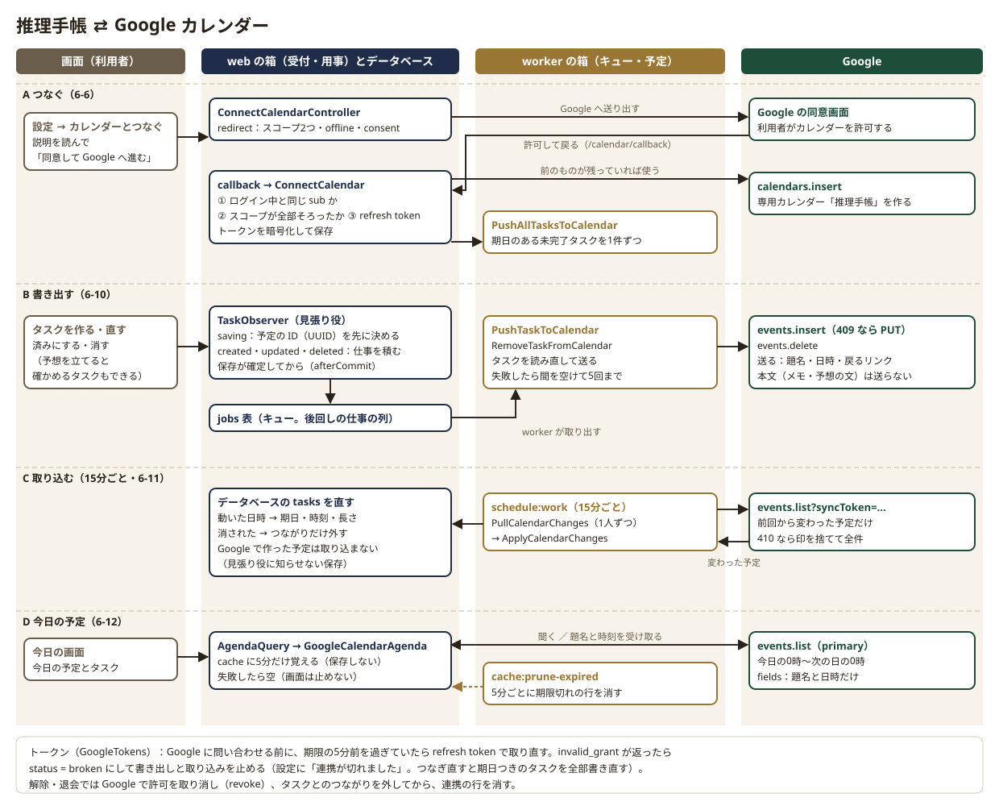
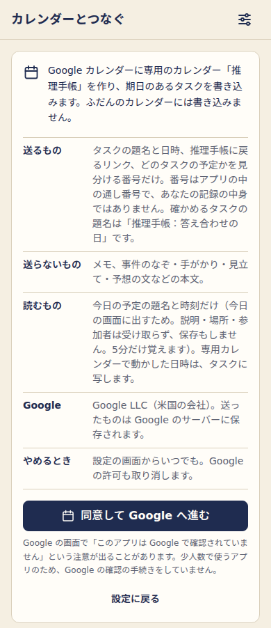
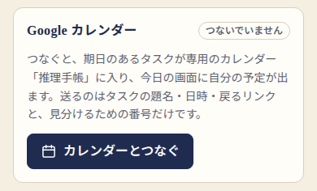

# 6. Google ログインとカレンダー連携

## この章でわかること

- 推理手帳が Google に頼んでいる3つのこと（ログイン・専用カレンダーへの書き込み・今日の予定の読み取り）と、使っている部品
- Google ログインの流れ（Socialite・`sub` で照合・一般公開と招待制の切り替え・同意）
- カレンダーの許可をログインと分けてもらう理由（段階的な許可）と、2つのスコープ（許可の範囲）の意味
- 専用カレンダーにだけ書く理由と、送るもの・送らないもの（本文を送らない／確かめるタスクの題名を固定にした理由）
- トークン（Google の鍵）の暗号化・更新・切れたときの動き
- 書き出しの流れ（見張り役 → キュー → worker の箱）、15分ごとの取り込み（差分の印と 410）、今日の予定の読み込み（5分のキャッシュと掃除）
- つなぐのをやめるとき・退会のとき

> Google 側の準備（プロジェクト・同意画面・OAuth クライアント・公開状態）は [11. Google の準備](11-google-setup.md) にあります。この章は、アプリの中のコードがどう動くかの説明です。決まりの元は [`.claude/rules/google.md`](../../.claude/rules/google.md) と [要件定義書](../design/requirements.md) の 4-1・4-5、調べたことは [調査 R4](../research/R4-google-integration.md) です。

---

## 6-0. 全体の図と、使っている部品

**役目：** Google のアカウントで本人を確かめ（ログイン）、つないだ人だけ、Google カレンダーに確かめる日を書き込み、今日の予定を読みます。

**たとえると：** 大きな施設（Google）の受付で身分証を見せてもらうのがログインです。カレンダー連携は、お客さんの手帳に「うちの店のページ」を1枚足してもらい、そのページにだけ書き込む許可と、今日のページを読む許可をもらうことです。

| 頼むこと | だれに | いつ |
|---|---|---|
| ログイン（名前・メール・アイコン・ID を受け取る） | 全員 | ログインのたび |
| 専用カレンダー「推理手帳」を作り、期日のあるタスクを書く | 「カレンダーとつなぐ」を押した人だけ | タスクを保存したあと（後回しの仕事で） |
| 今日の予定（題名と時刻）を読む | 同上 | 今日の画面を開いたとき（5分だけ覚える） |

**部品：**

- ログインと、カレンダーの許可をもらう画面への送り出しは **Laravel Socialite**（Google などのログインを数行で書ける Laravel の公式の部品）です。
- カレンダーの読み書きは、Google の公式の PHP ライブラリを使わず、**Laravel の HTTP クライアント**（`Http::`）で Google カレンダーの REST API（住所に問い合わせて JSON を受け取る形の窓口）を直接呼びます。公式のライブラリは新しい機能が足されない状態で重く、中身の読める薄い部品のほうが学びやすいからです（[要件定義書](../design/requirements.md) の 7、[調査 R4](../research/R4-google-integration.md) の 5）。



図の4つの帯（A〜D）が、この章の 6-6・6-10・6-11・6-12 に対応します。左から、利用者の画面・web の箱（受付と用事）とデータベース・worker の箱（後回しの仕事と、決まった時刻の仕事）・Google です。帯 C の「データベースの tasks を直す」は、worker の箱で動く用事 `ApplyCalendarChanges` がデータベースに書くことを表しています。

---

## 6-1. ログインの流れ

**役目：** 「Google でログイン」を押した人がだれかを Google に確かめてもらい、推理手帳の利用者として入れます。

**たとえると：** 受付で「Google 発行の身分証」を見せてもらい、名簿の番号と照らし合わせることです。名前やメールアドレスは変わることがあるので、照らすのは一生変わらない番号（`sub`）です。

**中身：** 受付は `src/app/Http/Controllers/Auth/GoogleLoginController.php`、用事は `src/app/Actions/Auth/LoginWithGoogle.php` です。

1. **送り出す**（`GET /auth/google` → `redirect()`）：Socialite が Google の画面へ送ります。求める範囲は Socialite の既定の `openid`・`email`・`profile` だけ（名前・メール・アイコン・ID）。この3つだけなら、Google の審査も7日の期限切れもかかりません（[調査 R4](../research/R4-google-integration.md) の 1.4）。
   - `enablePKCE()`：送り出しのときに作った合言葉を、戻りのときに確かめる仕組み（PKCE）。途中で横取りされた戻りを使えなくします。Socialite は state（なりすましの戻りを防ぐ合言葉）も自動で付けます。
   - `prompt=select_account`：家族で同じ端末を使うことがあるので、毎回アカウントを選ばせます。
2. **戻ってくる**（`GET /auth/google/callback` → `callback()`）：Socialite が Google から利用者の情報を受け取ります。キャンセル・時間切れ・合言葉の食い違いで失敗したら、トップへ戻して「もう一度お試しください」と出します。記録（ログ）にはエラーの種類だけを書き、メールアドレスは書きません。
3. **利用者を探すか登録する**（`LoginWithGoogle::handle()`）：
   - `users.google_id` が Google の `getId()`（＝`sub`）と同じ人を探します。メールアドレスは変わることがあるので鍵にしません（[調査 R4](../research/R4-google-integration.md) の 1.3）。見つかったら、アイコンだけ新しくして返します（表示名は本人が設定で直すので上書きしない）。
   - 見つからなければ新しく登録します（6-2。既定は一般公開で、招待制にしているときだけ名簿を確かめる）。断るときは `LoginRefused`（利用者に向けた文を持つ例外）を投げ、受付がその文をトップに出します。
4. **ログインさせる**：`Auth::login($user, remember: true)`（ログインしたままにする）のあと、`$request->session()->regenerate()` でセッションの番号を作り直します（ログイン前の番号を盗んでおく攻撃＝セッション固定を防ぐ）。
5. **同意がまだなら同意の画面へ**（6-3）、済んでいれば元の画面か今日の画面（`Support/Landing::url()`）へ送ります。

この2つのルートは `guest`（ログインしていない人だけ）と `throttle:auth`（同じ場所から1分に10回まで）が付いています（`src/routes/web/auth.php`・`AppServiceProvider`）。Google の鍵（クライアント ID とシークレット）が未設定なら、`GoogleLoginController::enabled()` が偽になり、「Google でのログインは準備中です」と出します。

---

## 6-2. だれが登録できるか（一般公開と招待制の切り替え）

**役目：** 新しく登録できる人を決めます。既定は **一般公開**（Google アカウントがあれば、だれでも登録できる）で、設定を1つ変えると **招待制**（運営者が名簿に入れたメールアドレスの人だけ）に戻せます。

**たとえると：** 入口の扉です。ふだんは開けておき（一般公開）、必要になったら名簿を持った受付を立てる（招待制）。扉の作りはそのままで、受付を立てるかどうかだけを札で切り替えます。名簿にない人には「招待制です」とお断りします。

**中身：** 切り替えの札は `config('suiri.invite_only')` です（`src/config/suiri.php`。値は `src/.env` の `SUIRI_INVITE_ONLY`、既定は `false`＝一般公開）。招待制にするときは `.env` に `SUIRI_INVITE_ONLY=true` と書き、設定を読み直します（本番は `php artisan optimize`。[10章](10-deploy-aws.md) の「招待制にしたいとき」）。コードは直しません。

新しい人を登録する前に、`LoginWithGoogle::register()` が次を確かめます。

1. Google がそのメールアドレスを**確認済み**か（`email_verified` か `verified_email`）。確かめられなければ断ります（本人のメールアドレスか確かめられないため）。これは一般公開でも招待制でも同じです。
2. **招待制のときだけ**、招待の名簿（`invitations`）にそのメールアドレスがあるか（`Invitation::findFor()`。小文字にそろえて探す）。なければ「推理手帳はいま招待制です」と断ります。一般公開のときは、名簿になくても先に進みます。
3. 同じメールアドレスで、**別の Google アカウント**の利用者がもういないか。いれば、乗っ取りを防ぐため結びつけずに断ります。

全部通れば、1つのトランザクションの中で利用者を作ります（`google_id` は書き込める列に入れていないので `forceFill` で入れる）。名簿にその人の行があれば、一般公開のときも招待の `used_at` に日時を入れます（あとで招待制に戻したとき、だれが使ったかわかるように）。

前から使っている人は `sub` で照らすので、一般公開でも招待制でも、名簿に関係なくそのままログインできます。招待制に戻しても、もう登録した人が締め出されることはありません。

名簿の管理画面は作らず、運営者がコマンドで扱います（運営者が記録の中身を読める画面を作らない決まり）。コマンドはいつでも使えますが、名簿が効くのは招待制にしているときだけです。

```bash
docker compose exec -T app php artisan invite:add user@example.com --note=保護者   # 名簿に足す（あればメモだけ直す）
docker compose exec -T app php artisan invite:list                                  # 一覧（使われたかも見える）
docker compose exec -T app php artisan invite:remove user@example.com               # 外す（登録済みのアカウントは消さない）
```

`invite:remove` で外しても、すでに登録した人はそのまま使えます（ログインは `sub` で照らすため）。退会すると、その人の名簿の行も消えます（[4章](04-data.md) の 4-7）。

トップの「はじめる」ボタンの下の一文と、利用規約の「登録できる人」の文も、この札で出し分けています（招待制のときだけ「招待制です」と書く）。

---

## 6-3. 初回の同意

**役目：** 初めてログインした人に、利用規約・プライバシーポリシーへの同意と「13歳以上。18歳未満は保護者の同意を得ています」の確認を求めます。

**中身：**

- 同意したかは `users.agreed_at` で決まります（空なら未同意。`User::hasAgreed()`）。
- ログインが要る画面には `auth` と `agreed` のミドルウェア（受付の前に立つ見張り）を付けています。`agreed` は `Http/Middleware/EnsureAgreed`（`bootstrap/app.php` で名前を付けている）で、未同意の人を `/agree` へ送り、同意したあとに元の画面へ戻れるよう覚えておきます（`redirect()->guest()`）。
- 同意の画面は `Auth\AgreementController`、記録は `Actions/Auth/AcceptTerms`（`agreed_at` に今の日時。同意済みなら最初の日時のまま）、チェックの確かめは `AcceptTermsRequest` です。

---

## 6-4. カレンダーの許可は、ログインと分けてもらう（段階的な許可）

**役目：** カレンダーの許可は、ログインのときには求めず、「カレンダーとつなぐ」を押した人にだけ、あとから求めます。

**たとえると：** お店に入るときは身分証を見せるだけにしておき、手帳に書き込ませてほしいときに、そのとき改めてお願いすることです。入口でいきなり「手帳も見せてください」と言われると、多くの人は帰ってしまいます。

**なぜ分けるか：**

1. **つながない人に、要らない許可を求めないため。** カレンダー連携は任意です（要件 G-1）。ログインは名前・メール・アイコン・ID だけで済みます。
2. **Google 自身が勧めるやり方だから。** 「タスクに必要な範囲だけを、必要になったときに求める」「求める前に理由を説明する」「ログインのときにまとめて求めない」とされています（[調査 R4](../research/R4-google-integration.md) の 4.1）。だから、つなぐ前に説明の画面（6-6）を置いています。
3. **審査と期限の条件が変わるから。** ログインの3つだけなら審査も7日の期限切れもかかりません。カレンダーの許可を全員に求めると、その条件を全員が背負うことになります（[調査 R4](../research/R4-google-integration.md) の 3）。
4. **子どもの利用を分けられるから。** 子ども（相棒）が自分のアカウントで使うときは、まずログインだけ（カレンダー連携なし）で使うのが安全です（[調査 R4](../research/R4-google-integration.md) の 7）。

ログイン（`GoogleLoginController`）はオフラインの許可（利用者がいないときにも使える鍵）を求めません。それを求めるのは、カレンダーとつなぐときだけです。

---

## 6-5. 2つのスコープの意味

**役目：** カレンダーについて求める許可の範囲（スコープ）を、いちばん狭い2つにします。

**中身：** `config/suiri.php` の `calendar.scopes` に書いてあります。

| スコープ（`https://www.googleapis.com/auth/` の後ろ） | できること | 推理手帳で使う所 |
|---|---|---|
| `calendar.app.created` | このアプリが作ったカレンダーを作り、その中の予定だけを読み書き・削除する。ほかのカレンダーには触れない | 専用カレンダー「推理手帳」を作り、タスクを書き出す（6-10）・動かされた予定を取り込む（6-11） |
| `calendar.events.owned.readonly` | 自分が持っているカレンダーの予定を**読むだけ** | 今日の画面に、ふだんのカレンダーの今日の予定を出す（6-12） |

- カレンダー全部を読み書きできる `calendar` や、すべての予定を書き換えられる `calendar.events` は**求めません**。
- `calendar.app.created` だけでは、ふだんの（primary の）カレンダーの予定を読めません。今日の予定を出すために、読むだけの `calendar.events.owned.readonly` を足しています（[調査 R4](../research/R4-google-integration.md) の 2.3）。
- 今日の予定を読む係は、もらった範囲に `config('suiri.calendar.read_scope')` が入っているか（`CalendarConnection::hasScope()`）を確かめてから読みます。
- スコープを足すときは、プライバシーポリシーと連携前の説明も直す決まりです（[`.claude/rules/google.md`](../../.claude/rules/google.md)）。

---

## 6-6. つなぐ流れ

**役目：** 説明を見せて同意をもらい、Google で許可をもらい、確かめてから鍵を保存し、専用カレンダーを用意します（図の帯 A）。

**たとえると：** 「この店のページに書くのは、予定の題名と日時（と、店に戻る案内と整理番号）だけです」と説明書きを見せてから、手帳を借りる手続きです。

### ① つなぐ前の説明（`GET /calendar/connect`）

`Calendar\ConnectCalendarController@show` が、`views/calendar/connect.blade.php` を返します。文はすべて `config/suiri.php` の `calendar.consent` から引きます。



| 見出し | 中身（要点） |
|---|---|
| 送るもの | タスクの題名と日時と、推理手帳に戻るリンクと、どのタスクの予定かを見分ける番号（`suiri_task_id`）だけ。番号はアプリの中の通し番号で、あなたの記録の中身ではない。確かめるタスクの題名は「推理手帳：答え合わせの日」に決めてある |
| 送らないもの | メモ、事件のなぞ・手がかり・見立て・予想の文などの本文 |
| 読むもの | 今日の予定の題名と時刻だけ（説明・場所・参加者は受け取らず、保存もしない。5分だけ覚える）。専用カレンダーで動かした日時はタスクに写す |
| Google | Google LLC（米国の会社）。送ったもの（題名・日時・リンク・番号）は Google のサーバーに保存される |
| やめるとき | 設定の画面からいつでも。Google の許可も取り消す |

Google の画面で「このアプリは Google で確認されていません」という注意が出ることがある、とも書いています。少人数で使うアプリなので、Google の確認（審査）を受けていないためです（[11章](11-google-setup.md) の 8）。

### ② Google へ送り出す（`POST /calendar/connect`）

`ConnectCalendarController@redirect` が、Socialite で Google の画面へ送ります。

| 付けるもの | 意味 |
|---|---|
| `redirectUrl(route('calendar.callback'))` | 戻り先はログインとは別の `/calendar/callback` |
| `scopes(config('suiri.calendar.scopes'))` | 6-5 の2つ |
| `access_type=offline` | refresh token（期限の短い鍵を取り直すための、長持ちする鍵）をもらう |
| `prompt=consent` | 同意の画面を必ず出す。refresh token は最初の許可のときにしか返らないので、確実にもらうために付ける（[調査 R4](../research/R4-google-integration.md) の 4.2） |
| `include_granted_scopes=true` | ログインで許可した範囲も含めた鍵にする（段階的な許可） |
| `login_hint` | ログイン中の人のメールアドレス。同じアカウントを選びやすくする |
| `enablePKCE()` | ログインと同じ、横取りされた戻りを防ぐ合言葉 |

`with()` は前の値を上書きするので、1回にまとめて渡しています。

### ③ 戻って確かめ、保存する（`GET /calendar/callback`）

`ConnectCalendarController@callback` が Socialite で許可を受け取り、用事 `src/app/Actions/Calendar/ConnectCalendar.php` に渡します。

1. **確かめる**（`check()`）：①ログイン中の人と**同じ Google アカウント**（`sub`）か（違えば、ほかの人のカレンダーに書かないよう断る）、②求めたスコープが**全部**許可されたか（Google の画面では項目ごとにチェックを外せるため）、③refresh token があるか。どれかが欠けたら、何も保存せずに `CalendarConnectRefused`（利用者に向けた文）を投げ、設定の画面にやり直しを案内します。
2. **専用カレンダーを用意する**（`prepareCalendar()`）：前につないだときの専用カレンダーが Google に残っていれば、それを使います（予定が二重にならない）。なければ `calendars.insert` で「推理手帳」（タイムゾーン Asia/Tokyo）を作ります。
3. **保存する**：トークン・期限・許可された範囲・状態（`active`）・専用カレンダーの ID を `calendar_connections` に保存します（トークンは暗号化。6-9）。専用カレンダーが新しくなったときは、前のカレンダーの予定とのつながり（`tasks.calendar_event_id`）と差分の印（`sync_token`）を空にして、全部書き直す準備をします。
4. **まとめて書き出す仕事を出す**：`PushAllTasksToCalendar` をキューに積み、期日のある未完了のタスク（と、前に予定を書いたタスク）を1件ずつ書き出し、専用カレンダーに残った「もうないタスクの予定」を消します（6-10）。

この3つのルートと、やめるルートには `throttle:calendar`（1分に10回まで）が付いています。住所に連携の番号を入れず、いつもログイン中の本人の連携だけを扱います（`src/routes/web/calendar.php`）。

設定の画面の「Google カレンダー」の枠（部品 `<x-settings.calendar-panel>`）は、状態ごとに中身が変わります：準備中（鍵が未設定）・つないでいない・つながっている（最後に同期した日時と「つなぐのをやめる」）・切れた（「連携が切れました。つなぎ直してください。」と「つなぎ直す」）。



---

## 6-7. 専用カレンダーにだけ書く理由

**役目：** 推理手帳が書き込むのは、つないだときに作る専用カレンダー「推理手帳」だけで、ふだんの（メインの）カレンダーには書きません。

**たとえると：** 人の手帳に直接書き込まず、自分の店の名前の入った付録のページを1枚挟み、そこにだけ書くことです。要らなくなったら、そのページを抜けば元どおりです。

**なぜ：**

1. **利用者の予定を勝手に変えないため。** ふだんのカレンダーには仕事や家族の大事な予定があります。推理手帳はそこに触れません。予定を自動で動かす機能も作りません（[要件定義書](../design/requirements.md) の 5）。
2. **許可をいちばん狭くできるため。** 専用カレンダーだけなら `calendar.app.created` で足ります（6-5）。
3. **見分けやすく、片付けやすいため。** Google カレンダーの画面で、推理手帳の予定だけを表示・非表示にでき、やめるときは専用カレンダーごと消せます。
4. **ほかの製品で確かめられた形だから。** タスク管理アプリの Todoist も、専用のカレンダーを作ってそこにだけ書き、Google 側で日時を動かされたらタスクに戻し、Google 側で新しく作られた予定は取り込みません（[調査 R3](../research/R3-products-oss.md) の 4-3・10-1 の 4）。推理手帳も同じ形です。

---

## 6-8. 送るもの・送らないもの

**役目：** Google に送る中身を、タスクの題名・日時・戻るリンクと、どのタスクの予定かを見分ける番号だけにします。

**たとえると：** 付録のページには「何時に何をするか」だけを書き、なぜそうするのか（事件の中身）は自分の手帳にだけ書いておくことです。

**中身：** タスクを予定の形にするのは `src/app/Services/Google/TaskEvent.php` の `toEvent()` です（計算だけで、Google にもデータベースにも触りません）。

| 予定の項目 | 入れるもの |
|---|---|
| `summary`（題名） | ふつうのタスクは題名。**確かめるタスクは決まった言葉「推理手帳：答え合わせの日」**（`calendar.verify_summary`）。済んだタスクは頭に「✓ 」（`done_prefix`。済んだ予定は消さずに印を付ける） |
| `description`（説明） | 「推理手帳で開く：」＋アプリに戻るリンク。確かめるタスクは答え合わせの画面（`predictions.show`）、ふつうのタスクは直す画面（`tasks.edit`） |
| `start`・`end` | 開始時刻がなければ終日の予定（終わりは次の日。Google の決まりで終わりの日は含まない）。あれば予想時間の長さ（なければ30分。`default_minutes`） |
| `transparency` | 確かめるタスクは `transparent`（予定なし＝時間を塞がない）、ふつうのタスクは `opaque` |
| `source` | アプリの名前と、上と同じリンク |
| `extendedProperties.private.suiri_task_id` | タスクの番号。利用者には見えない欄で、取り込み（6-11）と残った予定の片づけ（6-10）でどのタスクの予定かを見分ける印。番号はアプリの中の通し番号（1・2・3…）で、記録の中身（題名やメモ）ではない |

**送らないもの：** タスクのメモ、事件のなぞ・手がかり・見立て・予想の文・答え合わせの一言など、本文はすべて送りません。`bin/check` の「Google カレンダーに本文を送らない」が、`Services/Google`・`Jobs` のコードで本文の列（`memo`・`body`・`statement` など）を使うと止めます。Google への問い合わせの記録（ログ）にも、タスクの番号とエラーの種類だけを書き、題名は書きません。

**確かめるタスクの題名を固定にした理由：** 確かめるタスクの題名は「確かめる：」＋予想の文です（[5章](05-reasoning-flow.md) の 5-6）。そのまま送ると、予想の文（本文）が Google に渡ってしまいます。だから予定の題名だけは決まった言葉にし、中身は予定の説明のリンクから推理手帳を開いて見る形にしました（要件 G-3）。時間を塞がない（`transparent`）のは、確かめることは「その日のどこかで見に行けばよい」ことが多く、ほかの予定の邪魔をしないためです。

---

## 6-9. トークンの暗号化と更新・切れたとき

**役目：** Google の鍵（トークン）を安全にしまい、期限が切れる前に取り直し、使えなくなったら利用者に知らせます。

**たとえると：** 1時間で使えなくなる入館証（access token）と、入館証を作り直すための会員証（refresh token）です。会員証は鍵のかかる箱にしまい、入館証は切れる少し前に作り直します。会員証が取り消されたら、受付で「もう一度手続きしてください」と伝えます。

**中身：** 係は `src/app/Services/Google/GoogleTokens.php` です。

- **しまい方：** `calendar_connections` の `access_token`・`refresh_token` は `encrypted` キャストで暗号化し、JSON にも書き出しにも出しません（[4章](04-data.md) の 4-6）。
- **取り直す（`accessToken()` → `refresh()`）：** Google に問い合わせる前に、期限の5分前（`refresh_before_seconds` = 300秒）を過ぎていたら、refresh token で取り直します（`POST https://oauth2.googleapis.com/token`）。新しい access token と期限を保存します。Google が新しい refresh token もくれたときだけ入れ替えます（ふつうは返ってこない）。
- **401 と言われたら（`expire()`）：** 問い合わせで「鍵が通らない」（401）と返ったら、`CalendarApi` が access token を期限切れにしておきます。次の問い合わせで取り直します。
- **切れたら：** 取り直しで `invalid_grant`（許可が取り消された・切れた）が返ったら、連携の `status` を `broken` にして `GoogleAuthBroken` を投げます。後回しの仕事はこれを受けると、試し直さずに終わります。設定の枠に「連携が切れました。つなぎ直してください。」と出し、つなぎ直すまでタスクは書き出しません（タスクそのものは残っています）。つなぎ直すと（6-6）、期日のある未完了のタスクを全部書き出し、切れている間に消したタスクの予定を専用カレンダーから消します（6-10）。
- **そのほかの失敗**（Google の不調・つながらない）は `GoogleApiFailed` にして、連携はそのまま。後回しの仕事が、間を空けて試し直します（6-10）。

**切れる主な理由：** 利用者が Google のアカウントの画面で許可を取り消した、長く使われなかった、そして **Google の同意画面が「テスト中」のまま**だった場合です。テスト中のアプリがログインの3つ以外の範囲を求めると、refresh token が7日で切れます。だから本番では「In production（本番）」の公開状態にします（[調査 R4](../research/R4-google-integration.md) の 3.2、[11章](11-google-setup.md) の 8）。

- **取り消す（`revoke()`）：** つなぐのをやめる・退会のときに、Google 側で許可を取り消します（`POST https://oauth2.googleapis.com/revoke`）。失敗しても例外にせず、手元の鍵を消すところまで必ず進めます（6-13）。

---

## 6-10. 書き出しの流れ（見張り役 → キュー → worker）

**役目：** タスクを保存したら、Google への書き出しを「後回しの仕事」にして、画面を待たせずに送ります。Google が止まっていても、タスクの保存は成功させます（図の帯 B）。

**たとえると：** お店のレジ（web の箱）は、お客さんの注文を受けたら伝票を厨房の棚（キュー）に置くだけで、すぐ次のお客さんに戻ります。厨房の係（worker の箱）が伝票を1枚ずつ取り、料理（Google への書き込み）を作ります。失敗したら、少し時間をおいて作り直します。

**なぜ後回しにするか：** 受付から直接 Google を呼ぶと、Google の返事を待つ間、画面が止まります。Google が止まっていれば、タスクの保存まで失敗してしまいます。後回しにすれば、画面はすぐ返り、Google が戻ったら送り直せます（要件 G-7、[要件定義書](../design/requirements.md) の 6「性能」）。

### ① 見張り役 `TaskObserver`

`src/app/Observers/TaskObserver.php` は、タスクのモデルの保存・削除を見張る係です（`Providers/CalendarServiceProvider` の `Task::observe()` で結んでいます）。タスクの用事（`Actions/Tasks/*`・`MakePrediction`・`ResolvePrediction` など）は Google のことを知らなくてよく、保存するだけで書き出しが動きます。

| 合図 | すること |
|---|---|
| `saving`（保存の直前） | 期日があり、まだ予定の ID がなく、持ち主がつないでいるタスクなら、予定の ID（ハイフンを抜いた UUID）を決めて `calendar_event_id` に入れておく。タスクと一緒に保存されるので、試し直しでも同じ ID を使い、予定が二重にならない |
| `created`（作った） | 期日があれば `PushTaskToCalendar` を積む |
| `updated`（直した・済んだ・戻した） | 予定の中身に関わる列（`title`・`due_on`・`starts_at`・`duration_minutes`・`done_at`・`kind`・`prediction_id`）が変わったときだけ積む。メモやかかった時間だけの変更では送らない |
| `deleted`（消した） | 書き出した予定があれば `RemoveTaskFromCalendar` を積む（タスクはもう表にないので、持ち主の番号と予定の ID だけを渡す） |

- どれも、持ち主がいま**つながっている**（`status = active`）ときだけです（`connected()`）。
- 仕事は `->afterCommit()` で、**保存が確定してから**積みます。トランザクションが取り消されたのに、予定だけできてしまうことを防ぎます。
- 仕事を積むのに失敗しても（`safely()`）、タスクの保存は成功のままにして、タスクの番号とエラーの種類だけを記録します。

### ② キュー（`jobs` の表）

積んだ仕事は、データベースの `jobs` の表に1行ずつ入ります（`.env` の `QUEUE_CONNECTION=database`）。仕事には、タスクそのものではなく**番号だけ**を入れます。動くときにタスクを読み直すので、何度積んでも最新の中身が送られます。

### ③ worker の箱

`docker-compose.yml` の `worker` の箱が、`php artisan schedule:work`（決まった時刻の仕事を積む係）と `php artisan queue:work`（キューの仕事を片づける係）を動かしています。worker は**起動したときのコードで動き続ける**ので、Job や予定のコードを変えたら `docker compose restart worker` が要ります。

### ④ 仕事のクラス（`src/app/Jobs/`）

| 仕事 | すること |
|---|---|
| `PushTaskToCalendar` | タスクを読み直し、期日があれば予定を作る・置き換える。期日がなくなっていれば（いつかにした）予定を消してつながりを外す |
| `RemoveTaskFromCalendar` | 消したタスクの予定を消す。もう消えていれば（404・410）何もしない |
| `PushAllTasksToCalendar` | つないだ（つなぎ直した）直後に、期日のある未完了のタスクと、前に予定を書いたタスク（済んだ・いつかにした分の書き直し）を1件ずつ `PushTaskToCalendar` にする（1件が失敗しても、ほかは書き出せる）。続けて、専用カレンダーに残った「もうないタスクの予定」を消す（下の「残った予定の片づけ」） |

- **二重にしない：** 予定を作るときは、決めておいた ID を付けて `events.insert` を呼びます。同じ ID の予定がもうあれば Google が 409 を返すので、そのときは `PUT` で中身を置き換えます（`Services/Google/CalendarApi::upsertEvent()`）。何度送っても予定は1つです。
- **待っている間は1つにまとめる：** `PushTaskToCalendar` は `ShouldBeUniqueUntilProcessing` で、同じタスクの仕事がキューで待っている間は、新しく積んでも1つにまとまります。
- **試し直し：** 失敗したら `config/suiri.php` の `calendar.tries`（5回）まで、`calendar.backoff`（60秒・5分・15分・1時間）の間を空けて試し直します（仕事のクラスの `tries()`・`backoff()`。worker のコマンドの `--tries` より、仕事のほうの値が先です）。それでもだめなら `failed()` がタスクの番号とエラーの種類だけを記録し、`failed_jobs` の表に残ります。許可が切れていたら（`GoogleAuthBroken`）、試し直さずに終えます。
- 書き出したら、タスクの `calendar_synced_at` と連携の `last_synced_at` を今の日時にします。タスクを直すときは `saveQuietly()`（見張り役に知らせない保存）を使い、その保存でまた仕事が積まれるのを防ぎます。

### ⑤ 残った予定の片づけ（`Actions/Calendar/DeleteOrphanEvents`）

連携が切れている間（`broken`）にタスクを消すと、`RemoveTaskFromCalendar` は「切れている」ので何もせずに終わり、タスクの行も消えます。すると、予定だけが Google の専用カレンダーに残ってしまいます。

そこで、**つなぎ直したとき**（`PushAllTasksToCalendar`）と、**全件を読み直したとき**（6-11 の 410 のあと）に、専用カレンダーの予定を全部見て、印 `suiri_task_id` の番号が本人の今あるタスクに当たらない予定を消します。

- 専用カレンダーはアプリだけが書く場所（6-7）なので、アプリの印のついた予定を消しても、ふだんのカレンダーの予定には触れません。
- 印のない予定（利用者が専用カレンダーに手で足したもの）は消しません。
- Google が止まっていて片づけに失敗したら、つなぎ直したときは `PushAllTasksToCalendar` ごと間を空けて試し直します（書き出しは同じ予定の置き換えなので、出し直しても二重になりません）。全件を読み直したときは、取り込みは止めずに先へ進み（新しい印も保存する）、消せなかった分は次の機会に片づけます。

---

## 6-11. 15分ごとの取り込み（差分の印と 410）

**役目：** 利用者が Google カレンダーの専用カレンダーで予定の日時を動かした・消したら、それをタスクに写します（図の帯 C）。

**たとえると：** 付録のページを15分ごとに見に行き、前回見たときから書き換えられた所だけを、自分の手帳に写すことです。前回どこまで見たかは、しおり（`sync_token`）でわかります。

**中身：**

- **予定：** `src/routes/console.php` に `Schedule::job(new PullCalendarChanges)->cron('*/15 * * * *')`（15分は `calendar.pull_every_minutes`）と書いてあり、worker の箱の `schedule:work` が時刻を見て仕事を積みます。
- **1人ずつ：** 番号なしで積まれた `PullCalendarChanges` は、つながっていて専用カレンダーのある連携ごとに、番号つきの `PullCalendarChanges` を積み直します。1人が失敗しても、ほかの人は取り込めます。同じ連携の取り込みは、次の15分まで1つにまとめます（`ShouldBeUnique`・`uniqueFor()`）。
- **差分を読む（`Actions/Calendar/ApplyCalendarChanges`）：** 前回の印（`sync_token`）を付けて `events.list` を呼ぶと、Google は**前回から変わった予定だけ**を返し、最後のページに次回の印（`nextSyncToken`）を付けます（`CalendarApi::listChangedEvents()` がページを最後までたどる）。Google が **410**（印が古くなった）を返したら `SyncTokenExpired` になり、印を捨てて全件を読み直します。
- **写し方：**

  | 予定の様子 | すること |
  |---|---|
  | `suiri_task_id` の印がない（Google 側で新しく作られた予定） | 取り込まない |
  | 印はあるが、その人のタスクで、同じ予定とつながっているものが見つからない | 何もしない（他人のタスクや、つながりを外したタスクには触らない） |
  | 消された（`status = cancelled`） | タスクとのつながり（`calendar_event_id`）だけを外す。**タスクは消さない** |
  | 日時が動いた | タスクの期日・開始時刻・長さを合わせる（`TaskEvent::timesFrom()`）。終日の予定なら長さは今のまま。長さのない時刻つきタスクで、予定が既定の30分のままなら長さは入れない。何も変わっていなければ保存しない。答え合わせ待ちの予想の確かめるタスクなら、予想の確かめる日・時刻（`check_on`・`check_at`）も同じトランザクションで合わせる（`Tasks\SyncPredictionCheck`） |

- **全件を読み直したとき**（印がない・410 のあと）は、読み始める前に書き出しが済んでいたタスクのうち、Google の一覧にもうない予定とつながっているもののつながりを外し、もうないタスクの予定を消します（6-10 の⑤）。差分の取り込みでは、どちらもしません。
- タスクを直すのは `saveQuietly()` です。取り込んだ変更を、見張り役がまた Google に書き出す（行ったり来たりする）のを防ぎます。最後に、次回の印と取り込んだ日時を連携に保存します。

> **確かめるタスクを動かしたとき：** 確かめるタスクの予定を Google 側で別の日に動かすと、タスクの期日と一緒に、予想の「確かめる日」（`predictions.check_on`）と時刻（`check_at`）も動きます（`ApplyCalendarChanges::moveTask()` が `Tasks\SyncPredictionCheck` を同じトランザクションで呼ぶ）。今日の画面の「答え合わせ待ち」は予想の確かめる日で決まるので、動かした日に答え合わせ待ちとして出ます。予想の文と確かさは変わりません。写すのは答え合わせ待ちの予想だけで、答え合わせ済み・取り下げた予想の日付は動きません。テストは `tests/Feature/Calendar/PullRemovedEventsTest.php` の `test_moving_a_verify_event_moves_the_prediction_check`。

---

## 6-12. 今日の予定の読み込み（5分のキャッシュと掃除）

**役目：** 今日の画面に、自分の Google カレンダーの今日の予定（題名と時刻）を、タスクと混ぜて時刻順に出します。記録としては保存しません（図の帯 D）。

**たとえると：** 朝、手帳の今日のページをちらっと見て、メモ用紙に書き写し、5分たったらそのメモを捨てることです。何度も見に行かずに済み、写しも残りません。

**中身：**

- 今日の画面の「今日の予定とタスク」は `Queries/Today/AgendaQuery` が組み立てます。予定は窓口 `App\Contracts\CalendarAgenda` の `eventsOn()` から受け取り、今日が期日のタスクと混ぜ、終日のものを上に、あとは開始時刻の順に並べます。
- 窓口の本物は `src/app/Services/Google/GoogleCalendarAgenda.php` です（`CalendarServiceProvider` が結ぶ。結ぶ前の既定は、いつも空を返す `NullCalendarAgenda`）。
  - つないでいない・切れた・読む範囲（スコープ）がない人には、Google に聞かずに空を返します。
  - ふだんのカレンダー（`primary`）の、今日の0時から次の日の0時までの予定を `events.list` で読みます。`fields`（受け取る項目を絞る指定。`calendar.agenda_fields`）で、**題名と日時（とアプリの印）だけ**を受け取り、説明・場所・参加者は受け取りません。
  - 専用カレンダー「推理手帳」の予定（`suiri_task_id` の印つき）は、タスクとして別に出るので除きます。題名がない予定は「（題名なし）」にします。前の日から続く予定は 00:00 から、次の日まで続く予定は終わりの時刻を出しません。
  - 読んだ結果は `Cache::remember("calendar-agenda:{連携の番号}:{日付}", 300, …)` で **5分だけ** キャッシュ（`cache` の表）に覚え、その間は Google に聞き直しません。
  - 失敗したら、今日の画面を止めないよう空を返します（失敗した結果は覚えないので、次に開いたときにまた聞く）。
- **掃除：** キャッシュをデータベースに置いているので、期限が過ぎても同じキーを読みにこない限り、行が表に残ります。そこで、コマンド `cache:prune-expired`（`Console/Commands/PruneExpiredCache`）が5分ごとに期限の過ぎた行を消します（`routes/console.php` の `everyFiveMinutes()`）。これで「題名と時刻は5分だけ覚えて、保存しない」という約束を守ります（要件 G-5、[`.claude/rules/privacy.md`](../../.claude/rules/privacy.md)）。
- 予定の行の「気になる」で事件を作るときも、題名は住所に載せずに POST で送ります（[5章](05-reasoning-flow.md) の 5-1）。事件には題名と時刻の写し（`origin_label`）だけが残り、Google の予定の ID は持ちません。

---

## 6-13. つなぐのをやめるとき・退会のとき

**役目：** 連携をやめるとき、Google 側の許可を取り消し、手元の鍵を必ず消します。

**たとえると：** 店を閉めるときに、借りていた合鍵を持ち主に返し（取り消し）、自分の控えも捨てることです。付録のページを手帳から抜くか（専用カレンダーを消すか）は、持ち主に選んでもらいます。

**中身：** 受付は `Calendar\DisconnectCalendarController`（`DELETE /calendar`）、用事は `src/app/Actions/Calendar/DisconnectCalendar.php` です。

1. 「専用カレンダーも Google から消す」にチェックがあり、まだつながっていれば、専用カレンダーを消します（`calendars.delete`）。失敗しても先へ進みます。チェックがなければ、書いた予定は Google にそのまま残ります。切れている（`broken`）ときは消せないので、チェックの欄は出しません。
2. Google で許可を取り消します（`GoogleTokens::revoke()`）。失敗しても先へ進みます。
3. タスクと予定のつながり（`calendar_event_id`・`calendar_synced_at`）を空にし、連携の行（暗号化したトークン）を消します。

**Google が止まっていても、手元の鍵は必ず消します。** 退会（`Actions/Account/DeleteAccount`）も最初にこの用事を呼びます。退会のときは専用カレンダーを消さない形で呼ぶので、利用者の Google にある専用カレンダーは残ります（プライバシーポリシーに書いてあります。[4章](04-data.md) の 4-7）。

---

## 6-14. テストでは本物の Google に触らない

**役目：** テストのたびに本物の Google に問い合わせないようにし、Google の返事を自由に作って動きを確かめます。

**中身：**

- Google カレンダーの API は、窓口（インターフェース）`App\Contracts\CalendarApi` 越しに使います。`Providers/CalendarServiceProvider` が、ふだんは本物（`Services\Google\CalendarApi`）を、テストのときは偽物（`Services\Google\FakeCalendarApi`。メモリに書くだけ）を結びます。偽物は1つだけ作って使い回すので、テストが「何を送ったか」を中身から確かめられます。
- テストのときは `Http::preventStrayRequests()` で、`Http::fake()` で用意していない外への問い合わせを全部失敗にします。本物の Google には一度もつながりません。
- テストの置き場所：`tests/Feature/Calendar/`（つなぐ・やめる・見張り役・書き出し・取り込み・消された予定・今日の予定・キャッシュの掃除・設定の枠）と `tests/Unit/Google/`（`CalendarApiTest`・`GoogleTokensTest`・`TaskEventTest`）。ログインは `tests/Feature/Auth/` です。

---

## 6-15. 困ったとき

| 見えること | よくある理由 | 確かめること・直し方 |
|---|---|---|
| 設定に「連携が切れました」 | Google の公開状態がテスト中のまま（7日で切れる）・利用者が許可を取り消した・長く使われなかった | [11章](11-google-setup.md) の公開状態が In production か。利用者に「つなぎ直す」を押してもらう |
| タスクがカレンダーに出ない | worker の箱が止まっている・コードを変えたのに worker を再起動していない・連携が切れている | `docker compose ps` で worker が動いているか。`docker compose restart worker`。`failed_jobs` の表に残っていないか |
| Google で動かした日時がタスクに反映されない | 取り込みは15分ごと | 15分待つ。worker の箱の `schedule:work` が動いているか |
| 今日の画面に予定が出ない | つないでいない・切れた・Google の一時的な不調（空を返す）・5分のキャッシュ | 設定の枠の状態。5分おいて開き直す |
| 「ログイン中と同じ Google アカウントを選んで…」 | つなぐときに別のアカウントを選んだ | 同じアカウントを選び直す（`login_hint` で最初に出るもの） |
| 「カレンダーの許可が足りませんでした」 | Google の画面でチェックを外した | すべての項目にチェックを入れて、もう一度つなぐ |
| 「推理手帳はいま招待制です」 | 招待制にしていて、そのメールアドレスが名簿にない | 運営者が `invite:add` で名簿に足す。一般公開に戻すなら `.env` の `SUIRI_INVITE_ONLY=false`（6-2） |

本番での確かめ方（`.env` の Google の値・戻り先の住所）は [10章](10-deploy-aws.md) と [11章](11-google-setup.md) の「困ったとき」にもあります。

---

## 次に読む章

- 表の形（`calendar_connections`・`tasks` の連携の列・暗号化）：[4. データ](04-data.md)
- 確かめるタスクが生まれる推理の流れ：[5. 推理の流れ](05-reasoning-flow.md)
- Google 側の準備（プロジェクト・同意画面・OAuth クライアント・公開状態）：[11. Google の準備](11-google-setup.md)
- 本番に載せる手順（`.env` に鍵を書く所）：[10. 本番（AWS）に載せる](10-deploy-aws.md)
- 1回の操作がブラウザから DB までどう流れるか：[3. しくみ（太らない MVC）](03-architecture.md)
- Google 連携の決まり：[`.claude/rules/google.md`](../../.claude/rules/google.md)・調べたこと：[調査 R4](../research/R4-google-integration.md)
