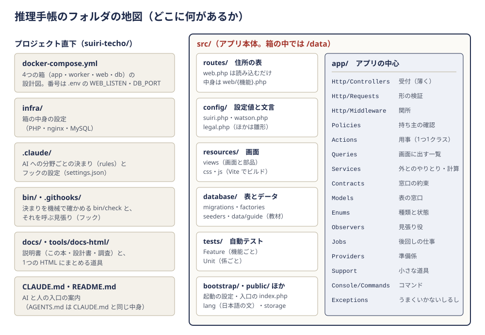

# 7. ファイルの案内

## この章でわかること

- プロジェクトのフォルダが、それぞれ何のためにあるか（地図）
- `src/` の中のファイルを1つずつ、「何のためにあるか」の一言つきで
- 「〇〇を直したいときは、どのファイルを開けばいいか」の引き方
- Laravel の雛形（最初から入っているひな形）のまま、触っていないファイル

**役目を一言でいうと：** この章は、部品説明書の「ファイル版」です。画面を組み立てる部品（Blade コンポーネント）の説明は [部品説明書](../design/components.md) にあるので、ここではそれ以外のファイルを全部並べます。

**たとえると：** 大きな建物の「館内案内図」です。全部の部屋を覚える必要はありません。用があるときに「タスクの一覧を作っている部屋はどこ？」と引ければ十分です。

**読み方：** パスはすべてプロジェクト直下（`suiri-techo/`）からの位置です。表の「何のためにあるか」は一言の説明で、くわしい中身はファイルの先頭のコメントに書いてあります（このプロジェクトでは、クラスや関数の手前に必ず「何をするか」のコメントがあります）。`(C-6)` のような記号は、[要件定義書](../design/requirements.md) の要件の番号です。

---

## 7-0. 地図

大きく分けると2つです。

| まとまり | 中身 | 開くとき |
|---|---|---|
| プロジェクト直下 | 箱（Docker）の設計図、決まりと見張り、説明書 | 動かし方を変える・決まりを変える・説明書を直す |
| `src/` | アプリ本体（Laravel）。箱の中では `/data` に見える | 画面や動きを変える |

`src/app/` の中は「層」（役目ごとの置き場所）に分かれています。どの層が何を受け持つか、なぜ分けるかは [3章](03-architecture.md) と [基本設計の1章](../design/basic-design.md) にあります。この章では、層ごとに「どのファイルがあるか」を並べます。

---

## 7-1. プロジェクト直下

**役目：** アプリを動かす土台と、作り方の決まりを置く場所です。

| パス | 何のためにあるか |
|---|---|
| `docker-compose.yml` | 4つの箱（`app`＝PHP、`worker`＝決まった時刻の仕事と後回しの仕事、`web`＝nginx、`db`＝MySQL）の設計図。`./src` を箱の `/data` に見せる。先頭の `x-logging` で箱のログを 10MB × 5 ファイルまでにする。ネットワークは `10.232.0.0/24` |
| `.env.example` | docker compose が読む設定の見本（DB の名前・パスワード・`WEB_LISTEN`・`DB_PORT`）。これを写して `.env` を作る |
| `.env` | 上の本物。パスワードが入るので git に入れない（`.gitignore` と `bin/check` が止める） |
| `.gitignore` | git に入れないものの一覧（`.env`・鍵・道具の部品など） |
| `CLAUDE.md` | AI（Claude Code）が作業を始めるといつも読む短い案内。どの作業でも守ることと、「どの作業ならどの決まりが読まれるか」の道案内の表、よく使うコマンド |
| `AGENTS.md` | AI（Codex など）が読む案内。`CLAUDE.md` を指すリンクなので中身は同じ |
| `README.md` | プロジェクトの顔。何のアプリか・主な機能・動かし方の最短の手順・説明書への案内 |

### `infra/`（箱の中身の設定）

| パス | 何のためにあるか |
|---|---|
| `infra/php/Dockerfile` | `app` と `worker` の箱の作り方。PHP 8.4 に Composer（PHP の部品を入れる道具）と Node.js 22（画面のビルド用）を入れ、uid 1000 の利用者で動かす |
| `infra/php/php.ini` | PHP の設定。エラーの中身を画面に出さない・返事に PHP の版を書かない（`expose_php = Off`）・日本時間・送信の大きさの上限（ファイルを上げる機能がないので小さく）・2026-10 の PHP の脆弱性への応急処置 |
| `infra/php/zz-security.conf` | PHP-FPM（PHP を動かす係）の設定の上乗せ。上の応急処置を、あとから上書きできない形で固定する |
| `infra/nginx/default.conf` | nginx（入口）の設定。`src/public` を公開し、`.php` は `app:9000` に渡す。ファイルを送る形の送信（multipart）は PHP に届く前に断る。隠しファイル（`.` で始まるもの）は見せない。nginx の版を返事に書かない（`server_tokens off;`） |
| `infra/mysql/Dockerfile` | `db` の箱の作り方。MySQL 8.4・日本時間 |
| `infra/mysql/my.cnf` | MySQL の文字コードを utf8mb4（絵文字まで入る形）にそろえる |

### `.claude/`（AI への決まり）

| パス | 何のためにあるか |
|---|---|
| `.claude/settings.json` | Claude Code のフックの設定。このフォルダで Claude Code を起動したときだけ有効になる。コマンドの前に `guard-bash`、ファイルを直した直後に `after-edit`、作業を終える前に `before-stop` を呼ぶ（[8章](08-operations.md) の 8-6） |
| `.claude/rules/domain.md` | 言葉＝表＝コードの名前の対応、使わない言葉、壊さない決まり（予想は書き換えない など） |
| `.claude/rules/architecture.md` | 太らない MVC。層の分け方・置き場所・行数の上限・名前の付け方 |
| `.claude/rules/ui-design.md` | 画面の見た目（手帳の色・平らな紙・端末の書体）と置き方、子ども向けの言葉を出す条件 |
| `.claude/rules/privacy.md` | 個人情報。注意書き・退会・データの書き出し・記録の消え方 |
| `.claude/rules/google.md` | Google ログインとカレンダー連携。スコープ・トークン・送る項目 |
| `.claude/rules/guide-content.md` | 手引きの教材（`database/data/guide/*.json`）の書き方 |
| `.claude/rules/tests.md` | テストの書き方と、見本のデータ `DemoSeeder` |
| `.claude/rules/code-comments.md` | コードのコメントの決まり（クラス・関数・if の手前に必ず書く） |
| `.claude/rules/deploy.md` | Docker・本番（AWS）・デプロイ |
| `.claude/rules/docs.md` | ドキュメントの置き場所と書き方、HTML 版の作り直し |

どの決まりのファイルも、先頭の `paths:` に書いたファイルを AI が読んだり直したりしたときだけ、自動で読み込まれます（関係のない決まりで頭がいっぱいにならないように）。

### `bin/` と `.githooks/`（決まりを機械で確かめる）

| パス | 何のためにあるか |
|---|---|
| `bin/check` | 決まりのチェック係（Python）。4つのモード `rules`・`docs`・`staged`・`worktree`（[8章](08-operations.md) の 8-5）。決まりの一覧はファイルの中の表 `RULES`・`WORD_RULES`・`SIZE_LIMITS`、例外は理由つきの `ALLOW`・`WORD_ALLOW`・`ALLOW_SIZE` |
| `bin/code_comments.py` | コードのコメントの抜けを探す係。`bin/check` から呼ばれる。手で動かすと抜けている所を一覧にする |
| `bin/hooks/guard-bash` | AI がコマンドを打つ前の見張り。サーバーへの SSH（本番の EC2 へ決まった鍵で入る ssh だけは通し、その中でも `.env` を読む・書く、記録を消す・読む などは止める。許す範囲はファイルの中の `PROD_SSH`・`PROD_FORBIDDEN`）・記録が消えるコマンド・強制プッシュ・チェックを飛ばすオプション・`.env` を git に入れる・ホストでの `php`／`composer` を止める |
| `bin/hooks/after-edit` | AI がファイルを直した直後の見張り。PHP なら pint で整形し、そのファイルを `bin/check rules` にかける |
| `bin/hooks/before-stop` | AI が作業を終える前の見張り。`bin/check worktree` を動かし、通らなければ直させる |
| `.githooks/pre-commit` | git のコミットの前に `bin/check staged` を動かす。人でも AI でも動く。クローンしたら1回 `git config core.hooksPath .githooks` で有効にする |

### `tools/` と `docs/`（説明書）

| パス | 何のためにあるか |
|---|---|
| `tools/docs-html/build.mjs` | `README.md`・`docs/README.md`・`docs/guide/*.md`・設計書・調査の入口と画像を、1つの HTML（`docs/guide.html`）にまとめる道具。並べる文書は中の `CHAPTERS` |
| `tools/docs-html/flow.mjs` | プログラムの流れ解説（`docs/flow.html`）を、断片（`docs/flow-src/`）から作る道具。いまは断片がまだない |
| `tools/docs-html/refresh_excerpts.py`・`sync_excerpts.py` | 流れ解説の中のコードの抜き出しを、本物のファイルに合わせ直す道具 |
| `tools/docs-html/package.json`・`package-lock.json` | 上の道具が使う部品（Markdown を HTML にする marked など）。`(cd tools/docs-html && npm ci)` で入れる |
| `docs/README.md` | 説明書の目次（読む順番の案内） |
| `docs/guide/NN-*.md` | この解体新書（1〜11章） |
| `docs/design/` | 設計書5つ：`requirements.md`（何を作るか）・`basic-design.md`（画面と層）・`data-model.md`（表）・`words.md`（言葉）・`components.md`（部品説明書） |
| `docs/research/` | 作る前の調査（R1〜R7。入口は `README.md`） |
| `docs/images/` | 説明書の画像（手で書いた SVG の図・画面のスクリーンショット・表紙の絵） |
| `docs/guide.html` | 上の全部を1つにまとめた HTML 版（`build.mjs` で作る。直接直さない） |
| `docs/ai/` | AI 向けの索引（`codemap.md`）を置く場所。いまは空 |

---

## 7-2. `src/` の直下（Laravel の土台）

**役目：** Laravel というフレームワーク（アプリの骨組み）が動くための、決まった置き場所のファイルです。

| パス | 何のためにあるか |
|---|---|
| `src/artisan` | Laravel のコマンドの入口（`php artisan migrate` など）。雛形のまま |
| `src/composer.json`・`composer.lock` | PHP の部品の一覧。Laravel 13・Laravel Socialite（Google ログイン）・laravel/mcp（ChatGPT・Claude とつなぐ読むだけの窓口）・Laravel Passport（その窓口の通行証を出す OAuth）など。`.lock` は入れた版の記録 |
| `src/package.json`・`package-lock.json` | 画面をビルドする道具の一覧（Vite・Tailwind CSS v4）。`npm run build` の中身もここ |
| `src/.npmrc` | npm の設定。部品を入れるときに部品のスクリプトを動かさない（`ignore-scripts=true`）、入れるときに既知の脆弱性を調べる（`audit=true`） |
| `src/vite.config.js` | 画面の CSS と JavaScript をまとめる設定。入口は `resources/css/app.css` と `resources/js/app.js`。外部の書体は読み込まない |
| `src/phpunit.xml` | テストの設定。DB は sqlite のメモリの中（毎回まっさら）、キューはその場で動かす（sync）、Google の鍵は空 |
| `src/.env.example` | Laravel の設定の見本。`APP_NAME=推理手帳`・`APP_URL=http://localhost:8086`・DB・セッション／キャッシュ／キューは database・Google の鍵（`GOOGLE_*`）・招待制にするか（`SUIRI_INVITE_ONLY`。既定 false＝一般公開）。写して `src/.env` を作る |
| `src/.env` | 上の本物（git に入れない） |
| `src/.editorconfig`・`.gitattributes`・`.gitignore` | 字下げ・改行の決まり、git の扱い。雛形のまま |
| `src/README.md` | Laravel の雛形の説明のまま（プロジェクトの説明はプロジェクト直下の `README.md`） |
| `src/bootstrap/app.php` | アプリの起動の設定。住所の表の場所、ミドルウェア（`agreed` の名前・守りの札 `SecurityHeaders`・ログイン前後の行き先・CloudFront の後ろで本当のアクセス元を取る `trustProxies`）、死活確認の住所 `/up` |
| `src/bootstrap/providers.php` | 起動時に読む準備係の一覧（`AppServiceProvider` → `CalendarServiceProvider` → `AiConnectServiceProvider` の順） |
| `src/bootstrap/cache/` | Laravel が作り置きを書く場所（自動） |
| `src/public/index.php` | すべてのアクセスの入口（nginx がここに渡す）。雛形のまま |
| `src/public/.htaccess`・`favicon.ico`・`robots.txt` | Apache 用の設定（nginx なので使わない）・タブの小さな絵・検索ロボットへの案内。雛形のまま |
| `src/public/build/` | `npm run build` が書き出す CSS・JS（git に入れない） |
| `src/lang/ja/validation.php` | 入力の確かめで出す日本語の文と、項目の日本語名（`attributes`）。新しい項目を確かめるときはここに名前を足す |
| `src/storage/` | ログ（`storage/logs/`）や画面のひな形の作り置きを、Laravel が自動で書く場所 |

---

## 7-3. `src/app/`（アプリの中心）

ここからは層ごとに並べます。機能の名前（Tasks・Cases など）は、フォルダの名前にもなっています。

| 機能の名前 | 日本語 | 画面 |
|---|---|---|
| Auth | ログイン・同意 | トップ・同意 |
| Today | 今日 | 今日の画面 |
| Tasks | タスク | タスクの一覧・作る・直す |
| Cases | 事件（手がかり・見立て・予想・入力の提案） | 事件の一覧・作る（1問ずつ）・事件の画面・答え合わせ |
| Guide | 手引き | 手引きの入口・技能・推論の説明・名推理カード・練習メニュー |
| Review・Attic | ふりかえり・屋根裏の棚 | 週のふりかえり・ノーベリ帳・屋根裏の棚 |
| Settings・Account | 設定・退会・データの書き出し | 設定 |
| Calendar | Google カレンダー連携 | つなぐ前の説明・設定の中の枠 |
| Ai（`Mcp`） | ChatGPT・Claude とつなぐ（読むだけの窓口） | 同意の画面・設定の中の枠・事件の画面の「AI に相談する用に写す」 |

### 受付（`src/app/Http/Controllers/`）

**役目：** ブラウザからの頼みを受け取り、検証済みの値を用事（Action）や一覧の組み立て（Query）に渡して、画面か転送を返すだけの係です。**たとえると** 窓口の係で、書類の点検（FormRequest）や本人確認（Policy）、実際の作業（Action）は奥の担当に回します。1つの動きだけなら `__invoke` の1つだけのメソッドを持つ「1アクションの受付」にしています。

| ファイル | 何のためにあるか |
|---|---|
| `Controller.php` | すべての受付の親。いまは共通の処理を持たない |
| `HomeController.php` | トップ（GET `/`）。ログイン前の人にアプリの説明とログインのボタン、ログイン済みの人は今日の画面へ |
| `LegalController.php` | 公開ページ（このアプリについて・プライバシーポリシー・利用規約）。ログインなしで見られる |
| `Auth/GoogleLoginController.php` | Google へ送り出す（`redirect`）・Google から戻る（`callback`）。戻ったら `LoginWithGoogle` で利用者を探すか、新しく登録（招待制のときだけ名簿を確かめる） |
| `Auth/AgreementController.php` | 同意の画面（GET/POST `/agree`）。利用規約・プライバシーポリシーと年齢の確認 |
| `Auth/LogoutController.php` | ログアウト（POST `/logout`） |
| `Today/TodayController.php` | 今日の画面（GET `/today`）。答え合わせ待ち・予定とタスク・今日の練習・捜査中の事件のデータを Query から集めて渡す |
| `Tasks/TaskController.php` | タスクの一覧・くわしく作る画面・作る・直す画面・直す・消す |
| `Tasks/DraftTaskController.php` | すばやく足す欄の「くわしく」（POST `/tasks/draft`）。題名を URL に載せないよう POST で受けて、作る画面へ持っていく |
| `Tasks/CompleteTaskController.php` | タスクを済みにする（POST `/tasks/{task}/done`）。かかった時間も受け取れる |
| `Tasks/ReopenTaskController.php` | 済んだタスクを戻す（DELETE `/tasks/{task}/done`） |
| `Cases/CaseController.php` | 事件の一覧・作る画面（1問ずつ。`cases/create-steps`）・作る・事件の画面（いまやることのカード1枚。`cases/board`）・なぞと場面を直す・消す |
| `Cases/DraftCaseController.php` | 予定・タスクの「気になる」（POST `/cases/draft`）。題名の写しを持って事件を作る画面へ |
| `Cases/CloseCaseController.php` | 事件を閉じる（解決・迷宮入り）。「つまり？」があれば屋根裏の棚へ（C-9） |
| `Cases/ReopenCaseController.php` | 閉じた事件を捜査中に戻す |
| `Cases/RevealHypothesesController.php` | 相棒モードで、隠して書いた見立てを見せ合う（C-11） |
| `Cases/ClueController.php` | 手がかりを足す・直す・消す（C-2） |
| `Cases/HypothesisController.php` | 見立てを足す・本文や状態を直す・消す（C-3・C-5） |
| `Cases/FitController.php` | ○×を付ける・外す（C-4） |
| `Cases/PredictionController.php` | 予想を立てる（確かめるタスクも作る）と、答え合わせの画面。予想を直すルートは作らない |
| `Cases/ResolvePredictionController.php` | 答え合わせ（C-7・C-8） |
| `Cases/WithdrawPredictionController.php` | 予想の取り下げ |
| `Cases/DismissHintController.php` | ワトソンのひとことを閉じる |
| `Cases/Concerns/RedirectsToCase.php` | 事件の受付が共通で使う「事件の画面へ戻す」部品。保存した文にほかの人がわかる情報らしきものがあれば、ワトソンの警告も付ける |
| `Guide/GuideController.php` | 手引きの入口（`/guide`）と、演繹・帰納・アブダクションの説明（`/guide/reasoning`） |
| `Guide/SkillController.php` | ホームズの思考の技能の画面（`/guide/skills/{key}`） |
| `Guide/SceneController.php` | 名推理カードの一覧とカード。表と裏（`?side=back`）を別のページにし、表にはホームズの推理を入れない |
| `Guide/SaveSceneAttemptController.php` | 名推理カードの「書いて裏返す」。自分の推理を保存して裏へ |
| `Guide/PracticeController.php` | 練習メニューの一覧 |
| `Review/ReviewController.php` | 週のふりかえり（GET `/review/{week?}`）と週の問いの保存 |
| `Review/NorburyController.php` | ノーベリ帳（GET `/norbury`） |
| `Attic/AtticNoteController.php` | 屋根裏の棚の一覧・足す・直す・消す |
| `Settings/SettingsController.php` | 設定の画面（表示名・相棒の名前・ふだんの場面・記録のきっかけ） |
| `Settings/RevokeAiAppController.php` | 設定の「つなぐのをやめる」（DELETE `/settings/ai/{app}`）。その AI の通行証をすべて取り消す。つないでいない AI なら 404 |
| `Account/ExportUserDataController.php` | データのダウンロード（自分のデータを JSON のファイルで） |
| `Account/DeleteAccountController.php` | 退会（確認の言葉を確かめ、ログアウトしてからすべて消す） |
| `Calendar/ConnectCalendarController.php` | カレンダーとつなぐ：説明の画面（`show`）・Google へ（`redirect`）・戻り（`callback`） |
| `Calendar/DisconnectCalendarController.php` | カレンダーとつなぐのをやめる |

### 形の検証（`src/app/Http/Requests/`）

**役目：** 送られてきた入力の形（必須か・長さ・選べる値か）を、受付に届く前に確かめる係です（Laravel の FormRequest）。**たとえると** 窓口の前で書類の書き漏れを見る係です。だめなら受付まで行かずに、元の画面へエラーの文つきで戻します。

| ファイル | 確かめる送信 |
|---|---|
| `Auth/AcceptTermsRequest.php` | 同意の画面：2つのチェックが両方入っている |
| `Tasks/StoreTaskRequest.php` | タスクを作る：題名（必須）・期日・開始時刻（入れるなら期日も）・予想時間・メモ |
| `Tasks/UpdateTaskRequest.php` | タスクを直す：作るときの決まり＋かかった時間 |
| `Tasks/CompleteTaskRequest.php` | 済みにする：かかった時間（任意）。確かめるタスクはここでは済みにできない |
| `Tasks/ReopenTaskRequest.php` | 戻す：確かめるタスクは戻せない |
| `Tasks/DeleteTaskRequest.php` | 消す：答え合わせ待ちの予想を確かめるタスクは消せない（やめるなら予想を取り下げる） |
| `Cases/StoreCaseRequest.php` | 事件を作る：なぞ（必須）・場面・相棒モード・きっかけ・最初の手がかりと見立て |
| `Cases/UpdateCaseRequest.php` | なぞと場面を直す |
| `Cases/CloseCaseRequest.php` | 閉じる：解決か迷宮入り・結論・つまり？・たとえば？（たとえば？だけなら、つまり？も求める） |
| `Cases/StoreClueRequest.php` | 手がかりを足す：種類と本文 |
| `Cases/UpdateClueRequest.php` | 手がかりを直す（足すときと同じ決まり） |
| `Cases/StoreHypothesisRequest.php` | 見立てを足す：本文と、相棒モードなら書いた人 |
| `Cases/UpdateHypothesisRequest.php` | 見立てを直す：本文か状態のどちらか1つ以上 |
| `Cases/UpdateFitRequest.php` | ○×：合う・合わないのどちらか。見立てと手がかりが同じ事件のものか |
| `Cases/StorePredictionRequest.php` | 予想：文・確かさ（50〜95％）・確かめる日（今日以降）・時刻・使う屋根裏の知識（自分の棚のものだけ） |
| `Cases/ResolvePredictionRequest.php` | 答え合わせ：4つの結果・一言・外れなら「何を見落とした？」。答え合わせ待ちの予想だけ |
| `Cases/WithdrawPredictionRequest.php` | 取り下げ：答え合わせ待ちの予想だけ（済んだ予想は 403） |
| `Guide/StoreSceneAttemptRequest.php` | 名推理カードの自分の推理（書かずに裏返してもよい） |
| `Review/UpdateWeeklyReflectionRequest.php` | 週の問い：考えが変わった事件（自分の事件だけ）・つまり？・たとえば？ |
| `Attic/StoreAtticNoteRequest.php` | 屋根裏の棚に足す：つまり？（必須）・たとえば？・どの事件から（自分の事件だけ） |
| `Attic/UpdateAtticNoteRequest.php` | 屋根裏の棚を直す（足すときと同じ決まり） |
| `Settings/UpdateSettingsRequest.php` | 設定：表示名（必須）・相棒の名前・ふだんの場面・記録のきっかけ |
| `Account/DeleteAccountRequest.php` | 退会：確認の言葉（「退会する」）を入力しているか |

### 関所（`src/app/Http/Middleware/`）

**役目：** 受付に届く前（や、画面を返す前）に、すべての頼みに共通の確かめや札付けをする係です（ミドルウェア）。**たとえると** 建物の入口の関所です。

| ファイル | 何のためにあるか |
|---|---|
| `EnsureAgreed.php` | 同意した人だけを通す（ルートでは `agreed`）。まだの人は同意の画面へ |
| `SecurityHeaders.php` | どの画面にも「守りの札」（セキュリティのヘッダ）を付ける。ログイン中の応答はブラウザにも CloudFront にも取り置かせない（`Cache-Control: private, no-store`）。https のときは HSTS |
| `RejectForeignOrigin.php` | AI の窓口（`/mcp`）を、よその画面（ブラウザ）から呼ばれたら断る。推理手帳自身と、使う AI のサービスの住所（`config/mcp.php` の `redirect_domains`）だけ通す |

### 持ち主の確認（`src/app/Policies/`）

**役目：** 「この記録は、ログインしている本人のものか」を確かめる係です（Policy）。ルートの `->can('update', 'case')`・`->can('write', 'case')` から呼ばれ、他人の記録なら 403（見せない）を返します。**たとえると** 貸し金庫の鍵の照合です。

| ファイル | 何のためにあるか |
|---|---|
| `Concerns/OwnerOnly.php` | 「持ち主だけが見る・直す・消すことができる」を1か所にまとめた部品。記録の `user_id` とログイン中の人の id を比べる |
| `Concerns/WritesOpenCase.php` | 「捜査中の事件にだけ書き込める」（能力の名前は `write`）。持ち主で、事件が閉じていないときだけ許す。閉じていれば「開き直してください」の 403 |
| `CaseFilePolicy.php` | 事件。閉じる・開き直すときも `update`。手がかりや見立てを足す・見せ合うときは `write` |
| `CluePolicy.php` | 手がかり。直す・消す・○×は `write` |
| `HypothesisPolicy.php` | 見立て。直す・消す・○×を付ける・予想を立てるときは `write` |
| `PredictionPolicy.php` | 予想。答え合わせ・取り下げも `update` |
| `TaskPolicy.php` | タスク |
| `AtticNotePolicy.php` | 屋根裏の棚の知識 |

### 用事（`src/app/Actions/`）

**役目：** 1つの用事（記録を作る・直す・消す）を、1クラスに1つずつ受け持つ係です。メソッドは `handle()` の1つだけ。画面の都合（転送・HTML）は知りません。**たとえると** 奥の作業場の職人さんで、窓口（受付）から渡された伝票どおりに1つの作業をします。

| ファイル | 何のためにあるか |
|---|---|
| `Auth/LoginWithGoogle.php` | Google から戻った人を Google の ID（sub）で探す。新しい人は登録する（既定は一般公開。`config('suiri.invite_only')` が true の招待制のときだけ名簿を確かめ、なければ `LoginRefused`） |
| `Auth/AcceptTerms.php` | 同意を記録する（`agreed_at` に今の日時） |
| `Tasks/CreateTask.php` | タスクを作る（種類はいつも「ふつう」） |
| `Tasks/UpdateTask.php` | タスクを直す。期日を消して「いつか」にしたら開始時刻も消す |
| `Tasks/CompleteTask.php` | タスクを済みにする。かかった時間も記録 |
| `Tasks/ReopenTask.php` | 済んだタスクを戻す（かかった時間は残す） |
| `Tasks/DeleteTask.php` | タスクを消す（見張り役がカレンダーの予定も消せるよう、モデルの `delete()` で消す）。答え合わせ待ちの予想を確かめるタスクは消さない |
| `Tasks/SyncPredictionCheck.php` | 確かめるタスクの期日・時刻を、もとの予想の確かめる日・時刻に写す（タスクを直したときと、専用カレンダーで予定を動かされたとき。答え合わせ待ちの予想だけ） |
| `Cases/CreateCase.php` | 事件を作る。最初の手がかりと見立ても1回で保存できる（一番軽い記録） |
| `Cases/DeleteCase.php` | 事件を消す。確かめるタスクも1件ずつ消す |
| `Cases/CloseCase.php` | 事件を閉じる。「つまり？」があれば屋根裏の棚に入れる |
| `Cases/ReopenCase.php` | 閉じた事件を開き直す（結論は残す） |
| `Cases/RevealHypotheses.php` | 見せ合った日時を残す（相棒モード） |
| `Cases/AddClue.php` | 手がかりを足す |
| `Cases/AddHypothesis.php` | 見立てを足す（相棒モードなら書いた人も） |
| `Cases/ChangeHypothesisStatus.php` | 見立ての状態を変え、「考えを変えた記録」を残す |
| `Cases/DeleteHypothesis.php` | 見立てを消す。確かめるタスクも消す |
| `Cases/SetFit.php` | ○×を付ける・外す（組ごとに1行。付け直すと上書き） |
| `Cases/MakePrediction.php` | 予想を立て、同時に確かめるタスクを作る |
| `Cases/ResolvePrediction.php` | 答え合わせを記録し、確かめるタスクを済みにする（行に鍵をかけて読み直し、答え合わせ待ちでなければ何もしない） |
| `Cases/WithdrawPrediction.php` | 答え合わせ待ちの予想を取り下げ、済んでいない確かめるタスクを消す |
| `Cases/DismissHint.php` | 閉じたワトソンのひとことを記録する |
| `Guide/SaveSceneAttempt.php` | 名推理カードへの自分の推理を保存（上書き） |
| `Review/SaveWeeklyReflection.php` | 週の問いを保存（同じ週は上書き） |
| `Attic/SaveAtticNote.php` | 屋根裏の棚の知識を足す・直す |
| `Settings/UpdateSettings.php` | 設定を保存 |
| `Account/ExportUserData.php` | 自分のデータをすべて配列にする（トークンは出さない）。表や列を足したらここにも足す |
| `Account/DeleteAccount.php` | 退会。Google の許可を取り消し、利用者の行を消す（ほかの表はつながりで一緒に消える）。ログインの記録と招待の名簿の行（ある場合）も消す |
| `Calendar/ConnectCalendar.php` | カレンダーとつなぐ。同じアカウントか・許可がそろったかを確かめ、専用カレンダーを用意し、トークンを暗号化して保存 |
| `Calendar/DisconnectCalendar.php` | つなぐのをやめる。専用カレンダーを消すか選べる。Google が止まっていても手元の鍵は必ず消す |
| `Calendar/ApplyCalendarChanges.php` | 専用カレンダーで動かされた・消された予定を、タスクに写す（新しく作られた予定は取り込まない。確かめるタスクなら予想の確かめる日も動かす） |
| `Calendar/DeleteOrphanEvents.php` | 連携が切れている間に消したタスクの予定を、専用カレンダーから消す（つなぎ直したとき・全件を読み直したとき） |
| `Ai/RevokeAiAccess.php` | 「つなぐのをやめる」。その人がその AI に出した通行証・更新の札・引換券をすべて取り消す（すぐ効く。他人の分には触れない） |

### 画面に出す一覧の組み立て（`src/app/Queries/`）

**役目：** 画面に出す一覧や集計を組み立てて返す係です。書き込みはしません。受付が太らないように、問い合わせの組み立てはここに置きます。**たとえると** 資料室の係で、「今日の答え合わせ待ちを、古い順に並べて」と頼むと、そろえて持ってきてくれます。

| ファイル | 何のためにあるか |
|---|---|
| `Today/DuePredictionsQuery.php` | 答え合わせ待ち（確かめる日が今日までに来た、結果のない予想） |
| `Today/AgendaQuery.php` | 今日の予定（Google）と今日が期日のタスクを1つの並びに（終日が上、あとは時刻順） |
| `Tasks/TaskListQuery.php` | タスクを今日／これから／いつか／済みに振り分ける |
| `Tasks/SimilarTasksQuery.php` | 題名の似た過去のタスクの実績（見積もりの答え合わせ）。2文字ずつの組の重なりで似ているかを測る |
| `Cases/CaseListQuery.php` | 事件の一覧（状態と場面で絞る・数を数える） |
| `Cases/OpenCasesQuery.php` | 今日の画面の捜査中の事件（最近の3件） |
| `Cases/NewCaseDraft.php` | 事件を作る画面の初めの値（練習メニューから来たら問いかけを入れる） |
| `Cases/CaseBoardQuery.php` | 事件の画面に出すものをまとめて組み立てる（いまの一手・ワトソン・見せ合いの表・選べる屋根裏の知識・入力の提案） |
| `Cases/NextStep.php` | 「いまの一手」を決める（上から順に確かめ、最初に当てはまったもの） |
| `Cases/RevealBoard.php` | 見せ合ったあとの「並べて見る」表 |
| `Cases/SuggestionsQuery.php` | 入力の提案（AI なし。要件の 4-10 S-1〜S-5）をまとめる窓口。押すと入力欄に入るだけで、保存は本人がする |
| `Cases/StarterSuggestions.php` | 決まった型の書き出し（手がかりの問いかけ・別の説明の型・予想の穴埋め）を、場面と子ども向けかで選ぶ |
| `Cases/AtticSuggestionsQuery.php` | 屋根裏の棚の知識のうち、事件のなぞ・手がかりと言葉が重なるものを数件（S-5） |
| `Cases/CheckDateSuggestionsQuery.php` | 確かめる日の候補：明日・3日後・1週間後と、事件の言葉と題名が重なる自分の予定の日（S-4。題名は保存しない） |
| `Ai/VisibleCases.php` | AI の窓口から見える事件の決まり（本人の事件だけ・仕事の場面は見せない）を1か所にまとめる |
| `Ai/CaseListQuery.php`・`Ai/CaseSheetQuery.php` | AI の道具が返す事件の一覧と、1つの事件の中身（見せ合う前の事件は見立てと予想を隠す） |
| `Ai/DuePredictionsQuery.php`・`Ai/AtticNotesQuery.php` | AI の道具が返す答え合わせ待ちの予想と、屋根裏の棚（どちらも仕事の場面の事件から来たものは出さない） |
| `Ai/PredictionSheet.php` | 予想1つを AI に渡す形にそろえる（書いた日時と、言葉にした状態つき） |
| `Ai/ConnectedAppsQuery.php` | その人がつないでいる AI の一覧（設定の枠とデータの書き出しで使う。通行証の番号は出さない） |
| `Review/WeekReviewQuery.php` | 週のふりかえりの画面に出すものをまとめる窓口 |
| `Review/WeekCasesQuery.php` | 週の問い「考えが変わった事件は？」の選択肢 |
| `Review/NorburyQuery.php` | ノーベリ帳（外れた予想と、見落としの種類ごとの数） |
| `Review/AtticNotesQuery.php` | 屋根裏の棚の一覧と「どの事件から？」の選択肢 |

### 外とのやりとり・計算（`src/app/Services/`）と窓口の約束（`src/app/Contracts/`）

**役目：** Services は、外（Google）とのやりとりと、画面や表を知らない計算の係です。Contracts は「この窓口は、こういうメソッドを持つ」という約束（インターフェース）で、本物とテスト用の偽物を差し替えられるようにします。**たとえると** Contracts は「電話の受け答えの決まり」、Services はその決まりどおりに外へ電話をかける係です。テストのときは、本物の Google にかけずに、決まった返事をする練習相手（偽物）に替えます。

| ファイル | 何のためにあるか |
|---|---|
| `Contracts/CalendarApi.php` | Google カレンダーの API の窓口の約束 |
| `Contracts/CalendarAgenda.php` | 自分の予定を読む窓口の約束（今日の画面の予定と、確かめる日の候補に使うこれからの予定。失敗しても空を返して画面を止めない） |
| `Services/Google/CalendarApi.php` | Google カレンダーの REST API を Laravel の HTTP クライアントで直接呼ぶ本物 |
| `Services/Google/FakeCalendarApi.php` | テスト用の偽物（メモリに書くだけ） |
| `Services/Google/GoogleTokens.php` | Google の鍵（トークン）の係：期限が近ければ取り直す・期限切れにする・許可を取り消す |
| `Services/Google/GoogleCalendarAgenda.php` | 今日の予定を読む本物。題名と時刻だけを受け取り、5分だけ覚える |
| `Services/Google/NullCalendarAgenda.php` | つながっていないときの窓口（いつも空） |
| `Services/Google/FakeCalendarAgenda.php` | テスト用の予定の窓口（偽物）。用意した予定をそのまま返す |
| `Services/Google/TaskEvent.php` | タスク ⇔ Google の予定の形の行き来（送るのは題名・日時・アプリに戻るリンクだけ） |
| `Services/Google/Exceptions/GoogleApiFailed.php` | Google への問い合わせがうまくいかなかったしるし（あとで試し直す） |
| `Services/Google/Exceptions/GoogleAuthBroken.php` | Google の許可が取り消された・切れたしるし（試し直さない） |
| `Services/Google/Exceptions/SyncTokenExpired.php` | 差分の取り込みの印が古くなったしるし（全件を取り直す） |
| `Services/Google/Exceptions/CalendarConnectRefused.php` | カレンダーとつなぐのを断ったしるし（文は利用者向け） |
| `Services/Watson/WatsonNotes.php` | ワトソンのひとこと（W-1〜W-6）を決まった規則で1つだけ選ぶ（AI ではない） |
| `Services/Watson/TextSigns.php` | 文の中の「しるし」（推測の言葉・原因の言葉・ほかの人がわかる情報など）を探す |
| `Services/Guide/DailyPractice.php` | 今日の練習を1つ選ぶ（日付と利用者で決まるので、同じ日は同じもの） |
| `Services/Review/WeeklyStats.php` | 週のふりかえりの数字（記録した事件・見立てを2つ以上の割合・答え合わせ・考えを変えた回数） |
| `Services/Review/Calibration.php` | 確かさの答え合わせ（確かさの区間ごとの当たった割合と件数） |
| `Services/Review/EstimateCheck.php` | 見積もりの答え合わせ（予想時間とかかった時間のずれ） |
| `Services/Review/ReviewWeek.php` | ふりかえりの「週」（月曜日の0時から1週間）の計算と、住所の日付との行き来 |

### 表の窓口（`src/app/Models/`）と種類・状態（`src/app/Enums/`）

**役目：** Models は、データベースの1つの表を、PHP から扱う窓口です（Eloquent のモデル）。表どうしのつながり（関係）・列の型（キャスト）・小さな判定を持ちます。Enums は、状態や種類の決まった値（列挙）で、画面の言葉は `config/suiri.php` から引きます。**たとえると** Models は帳簿の係、Enums は帳簿に書ける「決まったハンコ」の一覧です。

| ファイル | 何のためにあるか |
|---|---|
| `Models/User.php` | 利用者。すべての記録の軸。パスワードは持たない。`prefersKidWords()`（子ども向けの言葉を出すか）もここ |
| `Models/Invitation.php` | 招待の名簿（招待制のときに新しく登録してよいメールアドレス。いつも小文字） |
| `Models/Task.php` | タスク。`answeredByPrediction()`（答え合わせで済みになる確かめるタスクか）もここ |
| `Models/CaseFile.php` | 事件（`case` は PHP の予約語なので CaseFile） |
| `Models/Clue.php` | 手がかり |
| `Models/Hypothesis.php` | 見立て |
| `Models/ClueHypothesis.php` | ○×の1行（見立てと手がかりの組） |
| `Models/HypothesisStatusLog.php` | 見立ての状態を変えた記録（書いたあとは直さない） |
| `Models/Prediction.php` | 予想。文と確かさは保存後に書き換えようとすると例外になる |
| `Models/AtticNote.php` | 屋根裏の棚の1枚 |
| `Models/WeeklyReflection.php` | 週のふりかえり（1人1週に1行） |
| `Models/SceneAttempt.php` | 名推理カードへの自分の推理 |
| `Models/DismissedHint.php` | 閉じたワトソンのひとこと |
| `Models/CalendarConnection.php` | Google カレンダー連携（トークンは `encrypted` で暗号化し、JSON に出さない） |
| `Models/Concerns/CopiesOwnerFromCase.php` | 事件の中の記録を作るとき、`user_id` が空なら事件の持ち主を写す部品 |
| `Enums/Concerns/HasLabel.php` | 列挙に表示の言葉（`label()`・`kidLabel()`・`options()`）を持たせる共通の部品 |
| `Enums/Scene.php` | 場面（日常・親子・仕事） |
| `Enums/CaseStatus.php` | 事件の状態（捜査中・解決・迷宮入り） |
| `Enums/ClueKind.php` | 手がかりの種類（見た・聞いた・なかった） |
| `Enums/HypothesisStatus.php` | 見立ての状態（検討中・有力・消えた・当たり） |
| `Enums/HypothesisAuthor.php` | 見立てを書いた人（自分・相棒） |
| `Enums/Fit.php` | ○×（合う・合わない） |
| `Enums/PredictionResult.php` | 答え合わせの結果（当たり・外れ・どちらとも言えない・前提が崩れた） |
| `Enums/MissReason.php` | 外れたときの「何を見落とした？」 |
| `Enums/OriginKind.php` | 事件のきっかけ（タスク・予定・練習メニュー） |
| `Enums/TaskKind.php` | タスクの種類（ふつう・確かめる） |
| `Enums/CalendarStatus.php` | 連携の状態（つながっている・切れた） |

### 見張り役・後回しの仕事（`src/app/Observers/`・`src/app/Jobs/`）

**役目：** Observer は、モデルが保存・削除されたときに自動で呼ばれる見張り役です。Job は、画面を待たせないよう後回しにする仕事で、`worker` の箱が順に片づけます。**たとえると** 見張り役は「タスクの帳簿が書き換わったら、カレンダー係への伝票を箱に入れる人」、Job はその伝票です。

| ファイル | 何のためにあるか |
|---|---|
| `Observers/TaskObserver.php` | タスクの作る・直す・済む・戻す → `PushTaskToCalendar`、消す → `RemoveTaskFromCalendar` を出す。保存が確定してから出し、つないでいない人では何もしない |
| `Jobs/PushTaskToCalendar.php` | タスク1件を専用カレンダーに書き出す（予定の ID はタスクごとに1度だけ決めて二重登録を防ぐ） |
| `Jobs/PushAllTasksToCalendar.php` | つないだ（つなぎ直した）直後に、まだ済んでいない期日つきのタスクと、前に予定を書いたタスクをまとめて書き出し（1件ずつ上の仕事を出す）、もうないタスクの予定を消す（`DeleteOrphanEvents`） |
| `Jobs/RemoveTaskFromCalendar.php` | 消したタスクの予定を消す |
| `Jobs/PullCalendarChanges.php` | 15分ごとに、専用カレンダーで動かされた・消された予定をタスクへ取り込む（人ごとに仕事を分ける） |

### ChatGPT・Claude とつなぐ窓口（`src/app/Mcp/`）

**役目：** 利用者が自分の ChatGPT・Claude から、自分の記録を読むための窓口（MCP＝AI とアプリをつなぐ決まり）です。置く道具は読むだけの4つで、書き込みの道具は置きません。**たとえると** 図書館の閲覧窓口で、本人の許可証（通行証）を見せた AI に、本人の記録の写しを見せるだけです。決まりは `.claude/rules/ai-connect.md`、くわしくは [12章](12-ai-connect.md)。

| ファイル | 何のためにあるか |
|---|---|
| `Servers/SuiriServer.php` | 窓口そのもの（POST `/mcp`）。名前・説明と、置く道具の一覧 |
| `Tools/ListCases.php` | 道具 `list_cases`：事件の一覧（仕事の場面の事件は出ない） |
| `Tools/GetCase.php` | 道具 `get_case`：1つの事件の中身。見えない事件は、ない番号と同じ「見つかりません」 |
| `Tools/ListDuePredictions.php` | 道具 `list_due_predictions`：答え合わせ待ちの予想 |
| `Tools/SearchAttic.php` | 道具 `search_attic`：屋根裏の棚を探す |
| `Concerns/DescribedInConfig.php` | 道具の説明文（AI が読む文）を `config/ai_connect.php` から引く部品。どの道具にも「正誤を決めない・読むだけ」の一文を足す |

### 準備係・小さな道具・コマンド・しるし

| ファイル | 何のためにあるか |
|---|---|
| `Providers/AppServiceProvider.php` | アプリ全体の準備：名前つきの回数制限（`auth`・`writes`・`account`・`calendar`）、住所の `{case}` を `CaseFile` に結ぶ、本番では https の URL を作る |
| `Providers/CalendarServiceProvider.php` | カレンダー連携の準備：今日の予定の窓口を本物に差し替える、カレンダーの窓口を結ぶ（テストでは偽物）、`TaskObserver` を結ぶ |
| `Providers/AiConnectServiceProvider.php` | ChatGPT・Claude とつなぐ準備：Passport の住所を自分で置く、同意の画面は自前、通行証は1時間・更新の札は30日、回数制限（`mcp`・`oauth`・`oauth-register`） |
| `Support/Label.php` | 画面の言葉を `config/suiri.php` の `labels` から引く（場面ごとの出し分け・子ども向け） |
| `Support/Landing.php` | ログインしている人の最初の画面（今日の画面）を決める |
| `Support/WordOverlap.php` | 2つの文の言葉が重なるかを決まった規則で数える（漢字は2文字・カタカナと英数字は3文字のかけら。提案 S-4・S-5 で使う。AI ではない） |
| `Support/Ai/ConsultText.php` | 事件の画面の「AI に相談する用に写す」で写す文を組み立てる（端末に写すだけで、アプリからは送らない） |
| `Support/Ai/ConsentView.php` | 同意の画面（`views/oauth/authorize`）に渡す値を、Passport が渡す値から詰め替える |
| `Support/Guide/GuideLibrary.php` | 手引きの教材（`database/data/guide/*.json`）を読んでキャッシュする |
| `Support/Guide/ReasoningSteps.php` | 名推理カードのホームズの推理を「事実・推理・結論」の段に分ける |
| `Support/Guide/SceneAttemptReader.php` | 名推理カードへの自分の推理を、その人の行からだけ読む |
| `Console/Commands/InviteAdd.php` | `php artisan invite:add {email} {--note=}`：招待の名簿に足す（効くのは招待制のときだけ） |
| `Console/Commands/InviteList.php` | `php artisan invite:list`：招待の一覧（登録に使われたかも） |
| `Console/Commands/InviteRemove.php` | `php artisan invite:remove {email}`：招待を外す（登録済みのアカウントは消さない） |
| `Console/Commands/PruneExpiredCache.php` | `php artisan cache:prune-expired`：期限の過ぎたキャッシュの行を消す（今日の予定を5分より長く残さない）。worker が5分ごとに呼ぶ |
| `Console/Commands/PruneAiApps.php` | `php artisan ai:prune-apps`：だれにも使われないまま日がたった AI の自己登録を消す。worker が毎日呼ぶ |
| `Exceptions/LoginRefused.php` | Google での本人確認はできたが、ログインさせないとき（招待がない など）のしるし。文は画面にそのまま出る |

---

## 7-4. `src/config/`（設定値と文言）

**役目：** 数字や画面の文言を1か所に集める場所です。コードに数字や文言を直書きせず、ここから `config('suiri.…')` で引きます。`env()`（`.env` の値）を読んでよいのも、このフォルダの中だけです。

| ファイル | 何のためにあるか |
|---|---|
| `suiri.php` | 推理手帳の設定の中心。`labels`（列挙ごとの言葉・場面ごとの出し分け・子ども向け）・`confidence`（確かさの選択肢）・`nav`（ナビの項目）・`invite_only`（招待制にするか。`.env` の `SUIRI_INVITE_ONLY`、既定 false＝一般公開）・`limits`（入力の長さの上限）・`cue_examples`・`today`・`tasks`・`cases`・`calibration_min_count`・`review`・`calendar`（スコープ・取り込みの間隔・送る題名・つなぐ前の説明）・`notes`（いつも出す注意書き） |
| `watson.php` | ワトソンのひとこと。`rules`（規則の一覧。上ほど優先）と `detect`（探す言葉と形） |
| `legal.php` | プライバシーポリシー・利用規約に出す運営者の情報と日付（【】は仮の値。運営者が書き込む）、記録の消え方の数字（バックアップ7日など） |
| `ai_connect.php` | ChatGPT・Claude とつなぐ設定と言葉：窓口と道具の説明文（AI が読む文）・通行証の期限・同意の画面・設定の枠・「AI に相談する用に写す」 |
| `mcp.php` | 窓口の部品（laravel/mcp）の設定。許可したあとに戻ってよい住所を、使う AI のサービス（chatgpt.com・claude.ai・claude.com）だけに絞る |
| `app.php` | アプリの名前（既定は「推理手帳」）・時刻（`Asia/Tokyo`）・言葉（既定は `ja`、見本のデータの言葉は `ja_JP`）。それ以外は雛形のまま |
| `services.php` | 外のサービスの鍵。`google`（Google ログインの鍵と戻り先）を足した。ほかは雛形のまま |
| `auth.php` | ログインの係の設定。ChatGPT・Claude の通行証で入る `api`（Passport）を足した。ほかは雛形のまま |
| `cache.php`・`database.php`・`filesystems.php`・`logging.php`・`mail.php`・`queue.php`・`session.php` | Laravel の雛形のまま（値は `src/.env` で変える） |

---

## 7-5. `src/database/`（表とデータ）

### 表の設計図（`src/database/migrations/`）

**役目：** データベースの表を作る手順を、1ファイル1つずつ書いたものです（移行・マイグレーション）。`php artisan migrate` で、まだ動かしていないものだけが順に動きます。**たとえると** 棚の組み立て説明書で、番号の順に組み立てます。表の列のくわしい説明は [データ設計](../design/data-model.md)。

| ファイル | 作る表 |
|---|---|
| `0001_01_01_000000_create_users_table.php` | `users`（Google の ID・表示名・相棒の名前・ふだんの場面・記録のきっかけ・同意した日時。パスワードの列はない）と `sessions`（ログインの記録） |
| `0001_01_01_000001_create_cache_table.php` | `cache`・`cache_locks`（キャッシュを DB に置く。雛形のまま） |
| `0001_01_01_000002_create_jobs_table.php` | `jobs`・`job_batches`・`failed_jobs`（後回しの仕事の箱。雛形のまま） |
| `2026_10_31_000001_create_invitations_table.php` | `invitations`（招待） |
| `2026_10_31_000002_create_case_files_table.php` | `case_files`（事件） |
| `2026_10_31_000003_create_clues_table.php` | `clues`（手がかり） |
| `2026_10_31_000004_create_hypotheses_table.php` | `hypotheses`（見立て） |
| `2026_10_31_000005_create_clue_hypothesis_table.php` | `clue_hypothesis`（○×） |
| `2026_10_31_000006_create_hypothesis_status_logs_table.php` | `hypothesis_status_logs`（考えを変えた記録） |
| `2026_10_31_000007_create_attic_notes_table.php` | `attic_notes`（屋根裏の棚） |
| `2026_10_31_000008_create_predictions_table.php` | `predictions`（予想） |
| `2026_10_31_000009_create_tasks_table.php` | `tasks`（タスク） |
| `2026_10_31_000010_create_weekly_reflections_table.php` | `weekly_reflections`（週のふりかえり） |
| `2026_10_31_000011_create_scene_attempts_table.php` | `scene_attempts`（名推理カードへの推理） |
| `2026_10_31_000012_create_dismissed_hints_table.php` | `dismissed_hints`（閉じたワトソンのひとこと） |
| `2026_10_31_000013_create_calendar_connections_table.php` | `calendar_connections`（Google カレンダー連携） |
| `2026_10_31_100001_create_oauth_auth_codes_table.php` | `oauth_auth_codes`（AI に渡す引換券。Laravel Passport の表） |
| `2026_10_31_100002_create_oauth_access_tokens_table.php` | `oauth_access_tokens`（通行証） |
| `2026_10_31_100003_create_oauth_refresh_tokens_table.php` | `oauth_refresh_tokens`（更新の札） |
| `2026_10_31_100004_create_oauth_clients_table.php` | `oauth_clients`（AI の自己登録） |
| `2026_10_31_100005_create_oauth_device_codes_table.php` | `oauth_device_codes`（Passport が持つ表。推理手帳ではデバイスの許可を使わない） |

表を変えるときは、今あるファイルを書き換えず、新しい移行を足します（本番で動いた移行は、二度と動かないため）。

### テスト用の記録を作る係（`src/database/factories/`）

**役目：** テストで「それらしい記録」を1行で作るための型です（ファクトリー）。たとえば `Task::factory()->create()` で、今日が期日のタスクが1つできます。

| ファイル | 作るもの（ふつうの形と、変え方） |
|---|---|
| `UserFactory.php` | 利用者（同意済み・場面は日常） |
| `InvitationFactory.php` | 招待（`used()` で登録に使われた形） |
| `TaskFactory.php` | タスク（今日が期日・終日・ふつう・まだ済んでいない） |
| `CaseFileFactory.php` | 事件（捜査中・日常・きっかけなし） |
| `ClueFactory.php` | 手がかり（持ち主は事件にそろえる。`kind('absent')` で種類を変える） |
| `HypothesisFactory.php` | 見立て（`byPartner()`・`status('eliminated')` で形を変える） |
| `ClueHypothesisFactory.php` | ○×（`contradicts()` で ×） |
| `HypothesisStatusLogFactory.php` | 見立ての状態を変えた記録 |
| `PredictionFactory.php` | 予想（明日確かめる・確かさ70・答え合わせ待ち） |
| `AtticNoteFactory.php` | 屋根裏の棚の1枚 |
| `WeeklyReflectionFactory.php` | 週のふりかえり（今週の月曜日） |
| `SceneAttemptFactory.php` | 名推理カードへの推理 |
| `DismissedHintFactory.php` | 閉じたワトソンのひとこと |
| `CalendarConnectionFactory.php` | カレンダー連携（偽のトークン。`broken()` で切れた形） |

### 最初のデータ（`src/database/seeders/`）

| ファイル | 何のためにあるか |
|---|---|
| `DatabaseSeeder.php` | `php artisan db:seed` で動く最初のデータ。試しの利用者を1人作るだけ（雛形に近い） |
| `DemoSeeder.php` | 見本のデータ（`php artisan db:seed --class=DemoSeeder`）。**手元（`APP_ENV=local`）だけで動き、本番では何もしない。** 見本の利用者 `watson@example.com`（相棒「長男」）を作り、下の4つを呼ぶ。もう一度動かすと、見本の利用者の記録だけを作り直す |
| `Demo/DemoFamilyCase.php` | 見本の事件（親子）「体操着をなぜ忘れる？」。相棒と隠して見立てを書き、見せ合い、答え合わせ（当たり）して解決 |
| `Demo/DemoDailyCase.php` | 見本の事件（日常）「朝の電車がいつも遅れるのはなぜ？」。外れた予想（ノーベリ帳に載る）と、今日が確かめる日の予想 |
| `Demo/DemoWorkCase.php` | 見本の事件（仕事）「前回より右肩が上がって見えた件」。お客さまを特定できることは書かない形 |
| `Demo/DemoNotebook.php` | 見本の手帳の残り：タスク・手で足した屋根裏の棚・今週のふりかえり・名推理カードへの推理 |
| `Demo/TravelsInTime.php` | 見本を「何日か前に書いたもの」として作る道具（時計を一時的に合わせてから用事を呼ぶ） |

### 手引きの教材（`src/database/data/guide/`）

**役目：** 手引きの中身（本の中身にあたるもの）です。利用者のデータではないので、表ではなくファイルに置き、`GuideLibrary` が読みます。書き方の決まりは `.claude/rules/guide-content.md`、項目の一覧は [データ設計の4章](../design/data-model.md)。

| ファイル | 中身 |
|---|---|
| `skills.json` | ホームズの思考の10の技能（S1〜S10）：説明（大人・子ども）・原作の英語の引用と出典・練習の例・よくある失敗 |
| `scenes.json` | 名推理カード23枚：表の手がかり・ホームズの推理・どう確かめたか・練習できる技能・ホームズが外した場面か |
| `practices.json` | 練習メニュー11種：名前・技能・由来・説明・事件を作るときの問いかけ |
| `reasoning.json` | 演繹・帰納・アブダクションの説明（大人向け・子ども向け） |
| `overview.json` | 手引きの入口の中身：行き先の一覧と、アプリの流れの段とホームズの技能の対応 |

---

## 7-6. `src/resources/`（画面）

### 画面（`src/resources/views/`）

**役目：** 1つの画面を1つのファイルで書いた Blade のひな形です（Blade は、HTML に `{{ $値 }}` の穴をあけてデータを流し込む仕組み）。画面のファイルは部品（Blade コンポーネント）を並べるだけにして、計算はしません。

| ファイル | 画面 |
|---|---|
| `home.blade.php` | トップ（ログイン前）。何をするアプリかとログインのボタン |
| `auth/agree.blade.php` | 同意の画面 |
| `legal/about.blade.php` | このアプリについて（言えること・言わないこと・注意書き） |
| `legal/privacy.blade.php` | プライバシーポリシー |
| `legal/terms.blade.php` | 利用規約 |
| `today/index.blade.php` | 今日の画面 |
| `tasks/index.blade.php` | タスクの一覧（今日／これから／いつか／済み） |
| `tasks/create.blade.php` | タスクをくわしく作る |
| `tasks/edit.blade.php` | タスクを直す |
| `cases/index.blade.php` | 事件の一覧 |
| `cases/create-steps.blade.php` | 事件を作る（4つの問いを1問ずつ。動きは `js/parts/stepper.js`） |
| `cases/board.blade.php` | 事件の画面（いまやることのカードを1枚だけ大きく） |
| `predictions/show.blade.php` | 答え合わせの画面 |
| `guide/index.blade.php` | 手引きの入口 |
| `guide/skills/show.blade.php` | 技能（S1〜S10） |
| `guide/reasoning.blade.php` | 演繹・帰納・アブダクションの説明 |
| `guide/scenes/index.blade.php` | 名推理カードの一覧 |
| `guide/scenes/show.blade.php` | 名推理カード1枚（表と裏） |
| `guide/practices/index.blade.php` | 練習メニューの一覧 |
| `review/show.blade.php` | 週のふりかえり |
| `norbury/index.blade.php` | ノーベリ帳 |
| `attic/index.blade.php` | 屋根裏の棚 |
| `settings/show.blade.php` | 設定 |
| `calendar/connect.blade.php` | カレンダーとつなぐ前の説明 |
| `oauth/authorize.blade.php` | ChatGPT・Claude に記録を読ませてよいかを聞く同意の画面 |
| `legal/partials/ai-connect.blade.php` | プライバシーポリシーの中の「自分の AI とつないだとき」のかたまり（`@include` で読む） |

画面ごとの見た目と使い方は [2章](02-screens.md) にあります。

### 部品（`src/resources/views/components/`）

部品は13の分類・144個あります（`ui`・`layouts`・`today`・`task`・`case`・`case-new`（事件を作る1問ずつの問い）・`case-step`（事件の画面のいまやることのカード）・`case-partner`（相棒モードの渡し合い）・`guide`・`review`・`settings`・`auth`・`legal`）。1つずつの役目・受け取る値・使っている画面は [部品説明書](../design/components.md) にまとめてあるので、ここには並べません。画面の中では `<x-case-step.clue-card>` のように書き、ファイルは `components/case-step/clue-card.blade.php` です。

### 見た目と動き（`src/resources/css/`・`src/resources/js/`）

| ファイル | 何のためにあるか |
|---|---|
| `css/app.css` | 見た目の決まり（Tailwind CSS v4）。色は `:root` の変数（`paper`・`sheet`・`ink`・`accent` など）で決め、ダークモード（夜の書斎）は変数の値を入れ替えるだけ。書体は端末の書体で、明朝体は事件のなぞの1か所だけ |
| `js/app.js` | 画面の動きの入口。`js/parts/` を読み込むだけ（消す前の確認などは、JavaScript なしの `
` で動く）。部品の動きを足すときは `js/parts/{部品}.js` に1部品1ファイルで書き、ここで読み込む |
| `js/parts/stepper.js` | 事件を作る画面の「1問ずつ進む」動き（JavaScript がなければ4つの問いが縦に並び、そのまま送れる） |
| `js/parts/suggest-chips.js` | 提案のチップを押すと、同じフォームの欄に書き出し・種類・確かめる日などを入れる（送信はしない） |
| `js/parts/minute-chips.js` | 「何分かかりそう？」のよく使う分のボタンを押すと、欄にその数を入れる |
| `js/parts/ai-copy.js` | 「写す」ボタン（AI に相談する用の文・窓口の住所）を端末のクリップボードに写す。アプリからはどこにも送らない |

---

## 7-7. `src/routes/`（住所の表）

**役目：** 「この住所（URL）に来たら、どの受付に渡すか」を書いた表です（ルート）。ミドルウェア（`auth`・`agreed`・回数制限）と持ち主の確認（`->can()`）もここで付けます。全部の住所の一覧は [基本設計の2章](../design/basic-design.md)。

| ファイル | 何のためにあるか |
|---|---|
| `web.php` | 入口。中身は書かず、`routes/web/` の `.php` を名前の順に読み込むだけ |
| `web/auth.php` | トップ・Google へ送り出す／戻る・同意・ログアウト |
| `web/legal.php` | このアプリについて・プライバシーポリシー・利用規約 |
| `web/today.php` | 今日の画面 |
| `web/tasks.php` | タスク |
| `web/cases.php` | 事件・手がかり・見立て・○×・予想・答え合わせ・ワトソンのひとこと |
| `web/guide.php` | 手引き |
| `web/review.php` | 週のふりかえり・ノーベリ帳・屋根裏の棚 |
| `web/settings.php` | 設定・データのダウンロード・退会 |
| `web/calendar.php` | カレンダーとつなぐ・やめる |
| `web/ai.php` | ChatGPT・Claude とつなぐ同意の画面（`/oauth/authorize`）と、つなぐのをやめる（`/settings/ai/{app}`） |
| `ai.php` | AI の側の住所：案内（`/.well-known/…`）・自己登録・通行証・窓口 `/mcp`。セッションも CSRF もない代わりに、窓口は通行証が必須 |
| `console.php` | 決まった時刻の仕事の予定：15分ごとの `PullCalendarChanges`、5分ごとの `cache:prune-expired`、毎日の `passport:purge`（取り消した・期限の切れた通行証）と `ai:prune-apps`。`worker` の箱の `schedule:work` が時刻を見て動かす（`inspire` は雛形の見本） |

---

## 7-8. `src/tests/`（自動テスト）

**役目：** アプリが決まりどおりに動くかを、機械で確かめるプログラムです。530件ほど（2026-10-31 に数えて 536 件。機能を足すと増えます）。Feature は画面や住所を実際に開いて確かめるテスト、Unit は1つの係だけを確かめるテストです。動かし方は [8章](08-operations.md) の 8-4。

| ファイル | 確かめること |
|---|---|
| `TestCase.php` | すべてのテストの親。画面のビルドがなくても画面を開けるようにする（`withoutVite()`） |
| `Feature/Auth/GoogleLoginTest.php` | Google でのログインと、一般公開・招待制の切り替え（Google は偽物） |
| `Feature/Auth/AgreementTest.php` | 同意の画面とログアウト |
| `Feature/Auth/InviteCommandTest.php` | 招待のコマンド3つ |
| `Feature/Legal/PublicPagesTest.php` | 公開ページと守りの札 |
| `Feature/Today/TodayPageTest.php` | 今日の画面の並び |
| `Feature/Today/JustEndedEventTest.php` | さっき終わった予定への声かけ（S-6） |
| `Feature/Tasks/ManageTasksTest.php` | タスクを作る・直す・消す、「くわしく」 |
| `Feature/Tasks/TaskListTest.php` | 今日／これから／いつか／済みの振り分け |
| `Feature/Tasks/CompleteTaskTest.php` | 済み・戻す・かかった時間・確かめるタスク |
| `Feature/Tasks/SimilarTasksTest.php` | 題名の似た過去のタスクの実績 |
| `Feature/Tasks/TaskOwnershipTest.php` | 他人のタスクに触れない |
| `Feature/Tasks/VerifyTaskTest.php` | 確かめるタスクを直す・消すとき（予想の確かめる日とずらさない・答え合わせ待ちの予想だけを残さない） |
| `Feature/Tasks/TaskRouteMiddlewareTest.php` | タスクの住所に、書き込みの回数制限と持ち主の確認が付いているか |
| `Feature/Cases/CreateCaseTest.php` | 事件を作る（一番軽い記録・仕事の場面の注意・警告） |
| `Feature/Cases/CreateStepsTest.php` | 事件を作る画面の1問ずつの形（問いの順・送る入力の名前・練習メニュー・相棒モード・子ども向けの言葉） |
| `Feature/Cases/CaseListTest.php` | 事件の一覧の見せ方（空のとき・進み具合の一言・場面でしぼる・子ども向けの言葉） |
| `Feature/Cases/CaseBoardTest.php` | 事件の一覧と事件の画面・いまやることのカード・なぞと場面を直す・消す |
| `Feature/Cases/CaseLayoutTest.php` | 事件の画面と答え合わせの画面の置き方（主なボタンがスクロールせずに押せる） |
| `Feature/Cases/CaseBoardStepsTest.php` | 事件の画面が、いまの段に合わせてカードを1枚だけ出し、送ったあとも同じカードに戻るか |
| `Feature/Cases/ClueAndHypothesisTest.php` | 手がかり・見立て・○× |
| `Feature/Cases/PredictionTest.php` | 予想を立てる・取り下げる（文と確かさは直せない） |
| `Feature/Cases/ResolvePredictionTest.php` | 答え合わせ（取り下げと同時に来ても、先に書いたほうが残る） |
| `Feature/Cases/CloseCaseTest.php` | 閉じる・開き直す |
| `Feature/Cases/ClosedCaseWritesTest.php` | 閉じた事件への書き込み（手がかり・見立て・○×・予想・見せ合う）は 403。答え合わせ・取り下げはできる |
| `Feature/Cases/PartnerModeTest.php` | 相棒モード（隠して書く → 見せ合う） |
| `Feature/Cases/PartnerFlowTest.php` | 相棒の渡し合いの部品（付箋 → 書く → ○ → 渡す → 見せ合う。見せ合う前はもう片方の文を HTML に入れない） |
| `Feature/Cases/WatsonNoteTest.php` | ワトソンのひとことの出し方 |
| `Feature/Cases/OwnershipTest.php` | 他人の事件・手がかり・見立て・予想に触れない（403） |
| `Feature/Cases/StarterSuggestionsTest.php` | 決まった型の提案（S-1〜S-3）の出し分け |
| `Feature/Cases/AtticSuggestionsTest.php` | 屋根裏の棚からの提案（S-5。本人の棚の、言葉が重なる知識だけ） |
| `Feature/Cases/CheckDateSuggestionsTest.php` | 確かめる日の提案（S-4。つないでいる人の予定だけ・題名は保存しない） |
| `Feature/Cases/Concerns/BuildsCases.php` | 事件のテストの共通の準備 |
| `Feature/Guide/GuidePagesTest.php` | 手引きの画面が開く |
| `Feature/Guide/SceneCardTest.php` | 名推理カード（表には手がかりだけ・自分の推理の保存） |
| `Feature/Guide/PracticeSuggestionTest.php` | 今日の練習の提案（圧力の言葉を使わない） |
| `Feature/Review/ReviewPageTest.php` | 週のふりかえりの画面 |
| `Feature/Review/WeeklyStatsTest.php` | 週の数字（週の境目・他人を数えない） |
| `Feature/Review/WeeklyReflectionTest.php` | 週の問いの保存 |
| `Feature/Review/CalibrationTest.php` | 確かさの答え合わせの画面 |
| `Feature/Review/NorburyTest.php` | ノーベリ帳 |
| `Feature/Review/AtticNoteTest.php` | 屋根裏の棚 |
| `Feature/Settings/UpdateSettingsTest.php` | 設定の画面 |
| `Feature/Settings/KidWordsTest.php` | 子ども向けの言葉を出す条件が1つにそろっている |
| `Feature/Account/ExportUserDataTest.php` | データのダウンロード（トークンと他人のデータは入らない） |
| `Feature/Account/DeleteAccountTest.php` | 退会（すべての表からその人の行が消える） |
| `Feature/Calendar/ConnectCalendarTest.php` | カレンダーとつなぐ流れ |
| `Feature/Calendar/DisconnectCalendarTest.php` | つなぐのをやめる |
| `Feature/Calendar/CalendarPanelTest.php` | 設定の画面のカレンダーの枠の出し分け |
| `Feature/Calendar/TaskObserverTest.php` | タスクの見張り役が仕事を出すか |
| `Feature/Calendar/PushTaskToCalendarTest.php` | 書き出し（本文を送らない・二重登録しない） |
| `Feature/Calendar/PullCalendarChangesTest.php` | 取り込み |
| `Feature/Calendar/DeleteOrphanEventsTest.php` | 連携が切れている間に消したタスクの予定を、つなぎ直したとき・全件を読み直したときに消す（印のない予定は残す） |
| `Feature/Calendar/PullRemovedEventsTest.php` | 取り込みで消えた予定のつながりを外す・確かめるタスクの予定を動かされたら予想の確かめる日も合わせる |
| `Feature/Calendar/AgendaTest.php` | 今日の予定（読むだけ・数分覚える） |
| `Feature/Calendar/UpcomingTest.php` | これからの予定（確かめる日の提案に使う。失敗やつないでいないときは空） |
| `Feature/Calendar/PruneExpiredCacheTest.php` | 期限の過ぎたキャッシュを残さない |
| `Feature/Calendar/CalendarHelpers.php` | カレンダーのテストの共通の準備 |
| `Feature/Ai/McpAuthTest.php` | 窓口の入口の守り（通行証なしは 401・範囲が足りなければ 403・よその画面からは 403） |
| `Feature/Ai/DiscoveryTest.php` | AI が最初に読む案内の住所と、窓口の GET が 405 になること |
| `Feature/Ai/RegisterAppTest.php` | AI の自己登録（戻る先は3つの住所だけ・回数制限） |
| `Feature/Ai/AuthorizeTest.php` | 同意の画面（ログインと同意を先に確かめる・許す／やめる） |
| `Feature/Ai/ReadToolsTest.php`・`DueAndAtticToolsTest.php` | 道具が本人の分だけを返し、仕事の場面は見せず、見せ合う前は見立てを隠す |
| `Feature/Ai/ReadOnlyToolsTest.php` | 道具は読むだけの4つだけ（書き込みの道具がない） |
| `Feature/Ai/AiSettingsTest.php` | 設定の枠（つないでいる AI の一覧・つなぐのをやめる） |
| `Feature/Ai/AiCopyTest.php` | 「AI に相談する用に写す」の文と、仕事の場面では出さないこと |
| `Feature/Ai/AiAccountDataTest.php` | 退会で AI の許可の行も消え、書き出しに通行証の番号を出さない |
| `Feature/Ai/AiLegalTextTest.php` | プライバシーポリシーなどに、つなぐときの約束が載っている |
| `Feature/Ai/PruneAiAppsTest.php` | 使われないまま日がたった AI の自己登録だけを消す |
| `Feature/Ai/Concerns/ConnectsAi.php` | AI とつなぐテストの共通の準備（テスト用の鍵・自己登録・PKCE の合言葉・通行証） |
| `Feature/Models/ModelRulesTest.php` | モデルの決まり（予想の書き換え禁止・トークンの暗号化 など） |
| `Feature/Policies/OwnerOnlyTest.php` | 自分の記録は自分しか見られない |
| `Feature/Demo/DemoSeederTest.php` | 見本のデータ（手元だけ・もう一度動かしても増えない） |
| `Unit/Enums/LabelTest.php` | 列挙と画面の言葉（場面ごと・子ども向け） |
| `Unit/Watson/TextSignsTest.php` | ワトソンが探すしるし（まぎらわしい文には当たらない） |
| `Unit/Watson/WatsonNotesTest.php` | ワトソンの規則と優先度 |
| `Unit/Google/CalendarApiTest.php` | Google カレンダーの REST を呼ぶ係（Google は `Http::fake` の偽物） |
| `Unit/Google/GoogleTokensTest.php` | Google の鍵の係 |
| `Unit/Google/TaskEventTest.php` | タスク ⇔ 予定の形 |
| `Unit/Guide/GuideContentTest.php` | 教材のファイルの形がそろっているか |
| `Unit/Guide/DailyPracticeTest.php` | 今日の練習の選び方 |
| `Unit/Guide/ReasoningStepsTest.php` | ホームズの推理を段に分ける係 |
| `Unit/Review/CalibrationTest.php` | 確かさの区間の集計 |
| `Unit/Suggest/WordOverlapTest.php` | 言葉の重なりの判定（重なるべき組は重なり、まぎらわしい組は重ならない） |

---

## 7-9. 逆引き：〇〇を直したいとき

| したいこと | 開くファイル |
|---|---|
| 画面の言葉（ボタンの文字・状態の呼び名）を変える | `src/config/suiri.php` の `labels`（言葉の表 `docs/design/words.md` と `.claude/rules/domain.md` も一緒に） |
| 子ども向けの言葉を出す条件を変える | `src/app/Models/User.php` の `prefersKidWords()` |
| ワトソンのひとことの言葉・規則を変える | `src/config/watson.php`（探し方は `Services/Watson/`） |
| 注意書き・確かさの選択肢・件数などの数字を変える | `src/config/suiri.php` |
| 運営者の名前・連絡先を書き込む | `src/config/legal.php` の【】 |
| 画面の並びを変える | `src/resources/views/{機能}/{動作}.blade.php` と、その中の部品（[部品説明書](../design/components.md)） |
| 色・余白・書体を変える | `src/resources/css/app.css` |
| 新しい住所（画面・操作）を足す | `src/routes/web/{機能}.php` → 受付 → FormRequest → Action → 画面。住所の一覧は `docs/design/basic-design.md` の2章も |
| 表に列を足す | 新しい移行（`src/database/migrations/`）→ モデル → `docs/design/data-model.md` → `Actions/Account/ExportUserData.php`（書き出しにも足す） |
| 手引きの技能・カード・練習を足す・直す | `src/database/data/guide/*.json` |
| カレンダーに送る中身・取り込みの間隔を変える | `src/app/Services/Google/TaskEvent.php`・`src/config/suiri.php` の `calendar` |
| 招待制に切り替える・名簿に足す | `src/.env` の `SUIRI_INVITE_ONLY=true` とコマンド `php artisan invite:add`（[8章](08-operations.md) の 8-7） |
| 入力の提案（書き出しの型・候補の数）を変える | `src/config/suiri.php` の `suggest`（組み立ては `src/app/Queries/Cases/*Suggestions*`） |
| ChatGPT・Claude とつなぐ窓口の説明文・期限を変える | `src/config/ai_connect.php`（道具は `src/app/Mcp/Tools/`。決まりは `.claude/rules/ai-connect.md`） |
| 箱の設定・番号を変える | `docker-compose.yml`・`.env`・`infra/` |
| 機械のチェックの決まりを足す | `bin/check` の表（`RULES` など）と、関係する `.claude/rules/*.md` |

---

## 7-10. Laravel の雛形のまま触っていないもの

`src/artisan`、`src/public/index.php`・`.htaccess`・`favicon.ico`・`robots.txt`、`src/config/` のうち `suiri.php`・`watson.php`・`legal.php`・`ai_connect.php`・`mcp.php`・`services.php`（`google` を足した）・`auth.php`（`api` を足した）・`app.php`（名前・時刻・言葉の既定）以外、`src/database/migrations/0001_01_01_000001`（cache）と `000002`（jobs）、`src/routes/console.php` の `inspire`、`src/.editorconfig`・`.gitattributes`・`src/README.md` は、雛形のまま（またはほぼそのまま）です。

`src/vendor/`（PHP の部品）・`src/node_modules/`（画面のビルドの道具）・`src/public/build/`（ビルドしたもの）・`src/storage/` の中身・`src/bootstrap/cache/` は、コマンドや Laravel が自動で作る場所で、git に入れていません。

---

## 次に読む章

- [目次に戻る](../README.md)
- [8. 動かし方と運用](08-operations.md)：ここに出てきたコマンドの使い方と、困ったとき
- [9. 用語集](09-glossary.md)：わからない言葉を引く
- [3. しくみ](03-architecture.md)：層どうしがどうつながって1回の頼みを片づけるか
- [部品説明書](../design/components.md)：画面の部品144個
