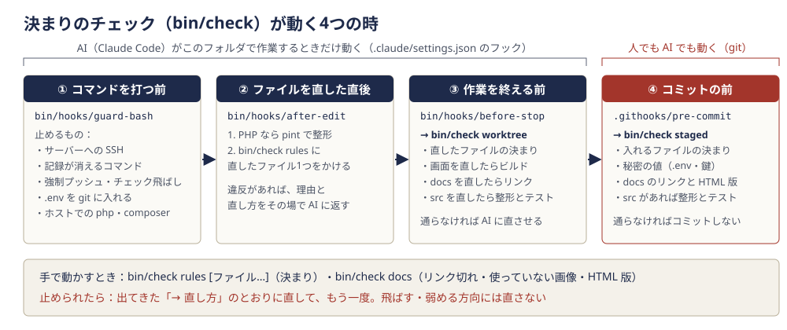

# 8. 動かし方と運用

## この章でわかること

- 手元のパソコンで推理手帳を初めて動かすまでの手順と、1つずつの意味
- 毎日の起動と停止、ブラウザで開いてログインするまで
- 見本のデータ（`DemoSeeder`）の入れ方と、できること・できないこと
- テスト・整形・画面のビルドのしかた
- 決まりのチェック係 `bin/check` の4つのモードと、止められたときの読み方・直し方
- AI のフックと、git のコミット前のチェック
- 一般公開（既定）から招待制に切り替えるときの設定と、招待のコマンド（`invite:add`・`invite:list`・`invite:remove`）
- 本番を新しいコードに入れ替える流れ（くわしくは [10章](10-deploy-aws.md)）
- 困ったとき：よくあるエラーと直し方

**前提：** コマンドはすべてプロジェクト直下（`suiri-techo/`）で打ちます。このパソコンには PHP が入っていないので、PHP・Composer・npm のコマンドは `docker compose exec -T app …` の形で **箱（コンテナ）の中で** 動かします（`-T` は「画面つきの端末として動かさない」の意味で、AI やスクリプトから打つときに付けます。人が打つときは付けなくても動きます）。ホストで `php` を打つと、AI のフックが止めます。

**たとえると：** 推理手帳は、パソコンの中に4つの小部屋（箱）を借りて動いています。受付（`web`＝nginx）、事務室（`app`＝PHP）、夜間の係（`worker`＝決まった時刻の仕事と後回しの仕事）、書庫（`db`＝MySQL）です。`docker compose exec app …` は「事務室の中に入って作業する」ことです。

---

## 8-1. はじめて動かす（初回だけ）

**役目を一言でいうと：** 箱を作り、部品を入れ、設定を書き、表を作る作業です。

**たとえると：** 新しいお店の開店準備です。建物を建て（箱を作る）、備品を運び込み（部品を入れる）、鍵と帳簿を用意し（設定）、棚を組みます（表を作る）。

### 設定のファイルは2枚ある

最初に、似た名前の2枚の設定ファイルの違いを押さえておきます。

| ファイル | 読む人 | 中身 | 見本 |
|---|---|---|---|
| `.env`（プロジェクト直下） | docker compose（箱を作る係） | DB の名前とパスワード、ブラウザの番号 `WEB_LISTEN`、DB の番号 `DB_PORT` | `.env.example` |
| `src/.env` | Laravel（アプリ） | アプリの名前・鍵 `APP_KEY`・DB へのつなぎ方・Google の鍵 など | `src/.env.example` |

どちらも秘密の値が入るので git に入れません（`.gitignore` に入っていて、`bin/check` も止めます）。DB のパスワードは **2枚に同じ値** を書きます（違うと、アプリが DB に入れません）。

### 手順

| 順 | コマンド・作業 | 何をしているか | なぜ要るか |
|---|---|---|---|
| 0 | Docker Desktop を起動する | Windows 側の Docker を動かす | 動いていないと `docker` のコマンドが使えない |
| 1 | `cp .env.example .env` | docker compose 用の設定を作る | 開いて `DB_PASSWORD` と `DB_ROOT_PASSWORD` に好きな値を書く。見本の `WEB_LISTEN=80` は本番用なので、手元では `8086` に変える |
| 2 | `docker compose up -d --build` | 4つの箱を作って起動する（`-d` は裏で動かし続ける、`--build` は設計図から箱を作る） | アプリを動かす土台。初回は数分かかる。PHP の設定（`infra/php/`）もこのとき箱の中に写される |
| 3 | `docker compose exec app composer install` | Laravel と使う部品を `src/vendor/` に入れる | 部品は git に入れていないので、ここで入れる。Google ログインの部品（Laravel Socialite）もここで入る |
| 4 | `cp src/.env.example src/.env` | Laravel 用の設定を作る | 開いて `DB_PASSWORD` を手順1と同じ値にする |
| 5 | `docker compose exec app php artisan key:generate` | `src/.env` の `APP_KEY` に、ランダムな鍵を書く | ログインの記録（セッション）と、Google のトークンの暗号化に使う鍵。ないと 500 エラー。**一度決めたら変えない**（変えると、暗号化して保存したトークンが読めなくなる） |
| 6 | `docker compose exec app npm ci` | 画面をビルドする道具（Vite・Tailwind CSS）を `src/node_modules/` に入れる | `package-lock.json` に書いた版のとおりに入れる。これも git に入れていない |
| 7 | `docker compose exec app npm run build` | 画面の CSS・JS をビルドして `src/public/build/` に書き出す | これがないと画面が「Vite manifest not found」のエラーになる |
| 8 | `docker compose exec app php artisan migrate` | 表を作る（移行を順に動かす） | 利用者・タスク・事件などの表がないと、どの画面も開けない |
| 9 | `git config core.hooksPath .githooks` | git のコミット前のチェックを有効にする | クローンしたら1回だけ。コミットのたびに `bin/check staged` が動く（8-6） |
| 10 | `(cd tools/docs-html && npm ci)` | 説明書を HTML にまとめる道具を入れる | 説明書を直す人だけ。`bin/check docs` もこの道具を使う |

ここまでで http://localhost:8086 にトップの画面が出ます。ただし、ログインするには次の 8-2 の「ログインできるようにする」が要ります。

**確かめ方：** `docker compose ps` で4つ（`app`・`worker`・`web`・`db`）が `Up`（`db` は `healthy`）。ブラウザで http://localhost:8086 を開くとトップが出る。

---

## 8-2. 毎日の起動と停止・ブラウザで開く

**役目：** 箱を動かす・止める・様子を見る、の3つです。

| コマンド | 何をするか |
|---|---|
| `docker compose up -d` | 4つの箱を起動する（パソコンを起動し直したあとなど）。箱は `restart: unless-stopped` なので、Docker が動けばふつうは自分で戻る |
| `docker compose ps` | 箱の様子を見る（`Up` なら動いている） |
| `docker compose logs --tail 100 app` | 箱のログ（記録）の最後の100行を見る。`app` を `worker`・`web`・`db` に変えれば、その箱 |
| `docker compose stop` | 箱を止める（中身は消えない）。次は `up -d` で再開 |
| `docker compose restart worker` | `worker` を起動し直す。Job や決まった時刻の仕事のコードを変えたら毎回（worker は起動したときのコードで動き続けるため） |

**してはいけないこと：** `docker compose down -v`（DB の入れ物ごと消す）と `docker volume rm` は、記録がすべて消えるので使いません（AI のフックも止めます）。止めるだけなら `stop` です。

| 住所・番号 | 何か |
|---|---|
| http://localhost:8086 | ブラウザで開くアプリ（`.env` の `WEB_LISTEN`） |
| 127.0.0.1:3311 | ホストから DB を見るときの番号（`.env` の `DB_PORT`。ユーザーは `suiri`、パスワードは `.env` の値） |
| http://localhost:8086/up | アプリが動いているかの確かめ（死活確認）。動いていれば 200 |

### ログインできるようにする（手元）

推理手帳のログインは Google だけです。既定は一般公開なので、手元で自分がログインするには Google の鍵があれば足ります。

1. **Google の鍵を `src/.env` に書く：** `GOOGLE_CLIENT_ID`・`GOOGLE_CLIENT_SECRET` に、Google Cloud で作った値を書きます。作り方は [11章](11-google-setup.md)（本番と同じ Google の鍵に、手元の戻り先 `http://localhost:8086/auth/google/callback` と `http://localhost:8086/calendar/callback` も登録してあります）。`GOOGLE_REDIRECT_URI` は手元では見本の `/auth/google/callback` のままで構いません。空のままだと、トップのボタンは「Google でのログインは準備中です」になります。
2. **（招待制を試すときだけ）自分を名簿に入れる：** `src/.env` に `SUIRI_INVITE_ONLY=true` を書いたときは、`docker compose exec app php artisan invite:add 自分のメールアドレス --note="自分"` も打ちます（8-7）。一般公開のまま（既定の `false`）なら要りません。

これで、トップの「Google ではじめる」→ Google の画面 → 初回だけ同意の画面（利用規約・プライバシーポリシー・年齢の確認）→ きょうの画面、と進みます。

**注意：** ブラウザは必ず `localhost` で開きます（`127.0.0.1:8086` で開くと、Google に伝える戻り先も `127.0.0.1` になり、登録した住所と違うので `redirect_uri_mismatch` で止まります）。

---

## 8-3. 見本のデータ（DemoSeeder）

**役目：** 画面の確かめやスクリーンショット、説明書の図のために、「使っている途中の手帳」を一度に作ります。

**たとえると：** 家具屋さんの展示用の部屋です。本物の暮らしではありませんが、どこに何が置かれるかがひと目でわかります。

```bash
docker compose exec app php artisan db:seed --class=DemoSeeder
```

**作られるもの：** 見本の利用者「ワトソン（見本）」（`watson@example.com`・相棒は「長男」・ふだんの場面は日常・記録のきっかけつき）と、その人の記録です。

| 作るもの | 中身 |
|---|---|
| 親子の事件「体操着をなぜ忘れる？」 | 相棒と隠して見立てを書き、見せ合い、答え合わせ（当たり）して解決。「つまり？・たとえば？」を屋根裏の棚に入れてある |
| 日常の事件「朝の電車がいつも遅れるのはなぜ？」 | 外れた予想（ノーベリ帳に載る）と、今日が確かめる日の予想（きょうの画面の答え合わせ待ちに出る） |
| 仕事の事件「前回より右肩が上がって見えた件」 | 施術者が、自分の見たこと・ご本人の言葉・自分の見立てを分けて書いた形 |
| 手帳の残り | 予想時間とかかった時間のあるタスク・期日を過ぎたタスク・いつかのタスク、手で足した屋根裏の棚、今週のふりかえり、名推理カードへの推理 |

どれも、ふだんの画面と同じ用事（Action）を通して作るので、確かめるタスクや考えを変えた記録も本物と同じ形でできます。作った日時は「何日か前に書いたもの」にずらしてあります（`Demo/TravelsInTime.php`）。

**決まり：**

- **手元（`src/.env` の `APP_ENV=local`）だけで動きます。** 本番やテストでは「見本のデータは手元でだけ入れられます」と出して何もしません（本番の記録に見本を混ぜないため）。
- **もう一度動かすと、見本の利用者の記録だけを作り直します。** ほかの利用者（自分のアカウントなど）には触りません。
- **見本の利用者として、ブラウザからログインすることはできません。** ログインは Google だけで、見本の利用者には Google のアカウントがないからです。ブラウザで確かめるときは自分のアカウントでログインして記録を作ります。見本の利用者の画面を開くのは、テストの中で「その人としてログインした状態」（Laravel の `actingAs`）にしたときです（`tests/Feature/Demo/DemoSeederTest.php` は、見本がそろうかを確かめるテスト）。

---

## 8-4. テスト・整形・ビルド

**役目：** 直したあとに「壊していないか」「書き方がそろっているか」「画面に出るか」を確かめる3つの作業です。

| コマンド | 何をするか | いつ |
|---|---|---|
| `docker compose exec -T app php artisan test --compact` | 自動テストを全部動かす（DB は sqlite のメモリの中なので、手元の記録には触らない） | PHP を直したら毎回 |
| `docker compose exec -T app php artisan test --compact --filter=PredictionTest` | 名前に `PredictionTest` を含むテストだけ動かす | 1つの機能を直している途中 |
| `docker compose exec -T app vendor/bin/pint` | PHP の書き方（字下げ・空白・並び）をそろえる（整形） | PHP を直したら毎回（AI のフックは直した直後に自動でする） |
| `docker compose exec -T app npm run build` | 画面の CSS・JS を作り直す | Blade の `class`・`resources/css`・`resources/js` を直したら毎回 |

**テストの数：** 400件ほど（2026-10-31 に数えて 407 件。機能を足すと増えます）。全部で数秒で終わります。テストでは Google を偽物に替えてあるので、本物の Google には届きません。テストの書き方の決まりは `.claude/rules/tests.md`、何を確かめるテストがあるかは [7章](07-file-guide.md) の 7-8。

**ビルドを並行して動かすとき：** AI が何人かで同時に作業しているときは、ビルドがぶつからないよう `flock /tmp/suiri-build.lock docker compose exec -T app npm run build` のように、前に `flock`（順番待ちの札）を付けます。

**`npm run dev` は使いません：** Vite の開発用のサーバー（5173番）は箱の外に出していないので、ブラウザから届きません。`npm run dev` を動かすと `src/public/hot` という印のファイルができ、画面がそちらを読みに行って CSS が当たらなくなります。画面を直したら、毎回 `npm run build` です。

**画面を直したとき：** headless Chrome（画面を出さずに動く Chrome）でスクリーンショットを撮って、スマホの幅（390px）・パソコンの幅・ダークモードで崩れていないかを確かめます（CLAUDE.md の決まり）。

---

## 8-5. 決まりのチェック（bin/check）

**役目を一言でいうと：** `.claude/rules/` に書いた決まりのうち、機械で判定できるものを確かめる係です。

**たとえると：** 工場の出口に立つ検品係と、駅の改札です。注意書き（決まり）を貼るだけでなく、作業の区切りと出荷の前（コミットの前）に、決まりに合っているかを1つずつ確かめ、合っていなければ通しません。



### 確かめる決まり

| 分類 | 確かめること（決まりの元） |
|---|---|
| 太らない MVC | 受付（コントローラー）で検証しない・DB を組み立てない・外の API を呼ばない／ルートにクロージャで処理を書かない／回数制限は名前つき（`throttle:writes` の形）／`env()` は `config/` の中だけ／Blade に `@php` のかたまりを書かない（`architecture.md`） |
| 画面 | 外部のファイル（CDN・書体）を読み込まない／影・浮き上がり・ずっと続く動きを付けない（`ui-design.md`） |
| 個人情報 | ログに入力の本文を書かない／Google カレンダーに本文を送らない（`privacy.md`・`google.md`） |
| 言葉 | 画面で使わない言葉（[言葉のルール](../design/words.md) の 3）／コードの名前に他人を表す言葉を使わない／難しい言葉（演繹・帰納・アブダクション）は手引きの画面だけ／ドキュメントで使わない言葉（`domain.md`・`docs.md`） |
| 行数の上限 | PHP クラス 200・コントローラー 150・ルート 120・Blade 150・JS 200・CSS 400・テスト 300 行（コメント込み） |
| コメント | クラス・関数の手前に「何をするか」、`if`・ループ・`match`・`try`（Blade なら `@if`・`@foreach` など）の手前に「何を確かめてどう分かれるか」のコメントがあるか（`bin/code_comments.py`。`code-comments.md`） |
| 秘密の値 | `.env`・鍵のファイル、AWS のアクセスキー・秘密鍵・Google の秘密の値、`.env` の書き方で値の入ったパスワード、を git に入れない |
| ドキュメント | 記録が消えるコマンドを手順に書かない／リンク切れ／どこからも使っていない `docs/images` の画像／HTML 版（`docs/guide.html`）の作り直し忘れ（`docs.md`） |
| 動くか | 整形（pint）・テスト・画面のビルド |

### 4つのモード

| コマンド | 確かめること | いつ使うか |
|---|---|---|
| `bin/check rules [ファイル…]` | 決まりの違反（1行ずつの決まり・言葉・行数・コメント）。ファイルを渡せばそのファイルだけ、渡さなければ git で管理しているものと、まだ入れていない新しいもの全部 | 決まりに合っているかだけを、さっと見たいとき |
| `bin/check docs` | ドキュメントのリンク切れ・使っていない画像・HTML 版の作り直し忘れ | ドキュメントや画像を直したとき |
| `bin/check staged` | コミットするファイルの決まり＋秘密の値。ドキュメントを変えていればリンクと HTML 版、`src/` を変えていれば整形とテスト | コミットの前（`.githooks/pre-commit` が自動で呼ぶ） |
| `bin/check worktree` | まだコミットしていない、直したファイルの決まり＋秘密の値のファイル。画面を直していればビルド、ドキュメントならリンクと HTML 版、`src/` なら整形とテスト | 作業の区切り（AI のフック `before-stop` が自動で呼ぶ） |

整形・テスト・ビルドは、`bin/check` の中から `docker compose exec -T app …` で **箱の中で** 動かします。箱が止まっていると、そこで失敗します（先に `docker compose up -d`）。

### 止められたときの読み方

通ったときは `決まりのチェック：問題なし` と出ます。通らないときは、こんな形で出ます。

```text
チェックが通りません（2 件。決まりは .claude/rules/、直し方は各行の → ）：

- src/app/Http/Controllers/Tasks/TaskController.php:42  【コントローラーで検証しない】$request->validate([
    → 形の検証は app/Http/Requests/{機能}/ の FormRequest に書き、受付は $request->validated() を受け取るだけにする
- src/resources/views/today/index.blade.php  【ファイルが長すぎる：163 行（上限 150・コメント込み）】
    → くり返す塊・意味のまとまりを resources/views/components/{分類}/ の部品にする（どうしても分けられないときは、理由つきで bin/check の ALLOW_SIZE に書く）
```

（上は読み方の見本です。実際のファイルの違反ではありません。）

| 部分 | 意味 |
|---|---|
| `src/…/TaskController.php:42` | どのファイルの何行目か（行数の上限のように、ファイル全体の違反なら行の番号はない） |
| `【コントローラーで検証しない】` | 破った決まりの名前。`bin/check` の表 `RULES` の名前と同じ |
| その後ろの文 | 当たった行の中身（120字まで） |
| `→ …` | 直し方。この方向に直す |

### 直し方の決まり

- 出てきた「→ 直し方」のとおりにファイルを直し、もう一度同じコマンドを動かします。
- **チェックを飛ばす（`git commit --no-verify`）・決まりを弱める・例外を足す、という方向では直しません。** `--no-verify` は AI のフックも止めます。
- どうしても決まりに合わせられないときだけ、`bin/check` の例外の表（`ALLOW`・`WORD_ALLOW`・`ALLOW_SIZE`）に **理由つきで** 1行足します。
- 決まりそのものを足すときは、`bin/check` の表に1行足し、理由と「→ 直し方」を必ず書きます。関係する `.claude/rules/*.md` も一緒に直します。

**よく出るもの：**

| 出てきたもの | 直し方 |
|---|---|
| `【コメントが手前にない（関数）】` など | すぐ上の行に、何をするかのコメントを書く（分岐なら何を確かめてどう分かれるか） |
| `【整形（pint）】整っていないファイルがあります` | 出てきたコマンド `docker compose exec -T app vendor/bin/pint …` を動かす |
| `【テスト】に失敗しました` | 下に出た失敗したテストの名前と理由を読み、コードかテストを直す |
| `【docs を変えたら HTML 版も作り直す】` | `node tools/docs-html/build.mjs` を動かし、できた `docs/guide.html` も一緒にコミットする |
| `【docs/guide.html の確認】道具が入っていません` | `(cd tools/docs-html && npm ci)` |
| `【使っていない画像】` | 説明のどこかで使うか、画像を消す |
| `【秘密の値を git に入れない：…】` | `git restore --staged ファイル` で外し、値は `.env` にだけ書く |

---

## 8-6. フックとコミット前のチェック

**役目：** 決まりのチェックを、人が忘れても自動で動くようにする仕掛けです（フック＝「何かが起きたら、決まった処理を呼ぶ」仕組み）。

**たとえると：** 自動ドアのセンサーです。前に立つ（コマンドを打つ・ファイルを直す・コミットする）と、決まった見張りが動きます。

### AI のフック（`.claude/settings.json`）

Claude Code をこのフォルダ（`suiri-techo/`）で起動したときだけ働きます。

| フック | いつ動くか | すること |
|---|---|---|
| `bin/hooks/guard-bash` | AI がコマンドを打つ前 | サーバーへの SSH・scp（本番の EC2 へ決まった鍵で入る ssh だけは通し、その中でも `.env` を読む・書く、記録を消す・読む、箱を止める・消す、`rm`、履歴を書き換える git などは止める）、記録が消えるコマンド（`migrate:fresh` 系・`db:wipe`・`docker compose down -v`）、強制プッシュ、チェックを飛ばすオプション、`.env` を git に入れる、コミット前のチェックの場所を変える、ホストでの `php`・`composer` を止め、理由を AI に返す |
| `bin/hooks/after-edit` | AI がファイルを直した直後 | PHP なら pint で整形し、そのファイルを `bin/check rules` にかけ、違反があれば理由を AI にすぐ返して直させる |
| `bin/hooks/before-stop` | AI が作業を終えて返事をする前 | `bin/check worktree` を動かし、通らなければ終わらせずに直させる（直しても通らないときに同じことを繰り返さないよう、2回目は止めずに「利用者に伝えて」と知らせるだけ） |

### git のコミット前のチェック（`.githooks/pre-commit`）

`git commit` のたびに `bin/check staged` が動き、通らなければコミットされません。こちらは人が手でコミットしても、AI がコミットしても動きます。

**有効にする（クローンしたら1回だけ）：**

```bash
git config core.hooksPath .githooks
```

git はふつう `.git/hooks/` の中のフックを使いますが、そこは git に入らないので、みんなで同じフックを使えるよう `.githooks/` を見に行くように変えています。これは人が手で打ちます（AI のフックは、この場所を `.githooks` 以外に変えるコマンドを止めます）。

---

## 8-7. 招待制に切り替えるとき（招待のコマンド）

**役目：** 推理手帳は、既定では **一般公開**（Google アカウントがあれば、だれでも登録できる）です。登録できる人を絞りたいときだけ、**招待制**（運営者が名簿に入れたメールアドレスの Google アカウントだけが新しく登録できる形）に切り替えます。名簿の管理画面は作らず（運営者が記録を見られる画面を作らないため）、コマンドで行います。

**たとえると：** ふだん開けている入口に、名簿を持った受付を立てることです。受付を立てたら、名簿に名前がある人だけが新しく会員証を作れます。

**切り替え方：** `src/.env` の `SUIRI_INVITE_ONLY` を `true` にし（既定は `false`＝一般公開）、作り置きがあれば `docker compose exec app php artisan optimize:clear` で消します。戻すときは `false` にします。コードは直しません（中身は [6章](06-google.md) の 6-2）。切り替える前に、自分を名簿に足しておきます。

| コマンド | 何をするか |
|---|---|
| `docker compose exec app php artisan invite:add taro@example.com --note="保護者"` | 名簿に足す。`--note` は運営者のメモ（任意・100字まで）。大文字は小文字にそろえて入れる。すでにあればメモだけ直す |
| `docker compose exec app php artisan invite:list` | 名簿を表で出す（登録に使われたかも見える） |
| `docker compose exec app php artisan invite:remove taro@example.com` | 名簿から外す。招待制のとき、これから新しく登録できなくなる |

**覚えておくこと：**

- コマンドはいつでも使えますが、名簿が効くのは **招待制にしているとき** だけです。一般公開のときは、名簿になくても登録できます。
- 名簿が要るのは **新しく登録するときだけ** です。一度登録した人は、Google の ID で照合するので、名簿から外しても、招待制に切り替えてもログインできます（`invite:remove` は登録済みのアカウントを消しません）。アカウントを消すのは本人の退会だけです。
- 招待制のとき、名簿にないメールアドレスでログインすると、トップに「推理手帳はいま招待制です。招待を受けたメールアドレスの Google アカウントでログインしてください。」と出ます。
- 本番では、本番の箱の中で同じコマンドを打ちます。本番の `.env` を書き換えるのはオーナーです（[10章](10-deploy-aws.md) の 10-4「招待制にしたいとき」）。

---

## 8-8. 本番の更新

**役目：** 動いている本番（https://suiri.agi-japan.com）を、GitHub に上げた新しいコードに入れ替えます。

**たとえると：** お店を開けたまま、棚と道具を新しいものに入れ替える作業です。商品（利用者の記録）はそのまま残します。

**一本道：** 本番のファイルは直接書き換えません。直すのは必ず手元で、`git push` → 本番の EC2 で `git pull` の一本道だけにします。

流れはこの順です（コマンドと1行ずつの意味は [10章の「更新するとき」](10-deploy-aws.md)）。

1. バックアップ（`~/bin/suiri-backup.sh`）：表を変える更新でも戻せるように
2. `git pull --ff-only`：新しいコードを取ってくる（サーバーで何か変わっていて食い違うときは、混ぜずに止まる）
3. `composer install --no-dev --optimize-autoloader`：PHP の部品を入れ直す
4. `php artisan migrate --force`：足りない表・列を足す（本番で動かすのはこれだけ。表を作り直すコマンドや見本のデータは使わない）
5. `npm ci` → `npm run build`：画面を作り直す
6. `php artisan optimize`：設定・住所の表・画面のひな形の作り置きを作り直す
7. `docker compose up -d`：箱の設計図が変わっていれば作り直す
8. `docker compose restart worker`：worker に新しいコードと、5分・15分ごとの予定を読ませる

終わったら `docker compose ps` で4つが `Up`（とくに worker）、`curl -i http://localhost/up` が 200、ブラウザで変えた所が出ているかを確かめます。worker が止まっていると、カレンダーへの書き出しも、今日の予定を5分で消す仕事も止まるからです。

AI が本番で手伝ってよい範囲（見る・この更新の手順・招待のコマンドだけ。`.env` は読まない・書かないので、招待制への切り替えはオーナーが書く）は `.claude/rules/deploy.md` の「本番で AI がしてよいこと」に書いてあります。

---

## 8-9. 困ったとき

**役目：** よくある症状から、見る所と直し方を引けるようにします。**まずログを読みます**（推測で設定を変える前に）。

```bash
docker compose ps                        # 4つの箱が動いているか
docker compose logs --tail 100 app       # PHP のエラー
docker compose logs --tail 100 worker    # カレンダーの書き出し・取り込みの係
docker compose logs --tail 100 web       # nginx
docker compose logs --tail 100 db        # MySQL
tail -n 50 src/storage/logs/laravel.log  # Laravel のログ（手元は1つのファイル）
```

| 症状 | 原因として多いもの | 直し方 |
|---|---|---|
| 500 で `Vite manifest not found` | 画面をビルドしていない（`src/public/build/` がない） | `docker compose exec app npm ci` → `docker compose exec app npm run build` |
| 画面の CSS が当たらない・真っ白に近い | `npm run dev` を動かしたあとに残った `src/public/hot` | `src/public/hot` を消して `npm run build` |
| 500 で `SQLSTATE[HY000] [2002]`（つながらない） | `db` の箱が止まっている・まだ起動中、`src/.env` の `DB_HOST` が `db` でない | `docker compose ps` で `db` が `healthy` か。`DB_HOST=db`・`DB_PORT=3306`（箱どうしの番号。ホストの 3311 ではない） |
| 500 で `SQLSTATE[HY000] [1045] Access denied for user` | パスワードが2枚の `.env` で違う | 2枚の `DB_PASSWORD` を見比べる。**MySQL のパスワードは、DB の入れ物を初めて作ったときの値で決まる** ので、あとから直下の `.env` を変えても DB の中は変わらない。最初の値に戻す |
| 500 で `No application encryption key has been specified` | `APP_KEY` が空 | `docker compose exec app php artisan key:generate`（すでにトークンを保存していたら、鍵は変えない） |
| 500 で `Base table or view not found` | 表を作っていない・新しい移行を動かしていない | `docker compose exec app php artisan migrate` |
| 500 でログに `Permission denied`（`storage` など） | 箱の利用者（uid 1000）が書けないフォルダがある | `docker compose exec app chmod -R guo+w storage bootstrap/cache` |
| `src/.env` を直したのに変わらない | 作り置き（`php artisan optimize` で作ったもの）が古い | `docker compose exec app php artisan optimize:clear` → `docker compose restart worker` |
| 「Google でのログインは準備中です」 | `src/.env` の Google の鍵（`GOOGLE_CLIENT_ID`・`GOOGLE_CLIENT_SECRET`）が空 | [11章](11-google-setup.md) の値を書く。作り置きがあれば `optimize:clear` |
| Google で「エラー 400: redirect_uri_mismatch」 | Google に登録した戻り先と、アプリが送る戻り先が1字違う | 手元は `http://localhost:8086/auth/google/callback`（`127.0.0.1` で開いていないか、番号が 8086 か）。本番は `GOOGLE_REDIRECT_URI` が `https://suiri.agi-japan.com/auth/google/callback` と1字も違わないか。登録は [11章](11-google-setup.md) の Clients |
| ログインすると「推理手帳はいま招待制です」 | 招待制（`SUIRI_INVITE_ONLY=true`）にしていて、そのメールアドレスが名簿にない | `invite:list` で確かめ、`invite:add`。一般公開のつもりなら `src/.env` を `SUIRI_INVITE_ONLY=false` に（8-7） |
| 「このメールアドレスは、別の Google アカウントで登録されています」 | 同じメールアドレスの利用者が、別の Google アカウントですでにいる | 乗っ取りを防ぐための止め。前に登録した Google アカウントでログインする |
| 送信すると 419 Page Expired | ページを開いたまま時間がたち、送信の合言葉（CSRF トークン）が古くなった | ページを開き直してから送る。本番で続くなら [10章](10-deploy-aws.md) の「困ったとき」（クッキーが届いていない） |
| カレンダーに予定が入らない・動かした日時が戻ってこない | `worker` が止まっている・古いコードのまま | `docker compose ps` の worker、`docker compose logs worker`。`docker compose restart worker` |
| 設定の画面に「連携が切れました」 | Google の許可が取り消された・切れた（公開状態がテストのままだと7日で切れる） | 設定の画面からつなぎ直す。続くなら [11章](11-google-setup.md) の Audience が In production か |
| ほかの人の記録の住所を開くと 403 | 持ち主しか開けない決まり（Policy） | 正しい動き。自分の記録だけが開ける |
| `docker compose up` で `port is already allocated` | 8086 か 3311 を別のアプリが使っている | 別のアプリを止める。番号を変えるなら `.env` の `WEB_LISTEN`・`DB_PORT`、`src/.env` の `APP_URL`、Google の戻り先の登録も一緒に変える |
| `docker compose up` で `Pool overlaps with other one on this address space` | Docker のネットワークの住所が、ほかのプロジェクトとぶつかった | `docker-compose.yml` の `subnet`（`10.232.0.0/24`）と、ほかのプロジェクトの範囲を見比べる |
| ホストで `php: command not found`・AI が止められる | ホストに PHP はない | `docker compose exec app php …` の形で打つ |
| テストが `risky`（後片付けがない）になる | Blade の閉じていない `@section` や `@push` | 開いたら閉じる（`.claude/rules/tests.md`） |

---

## 次に読む章

- [目次に戻る](../README.md)
- [9. 用語集](09-glossary.md)：この章に出てきた言葉（キュー・Job・移行・フック など）を引く
- [7. ファイルの案内](07-file-guide.md)：コマンドが触るファイルの場所
- [10. 本番（AWS）に載せる](10-deploy-aws.md)：本番を作る手順・更新・バックアップ
- [11. Google の準備](11-google-setup.md)：ログインとカレンダー連携の鍵を作る
